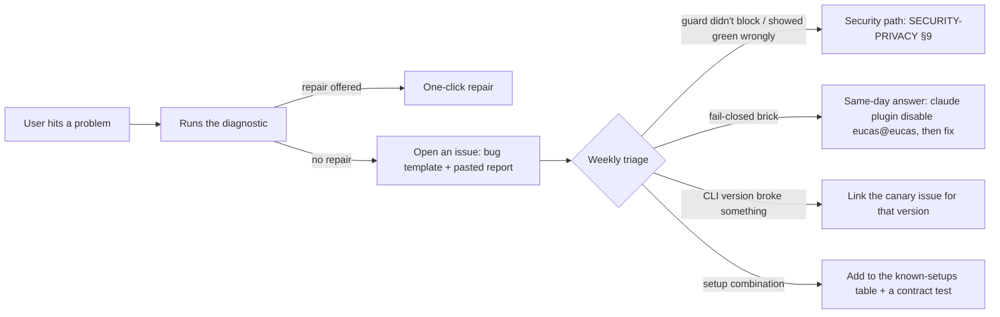

# Observability and operations: the Eucas companion

Sized for **one founder working with Claude, about 5 hours a week of business time** (pre-mortem). Everything here is either automatic or a short weekly routine. The general runbook is [docs/incident-runbook.md](../../incident-runbook.md); the security incident playbook is [SECURITY-PRIVACY §9](SECURITY-PRIVACY.md).

## 1. Telemetry (opt-in, no content)

**Off by default.** Asked once, at the end of first run, in one line: "Send anonymous counts (no commands, paths or text) to help fix Eucas? [Send counts] [No]". Changeable in Settings › Privacy, with **See what's sent** (the last 7 days of payloads, verbatim).

Sent at most once a day to `POST /v1/telemetry`, schema-allowlisted on both ends (`contracts/api/telemetry.schema.json`, `.strict()`):

| Field | Example | Why |
|---|---|---|
| `appVersion`, `channel`, `os`, `arch`, `cliVersion`, `shellKinds` | `0.1.3`, `stable`, `win 11 26300`, `x64`, `2.1.314`, `["git-bash","pwsh7"]` | Which combinations break |
| `guardStateMinutes` | `{ guarded: 412, not_guarded: 0, not_verified: 15, … }` | Is the guard provably on? (kill criterion) |
| `guardP95Ms`, `checkEventsLostPer10k` | `21`, `0` | Budgets in the field |
| `canary` | `{ ran: 2, blocked: 2, couldNotRun: 0 }` | Edge J/K rates |
| `counts` | `{ blocks: { delete: 3, push_default: 1, send: 0, pay: 0 }, tripwireStops: 0, needsYou: 41, rulesSaved: 2 }` | Value and noise |
| `firstRun` | `{ stepReached: 6, secondsToProtected: 262, uac: "accepted" }` | The 4:30 target and the D-4 split |
| `errors` | `{ GUARD_INTERNAL: 0, PIPE_TIMEOUT: 3 }` | Error codes only |

`installHash` (salted per release, not linkable across releases) dedupes daily counts. No IP is stored (Workers Analytics Engine row without it). **Never:** commands, paths, project or repo names, rule text, prompt or file text, usernames, emails.

**Without telemetry**, the founder still sees: GitHub downloads per release, waitlist counts (anonymous), the canary, and issues. That is enough to run the product; telemetry only makes the kill-criteria numbers (installs, weekly actives) measurable, so the prompt says that plainly.

## 2. Crash reports (opt-in, separate switch)

- Rust panics in the core and the guard are caught by a panic hook that writes `%LOCALAPPDATA%\Eucas\crashes\<time>.json`: message, crate, file and line, versions, the last 50 **error codes** (not messages). Paths are stripped by the redactor. The guard's panic hook writes the note **first**, then exits per subcommand (ADR-0009): deny for `pre-tool-use` and `permission-request` (fail closed), exit 0 with no output for every other hook, so a crash never stops an agent from stopping.
- Renderer errors (window `error`, `unhandledrejection`, React error boundaries) go to the core as error codes plus the component name.
- If crash reports are on, they're sent with the next telemetry batch; otherwise they stay local and are included in the diagnostic when you choose.
- No minidumps, no environment variables, no memory.

## 3. The diagnostic bundle (one button)

Settings › Diagnostic, the tray menu and every error's secondary action (DESIGN §4.17). It runs in about 5 s and produces Markdown you read before you share:

| Section | Content |
|---|---|
| Versions | Eucas app, plugin, guard (user copy), limits guard (admin copy), Claude Code (each install found, with type: native, npm, desktop bundle), Windows build, WebView2 version |
| Shells | Git Bash found?, PowerShell 5.1/7 paths, the shell Claude Code uses for hooks |
| Hooks | Plugin enabled?, our hooks present in each source, other hook sources by **count** only, `disableAllHooks`/`allowManagedHooksOnly` flags and where they're set |
| Managed settings | Source in use (file / HKLM / none / organisation), our marker present, which limits are locked, limits guard and helper paths and their **SHA-256 check against the hashes pinned in the app build** (unsigned v0.1, CR-010, founder 2026-10-26) |
| Heartbeat | Per running session: guard state, last check age, tool activity seen without a check (count) |
| Canary | Last 3 runs: CLI version, path (hook-only/model), result |
| Status line | Wrapped? Saved command's program name; last tick age; `rate_limits` present? |
| Events | Last 20 guard events: time, session (folder display name), tool kind, **program name only**, decision, rule or limit id |
| Store | DB size, spool size and dropped count, retention last run |
| Errors | Last 20 error codes with times |
| Repairs | The specific repair available, if any ("Restart bench's guard", "Re-install the plugin") |

Every path in the report is written relative to a known folder (`~/.claude/…`, `%LOCALAPPDATA%\Eucas\…`, `%ProgramFiles%\…`), and project folders appear only by display name. Fixed line on top, as in DESIGN §4.17: "The report has no prompts, file contents, paths outside Claude Code's folder, or tokens. Read it before you share it." That line isn't literally true for the system-tool paths above, so the design proposes, with the privacy line (ADR-0015), "…no prompts, file contents, paths to your projects or files, or tokens…" (**founder copy decision**). Actions: **Copy report** · Save as file · **Open an issue** (opens GitHub's new-issue page with the bug template; Eucas sends nothing itself).

## 4. Support flow

- **Channels:** GitHub Issues (bug, setup, false block, feature) and Discussions (questions). No email support, no Discord in v0.1.
- **Response targets (best effort, solo):** security or "showed protected and lost data": same day. Fail-closed brick: same day (the one-line unbrick is in the README and the diagnostic, so the user is never stuck waiting). Everything else: within a week, in the triage slot.
- **Labels:** `security`, `bypass`, `brick`, `canary`, `setup`, `false-block`, `cli-x.y.z`, `good-first-issue`.
- **Known setups table** (`docs/support/known-setups.md`, created with the first issue): shell × install type × AV × managed policy → status and workaround.

## 5. Monitoring the parts the founder runs

| What | Signal | Alert |
|---|---|---|
| Nightly canary | Workflow result | Auto-filed issue (CI-CD §3) + GitHub notification |
| Worker | Cloudflare analytics: 5xx rate, p95, request count | Cloudflare notification email: 5xx > 2 % for 10 min |
| Model spend | DO daily spend sum; OpenRouter credit balance | Email at 50 % and 90 % of the daily breaker; OpenRouter low-credit email |
| Update rollout | Telemetry `appVersion` mix (if on); GitHub release download counts | Manual check 48 h after a stable release, before widening from 10 % |
| Signing certificate | **When Authenticode is bought** (none in v0.1, CR-010): expiry date in `docs/support/calendar.md` | Calendar reminder 60 and 14 days before |
| Domains, Cloudflare and Lemon Squeezy billing | Their own emails | — |

No pager, no on-call. The safety layer doesn't depend on anything the founder runs, so an outage of the Worker degrades Pro to "ask you" and stops updates, and nothing else.

## 6. Runbooks (short)

| Situation | Steps |
|---|---|
| **Canary red on a new CLI release** | Read the issue → reproduce locally with that CLI → if fail-open: add it to `knownBadCli[]` in `verified-versions.json` at once (the canary usually already did; by hand, sign with the config key) (every PC on it turns red with "Update or roll back Claude Code") → fix + test → hotfix → nightly green → clear the mark |
| **Bad Eucas release** | `updates.stable.paused = true` (signed config) → revert on `main` (CONTRIBUTING rollback) → release vX.Y.Z+1 → unpause |
| **Fail-closed brick reports** | Confirm cause in the report (missing guard, AV quarantine, schema change) → reply with the recovery path for that layer (SYSTEM-DESIGN §7.1: `claude plugin disable eucas@eucas`, or Pause the limits with one UAC prompt) and "restart your sessions" → fix → if it's AV: submit the file to the vendor's false-positive portal (Microsoft: the Defender submission portal) |
| **Provider outage or price change** | Swap the model order in signed config (Gemma first) → no app release |
| **Worker incident** | `wrangler rollback` to the previous version → check the smoke |
| **Lost updater key** | Follow ADR-0013's rotation release with the sealed backup |
| **Anthropic policy change** (subscription use, hooks, plugins) | Kill-criteria review with the PRD; config can hide Pro and cloud lines within minutes |

## 7. Maintenance load for a solo founder

| Routine | When | Time | Automation that keeps it small |
|---|---|---|---|
| Canary issues | When filed (~1–3 a week at 6–8 CLI releases a week; most need only a fixture PR) | 30–90 min each when real | The nightly captures fixtures and diffs; most schema changes are additive and land as a reviewed fixtures PR |
| Read the Claude Code changelog for hooks, status line, plugins, permissions | Weekly | 20 min | The canary already ran; this is for semantic changes tests can't see |
| Triage issues and Discussions | Weekly slot | 60 min | Diagnostic report in every bug; templates; known-setups table |
| Dependabot PRs | Weekly | 20 min | Grouped minor/patch; CI decides |
| Release (beta → stable) | Every 1–2 weeks | 45 min incl. the 15-minute manual checklist | Changesets, updater-signed builds with published SHA-256s, staged rollout |
| Supervisor eval and config (Pro) | Monthly | 30 min | `xtask` scripts |
| **Total** | | **~3–4 h/week steady state**, more in a CLI-breaking week | |

**Load shedding, in order, if it grows past 5 h/week:** stop the Ubuntu e2e (keep unit and contract), widen the beta cadence to monthly, drop arm64, freeze Pro scope. Never shed: the nightly canary, the bypass suite, fail-closed tests, update signing and the published hashes.
