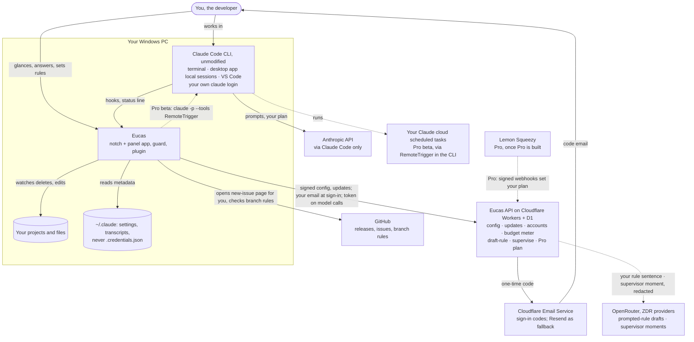
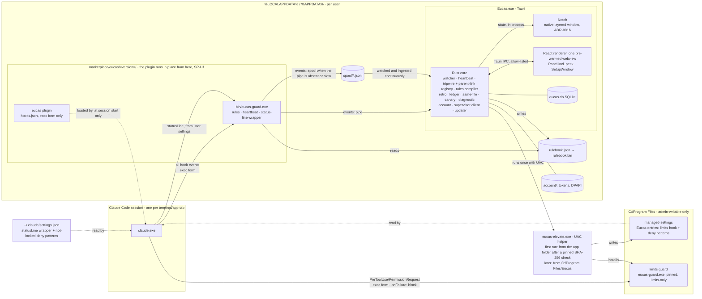
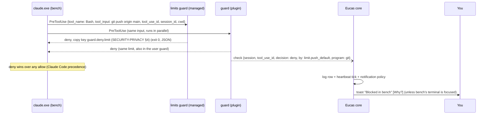
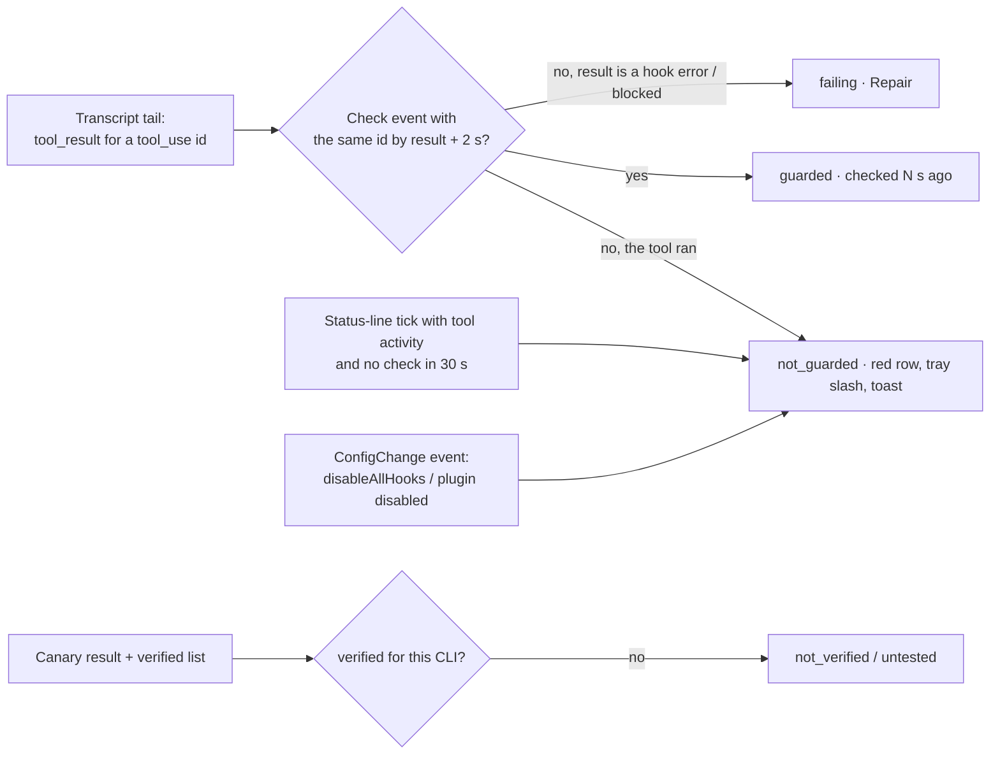

# System design: the Eucas companion

| Date | Author | Status | Builds on |
|---|---|---|---|
| 2026-10-26 | Lead systems engineer (Claude), `tech-lead` role, `engineering-craft` method | Draft for Gate 6; design only, no product code | UX [PR #55](https://github.com/eucas-app/eucas/pull/55), UI [PR #57](https://github.com/eucas-app/eucas/pull/57), [SP-SUP1](https://github.com/eucas-app/eucas/pull/56), [SP-CR1](https://github.com/eucas-app/eucas/pull/54), the 26 Oct pre-mortem |

**Updated 2026-10-26** with the spike results ([SP-H1](../../spikes/SP-H1.md), [S-1](../../spikes/S-1.md), [SP-ST1](../../spikes/SP-ST1.md), [S-4](../../spikes/S-4.md), [S-6](../../spikes/S-6.md), [SP-TW1](../../spikes/SP-TW1.md), [SP-SUP2 recorder](../../spikes/SP-SUP2-recording.md)), [CR-011](../../requirements/change-requests/CR-011.md) (your Euca in the notch; meter; trial and taste), [CR-012](../../requirements/change-requests/CR-012.md) (accounts) and the [founder's answers of 26 Oct](../../requirements/interviews/2026-10-26-v1.4-open-items.md), then the setup reorder (the four limits locked before sign-in, one UAC prompt; founder, 2026-10-26, §5.6), then **no-account mode** (setup can finish without an account: everything Free sees minus memory, one own rule, and a supervisor taste of 10 decisions per install (founder answers: *"Everything a free account sees but with limited supervisour usage and no memory and 1 custom role"*); founder, 2026-10-26: *"we make people have a small taste without sign up and then they have to create account or buy pro"* and *"Let the no account also have to try the supervisor also but like small number of usage"*; §4.2, §5.6, ADR-0017, ADR-0018). Changed text is marked with its source.

**This folder:** this file (context, containers, flows, failure and scale checks) · [CODE-STRUCTURE](CODE-STRUCTURE.md) · [CI-CD](CI-CD.md) · [SUPERVISOR](SUPERVISOR.md) · [SECURITY-PRIVACY](SECURITY-PRIVACY.md) · [TESTING](TESTING.md) · [OPERATIONS](OPERATIONS.md) · [BUILD-PLAN](BUILD-PLAN.md). Decisions: [ADR-0007 … ADR-0018](../../adr/).

**Naming:** everything is named Eucas (the rename is done, CR-010). Binaries, plugin name, pipe names, folders and the UAC publisher (once Authenticode is bought, ADR-0013) are **user-visible and hard to rename once installed**, so they are `eucas-*` / `Eucas` from day one, and the crates follow so the codebase has one name; BUILD-PLAN §1 P6. "Claude Code" appears only as the name of the thing we attach to, never as ours.

---

## 0. Decisions in one table

| # | Decision | ADR |
|---|---|---|
| 1 | Attach to the user's own sessions: a **user-scope plugin** calling a **native guard**, the four **limits always on**, each one you lock held in **admin-written managed settings** (one UAC prompt), the app optional for safety | [0007](../../adr/0007-companion-attach-architecture.md) |
| 2 | **Tauri 2 + Rust core + React renderer** for the companion (Electron stays for the team app) | [0008](../../adr/0008-companion-stack-tauri-rust.md) |
| 3 | The guard is a **short-lived exe** that decides alone; events go over a **named pipe**, with a spool file when the app is closed | [0009](../../adr/0009-guard-process-and-event-channel.md) |
| 4 | A **vendor-neutral rulebook** (JSON Schema) compiled per vendor; limits are not expressible in it | [0010](../../adr/0010-vendor-neutral-rulebook.md) |
| 5 | Supervisor: **rules first, then the model**, never approves, falls back to asking you. **Always on for every user since 2026-10-26** (founder: Level 1/2 retired; tiers differ only in budget) | [0011](../../adr/0011-supervisor-rules-first-model-at-level-2.md) |
| 6 | A **thin stateless Worker** for config, updates, waitlist counts, opt-in telemetry and prompted-rule drafting (`/v1/draft-rule`, CR-010), and ~~(Pro) licence, quota and~~ model routing; **since CR-011/CR-012: accounts, the budget and meter in D1, the supervisor for every signed-in user, the Pro plan by Lemon Squeezy webhook; since 2026-10-26 an anonymous install token for the no-account supervisor taste** | [0012](../../adr/0012-thin-server-cloudflare-workers.md) |
| 7 | **Unsigned v0.1** (no Authenticode; D-3 decided, CR-010, founder 2026-10-26): updates signed with the Tauri updater's Ed25519 key, installer SHA-256s published, the elevate helper checked by a **pinned SHA-256**; Tauri updater channels; Authenticode once revenue covers it | [0013](../../adr/0013-code-signing-and-updates.md) |
| 8 | **Nightly canary** on the latest CLI; "Verified for Claude Code x.y" only for versions CI and the PC both proved | [0014](../../adr/0014-canary-and-verified-badge.md) |
| 9 | **Counts, not text** in one local SQLite; transcripts read, never copied | [0015](../../adr/0015-local-data-counts-not-text.md) |
| 10 | **The notch is a native Rust layered window** (0.9 MB vs 87–106 MB as a webview); the **panel** is the one pre-warmed webview and also renders the peek; the tray is a fallback; no main window (SP-ST1, CR-011) | [0016](../../adr/0016-notch-native-layered-window.md) |
| 11 | **Eucas accounts ~~for everyone~~ offered to everyone, not required** (revised 2026-10-26: no account = Free minus memory, one own rule, a 10-decision supervisor taste per install; §4.2): email + 6-digit code, 1-hour HMAC-signed access tokens, D1, Cloudflare Email Service (Resend as the configured fallback); only model calls and the plan need it, never the guard (CR-012) | [0017](../../adr/0017-accounts-email-code-d1.md) |
| 12 | **The supervisor allowance is a hidden dollar budget per account**, reserved before and settled after each model call; trial 14 days ~~from the end of setup~~ **from account creation** (founder, 2026-10-26, decided; ADR-0017) / ~$0.50, taste ~$0.02 a month, Pro ~$1.48 a month (founder, 2026-10-26); prompts ≤ ~2,000 tokens; the app only ever sees a percentage (CR-011). Empty → rules only. Local data is **per account**: a new account starts from zero (founder) | [0018](../../adr/0018-supervisor-hidden-dollar-budget.md), [0017](../../adr/0017-accounts-email-code-d1.md) |

---

## 1. Requirements

**The core** (remove it and it isn't Eucas): a guard on every local Claude Code tool call that **proves it's running** and **holds the four limits** even when the app is closed.

**In v0.1** (pre-mortem cut, D-1 (b), D-2 (b)): the guard with `onFailure: "block"`, the heartbeat and canary, the mass-delete tripwire, the four limits always on, each locked in managed settings (UAC) or left at user scope and labelled "not locked", rules from suggestions + 5 templates, **"Choose your rules"** in first run (~~the four limits with a lock choice each,~~ library rules on or off; since 2026-10-26 the four limits are locked earlier, before sign-in, §5.6), **prompted rules** (you describe a rule; `/v1/draft-rule` drafts it; it must validate, compile and pass the limit and bypass checks before you confirm it), the ledger and forecast through status-line chaining, the same-file warning with the plain-code **guided merge** (rebase, run the tests, open the PR; no AI, never writes code), ~~the tray, popover and Windows toasts~~ the notch and panel, with the tray and Windows toasts as fallbacks (CR-011), the 7-day retro first run, the diagnostic, **unsigned binaries with Ed25519-signed updates and published installer SHA-256s** (ADR-0013), auto-update, clean uninstall, every session guarded, session details capped at 3, Pro as a waitlist line. Guided merge, prompted rules, "Choose your rules" and unsigned v0.1: CR-010, founder 2026-10-26.

**Added to v0.1 (CR-011, CR-012, founder 2026-10-26):**
- **Your Euca** made in setup (name, look), living in **the notch** (eyes, glow, needs-you markers that stay, a peek on hover, never opening by itself) with **one panel**: needs-you on top, then Usage · Rules · Settings. The tray and toasts are fallbacks. **No main window.**
- **The supervisor ships in v0.1 and is always on for every user, Free included** (founder, 2026-10-26, relayed by the PM: *"The supervisor is the main thing for this tool so keep it on and tell the user what is being sent."*). **Level 1 / Level 2 are retired;** what is sent equals the old Level 2 (signals + the trimmed, redacted last message) and is shown exactly in setup and in Settings. **Tiers differ only in budget:** a 14-day trial that ~~**starts when setup finishes**~~ **starts when the account is created** (founder, 2026-10-26, decided; a no-account user never burns it; ADR-0017) (one per account), then a monthly taste on Free; Pro gets more. **When the budget is empty, the supervisor falls back to rules only and asks you more.** It launches behind its kill switch, which stays on until **SP-SUP2 passes** (the gate). The meter shows percent and reset date, never dollars.
- **A Eucas account ~~for everyone~~ offered to everyone** (email + one-time code) in setup ~~after the retro~~ (since 2026-10-26: step 6, after the four limits are locked, §5.6), **Settings › Account** with sign out and **Delete account**. ~~**Sign-in is mandatory** (founder, 2026-10-26: *"don't allow to access without sign in"*).~~ **Revised 2026-10-26 (founder: *"we make people have a small taste without sign up and then they have to create account or buy pro"*):** setup can finish **without an account**; no account = ~~safety + a small supervisor taste … a minimal notch and panel~~ **everything a Free account sees, minus memory** (founder answers: *"Everything a free account sees but with limited supervisour usage and no memory and 1 custom role"*): the full notch and panel, Usage, Rules, receipts and the ledger; **10 supervised decisions per install, in total** (an anonymous install token); **one rule of your own**; learns-you, What Pip knows and learned suggestions off. The trial, Pro, more own rules and memory need an account (§4.2). ~~After the first sign-in, the guard, limits, tripwire and rules work offline~~ The guard and the four limits work **from the lock at setup step 4, before any sign-in**, with no account token at all; the tripwire and rules work offline too: none of them read the account.
- **No voice and no global keyboard hook** (founder): nothing in the product calls `SetWindowsHookEx`. **An optional panel shortcut, off by default** (founder, 2026-10-26, BRD #61), uses `RegisterHotKey`: Windows delivers only that one combination; Eucas never sees other keys.
- ~~**Sign-in finishes setup** when online; offline, "Sign in later" leaves the guard and rules working while drafting and the supervisor wait (founder, 2026-10-26, BRD #57).~~ **Revised 2026-10-26 (BRD #57):** there is **no "Sign in later"**. Offline (or the server or email provider down) at the sign-in step, setup **waits**: "You need to be online to sign in. Pip will start once you're connected." with Retry and Back; nothing past the step is written. ~~**Once signed in, the guard works offline.**~~ **Revised again 2026-10-26 (founder, *"okay do that"*):** the four limits and their lock come **before** sign-in (setup steps 4–5), so a PC waiting at sign-in is **already protected**; everything else still needs sign-in (§5.6). **Revised again 2026-10-26 (no-account mode):** offline, step 6 also offers "Continue without an account", so setup never has to wait. Signed out (Sign out or Delete account), ~~the panel shows **only sign-in**~~ the app returns to the **no-account state** (Free minus memory, one own rule, "Sign in" in Settings › Account); the guard, the four limits and everything locked in managed settings keep protecting, because the locks live in the PC's managed settings and turning safety off on sign-out would be unsafe (founder, 2026-10-26, *"yes"*); the supervisor, drafting, Usage and Rules editing need sign-in.
- **All four limits start ticked to lock** in setup; you can untick any (founder).
- **Pressing Draft is the opt-in** for that one sentence, and only that sentence is sent (founder).
- **Pro stays a waitlist button** in v0.1 (CR-011 design D-7); payments, when Pro opens, go through **Lemon Squeezy** (founder).

**Out of v0.1:** ~~the notch (CR-009 stays with the team app)~~ (in since CR-011), voice, Authenticode signing (once revenue covers it), payments (Pro; it can charge once built, CR-010), per-session budgets (Pro), cloud hand-off (Pro beta; the only part that waits for Anthropic's written OK), launching sessions, "Allow once" unless S-2 passes, macOS and Linux installers (CI still builds and tests on Ubuntu).

**Budgets (Pro, CR-010, founder 2026-10-26):** when a task's budget runs out, the guard **blocks the agent's next step at PreToolUse** and the core adds the needs-you item "Budget reached for this session. Continue?". The copy says Eucas "stops before the next step", never "pauses". **A budget covers one session** (founder, 2026-10-26): from the `SessionStart` of a `claude` process to its `SessionEnd`, keyed by `session_id`, counted by the core from the status-line usage of that session. Whether `claude --resume` keeps the `session_id` (same budget) or starts a new one is pinned by a contract test. This per-session budget is unrelated to the supervisor's hidden budget (ADR-0018).

**Assumptions (owner):** Claude Code ≥ 2.1.310 on Windows for a "verified" state (founder, via docs; the desktop app bundled 2.1.308 when tested, so its sessions show "not verified" until it updates, ADR-0014); a plugin at user scope reaches the terminal (confirmed in SP-H1), the desktop app's local sessions and VS Code (pre-mortem F30; **still on the manual checklist**: the desktop app runs its own bundled CLI and loaded the founder's user-scope plugins); Windows 11 22H2+ x64 first, arm64 later (founder).

## 2. Numbers (NFRs)

| What | Budget | Measured where |
|---|---|---|
| PreToolUse decision, p95 / p99 | **≤ 50 ms / ≤ 150 ms** on the reference PC with Defender on. **Measured (SP-H1): p95 33 / p99 44 ms.** The first run of a newly written guard (130–196 ms, a Defender scan) is excluded and absorbed by the core's warm-up run | Benchmark test in CI (synthetic) + nightly canary (real CLI) |
| Check event lost while the app runs | ≤ 1 in 10,000 | Soak test |
| "Not guarded" raised after an unguarded tool call | ≤ **2 s** after that tool's **result** appears in the transcript (PreToolUse runs before the tool, so a real check always lands first) | Contract test with the hook removed |
| Tripwire: from the 200th delete in 20 s to "stopping" | ≤ 1 s; process tree gone ≤ 3 s. **Measured (SP-TW1): kill 16–49 ms after the threshold delete, tree gone 16–25 ms**, 0 wrong trips in 14 trials with 3 sessions | Tripwire e2e on a Windows runner |
| App idle (panel hidden, notch resting, 3 sessions idle) | **< 0.5 % CPU, < 90 MB private bytes** across our processes: the core, the **native notch** and **one pre-warmed, hidden panel webview**; the setup window is destroyed when closed. **Measured (SP-ST1):** tray + hidden webview 78.5 MB / 0.7 %, native notch 0.9 MB / 0.16 % at rest, ≈ 80 MB together (a sum of two runs; the perf job measures them together). The CPU bar is re-checked on the combined build; the webview's share is idle Chromium, which the notch change can't reduce | Perf job, `Get-Process` sampling 10 min |
| App idle, **no account** (2026-10-26, §4.2) | Same as the row above (< 0.5 % CPU, < 90 MB): the same notch and panel | Perf job, sampled in no-account mode too |
| Egress, **no account** (2026-10-26, §4.2) | Only the update check (`GET /v1/updates`, `GET /v1/config`), `POST /v1/install/register` **once**, and `POST /v1/supervise` or `/v1/draft-rule` with the install token **at most `anonTasteDecisions` (10) successful times in total**; **0 requests** to auth, account, meter, trial, telemetry, waitlist or draft-rule; **0 requests of any kind except the update check once the taste is used up**; no account token ever. Run: setup with "Continue without an account", a block, a tripwire trip, 15 unclear Stop moments, 24 simulated hours | Integration test with a fake Worker counting requests by route (TESTING §4) |
| Notch (CR-011, ADR-0016) | **< 2 MB private; < 0.3 % CPU at rest; < 1.5 % while the eyes follow the cursor** (30 Hz); never takes focus; hidden within 1 s of a full-screen app | Perf job + Win32 probes |
| App active (panel open, 6 sessions working) | < 3 % CPU, < 180 MB | Same |
| Panel / peek open | < 150 ms from click (panel) or the end of the 280 ms hover dwell (peek) to first frame; the pre-warmed webview is shown, not created. **Measured: p95 8 ms** | Playwright trace |
| Sign-in (CR-012) | `/v1/auth/start` → code in the inbox p95 < 30 s (SP-AC1); `verify` p95 < 500 ms | Spike, then Worker analytics |
| Retro | First card ≤ 5 s, all ≤ 30 s for 7 days / 300 sessions / 500 MB of transcripts | Fixture of that size |
| Installer | < 20 MB; install < 10 s; no admin | Release job |
| Guard binary | < 4 MB, no runtime dependencies, starts with no network | Release job |
| Local DB | < 50 MB after 90 days of heavy use (ADR-0015 roll-ups) | Soak estimate |
| Server | p95 < 2.5 s for `/v1/supervise` incl. model (model p95 1.1 s) and the budget reserve (one D1 write, ≤ 150 ms); 0 bytes of content at rest; at rest per person only the account row (ADR-0017) | Worker analytics |
| Cost | Infra < $100/month (Workers Paid $5 from v0.1, CR-012); model spend per account **never above its period cap** (trial ~$0.50, taste ~$0.02/month, Pro ~$1.48/month (founder, 2026-10-26), ADR-0018); prompt ≤ ~2,000 tokens | Monthly check |

**Load estimate:** heavy user = 6 sessions × ~12 tool calls a minute = ~4,300 tool calls an hour. Each call starts **two** guards (the managed limits guard and the plugin guard, in parallel), edit tools add a PostToolUse start (~30 % of calls), and status-line ticks add about one wrapper start per call. That is **~14,000 guard starts an hour**; at ~20 ms CPU each, ~4.7 CPU-minutes an hour spread across cores (under 1 % of an 8-core PC on average). Checks: ~35,000 a working day, ~200 bytes on the pipe and ~220 bytes per stored row with its index, so raw checks are rolled up after 24 hours (ADR-0015). The single dominant resource is **process start cost of the guard**, which is why it is a small native exe (ADR-0009).

**Server load (CR-011, CR-012; 2026-10-26):** at 10,000 free accounts and 1,000 new trials a month, about 1.6 M model calls a month (taste ~80 calls a user, trial up to ~750) → 3 D1 writes each (reserve, settle, daily spend) ≈ 4.8 M writes a month, inside Workers Paid's included 50 M; one account row ≈ 200 bytes, so 100,000 accounts ≈ 20 MB of D1. **No-account taste (2026-10-26):** at most 10 decisions per install in total (drafts included), ≈ 31 D1 writes per install; worst case $0.005 per install, $500 for 100,000 installs, farming capped at $5 a day by the anonymous daily cap (ADR-0018). Sign-in sends < 3,000 emails a month, with launch-day bursts in the hundreds, which is why the provider must have no daily cap (ADR-0017).

---

## 3. System context



**Trust boundaries:** (1) Claude Code ↔ the guard (stdin JSON from a process that runs untrusted model output); (2) the guard ↔ the app (local pipe, same user); (3) the renderer ↔ the Rust core (Tauri IPC); (4) the app ↔ the Worker (TLS, signed config, account tokens since CR-012); (5) the Worker ↔ OpenRouter; (6) the Worker ↔ the email provider and Lemon Squeezy (signed webhooks). Detail in [SECURITY-PRIVACY](SECURITY-PRIVACY.md).

## 4. Containers



| Container | Tech | Runs | Owns | Fails how, and what's safe |
|---|---|---|---|---|
| **Limits guard** | Rust exe in Program Files (unsigned in v0.1; admin-only ACLs) | Per PreToolUse / PermissionRequest, from managed settings | The limits you locked (D-4) | Crash or timeout → `onFailure: "block"` denies; managed `permissions.deny` patterns still apply with no binary. If it can't start at all, every session is blocked and **only an admin step lifts it** (§7.1) |
| **Plugin** | Claude Code plugin (manifest, `hooks/hooks.json` in **exec form only**, `bin/eucas-guard.exe`). Our installer writes it to a **local marketplace** folder, one subfolder per version. **SP-H1 (2026-10-26): a directory marketplace runs the plugin in place**, so `%LOCALAPPDATA%\Eucas\marketplace\` is part of the install (separate from the app's own folder); the status line can't ship in the plugin and goes in user settings | Loaded by every local session **at its start** (a running session never picks up a new install; restart it) | Wiring + the guard binary | Disabled by the user → heartbeat goes red within one tool call; marketplace folder deleted → every call fails closed, Repair rewrites it |
| **Guard** | Same Rust exe, user copy, inside the plugin | Per hook event and per status-line tick | Rule decisions, check events, status-line wrapper | Internal error → deny (PreToolUse) or no opinion (others); app down → spool |
| **Core** | Rust (`crates/eucas-app` + library crates) | Tray process, starts at login (with or without an account; the tripwire needs it running) | State, verdicts, UI data, tripwire, canary, **the account state and feature gate** (§4.2) | Crash → safety unchanged; the guard keeps deciding; Windows restarts it via the login task; the spool fills the gap |
| **Notch** (CR-011, ADR-0016) | Native Win32 layered window in the core process; drawing in the pure `eucas-notch` crate | Always (steps aside for full-screen apps); ~~minimal mode with no account~~ the same notch with or without an account (founder answers, 2026-10-26) | Pixels for the eyes, glow, beam, markers, thin line; a UI Automation provider | Core crash → the notch disappears with it; the guard is unaffected; the login task restarts the app |
| **Renderer** | React 19, TS strict, Tailwind, shadcn, tokens from DESIGN | WebView2: **one pre-warmed, hidden panel webview** (it renders the peek without activation and the panel with it) (the same full panel with or without an account, founder answers 2026-10-26); the setup window is created on demand (also for sign-up from the tray). ~~The flyout, main window~~ (CR-011: no main window) | Pixels only | Setup window destroyed when closed; no Node, no secrets, never the account tokens |
| **Elevate helper** | Rust exe, `requireAdministrator` manifest, unsigned in v0.1. **Fixed operations only** (`install`, `repair`, `pause-limits`, `resume-limits`, `remove`, `update-limits-guard`, `update-locked-set`); the managed entries and the limits-guard binary are embedded in it (SECURITY-PRIVACY T7); `install` and `update-locked-set` take the locked set as an enum-set option (a subset of the four limit ids), never free text, **plus (2026-10-26, D-4 as drawn in the CR-011 design) a list of block rules to lock, validated against a strict deny-only schema, so a forged request can only block more** (ADR-0007, ADR-0010). The managed source is merged into whichever exists; if both the file and HKLM exist, the same JSON goes to both (SP-H1). The first run launches it from the app folder only after the core checks its **SHA-256 against the hash pinned in the app build** (CR-010, founder 2026-10-26); it then installs itself to `C:\Program Files\Eucas\`, and every later UAC step runs that copy | First run, Repair, pause/resume, changing the locked set, uninstall, limits-guard updates | Managed-settings entries for the locked limits, limits guard copy | Declined → every limit stays on at user scope, labelled "not locked" (D-4) |
| **Eucas API** | Cloudflare Worker (TS, Hono, zod), KV (config), **D1** (accounts and budgets; replaces the DO class, CR-012), Email Service binding | Edge | Config, update manifests, opt-in telemetry, **accounts** (sign-in, Settings › Account, delete), the **budget and meter**, prompted-rule drafts and supervisor calls (both need the account token and reserve budget), the Pro plan by Lemon Squeezy webhook | Down → cached config (7 days), no updates, no rule drafting (the guided exact-rule form instead), no sign-in, the supervisor asks you, the last known plan holds 7 days. **The guard, limits, tripwire and rules are unaffected** |

### 4.1 Inside the core

Names below are modules in `crates/eucas-core/src/` (`eucas-ingest` = `ingest/`), except `eucas-rules`, which is its own crate because the guard links it too ([CODE-STRUCTURE](CODE-STRUCTURE.md) §1).

| Module | Job | Inputs → outputs |
|---|---|---|
| `eucas-ingest` | Pipe server + **continuous** spool ingest (the spool folder is watched, so a frame that fell back to the spool while the app runs arrives within ~100 ms), dedupe by `event_id` | guard frames → typed `GuardEvent`s |
| `eucas-sessions` (session watcher) | One `Session` per Claude Code session: id, folder, CLI version, pid + start time, `SessionState` | SessionStart/End, Notification, Stop, UserPromptSubmit (a "you answered" signal only; the guard drops the prompt text), PreToolUse events; status-line ticks; `claude agents --json` every 30 s **only while sessions exist** (optional input, ignored when it fails) |
| `eucas-heartbeat` | Per-session guard verdict → `GuardState` | check events + transcript tool-use ids + status-line ticks + canary results + verified list |
| `eucas-transcripts` | Streaming, metadata-only reader of `~/.claude/projects/**/*.jsonl` (tail for live sessions, full for the retro) | JSONL → `ToolUseSeen { session, tool_use_id, tool, program, at }`, token usage, file paths |
| `eucas-tripwire` | Delete counting per watched root, attribution, stop and verify; the **parent-link registry** (SP-TW1) | `ReadDirectoryChangesW` (64 KB buffer, dedicated thread, recount on overflow) on each active session's folder + the user profile, a 200 ms process snapshot → `TripwireEvent`s, process-tree kill |
| `eucas-samefile` | Same file touched by two sessions within 15 min, same working tree | PostToolUse file paths (canonicalised: junctions resolved, case-folded) → `SameFileWarning` (a warning only) |
| `eucas-merge` (guided merge; **revised 2026-10-26 to the approved design**, founder BRD §10 #60) | ~~From a same-file warning, rebase the later branch onto the earlier one.~~ **Offered as a needs-you item when a session finishes (`Stop` after a run, or `SessionEnd`) on a branch that isn't the default and has commits ahead of it.** One button runs fixed commands, with no model and no code written: (1) the working tree is clean and the session is idle (a tool call starting in that session aborts the run); (2) `git fetch <remote> <default>`; (3) **update from your default branch** with `git merge --no-edit <remote>/<default>` (a merge, so a pushed branch never needs a force-push); a conflict → `git merge --abort`, stop, name the files, nothing pushed; (4) the project's test command (detected from `package.json` `test`, `Cargo.toml` or `pyproject.toml`, else the one you set once per project); failing → stop, nothing pushed; (5) `git push -u <remote> <branch>`, after asserting the target is **not** the default branch (the `limit.push_default` matcher is reused as a self-check); (6) `gh pr create --base <default>`, or the exact command to copy without `gh`. It **never merges into the default branch**. Undo on the result: **Close the PR** (`gh pr close`; the branch and commits stay) | `Stop`/`SessionEnd` + the session's git state → `MergeOffer` → `MergeResult` (PR url, tests passed/failed, or the conflict files) |
| `eucas-ledger` | Usage samples, per-session and per-project tokens and plan share, forecast | status-line JSON + transcript usage → `UsageSnapshot`, `Forecast` |
| `eucas-rules` | Neutral `ToolCall` model, shell tokenizers, rule matching, compiler, dry runs, suggestions | rulebook + history → `rulebook.bin`, `DryRun`, `Suggestion`s |
| `eucas-ruledraft` (CR-010) | Prompted rules: on **Draft** (the opt-in for that one sentence; founder 2026-10-26) sends only your sentence to `/v1/draft-rule` with the account token (or, with no account, the install token: one draft = one decision of the taste, 2026-10-26), then re-validates the draft against the rulebook schema, compiles it, rejects any overlap with a limit or any bypass case it would auto-approve, and hands it to `RulePreview`; nothing is saved until you confirm | sentence → `RuleDraft` or a rejection reason |
| `eucas-installer` | Plugin install via `claude plugin` CLI, status-line wrap, the helper operation to request (including `update-locked-set` when you change which limits are locked), **key-level** restore | current config → `InstallPlan` (shown as the checklist) → applied, with a JSON patch per touched file |
| `eucas-canary` | Local canary (S-1 path or a real turn) | → `CanaryResult` |
| `eucas-notify` | Notification policy (DESIGN §4.18 budget); **the notch state** (CR-011: resting, working, needs-you markers, not protected, tripwire, doze, before setup, each mapped to one of the eight faces by DESIGN §2.3) as the primary surface; toasts and the tray icon as fallbacks | store changes → `NotchState`, toasts, `TrayState` |
| `eucas-account` (CR-012) | Sign-in (start, verify, refresh), token storage (`CryptProtectData`), Settings › Account, sign out, delete account, last known plan and meter (7-day grace offline). **Since 2026-10-26: the `AccountState` (`no_account` · `signed_in` · `signed_out`) and the one feature gate, §4.2.** ~~No other module needs it except `ruledraft` and `supervisor`~~ Feature modules ask the gate, not the account; **the guard never links it** | email + code → tokens; server responses → `Account`, `Meter`; tokens on disk → `AccountState` |
| `eucas-diagnostic` | Redacted report | everything above → Markdown |
| `eucas-supervisor` (trial, taste and Pro since CR-011) | Rules v2, trimmer, redactor, server client (with the account token, or the install token for the no-account taste, 2026-10-26), overrides | Stop moments → `Decision` |
| `eucas-cloud` (Pro beta) | Branch-rule check, RemoteTrigger body builder, run reader | brief → routine update + run; logs → trace rows |
| `eucas-store` | SQLite schema, migrations, retention job | — |

**One store, derived state:** the core keeps the UI store of DESIGN §11 (`guard`, `sessions`, `needs`, `log`, `rules`, `suggestions`, `usage`, `notificationsPausedUntil`, `decisions`, and since 2026-10-26 `accountState`). `trayState` and every `HeartbeatLine` are **derived** by one pure function each (DESIGN §5.1), unit-tested with a table of every combination, and pushed to the renderer as events; the renderer never polls.

### 4.2 Account state and the feature gate (no-account mode, founder, 2026-10-26)

Founder, 2026-10-26: *"we make people have a small taste without sign up and then they have to create account or buy pro"*, then *"Let the no account also have to try the supervisor also but like small number of usage"*, then the answers: *"Everything a free account sees but with limited supervisour usage and no memory and 1 custom role"* ("role" read as rule). Partly reverses BRD §10 #57 (ADR-0017). ~~Minimal notch and minimal panel; tray-only as the alternative~~ (both options gone with the answers; the tray stays the fallback, BRD #65).

**The state.** `AccountState` lives in `eucas-core/src/account/state.rs`, derived from what is on disk and the last server answer:

| State | When | Invite (DESIGN, pending) |
|---|---|---|
| `no_account` | Never signed in on this PC, or "Continue without an account" at step 6 | Settings › Account "Create an account"; "Create an account for more rules" on a second own rule; the used-up line once |
| `signed_in` | A refresh token the server hasn't rejected (offline counts: the 7-day plan grace still applies) | — |
| `signed_out` | Sign out, Delete account, or a `401` after a refresh | "Sign in" in the same places |

**For features, `signed_out` = `no_account`.** They differ only in the invite's words and in whether a profile waits on disk for that account. The taste is per install, so a signed-out PC uses whatever taste is left (none, if it was used up).

**The gate, in one place.** `eucas-core/src/account/gate.rs` holds one pure function, `features(AccountState, TasteState) -> FeatureSet`, and nothing else decides. **No account = Free minus memory, with the taste and a one-rule cap:**

| Feature | No account / signed out | Signed in (Free) |
|---|---|---|
| Guard, the four limits (locked or "Not locked"), self-protection, tripwire, heartbeat, canary, Repair / Off for 15 minutes | ✅ | ✅ |
| Update check (anonymous; not the account) | ✅ | ✅ |
| The notch and the full panel (needs-you, Usage, Rules, Settings); the tray as the fallback | ✅ | ✅ |
| Needs-you items, same-file warning, guided merge | ✅ | ✅ |
| Receipts and the ledger (local; the status-line wrapper), What is sent (setup step 8 and the sent log) | ✅ | ✅ |
| Rules: the compiler, library rules, dry runs | ✅ | ✅ |
| **Rules of your own** (described and drafted; with the taste used up or offline, the guided exact-rule form; never from a suggestion, which is off) | **max 1** (`FeatureSet.max_own_rules = Some(1)`; a second → "Create an account for more rules") | unlimited |
| Drafting (`/v1/draft-rule`) | ✅ with the install token; one draft = one decision of the taste | ✅ account budget |
| Supervisor | **taste: 10 decisions per install, in total** (install token, ADR-0018), then rules only and no server calls | trial (from account creation), then the monthly taste; Pro |
| Meter | the taste as a count ("7 of 10 supervisor answers left"), from the taste responses, no meter call | `/v1/meter` (percent + reset; counts as a meter allowed, never money) |
| **Memory:** learns-you, What Pip knows, learned-item suggestions, **and the rule suggestions from your repeated allows** (R-1; "From your week" at step 7 and in Rules) | ❌ the learns-you store and the `suggestion` table aren't written; "From your week" is hidden (2026-10-26 correction) | ✅ (once #67 is approved) |
| Opt-in telemetry and crash-report upload, waitlist (Pro needs an account) | ❌ not asked, nothing sent (crash notes stay local) | ✅ opt-in |

How it is enforced:
- **One network door.** Every request to `eucas-api` goes through one `ApiClient` in the core. Its routes take a capability: `UpdateCheck` (always), `InstallToken` (only for `install/register`, `supervise` and `draft-rule`, handed out by the gate while `no_account`/`signed_out` and the taste isn't used up) or `SignedToken` (only for `signed_in`). Without the matching capability, no request; there is no other HTTP client in `eucas-core` (`xtask check-deps` greps for `reqwest` outside `api_client.rs`).
- **The one-rule cap** is checked in the core's `rule_save` against `max_own_rules` (the renderer only mirrors it). Library rules and the four limits don't count. On sign-out with more than one own rule, every existing rule stays compiled and enforced and can be turned off or deleted; adding is refused until the count is under the cap or you sign in.
- **No memory:** the gate's `memory` flag is off, so neither the learns-you store nor the `suggestion` table (repeated manual allows) is written, and "From your week", What Pip knows and every suggestion are hidden; the first account starts its memory from zero.
- **IPC:** every Tauri command is tagged with the feature it needs; one wrapper in `eucas-app/src/commands/gate.rs` refuses a command whose feature is off with `IpcError { code: FEATURE_NEEDS_ACCOUNT }`.
- **Sign-out keeps protection:** the four limits, the tripwire and anything locked in managed settings never depend on the state; the compiled `rulebook.bin` stays in force (founder, *"yes"*).
- **The taste used up:** the server answers `402` with `taste: 0`; the core stores it, the gate withdraws `InstallToken`, the Euca asks you (normal needs-you), Draft shows the guided exact-rule form, and the panel shows one calm line, once: "Sign up for 14 more days of the supervisor". No reminders, badges, countdowns or timed pop-ups.

**Tests (the gate is safety- and privacy-relevant, so it's tested like the derive functions):** a table test over every `AccountState` × `TasteState` × feature (the table above is the fixture); the one-rule cap (a second own rule refused in `no_account`, allowed after sign-in, kept after sign-out); no learns-you row written in `no_account`; a transition test (`no_account → signed_in → signed_out → signed_in`) with the limits blocking throughout; the **no-account egress integration test** (§2, TESTING §4); an IPC test that every account-only command is refused.

---

## 5. Key flows

### 5.1 A tool call, end to end (the hot path)



- An **allowed** call (a user rule matches): G returns `permissionDecision: "allow"`, L returns no opinion; the user's own `ask`/`deny` rules in Claude Code still win (pre-mortem execution F22–F23), which the Rules screen shows as "would do nothing".
- **No opinion:** both return nothing; Claude Code's normal permission flow runs (the terminal prompt), and the `Notification` hook raises the needs-you card.
- **The deny message to the agent** is one copy key, `guard.deny.limit` (text in SECURITY-PRIVACY §4): it tells the agent to hand back to the user (trust F35), so it stops trying other routes.

### 5.2 Heartbeat and "not guarded" (UX principle 1, spike S-5)



- `guarded` needs a real check; `idle` means no tool activity and is never shown as a tick. A session that starts without a `SessionStart` from our plugin (installed before the plugin, S-3) is `not_guarded` with "restart it to guard" until its first check arrives. **SP-H1 confirmed it:** a running session never loads a newly installed plugin, so setup lists the sessions already running as "not protected until restarted".
- **Signals, fastest first (SP-H1):** the plugin's `PostToolUse` arrives ~60 ms after a tool starts, so a PostToolUse without a check for that `tool_use_id` is the quickest "tool ran, no check"; the transcript shows the tool_use only with its result (~250 ms for a short tool, at the end for a long one) and is the only signal when every plugin hook is off. A `config-change` event, or transcript activity with no `session-start` / `check`, also means `not_guarded` (the detection rule for limits left not locked, CR-010).
- **Smart App Control (SP-H1, ADR-0013):** if the SAC state becomes on while an unsigned guard is installed, every call fails closed; the verdict is `failing` with the "Off for 15 minutes" escape.
- Verdict priority per session: `org` › `failing` › `off` › `not_guarded` › `untested` › `not_verified` › `user_level` (at least one limit not locked; the label says "not locked", CR-010) › `guarded` › `idle`; the app-level `GuardState` is the worst session state, `setup` before first run ends.
- `failing` = the guard is blocking calls without a rule deciding, on ≥ 3 calls in 60 s: either it reported its own error (`GUARD_INTERNAL`, `GUARD_SCHEMA` when a CLI release changed a required field), or the transcript shows tool results that Claude Code blocked because a hook failed to start or timed out with **no** check event (antivirus quarantine, a missing binary). The recovery paths are in §7.1.

### 5.3 Status-line chaining (ledger and forecast)

1. Install saves the user's current `statusLine` (from user settings) to `%APPDATA%\Eucas\statusline.saved.json` and sets ours: `eucas-guard status-line`.
2. Per tick, the guard reads the JSON from stdin, starts the saved command (exec form if it was, else the same shell Claude Code would use) with the **same stdin bytes**, copies its stdout to our stdout unchanged, and sends the parsed JSON's usage fields to the core (pipe, 10 ms budget). If the saved command fails, its stderr and exit code pass through unchanged: we never make the user's status line look different.
3. The core stores a `UsageSample`; the forecast is a least-squares fit of the five-hour `used_percentage` over the last 45 minutes, giving one time plus a range (DESIGN §4.11). No `rate_limits` → `tokens_only` mode; `ANTHROPIC_API_KEY` sessions → `api` mode (cost).
4. Uninstall puts the saved `statusLine` object back **only if ours is still there**; if you changed your status line since, yours stays. No other key in your settings is touched (key-level restore, §6).

### 5.4 Needs-you, the notch, toasts, Open session

- **Surfaces (CR-011, 2026-10-26):** every needs-you item is a **marker on the notch that stays** plus a row in the panel's list (client: "both"). The notch never opens by itself; the peek shows up to 3 lines on hover. **Toasts are a fallback** (SP-ST1: Windows can drop a toast straight into Notification Center), shown only under the policy below; the app reads the notification state (`SHQueryUserNotificationState`) before relying on a banner.
- Sources: `Notification` hook (`permission_prompt`, `idle_prompt`), `Stop` after a run ≥ 2 min (done), guard problems, tripwire stops. Resolved when the next tool call or `UserPromptSubmit` arrives in that session ("Answered in bench"); the plugin has a `UserPromptSubmit` hook for this, and the guard discards the prompt text before emitting.
- Policy (DESIGN §4.18): one toast per event, ≤ 1 per 2 min per session, ≤ 2 on screen, grouped beyond. The "no toast when that session's terminal is focused" rule is applied **only when Eucas can tell the session itself is in front**: a classic console whose window (`GetConsoleWindow` of the session's console) is the foreground window. For tabbed hosts (Windows Terminal, VS Code, the desktop app) Eucas can't see which tab is active, so it toasts; a needless toast is better than a silent miss.
- **Open session (S-4):** walk the session pid's ancestors to the window host (Windows Terminal, conhost, VS Code, the Claude desktop app), `SetForegroundWindow` with the activation right the toast click grants; if the host has tabs we can't address, name it ("It's the Windows Terminal tab titled bench"). **S-4 findings (2026-10-26):** classify hosts by image path (all are `claude.exe`); the desktop app hosts all its sessions in **one window**, so Eucas focuses it and names the session ("Open Claude, session: api-server"); Windows Terminal has no tab API, so focus the window and name the tab by the console title; the console may belong to `OpenConsole.exe`/`conhost.exe`, which isn't an ancestor. **Focus must run inside the click handler** (panel button or toast), which holds the foreground right; never later. Terminal and VS Code focus stay on the manual checklist.
- **Allow once** only if S-2 shows a waiting `PermissionRequest` hook can answer without racing the terminal prompt; otherwise the card says "Answer in the terminal, or open it".

### 5.5 Mass-delete tripwire

```mermaid
sequenceDiagram
  participant FS as ReadDirectoryChangesW (bench folder, profile)
  participant T as tripwire
  participant G as guard
  participant P as process tree of claude.exe (bench)
  participant U as You
  FS->>T: FILE_ACTION_REMOVED × n
  T->>T: sliding 20 s window per root; attribute to every live session whose folder contains the paths (tool call in flight or not: background jobs count)
  T->>G: set tripped flag for session (file under %LOCALAPPDATA%/Eucas/guard/tripped/)
  Note over G: every later tool call in that session → deny
  T->>P: kill the remembered tree from the parent-link registry (live descendants + orphans whose parent already exited), TerminateProcess each, repeat until no new children for 1 s
  T->>FS: keep counting
  opt deletes still landing 300 ms after the first kill (SP-TW1)
    T->>P: second kill pass over the registry
  end
  alt count still moving after 3 s
    T->>P: terminate claude.exe too; keep counting
    T->>U: TripwireCard "bench is still deleting files" (live count)
  else count stopped
    T->>U: TripwireCard "Eucas stopped bench" + what was deleted + how to get it back
  end
```

- **What counts.** Deletes of git-tracked files in a session's folder, and **any** delete outside the session folders (elsewhere in your profile), count toward **200 files in 20 s**. Deletes inside git-ignored folders *inside* the project (`node_modules`, `dist`, `target`, build output) don't count, so `pnpm install`, `cargo clean` and a bundler emptying its output folder don't trip it, with one exception: if, in the same window, deletes also start outside the project root, the trip is immediate. That is the shape of the field incidents (a clean of `node_modules` that escaped through path aliasing, UX §3.1). "This was expected" adds a folder to the project's allow list, with the consequence spelled out.
- **What gets stopped.** Every descendant of the attributed session's `claude.exe` is terminated, which includes `run_in_background` jobs and scripts the agent started, because they're its children. ~~A process that has detached from the tree (re-parented, a scheduled task, a service) can't be attributed by path alone; that is in the gap list.~~
- **The parent-link registry (SP-TW1, 2026-10-26).** SP-TW1 found an orphaned deleter: started through `Start-Process`, its parent exits at once, so it's outside the live tree; the tree was killed in 20 ms but **24,752 more files were deleted** over 8 s. Fix, now part of the design: a **200 ms process snapshot** (Toolhelp32) records every `(pid, creation time) → (parent pid, parent creation time)` link while any session runs (keyed with creation time, so PID reuse can't alias), and the kill walks the **remembered** tree, not only the live one. Then a **second kill** if deletes are still landing 300 ms after the first. After the fix: 4 processes killed, 81 in-flight deletes, 48,919 of 50,000 files saved. Entries expire 10 minutes after both ends exit. Cost: one snapshot every 200 ms only while sessions exist (the watcher itself blocks in the kernel).
- **Still a gap:** a deleter whose intermediate parent lived less than ~200 ms can escape the registry; a scheduled task or a service was never in the tree. For those, the "still deleting after the kill" signal makes the card say so. ETW (v0.2) closes it.
- **Overflow = recount (SP-TW1):** `ReadDirectoryChangesW` on a dedicated thread with a 64 KB buffer; when it returns 0 bytes (overflow), the watcher recounts each session folder and charges the difference (96 real overflows still counted 50,000 of 50,000). With overflows the trip lands late (1,282–1,409 deletes instead of the threshold), so **the card reports the measured count, never the threshold**.
- Verification: each terminated PID is opened with `SYNCHRONIZE` and waited on; PID reuse is ruled out by the recorded start time. "Stopped" appears only when no PID remains **and** the count hasn't moved for 3 s.
- SP-TW1 ran at 1,000 deletes in 10 s to stress overflow; the product threshold stays **200 in 20 s** above (the kill latency is measured from the threshold delete, so it doesn't depend on the number). Two sessions in one folder weren't tested; the rule stands: stop every session in that folder with a tool call in flight.
- Honest limit, stated in the gap list: the tripwire needs the app running; path attribution can't see deletes outside watched roots; ETW-based per-process attribution needs admin and is a v0.2 candidate.

### 5.6 Setup (CR-011 setup flow; account step from CR-012; order revised 2026-10-26)

~~**Updated 2026-10-26:** the step order follows the approved setup flow (make your Euca, your week, choose rules, lock, watch it block a test, what it may read, the notch), with the **account step after the retro, before choosing rules** (CR-012 as approved: drafting is the first step that needs the server).~~ **Revised 2026-10-26 (founder, *"okay do that"*):** the four limits and their lock come **before** sign-in, so a PC is protected even if setup has to wait at sign-in (offline, or the server or email provider down). Final order:

1 Find your sessions · 2 Make your Euca · 3 Your week · 4 Lock the four limits (the one UAC prompt) · 5 Watch it block a test · 6 Sign in · 7 Choose your rules · 8 What is sent · 9 Pip is watching.

- **Only the four always-on limits and their lock moved.** Everything else still needs sign-in: there is no "Sign in later" ~~and no use of the app without an account~~; library rules, your own rules, drafting, the supervisor, Usage and Rules editing all wait for step 6.
- **Revised 2026-10-26: setup can finish without an account** (founder: *"we make people have a small taste without sign up and then they have to create account or buy pro"*, the taste addendum, then the answers: *"Everything a free account sees but with limited supervisour usage and no memory and 1 custom role"*; partly reverses BRD §10 #57). Two paths:
  - **With an account (unchanged):** 1 – 9 as above. The 14-day trial starts at step 6, when the account is created (founder, decided).
  - ~~Without an account: 1 – 5 · 6 → "Safety is on" (tray)~~ · ~~1 – 5 · 6 → 8 → 9, step 7 skipped (minimal notch)~~ (both superseded).
  - **Without an account:** 1 – 5 the same · 6 **"Continue without an account"** (a secondary button under sign-in; offered offline too, so offline no longer has to wait; this supersedes the "setup waits" part of BRD #65 (a), while its tray Protected / Not protected line stays) · **7 Choose your rules** (library rules as on Free; "From your week" suggestions hidden; **one rule of your own**, described and drafted, which uses the taste) · **8 What is sent** · **9 Pip is watching** in its no-account form ("The four limits are locked · the tripwire is on · 10 supervisor answers to try", or "Not locked" if UAC was declined), then the flight to the notch. No trial, no telemetry question. Nothing is sent during setup unless you press Draft; otherwise the install registers lazily, at the first moment the rules can't settle (ADR-0012).
  - **Step 2 still runs for everyone** (assumption, flagged to the PM).
- **The no-account surface:** the same notch and full panel as Free (founder answers). ~~Minimal notch and panel; tray only~~ (gone). The tray stays the fallback (BRD #65).
- **Signing up later** (Settings › Account, "Create an account for more rules", the used-up line, or the tray): opens the setup window **at step 6** (sign in) and returns to the notch; steps 1 – 5 and 7 – 8 aren't repeated, because the rules, lock choices and the Euca are adopted with the profile (ADR-0017). The trial starts at that moment, when the account is created. The unused taste is not carried over and doesn't count against the trial. Closing the window before sign-in completes leaves the no-account state unchanged.
- **Exactly one admin prompt in setup** (step 4, the four limits only; all four start ticked, founder). Rules chosen at step 7 are written at **user scope and labelled "Not locked"**; locking one later from Rules uses `update-locked-set` (admin again, below). No second UAC prompt in setup.
- **Architectural consequence:** the guard, the four limits and the step-5 test must work with **no account and no token at all** (first run, never signed in), not only after a first sign-in. They already never read the account (the guard doesn't link `eucas-account`, §4); step 4 installs the plugin with an **empty rulebook** (limits only, no auto-approvals), so nothing in it depends on a profile. What is made before sign-in (the Euca from step 2, the lock choices) is adopted by the first account that signs in (ADR-0017).
- Smart App Control is checked at step 1 (SP-H1).

```mermaid
sequenceDiagram
  participant I as Installer (per user)
  participant C as core
  participant R as renderer (SetupWindow)
  participant W as Eucas API
  participant E as eucas-elevate.exe
  participant CC as claude CLI
  I->>C: first launch (installer registered the AUMID shortcut)
  Note over C,R: 1 Find your sessions
  C->>CC: claude --version; find installs by image path (native, npm, desktop app bundle)
  C->>C: read settings (statusLine, hooks, managed flags), Smart App Control state, list 7 days of transcripts
  C-->>R: detection checklist (≤ 3 s); SAC on or evaluation → can't protect in unsigned v0.1 (edge, no guard installed)
  Note over C,R: 2 Make your Euca
  R->>C: name + look (setting row)
  Note over C,R: 3 Your week
  C-->>R: retro cards streamed (first ≤ 5 s)
  Note over C,E: 4 Lock the four limits (no account, no network needed)
  R->>C: Lock: the four limits (always on, all ticked; an unticked one stays on at user scope, "not locked")
  C->>CC: claude plugin marketplace add + install eucas@eucas --scope user
  C->>C: write the plugin version folder, run the guard once (Defender warm-up), write an empty rulebook → rulebook.bin (limits only); deny patterns for any limit left not locked → user settings
  C->>C: SHA-256 of eucas-elevate.exe == hash pinned in the app build? (no → stop, nothing elevated)
  C->>E: ShellExecute runas "install --source auto --lock <limits>" (the only UAC prompt in setup; v0.1 names no verified publisher)
  E->>E: install itself to Program Files; merge its embedded managed entries (JSON patch recorded) into the existing source (both, if both exist); install the embedded limits guard, set ACLs
  E-->>C: result
  Note over C,CC: 5 Watch it block a test
  C->>C: canary: a push to the default branch, one of the four limits (S-1 path, 0 tokens, works offline)
  C-->>R: "Blocked by <your Euca's name> · logged"
  Note over C,W: 6 Sign in
  R->>C: email + "Send me product news" (unticked by default)
  C->>W: POST /v1/auth/start
  R->>C: 6-digit code
  C->>W: POST /v1/auth/verify {newsOptIn} → tokens (DPAPI) + plan + meter (~~trial starts at setup_finish~~ a new account starts its 14-day trial here, founder 2026-10-26)
  Note over C,W: offline or server or email down → Retry, Back, or Continue without an account (revised 2026-10-26); the PC is already protected since step 4
  alt Continue without an account (2026-10-26)
    R->>C: setup_continue_without_account
    Note over C,R: accountState = no_account; steps 7 (one own rule; Draft uses the taste), 8, 9 (no-account form) run as below; no trial
    C->>C: no request to eucas-api unless you press Draft, until the first moment the rules can't settle (then install/register, once)
  end
  Note over C,R: with an account, the trial started at verify (account creation)
  Note over C,R: 7 Choose your rules
  R->>C: library rules on or off, Draft your own (sends only that sentence)
  C->>C: wrap status line in user settings (backup); write rulebook.json in the account's profile, compile rulebook.bin; every rule at user scope, labelled "Not locked"
  Note over C,R: 8 What is sent
  C-->>R: your own last moment, redacted, exactly as the supervisor would receive it (no choice; always on, founder 2026-10-26)
  Note over C,R: 9 Pip is watching
  C-->>R: sessions already running → "not protected until restarted"
  Note over C,W: ~~POST /v1/trial/start at setup finish~~ (removed 2026-10-26: the trial starts at account creation)
  C->>C: show the notch; destroy the setup window
```

Every write is **atomic per file** (write temp, flush, rename) and recorded as a JSON patch of the keys Eucas added or changed; any failure rolls back the steps already done in reverse order (UX edge I). Quitting before step 4 leaves nothing written. **Quitting or waiting at step 6 leaves the four limits installed and enforcing** (that is the point of the order); the next launch resumes at step 6, ~~and the panel shows only sign-in until it completes~~ where "Continue without an account" is offered as well (revised 2026-10-26). **Unsigned v0.1 (CR-010, founder 2026-10-26):** Windows shows the prompt in yellow with "Unknown publisher", so the UacFrame copy can't use the publisher name as the check and must not tell you to press No on "Unknown publisher"; the check is the core's pinned-hash comparison just before the prompt, and every later UAC step runs the admin-only Program Files copy. If you lock none of the four, no UAC prompt is shown and all four stay on at user scope, labelled "not locked".

**Changing the locked set later** (D-4, CR-010, founder 2026-10-26): the four limits stay on whatever you choose; locking or unlocking one runs the Program Files helper's fixed `update-locked-set` operation with the new set, which asks Windows for admin again. Moving a limit from locked to not locked puts its deny patterns in your user settings in the same step, so it is never off in between. The same operation locks your own **block** rules, which setup always leaves "Not locked" (step 7; one admin prompt in setup, 2026-10-26). No rule, user-written or drafted, can make Eucas auto-approve one of the four (ADR-0010).

### 5.7 Supervisor at a Stop moment (trial, taste and Pro since CR-011)

The `Stop` hook's guard asks the core over `eucas-ask` (8 s budget). Flow and data shapes in [SUPERVISOR](SUPERVISOR.md) §2. Failure or no answer → allow the stop and raise needs-you. It calls the model whenever rules can't settle the moment, the account is signed in and budget is reserved (§5.10); with no budget or offline it is **rules only** and asks you more, and the meter says why. ~~or signed out~~ With no account or signed out (2026-10-26, §4.2) the supervisor runs on the **install's taste** (10 decisions in total, the install token, ADR-0018) until it is used up, then rules only and the Euca asks you, with no further server calls. There is no off switch (founder, 2026-10-26); the kill switch is the founder's, server-side.

### 5.8 Cloud hand-off (Pro beta, not v0.1)

From SP-CR1: one routine per cloud-eligible project, created disabled with a far `run_once_at`; each hand-off `update`s the saved prompt with the brief, sends an **explicit connector list or `clear_mcp_connections: true`**, sets `disallowed_tools` (Bash only if the task needs it, plus the cloud's own tools: `mcp__github`, `PushNotification`, `Agent`, `Workflow`, `Artifact`, `SendMessage`, `SendUserFile`, `CronCreate`, `ScheduleWakeup`, `Monitor`, `mcp__claude-code-remote__add_repo`), `get`s it back, refuses on any mismatch, then `run`s. All through `claude -p --tools RemoteTrigger --strict-mcp-config --setting-sources ""` with `ANTHROPIC_API_KEY` stripped; the core builds the body itself and validates every response.

**Gate:** before enabling hand-off for a repo, the core reads the rulesets through the user's own `gh` (we never read a token): `gh api repos/{o}/{r}/rules/branches/{default}` to find the active rules and their ruleset ids, then `gh api repos/{o}/{r}/rulesets/{id}` for each, which shows `bypass_actors` only to users with admin read. It requires `deletion`, `non_fast_forward` and `pull_request` on the default branch with an **empty** `bypass_actors`. If the bypass list can't be read, the gate counts as unverified. No rules or unverified (for example a private repo on a free plan) → hand-off with Bash is refused, and the UI says why.

**One run at a time per routine:** hand-offs for the same project queue in the core, so the `update` → `get` → `run` sequence never interleaves (otherwise run A could execute brief B). Run logs are untrusted data.

### 5.9 Sign in, sign out, delete account (CR-012, ADR-0017)

1. **Start:** the panel or setup sends the email to the core (`account_start`); the core calls `POST /v1/auth/start`. The answer is the same whether the account exists or not. Resend is the same call (3 per email per hour).
2. **Verify:** the 6-digit code → `POST /v1/auth/verify` → access token (1 h) and refresh token (60 days), stored with `CryptProtectData` in `%LOCALAPPDATA%\Eucas\account\`; plan and meter go into the store. ~~A new account starts in `pending`~~; the trial starts ~~when setup finishes~~ **when the account is created**, in `verify` (founder, 2026-10-26, decided; ADR-0017, ADR-0018).
3. **Use:** every model call (`/v1/draft-rule`, `/v1/supervise`, `/v1/meter`) carries the access token; the core refreshes it when under 5 minutes are left, using the one retry/backoff helper. A `401` after a refresh → signed out: ~~the panel shows only sign-in~~ the no-account state (Free minus memory, one own rule; "Sign in" in Settings › Account; 2026-10-26, §4.2), and the guard is unaffected.
4. **Sign out:** `POST /v1/auth/signout` (bumps the epoch: all devices), then the local tokens are deleted. If offline, the local tokens are deleted anyway and the server call is retried later. Then ~~the panel shows **only sign-in**~~ the app returns to the **no-account state** (Free minus memory, one own rule, the install's taste if any is left; revised 2026-10-26, §4.2); the guard, the four limits and everything locked in managed settings keep protecting, because the locks live in the PC's managed settings and turning safety off on sign-out would be unsafe (founder, 2026-10-26, *"yes"*); the supervisor, drafting, Usage and Rules editing need sign-in. Another account signing in gets its own profile; nothing is wiped (founder, 2026-10-26).
5. **Delete account** (Settings › Account; the user's own action on their own data, not an agent delete, CR-008): a confirm that says the same email gets no new trial and, on Pro or the Founders' price, that Pro stops at once with no partial refund → `DELETE /v1/account` → the server row and any pending code are gone (the `trial_claim` key stays; a Pro subscription is cancelled at once); local tokens and the email are removed; rules, history and the guard stay until uninstall (CR-012); the app returns to the **no-account state** (2026-10-26). A failure leaves the account intact and says so; it's never half-deleted, because it's one `DELETE` statement.

### 5.10 A budgeted model call (CR-011, ADR-0018)

`POST /v1/draft-rule` or `/v1/supervise` → token check → strict schema, size cap and secret re-scan → the prompt is built from the template and capped at ~2,000 tokens (guidance text trimmed first, else `413` → ask you) → **reserve** the worst-case cost in one conditional D1 `UPDATE` (no room → `402 budget_empty` → the meter shows empty and the Euca asks you) → model chain → response with the meter (`percentLeft`, `resetsAt`) → **settle** the actual cost after responding. The app never receives a money value. Retry safety: a request carries an idempotency key; a repeat within 60 s returns the stored outcome code without a second reservation (kept in Worker memory only, never in D1).

---

## 6. Data model (summary; schema in CODE-STRUCTURE §5)

| Entity | Key | Notes |
|---|---|---|
| `session` | Claude Code `session_id` | folder (display name + hash), vendor, cli_version, pid, pid_started_at, state, guard_state, first_seen, last_check_at |
| `check` | `event_id` (UUIDv7) | session, tool_use_id, at, tool kind, program, decision, decided_by (rule id or limit id), latency_us; rolled up after 24 hours |
| `log_entry` | id | kind: block · warn · trip · off · on; receipt text (≤ 512 chars, redacted, 30 days) |
| `file_touch` | (session, path, at) | 24 h |
| `usage_sample` | (session, at) | tokens, cost, five_hour %, seven_day %, resets_at |
| `rule_counter` | rule id | count, last_used_at |
| `suggestion` | (program+args, folder) | manual_allows, last_seen |
| `needs_item` | id | kind, session, since, resolved_at |
| `canary_run` | id | cli_version, path (hook-only / model), result, at |
| `setting` | key | JSON value. Since CR-011/CR-012: the Euca's name and look, the account email, last known plan and meter (7-day grace) |
| *(all tables above)* | per account | **Since 2026-10-26 (founder, trial abuse): one `eucas.db` and `rulebook.json` per signed-in account** in `profiles\<sha256(account id)>\`; a different account starts empty; the first account adopts what was made before sign-in; protection (limits, managed locks, the active `rulebook.bin`) never drops on a switch or sign-out (ADR-0015, ADR-0017). **No account (2026-10-26):** a `profiles\local\` profile with the same schema as Free (sessions, checks, needs, receipts, usage, the sent log, `rulebook.json` with at most one own rule), **minus memory: no learned items and no `suggestion` rows are written** (founder answers, 2026-10-26). The **install token** is a DPAPI blob in `%LOCALAPPDATA%\Eucasccount\install`, kept across sign-in and sign-out. The first account to sign in adopts it |
| `sent_payload` *(2026-10-26, always-on supervisor)* | id | the last 20 supervisor payloads **verbatim as sent**, for Settings › What is sent; `CryptProtectData`, 7 days (ADR-0015) |

**On the server (D1, ADR-0017):** `account` (id, email, plan, plan_until, budget period and used/reserved micro-dollars, trial_used, token_epoch, waitlist_at, news_opt_in; no device count since 2026-10-26), `trial_claim` (keyed hash of the alias-normalised email; survives Delete account), `auth_code` (≤ 10 minutes), `spend_day` (server-wide, no user key). Since 2026-10-26 also `install` (random id, decisions used, used/reserved micro-dollars, created_at; the no-account taste, ADR-0012, ADR-0018). Nothing about your work. Tokens on the PC live in `%LOCALAPPDATA%\Eucas\account\` as DPAPI blobs, never in `eucas.db`.

Files (single sources of truth): `rulebook.json` (rules), `statusline.saved.json`, `install-manifest.json` (which of the four limits are locked (D-4, CR-010), every file Eucas touched, the **JSON patch of the keys it added or changed**, the file's hash right after install, and a backup). Uninstall reverses only Eucas's keys; it restores the whole file from backup only if the file's hash still equals the post-install hash. Your later edits survive, managed-settings entries (owned by the helper). The manifest also lists the plugin version folders under `marketplace\` and which running sessions loaded each (SP-H1), so cleanup never deletes a guard a live session still calls.

---

## 7. Failure check (kill it at the worst moment)

| Component | Worst moment | What happens | Safe? |
|---|---|---|---|
| Guard crashes mid-PreToolUse | Any | `onFailure: "block"` → deny; Claude Code logs it; repeated → `failing` with the recovery paths of §7.1 | ✅ fails closed |
| Guard crashes in an observational hook (Stop, Notification, PostToolUse, …) | Any | The panic path exits 0 with no output for these, so it never blocks a stop or a prompt (only PreToolUse and PermissionRequest deny) | ✅ |
| Guard hangs | Any | 5 s timeout → block | ✅ |
| Antivirus quarantines the guard | Any | Hook can't start → block; `failing` (from the transcript's blocked results with no check); UX edge M; §7.1 | ✅ closed, loud |
| The app folder deleted by hand (not uninstalled) | Any | ~~The guard lives in Claude Code's plugin cache~~ (SP-H1: it runs from `%LOCALAPPDATA%\Eucas\marketplace\`, which is separate from the app's install folder), so sessions stay guarded by rules and limits; only the app's features (notch, tripwire, heartbeat) stop. The proper uninstaller removes the plugin and the managed entries together | ✅ |
| `%LOCALAPPDATA%\Eucas\marketplace\` deleted by hand (SP-H1) | Any | The plugin guard can't start → every call fails closed in every session → `failing`; Repair rewrites the folder from the app's embedded copy; the escape is Off for 15 minutes. Agents can't do it through a tool call (self-protection, SECURITY-PRIVACY T2) | ✅ closed, recoverable |
| Smart App Control switches on after install (unsigned v0.1) | Any | Windows refuses the unsigned guard → fail closed → `failing`, with "Off for 15 minutes" and Remove Eucas; setup refused to install while SAC was on or in evaluation (ADR-0013) | ✅ closed, loud |
| Guard prints a stray line on stdout | Any | Claude Code reads non-JSON stdout with exit 0 as **no opinion** (SP-H1), which would be a silent allow; the guard writes hook JSON or nothing, enforced by a fuzz test | ✅ by test |
| The plugin's or the limits guard's binary deleted or quarantined | Any | Every tool call blocked (the CrowdStrike shape, trust #4), never silently open. Recovery per layer in §7.1 | ✅ closed, recoverable |
| App crashes | During first run | Steps are atomic with rollback; resume from the last completed step | ✅ |
| App crashes | Tripwire in progress | Tripped flag already written → the session's tool calls stay denied; on restart the core resumes counting and shows the card | ✅ |
| App closed | Any | Limits and rules hold; spool fills; heartbeat, toasts, tripwire pause; quit dialog said so | ✅ honest |
| Pipe full or slow | Burst | The whole event emit is capped at ~5 ms (pipe connect, else one unlocked append to the spool, else drop and count); the decision is already on stdout | ✅ bounded delay |
| Spool disk full | Any | Event dropped, decision unaffected; the drop count is shown | ✅ |
| Rulebook corrupt | Any | Guard ignores it (checksum) → limits only, no auto-approvals → Claude Code prompts | ✅ |
| Managed settings removed by an admin | Any | ConfigChange or canary → `user_level` or `not_guarded`; never green | ✅ loud |
| Worker down | Supervisor moment / Draft | Rules only, ask the user; Draft shows the guided exact-rule form; the meter says "unreachable"; the guard is unaffected | ✅ |
| Worker dies between budget reserve and settle | Model call | At most one call's worst-case cost stays reserved until the period rolls over (ADR-0018) | ✅ bounded |
| D1 or the email provider down | Sign-in | No code sent; setup **waits at sign-in** with Retry and Back (no "Sign in later", 2026-10-26) **or "Continue without an account"** (no-account mode, 2026-10-26); ~~so a new PC isn't protected until it signs in~~ the four limits were locked at step 4, so a new PC is already protected while it waits (founder, 2026-10-26); signed-in users keep working until their token can't refresh, then rules only | ✅ |
| Signed out, token expired, account deleted | Any | ~~The panel shows only sign-in~~ The no-account state (2026-10-26); drafting and the supervisor use the install's taste if any is left; the guard, limits, tripwire and locked rules never read the account and keep protecting | ✅ |
| No account, `eucas-api` unreachable | Supervisor moment | Rules only and the Euca asks you (as when signed in); the taste isn't charged; the guard, limits and tripwire never needed the server | ✅ |
| Anonymous daily cap hit (farming or a launch spike) | Supervisor moment | No-account installs get `402` for the rest of the UTC day → rules only, ask you; accounts unaffected (ADR-0018) | ✅ bounded |
| The notch window or its drawing panics | Any | Caught at the window procedure: the notch hides and the tray fallback shows its state; the core keeps running | ✅ |
| Update interrupted | Install | The app update and the plugin update are separate steps: the app updates first; then the core writes the new plugin version to the local marketplace and runs `claude plugin update eucas@eucas`, ~~which replaces the cache copy (atomicity to confirm in SP-H1)~~. **SP-H1:** the plugin runs in place, so each version goes in its own folder and the marketplace manifest is repointed atomically (write temp, rename); running sessions keep the version they loaded (no hot load) and pick up the new one when restarted; old folders go when no live session reports them. A failed plugin update leaves the old, working guard in place | ✅ |
| Claude Code changes a hook schema | New release | A required field missing → guard denies with `GUARD_SCHEMA` (closed) → `failing` with Repair and the §7.1 paths, and `not_verified` for that CLI; the nightly canary opens an issue, and the fix ships as a plugin update | ✅ closed, loud |

### 7.1 Getting out of a fail-closed brick

A fail-closed guard that can't run blocks every tool call. That is the right failure, but you must never be stuck. Recovery per layer; the `failing` banner offers them in this order, and the README, the diagnostic and the support page repeat them:

| Layer | First try | Escape | Admin? |
|---|---|---|---|
| Plugin guard (user) | **Repair**: re-install the plugin from the local marketplace (`claude plugin update eucas@eucas`), re-run the canary | **Off for 15 minutes**: the app runs `claude plugin disable eucas@eucas` and re-enables it when the time is up (a guard that can't start can't read a flag, so Off works by removing the hook, not by telling the guard). Without the app: the same command by hand | No |
| Limits guard (admin, the limits you locked, D-4) | **Repair (asks Windows)**: the Program Files helper restores the limits guard from its embedded copy | **Pause the limits (asks Windows)**: `pause-limits` removes our managed hook entry and leaves the deny patterns (they need no binary); **Turn them back on** runs `resume-limits` with a second UAC prompt. The copy says both prompts up front. While paused, every surface shows `user_level` | Yes, once each way |
| Both | — | Settings › Remove Eucas (one UAC prompt) | Yes |

After any unbrick, Eucas tells you to **restart running sessions**. **SP-H1 answered it:** managed entries and settings-file hooks hot-reload within ~3 s, but plugins never load or unload in a running session, so an Off or Repair of the **plugin** layer takes effect only after a restart; the copy says so. If antivirus quarantined the binary, Repair may be re-quarantined; the banner then links the vendor's false-positive submission and keeps the escape on screen.

## 8. Scale check

One user, one machine, up to ~10 concurrent sessions. No queue, no cache server, no second database. The Worker is the only shared component; since CR-012 it holds one account row per person in D1 (~200 bytes) and serves every signed-in install's supervisor calls (§2 server load). At 10× (100,000 accounts, ~16 M model calls a month): ~48 M D1 writes a month, at the edge of Workers Paid's included 50 M (pennies beyond), one D1 database still well under its size limit; nothing to shard. The skip list holds. What changes at 10× (60 sessions): guard starts per second (~40/s, about 0.8 of a core; the first thing to revisit, with the warm-helper option of ADR-0009), the pipe server's worker pool (bounded at 8 connections, the rest spool), and the transcript tailer (one file handle per live session, tail by notification, not polling).

## 9. Rejected

| Rejected | Why |
|---|---|
| `http` hook to the running app | Fails open when closed, or bricks every session with `onFailure: block` (ADR-0007) |
| Writing hooks into project `.claude/settings.json` | Pollutes repos and teammates (pre-mortem execution #5) |
| Replacing the status line | One per scope; power users lose theirs (execution F26–F27) |
| Setting `allowManagedHooksOnly` ourselves | Would switch off the user's own hooks |
| A Windows service for the tripwire (ETW, per-PID attribution) | Admin install, a permanent elevated process, AV scrutiny; v0.2 candidate if path attribution proves too coarse |
| Model calls from the app straight to a provider | Ships our key, no quota, no hot swap (ADR-0012) |
| The global keyboard hook (notch) | Looks like a keylogger to AV on a new app (pre-mortem); **never** (founder, 2026-10-26: no voice, so no keyboard hook). `SetWindowsHookEx` is banned in the workspace by `xtask check-deps` |
| The notch as a webview (Tauri or Electron) | 87–106 MB and 2.5–2.8 % CPU at rest vs 0.9 MB and 0.16 % native (SP-ST1, ADR-0016) |
| Counting supervisor calls | Doesn't bound cost when prompts grow; replaced by a hidden dollar budget (CR-011, ADR-0018) |
| Passwords, magic links, OAuth for Eucas accounts | A secret to store, a browser hand-off, or a third party per user; email + code instead (ADR-0017) |
| A Durable Object for quota | D1 holds the account anyway; one store is simpler (ADR-0017) |
| Resend as the primary email provider | 100 emails a day on Free would refuse sign-ups on a launch day; kept as the configured fallback (ADR-0017) |
| Level 1 / Level 2 supervisor levels | Retired by the founder, 2026-10-26: the supervisor is always on and shows what it sends |
| Reading `~/.claude/jobs/` | "Not a stable interface"; `claude agents --json` is the supported read, and it's optional input |

## 10. Open questions → spikes before Gate 6

**Status 2026-10-26:** SP-H1 GO with limits, S-1 GO, SP-ST1 GO with limits, SP-TW1 GO, S-4 and S-6 provisional GO (manual checks pending, [G6-MANUAL-CHECKLIST](../../spikes/G6-MANUAL-CHECKLIST.md)); the SP-SUP2 recorder is built, not installed. **New:** **SP-ST2** (native notch accessibility and a hook-free keyboard path, 0.5 d), **SP-AC1** (sign-in email deliverability, 0.25 d), and **SP-SUP2** moves from "before Pro" to **the v0.1 gate for the supervisor** (founder, 2026-10-26). Details in BUILD-PLAN §2. The original list:


Each is in [BUILD-PLAN](BUILD-PLAN.md) §2 with a cost and a pass bar: **SP-H1** (hook attach path: firing, fail-closed with and without Git Bash, PowerShell 5.1/7, latency with Defender, plugin pickup by running sessions, plugin-shipped status line, managed source and precedence, repo `disableAllHooks`, agent editing settings), **SP-ST1** (Tauri tray, popover, toasts with buttons, updater, WebView2 CDP for Playwright, idle RAM), **S-1** (hook-only canary), **S-2** (Allow once), **S-4** (find and focus the session window), **S-5** folded into SP-H1, **S-6** (a deep link to "Other system tray icons" for first-run screen 6), **SP-TW1** (tripwire: delete counting under load, kill and verify), **SP-SUP2** (supervisor re-run on real moments, Pro, before Pro launch).
