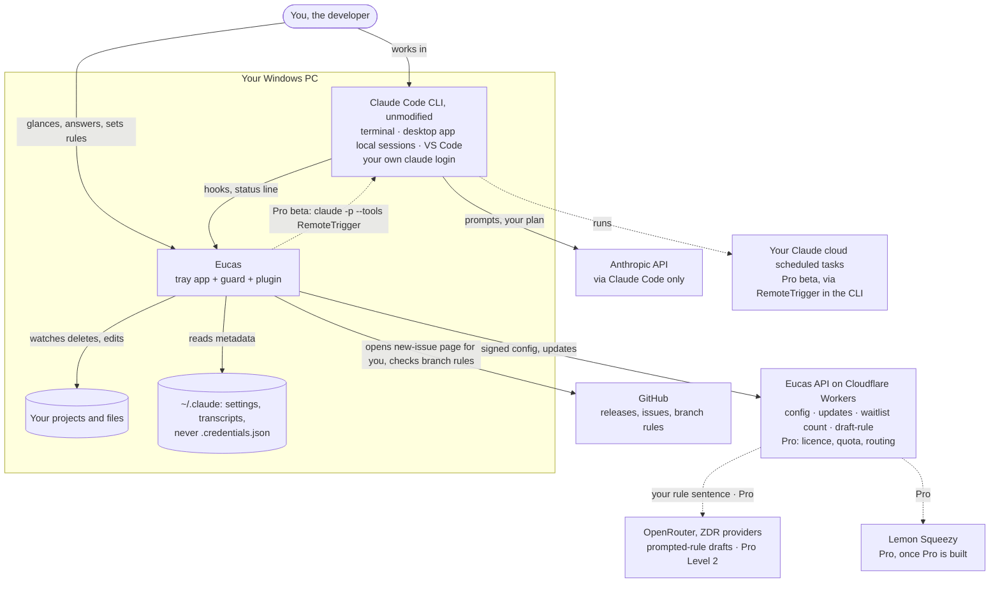
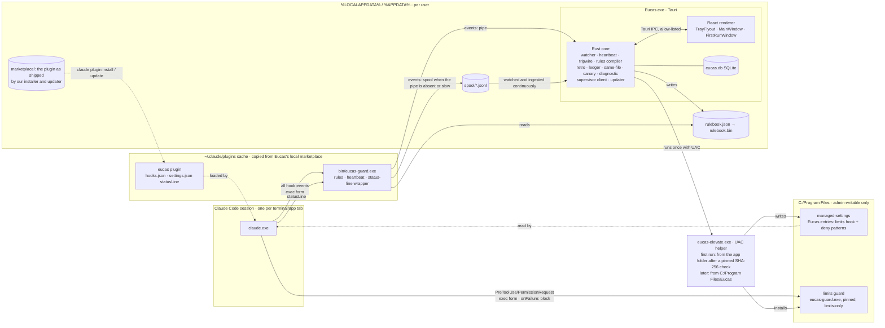
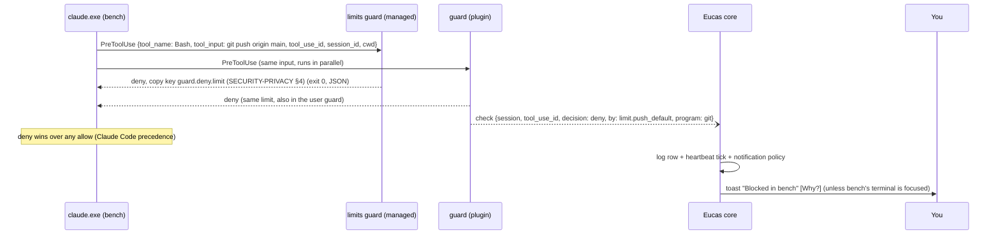
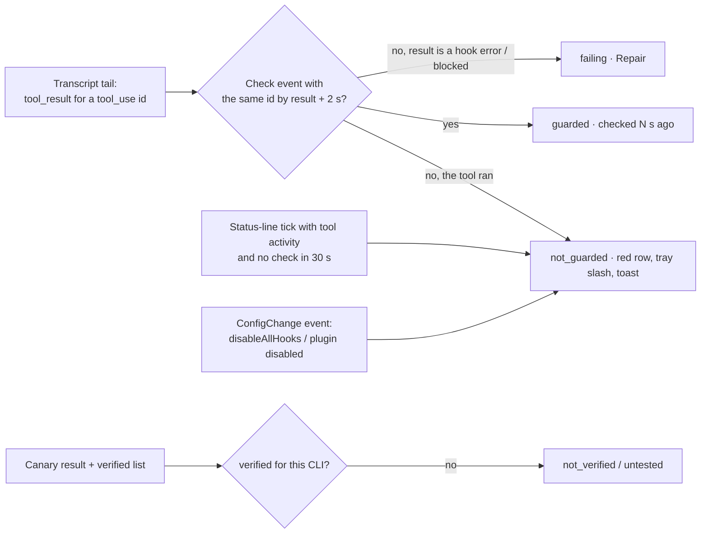

# System design: the Eucas companion

| Date | Author | Status | Builds on |
|---|---|---|---|
| 2026-10-26 | Lead systems engineer (Claude), `tech-lead` role, `engineering-craft` method | Draft for Gate 6; design only, no product code | UX [PR #55](https://github.com/eucas-app/eucas/pull/55), UI [PR #57](https://github.com/eucas-app/eucas/pull/57), [SP-SUP1](https://github.com/eucas-app/eucas/pull/56), [SP-CR1](https://github.com/eucas-app/eucas/pull/54), the 26 Oct pre-mortem |

**This folder:** this file (context, containers, flows, failure and scale checks) · [CODE-STRUCTURE](CODE-STRUCTURE.md) · [CI-CD](CI-CD.md) · [SUPERVISOR](SUPERVISOR.md) · [SECURITY-PRIVACY](SECURITY-PRIVACY.md) · [TESTING](TESTING.md) · [OPERATIONS](OPERATIONS.md) · [BUILD-PLAN](BUILD-PLAN.md). Decisions: [ADR-0007 … ADR-0015](../../adr/).

**Naming:** everything is named Eucas (the rename is done, CR-010). Binaries, plugin name, pipe names, folders and the UAC publisher (once Authenticode is bought, ADR-0013) are **user-visible and hard to rename once installed**, so they are `eucas-*` / `Eucas` from day one, and the crates follow so the codebase has one name; BUILD-PLAN §1 P6. "Claude Code" appears only as the name of the thing we attach to, never as ours.

---

## 0. Decisions in one table

| # | Decision | ADR |
|---|---|---|
| 1 | Attach to the user's own sessions: a **user-scope plugin** calling a **native guard**, the four **limits always on**, each one you lock held in **admin-written managed settings** (one UAC prompt), the app optional for safety | [0007](../../adr/0007-companion-attach-architecture.md) |
| 2 | **Tauri 2 + Rust core + React renderer** for the companion (Electron stays for the team app) | [0008](../../adr/0008-companion-stack-tauri-rust.md) |
| 3 | The guard is a **short-lived exe** that decides alone; events go over a **named pipe**, with a spool file when the app is closed | [0009](../../adr/0009-guard-process-and-event-channel.md) |
| 4 | A **vendor-neutral rulebook** (JSON Schema) compiled per vendor; limits are not expressible in it | [0010](../../adr/0010-vendor-neutral-rulebook.md) |
| 5 | Supervisor: **rules first, model only at Level 2**, never approves, falls back to asking you | [0011](../../adr/0011-supervisor-rules-first-model-at-level-2.md) |
| 6 | A **thin stateless Worker** for config, updates, waitlist counts, opt-in telemetry and prompted-rule drafting (`/v1/draft-rule`, CR-010), and (Pro) licence, quota and model routing | [0012](../../adr/0012-thin-server-cloudflare-workers.md) |
| 7 | **Unsigned v0.1** (no Authenticode; D-3 decided, CR-010, founder 2026-10-26): updates signed with the Tauri updater's Ed25519 key, installer SHA-256s published, the elevate helper checked by a **pinned SHA-256**; Tauri updater channels; Authenticode once revenue covers it | [0013](../../adr/0013-code-signing-and-updates.md) |
| 8 | **Nightly canary** on the latest CLI; "Verified for Claude Code x.y" only for versions CI and the PC both proved | [0014](../../adr/0014-canary-and-verified-badge.md) |
| 9 | **Counts, not text** in one local SQLite; transcripts read, never copied | [0015](../../adr/0015-local-data-counts-not-text.md) |

---

## 1. Requirements

**The core** (remove it and it isn't Eucas): a guard on every local Claude Code tool call that **proves it's running** and **holds the four limits** even when the app is closed.

**In v0.1** (pre-mortem cut, D-1 (b), D-2 (b)): the guard with `onFailure: "block"`, the heartbeat and canary, the mass-delete tripwire, the four limits always on, each locked in managed settings (UAC) or left at user scope and labelled "not locked", rules from suggestions + 5 templates, **"Choose your rules"** in first run (the four limits with a lock choice each, other library rules on or off), **prompted rules** (you describe a rule; `/v1/draft-rule` drafts it; it must validate, compile and pass the limit and bypass checks before you confirm it), the ledger and forecast through status-line chaining, the same-file warning with the plain-code **guided merge** (rebase, run the tests, open the PR; no AI, never writes code), the tray, popover and Windows toasts, the 7-day retro first run, the diagnostic, **unsigned binaries with Ed25519-signed updates and published installer SHA-256s** (ADR-0013), auto-update, clean uninstall, every session guarded, session details capped at 3, Pro as a waitlist line. Guided merge, prompted rules, "Choose your rules" and unsigned v0.1: CR-010, founder 2026-10-26.

**Out of v0.1:** the notch (CR-009 stays with the team app), Authenticode signing (once revenue covers it), payments and licence keys (Pro; it can charge once built, CR-010), the supervisor and budgets (Pro), cloud hand-off (Pro beta; the only part that waits for Anthropic's written OK), launching sessions, "Allow once" unless S-2 passes, macOS and Linux installers (CI still builds and tests on Ubuntu).

**Budgets (Pro, CR-010, founder 2026-10-26):** when a task's budget runs out, the guard **blocks the agent's next step at PreToolUse** and the core adds the needs-you item "Budget reached for this task. Continue?". The copy says Eucas "stops before the next step", never "pauses".

**Assumptions (owner):** Claude Code ≥ 2.1.310 on Windows for a "verified" state (founder, via docs); a plugin at user scope reaches the terminal, the desktop app's local sessions and VS Code (pre-mortem F30; confirmed in SP-H1); Windows 11 22H2+ x64 first, arm64 later (founder).

## 2. Numbers (NFRs)

| What | Budget | Measured where |
|---|---|---|
| PreToolUse decision, p95 / p99 | **≤ 50 ms / ≤ 150 ms** on the reference PC with Defender on | Benchmark test in CI (synthetic) + nightly canary (real CLI) |
| Check event lost while the app runs | ≤ 1 in 10,000 | Soak test |
| "Not guarded" raised after an unguarded tool call | ≤ **2 s** after that tool's **result** appears in the transcript (PreToolUse runs before the tool, so a real check always lands first) | Contract test with the hook removed |
| Tripwire: from the 200th delete in 20 s to "stopping" | ≤ 1 s; process tree gone ≤ 3 s | Tripwire e2e on a Windows runner |
| App idle (windows hidden, 3 sessions idle) | **< 0.5 % CPU, < 90 MB private bytes** across our processes: the core plus **one pre-warmed, hidden flyout webview**; the main and first-run windows are destroyed when closed. The figure is set in SP-ST1 from a measurement, and the popover budget below wins if they conflict | Perf job, `Get-Process` sampling 10 min |
| App active (popover open, 6 sessions working) | < 3 % CPU, < 180 MB | Same |
| Popover open | < 150 ms from click to first frame (the pre-warmed flyout is shown, not created) | Playwright trace |
| Retro | First card ≤ 5 s, all ≤ 30 s for 7 days / 300 sessions / 500 MB of transcripts | Fixture of that size |
| Installer | < 20 MB; install < 10 s; no admin | Release job |
| Guard binary | < 4 MB, no runtime dependencies, starts with no network | Release job |
| Local DB | < 50 MB after 90 days of heavy use (ADR-0015 roll-ups) | Soak estimate |
| Server | p95 < 2.5 s for `/v1/supervise` incl. model (model p95 1.1 s); 0 bytes of content at rest | Worker analytics |
| Cost | Infra < $100/month at 1k Pro users before model spend; model ≤ $1.48/user/month at the full allowance | Monthly check |

**Load estimate:** heavy user = 6 sessions × ~12 tool calls a minute = ~4,300 tool calls an hour. Each call starts **two** guards (the managed limits guard and the plugin guard, in parallel), edit tools add a PostToolUse start (~30 % of calls), and status-line ticks add about one wrapper start per call. That is **~14,000 guard starts an hour**; at ~20 ms CPU each, ~4.7 CPU-minutes an hour spread across cores (under 1 % of an 8-core PC on average). Checks: ~35,000 a working day, ~200 bytes on the pipe and ~220 bytes per stored row with its index, so raw checks are rolled up after 24 hours (ADR-0015). The single dominant resource is **process start cost of the guard**, which is why it is a small native exe (ADR-0009).

---

## 3. System context



**Trust boundaries:** (1) Claude Code ↔ the guard (stdin JSON from a process that runs untrusted model output); (2) the guard ↔ the app (local pipe, same user); (3) the renderer ↔ the Rust core (Tauri IPC); (4) the app ↔ the Worker (TLS, signed config); (5) the Worker ↔ OpenRouter. Detail in [SECURITY-PRIVACY](SECURITY-PRIVACY.md).

## 4. Containers



| Container | Tech | Runs | Owns | Fails how, and what's safe |
|---|---|---|---|---|
| **Limits guard** | Rust exe in Program Files (unsigned in v0.1; admin-only ACLs) | Per PreToolUse / PermissionRequest, from managed settings | The limits you locked (D-4) | Crash or timeout → `onFailure: "block"` denies; managed `permissions.deny` patterns still apply with no binary. If it can't start at all, every session is blocked and **only an admin step lifts it** (§7.1) |
| **Plugin** | Claude Code plugin (manifest, `hooks/hooks.json`, `settings.json`, `bin/eucas-guard.exe`). Our installer writes it to a **local marketplace** folder; `claude plugin install` copies it into Claude Code's plugin cache, so the guard doesn't depend on the app folder | Loaded by every local session | Wiring + the guard binary | Disabled by the user → heartbeat goes red within one tool call |
| **Guard** | Same Rust exe, user copy, inside the plugin | Per hook event and per status-line tick | Rule decisions, check events, status-line wrapper | Internal error → deny (PreToolUse) or no opinion (others); app down → spool |
| **Core** | Rust (`crates/eucas-app` + library crates) | Tray process, starts at login | State, verdicts, UI data, tripwire, canary | Crash → safety unchanged; the guard keeps deciding; Windows restarts it via the login task; the spool fills the gap |
| **Renderer** | React 19, TS strict, Tailwind, shadcn, tokens from DESIGN | WebView2: the flyout is pre-warmed and hidden; the main and first-run windows are created on demand | Pixels only | Main and first-run windows destroyed when closed; no Node, no secrets |
| **Elevate helper** | Rust exe, `requireAdministrator` manifest, unsigned in v0.1. **Fixed operations only** (`install`, `repair`, `pause-limits`, `resume-limits`, `remove`, `update-limits-guard`, `update-locked-set`); the managed entries and the limits-guard binary are embedded in it (SECURITY-PRIVACY T7); `install` and `update-locked-set` take the locked set as an enum-set option (a subset of the four limit ids), never free text. The first run launches it from the app folder only after the core checks its **SHA-256 against the hash pinned in the app build** (CR-010, founder 2026-10-26); it then installs itself to `C:\Program Files\Eucas\`, and every later UAC step runs that copy | First run, Repair, pause/resume, changing the locked set, uninstall, limits-guard updates | Managed-settings entries for the locked limits, limits guard copy | Declined → every limit stays on at user scope, labelled "not locked" (D-4) |
| **Eucas API** | Cloudflare Worker (TS, Hono, zod), KV, one DO class | Edge | Config, update manifests, waitlist counts, opt-in telemetry, prompted-rule drafts (`/v1/draft-rule`, counted toward the supervisor budget); Pro licence and quota | Down → cached config (7 days), no updates, no rule drafting (suggestions and templates still work), Pro asks you |

### 4.1 Inside the core

Names below are modules in `crates/eucas-core/src/` (`eucas-ingest` = `ingest/`), except `eucas-rules`, which is its own crate because the guard links it too ([CODE-STRUCTURE](CODE-STRUCTURE.md) §1).

| Module | Job | Inputs → outputs |
|---|---|---|
| `eucas-ingest` | Pipe server + **continuous** spool ingest (the spool folder is watched, so a frame that fell back to the spool while the app runs arrives within ~100 ms), dedupe by `event_id` | guard frames → typed `GuardEvent`s |
| `eucas-sessions` (session watcher) | One `Session` per Claude Code session: id, folder, CLI version, pid + start time, `SessionState` | SessionStart/End, Notification, Stop, UserPromptSubmit (a "you answered" signal only; the guard drops the prompt text), PreToolUse events; status-line ticks; `claude agents --json` every 30 s **only while sessions exist** (optional input, ignored when it fails) |
| `eucas-heartbeat` | Per-session guard verdict → `GuardState` | check events + transcript tool-use ids + status-line ticks + canary results + verified list |
| `eucas-transcripts` | Streaming, metadata-only reader of `~/.claude/projects/**/*.jsonl` (tail for live sessions, full for the retro) | JSONL → `ToolUseSeen { session, tool_use_id, tool, program, at }`, token usage, file paths |
| `eucas-tripwire` | Delete counting per watched root, attribution, stop and verify | `ReadDirectoryChangesW` on each active session's folder + the user profile → `TripwireEvent`s, process-tree kill |
| `eucas-samefile` | Same file touched by two sessions within 15 min, same working tree | PostToolUse file paths (canonicalised: junctions resolved, case-folded) → `SameFileWarning`; **guided merge** (CR-010): clean-tree check, rebase the later branch, the project's test command, `gh pr create` or the command to copy; on a conflict or failing test it aborts and leaves both branches as they were |
| `eucas-ledger` | Usage samples, per-session and per-project tokens and plan share, forecast | status-line JSON + transcript usage → `UsageSnapshot`, `Forecast` |
| `eucas-rules` | Neutral `ToolCall` model, shell tokenizers, rule matching, compiler, dry runs, suggestions | rulebook + history → `rulebook.bin`, `DryRun`, `Suggestion`s |
| `eucas-ruledraft` (CR-010) | Prompted rules: sends only your sentence to `/v1/draft-rule`, then re-validates the draft against the rulebook schema, compiles it, rejects any overlap with a limit or any bypass case it would auto-approve, and hands it to `RulePreview`; nothing is saved until you confirm | sentence → `RuleDraft` or a rejection reason |
| `eucas-installer` | Plugin install via `claude plugin` CLI, status-line wrap, the helper operation to request (including `update-locked-set` when you change which limits are locked), **key-level** restore | current config → `InstallPlan` (shown as the checklist) → applied, with a JSON patch per touched file |
| `eucas-canary` | Local canary (S-1 path or a real turn) | → `CanaryResult` |
| `eucas-notify` | Notification policy (DESIGN §4.18 budget), toasts, tray icon state | store changes → toasts, `TrayState` |
| `eucas-diagnostic` | Redacted report | everything above → Markdown |
| `eucas-supervisor` (Pro) | Rules v2, trimmer, redactor, server client, overrides | Stop moments → `Decision` |
| `eucas-cloud` (Pro beta) | Branch-rule check, RemoteTrigger body builder, run reader | brief → routine update + run; logs → trace rows |
| `eucas-store` | SQLite schema, migrations, retention job | — |

**One store, derived state:** the core keeps the UI store of DESIGN §11 (`guard`, `sessions`, `needs`, `log`, `rules`, `suggestions`, `usage`, `notificationsPausedUntil`, `decisions`). `trayState` and every `HeartbeatLine` are **derived** by one pure function each (DESIGN §5.1), unit-tested with a table of every combination, and pushed to the renderer as events; the renderer never polls.

---

## 5. Key flows

### 5.1 A tool call, end to end (the hot path)



- An **allowed** call (a user rule matches): G returns `permissionDecision: "allow"`, L returns no opinion; the user's own `ask`/`deny` rules in Claude Code still win (pre-mortem execution F22–F23), which the Rules screen shows as "would do nothing".
- **No opinion:** both return nothing; Claude Code's normal permission flow runs (the terminal prompt), and the `Notification` hook raises the needs-you card.
- **The deny message to the agent** is one copy key, `guard.deny.limit` (text in SECURITY-PRIVACY §4): it tells the agent to hand back to the user (trust F35), so it stops trying other routes.

### 5.2 Heartbeat and "not guarded" (UX principle 1, spike S-5)



- `guarded` needs a real check; `idle` means no tool activity and is never shown as a tick. A session that starts without a `SessionStart` from our plugin (installed before the plugin, S-3) is `not_guarded` with "restart it to guard" until its first check arrives.
- Verdict priority per session: `org` › `failing` › `off` › `not_guarded` › `untested` › `not_verified` › `user_level` (at least one limit not locked; the label says "not locked", CR-010) › `guarded` › `idle`; the app-level `GuardState` is the worst session state, `setup` before first run ends.
- `failing` = the guard is blocking calls without a rule deciding, on ≥ 3 calls in 60 s: either it reported its own error (`GUARD_INTERNAL`, `GUARD_SCHEMA` when a CLI release changed a required field), or the transcript shows tool results that Claude Code blocked because a hook failed to start or timed out with **no** check event (antivirus quarantine, a missing binary). The recovery paths are in §7.1.

### 5.3 Status-line chaining (ledger and forecast)

1. Install saves the user's current `statusLine` (from user settings) to `%APPDATA%\Eucas\statusline.saved.json` and sets ours: `eucas-guard status-line`.
2. Per tick, the guard reads the JSON from stdin, starts the saved command (exec form if it was, else the same shell Claude Code would use) with the **same stdin bytes**, copies its stdout to our stdout unchanged, and sends the parsed JSON's usage fields to the core (pipe, 10 ms budget). If the saved command fails, its stderr and exit code pass through unchanged: we never make the user's status line look different.
3. The core stores a `UsageSample`; the forecast is a least-squares fit of the five-hour `used_percentage` over the last 45 minutes, giving one time plus a range (DESIGN §4.11). No `rate_limits` → `tokens_only` mode; `ANTHROPIC_API_KEY` sessions → `api` mode (cost).
4. Uninstall puts the saved `statusLine` object back **only if ours is still there**; if you changed your status line since, yours stays. No other key in your settings is touched (key-level restore, §6).

### 5.4 Needs-you, toasts, Open session

- Sources: `Notification` hook (`permission_prompt`, `idle_prompt`), `Stop` after a run ≥ 2 min (done), guard problems, tripwire stops. Resolved when the next tool call or `UserPromptSubmit` arrives in that session ("Answered in bench"); the plugin has a `UserPromptSubmit` hook for this, and the guard discards the prompt text before emitting.
- Policy (DESIGN §4.18): one toast per event, ≤ 1 per 2 min per session, ≤ 2 on screen, grouped beyond. The "no toast when that session's terminal is focused" rule is applied **only when Eucas can tell the session itself is in front**: a classic console whose window (`GetConsoleWindow` of the session's console) is the foreground window. For tabbed hosts (Windows Terminal, VS Code, the desktop app) Eucas can't see which tab is active, so it toasts; a needless toast is better than a silent miss.
- **Open session (S-4):** walk the session pid's ancestors to the window host (Windows Terminal, conhost, VS Code, the Claude desktop app), `SetForegroundWindow` with the activation right the toast click grants; if the host has tabs we can't address, name it ("It's the Windows Terminal tab titled bench").
- **Allow once** only if S-2 shows a waiting `PermissionRequest` hook can answer without racing the terminal prompt; otherwise the card says "Answer in the terminal, or open it".

### 5.5 Mass-delete tripwire

```mermaid
sequenceDiagram
  participant FS as ReadDirectoryChangesW (bench folder, profile)
  participant T as tripwire
  participant G as guard
  participant P as process tree of claude.exe (bench)
  participant U as You
  FS->>T: FILE_ACTION_REMOVED × n
  T->>T: sliding 20 s window per root; attribute to every live session whose folder contains the paths (tool call in flight or not: background jobs count)
  T->>G: set tripped flag for session (file under %LOCALAPPDATA%/Eucas/guard/tripped/)
  Note over G: every later tool call in that session → deny
  T->>P: snapshot descendants (Toolhelp32), TerminateProcess each, repeat until no new children for 1 s
  T->>FS: keep counting
  alt count still moving after 3 s
    T->>P: terminate claude.exe too; keep counting
    T->>U: TripwireCard "bench is still deleting files" (live count)
  else count stopped
    T->>U: TripwireCard "Eucas stopped bench" + what was deleted + how to get it back
  end
```

- **What counts.** Deletes of git-tracked files in a session's folder, and **any** delete outside the session folders (elsewhere in your profile), count toward **200 files in 20 s**. Deletes inside git-ignored folders *inside* the project (`node_modules`, `dist`, `target`, build output) don't count, so `pnpm install`, `cargo clean` and a bundler emptying its output folder don't trip it, with one exception: if, in the same window, deletes also start outside the project root, the trip is immediate. That is the shape of the field incidents (a clean of `node_modules` that escaped through path aliasing, UX §3.1). "This was expected" adds a folder to the project's allow list, with the consequence spelled out.
- **What gets stopped.** Every descendant of the attributed session's `claude.exe` is terminated, which includes `run_in_background` jobs and scripts the agent started, because they're its children. A process that has detached from the tree (re-parented, a scheduled task, a service) can't be attributed by path alone; that is in the gap list.
- Verification: each terminated PID is opened with `SYNCHRONIZE` and waited on; PID reuse is ruled out by the recorded start time. "Stopped" appears only when no PID remains **and** the count hasn't moved for 3 s.
- Honest limit, stated in the gap list: the tripwire needs the app running; path attribution can't see deletes outside watched roots; ETW-based per-process attribution needs admin and is a v0.2 candidate.

### 5.6 First run (UX screens 0–6)

```mermaid
sequenceDiagram
  participant I as Installer (per user)
  participant C as core
  participant R as renderer (FirstRunWindow)
  participant E as eucas-elevate.exe
  participant CC as claude CLI
  I->>C: first launch
  C->>CC: claude --version; find installs (native, npm, desktop app bundle)
  C->>C: read settings (statusLine, hooks, managed flags), list 7 days of transcripts
  C-->>R: detection checklist (≤ 3 s)
  C-->>R: retro cards streamed (first ≤ 5 s)
  R->>C: Choose your rules: the four limits (always on), a lock choice for each; library rules on or off
  R->>C: Turn on protection
  C->>CC: claude plugin marketplace add + install eucas@eucas --scope user
  C->>C: wrap status line (backup), write rulebook, compile rulebook.bin; deny patterns for limits left not locked → user settings
  C->>C: SHA-256 of eucas-elevate.exe == hash pinned in the app build? (no → stop, nothing elevated)
  C->>E: ShellExecute runas "install --source auto --lock <chosen limits>" (UAC; v0.1 names no verified publisher)
  E->>E: install itself to Program Files; merge its embedded managed entries for the locked limits (JSON patch recorded), install the embedded limits guard, set ACLs
  E-->>C: result
  C->>C: canary (S-1 path)
  C-->>R: "Blocked by Eucas · logged" → You're protected
```

Every write is **atomic per file** (write temp, flush, rename) and recorded as a JSON patch of the keys Eucas added or changed; any failure rolls back the steps already done in reverse order (UX edge I). Quitting before step 4 leaves nothing written. **Unsigned v0.1 (CR-010, founder 2026-10-26):** Windows shows the prompt in yellow with "Unknown publisher", so the UacFrame copy can't use the publisher name as the check and must not tell you to press No on "Unknown publisher"; the check is the core's pinned-hash comparison just before the prompt, and every later UAC step runs the admin-only Program Files copy. If you lock none of the four, no UAC prompt is shown and all four stay on at user scope, labelled "not locked".

**Changing the locked set later** (D-4, CR-010, founder 2026-10-26): the four limits stay on whatever you choose; locking or unlocking one runs the Program Files helper's fixed `update-locked-set` operation with the new set, which asks Windows for admin again. Moving a limit from locked to not locked puts its deny patterns in your user settings in the same step, so it is never off in between. No rule, user-written or drafted, can make Eucas auto-approve one of the four (ADR-0010).

### 5.7 Supervisor at a Stop moment (Pro, not v0.1)

The `Stop` hook's guard asks the core over `eucas-ask` (8 s budget). Flow and data shapes in [SUPERVISOR](SUPERVISOR.md) §2. Failure or no answer → allow the stop and raise needs-you.

### 5.8 Cloud hand-off (Pro beta, not v0.1)

From SP-CR1: one routine per cloud-eligible project, created disabled with a far `run_once_at`; each hand-off `update`s the saved prompt with the brief, sends an **explicit connector list or `clear_mcp_connections: true`**, sets `disallowed_tools` (Bash only if the task needs it, plus the cloud's own tools: `mcp__github`, `PushNotification`, `Agent`, `Workflow`, `Artifact`, `SendMessage`, `SendUserFile`, `CronCreate`, `ScheduleWakeup`, `Monitor`, `mcp__claude-code-remote__add_repo`), `get`s it back, refuses on any mismatch, then `run`s. All through `claude -p --tools RemoteTrigger --strict-mcp-config --setting-sources ""` with `ANTHROPIC_API_KEY` stripped; the core builds the body itself and validates every response.

**Gate:** before enabling hand-off for a repo, the core reads the rulesets through the user's own `gh` (we never read a token): `gh api repos/{o}/{r}/rules/branches/{default}` to find the active rules and their ruleset ids, then `gh api repos/{o}/{r}/rulesets/{id}` for each, which shows `bypass_actors` only to users with admin read. It requires `deletion`, `non_fast_forward` and `pull_request` on the default branch with an **empty** `bypass_actors`. If the bypass list can't be read, the gate counts as unverified. No rules or unverified (for example a private repo on a free plan) → hand-off with Bash is refused, and the UI says why.

**One run at a time per routine:** hand-offs for the same project queue in the core, so the `update` → `get` → `run` sequence never interleaves (otherwise run A could execute brief B). Run logs are untrusted data.

---

## 6. Data model (summary; schema in CODE-STRUCTURE §5)

| Entity | Key | Notes |
|---|---|---|
| `session` | Claude Code `session_id` | folder (display name + hash), vendor, cli_version, pid, pid_started_at, state, guard_state, first_seen, last_check_at |
| `check` | `event_id` (UUIDv7) | session, tool_use_id, at, tool kind, program, decision, decided_by (rule id or limit id), latency_us; rolled up after 24 hours |
| `log_entry` | id | kind: block · warn · trip · off · on; receipt text (≤ 512 chars, redacted, 30 days) |
| `file_touch` | (session, path, at) | 24 h |
| `usage_sample` | (session, at) | tokens, cost, five_hour %, seven_day %, resets_at |
| `rule_counter` | rule id | count, last_used_at |
| `suggestion` | (program+args, folder) | manual_allows, last_seen |
| `needs_item` | id | kind, session, since, resolved_at |
| `canary_run` | id | cli_version, path (hook-only / model), result, at |
| `setting` | key | JSON value |

Files (single sources of truth): `rulebook.json` (rules), `statusline.saved.json`, `install-manifest.json` (which of the four limits are locked (D-4, CR-010), every file Eucas touched, the **JSON patch of the keys it added or changed**, the file's hash right after install, and a backup). Uninstall reverses only Eucas's keys; it restores the whole file from backup only if the file's hash still equals the post-install hash. Your later edits survive, managed-settings entries (owned by the helper).

---

## 7. Failure check (kill it at the worst moment)

| Component | Worst moment | What happens | Safe? |
|---|---|---|---|
| Guard crashes mid-PreToolUse | Any | `onFailure: "block"` → deny; Claude Code logs it; repeated → `failing` with the recovery paths of §7.1 | ✅ fails closed |
| Guard crashes in an observational hook (Stop, Notification, PostToolUse, …) | Any | The panic path exits 0 with no output for these, so it never blocks a stop or a prompt (only PreToolUse and PermissionRequest deny) | ✅ |
| Guard hangs | Any | 5 s timeout → block | ✅ |
| Antivirus quarantines the guard | Any | Hook can't start → block; `failing` (from the transcript's blocked results with no check); UX edge M; §7.1 | ✅ closed, loud |
| The app folder deleted by hand (not uninstalled) | Any | The guard lives in Claude Code's plugin cache, not in the app folder, so sessions stay guarded by rules and limits; only the app's features stop. The proper uninstaller removes the plugin and the managed entries together | ✅ |
| The plugin's or the limits guard's binary deleted or quarantined | Any | Every tool call blocked (the CrowdStrike shape, trust #4), never silently open. Recovery per layer in §7.1 | ✅ closed, recoverable |
| App crashes | During first run | Steps are atomic with rollback; resume from the last completed step | ✅ |
| App crashes | Tripwire in progress | Tripped flag already written → the session's tool calls stay denied; on restart the core resumes counting and shows the card | ✅ |
| App closed | Any | Limits and rules hold; spool fills; heartbeat, toasts, tripwire pause; quit dialog said so | ✅ honest |
| Pipe full or slow | Burst | The whole event emit is capped at ~5 ms (pipe connect, else one unlocked append to the spool, else drop and count); the decision is already on stdout | ✅ bounded delay |
| Spool disk full | Any | Event dropped, decision unaffected; the drop count is shown | ✅ |
| Rulebook corrupt | Any | Guard ignores it (checksum) → limits only, no auto-approvals → Claude Code prompts | ✅ |
| Managed settings removed by an admin | Any | ConfigChange or canary → `user_level` or `not_guarded`; never green | ✅ loud |
| Worker down | Pro moment | Ask the user | ✅ |
| Update interrupted | Install | The app update and the plugin update are separate steps: the app updates first; then the core writes the new plugin version to the local marketplace and runs `claude plugin update eucas@eucas`, which replaces the cache copy (atomicity to confirm in SP-H1). A failed plugin update leaves the old, working guard in place | ✅ |
| Claude Code changes a hook schema | New release | A required field missing → guard denies with `GUARD_SCHEMA` (closed) → `failing` with Repair and the §7.1 paths, and `not_verified` for that CLI; the nightly canary opens an issue, and the fix ships as a plugin update | ✅ closed, loud |

### 7.1 Getting out of a fail-closed brick

A fail-closed guard that can't run blocks every tool call. That is the right failure, but you must never be stuck. Recovery per layer; the `failing` banner offers them in this order, and the README, the diagnostic and the support page repeat them:

| Layer | First try | Escape | Admin? |
|---|---|---|---|
| Plugin guard (user) | **Repair**: re-install the plugin from the local marketplace (`claude plugin update eucas@eucas`), re-run the canary | **Off for 15 minutes**: the app runs `claude plugin disable eucas@eucas` and re-enables it when the time is up (a guard that can't start can't read a flag, so Off works by removing the hook, not by telling the guard). Without the app: the same command by hand | No |
| Limits guard (admin, the limits you locked, D-4) | **Repair (asks Windows)**: the Program Files helper restores the limits guard from its embedded copy | **Pause the limits (asks Windows)**: `pause-limits` removes our managed hook entry and leaves the deny patterns (they need no binary); **Turn them back on** runs `resume-limits` with a second UAC prompt. The copy says both prompts up front. While paused, every surface shows `user_level` | Yes, once each way |
| Both | — | Settings › Remove Eucas (one UAC prompt) | Yes |

After any unbrick, Eucas tells you to **restart running sessions**: whether a running session picks up a disabled plugin or a changed managed entry is part of SP-H1 (until it's proven, the copy assumes it doesn't). If antivirus quarantined the binary, Repair may be re-quarantined; the banner then links the vendor's false-positive submission and keeps the escape on screen.

## 8. Scale check

One user, one machine, up to ~10 concurrent sessions. No queue, no cache server, no second database. The Worker is the only shared component, and it holds two hashes and a counter per Pro user. What changes at 10× (60 sessions): guard starts per second (~40/s, about 0.8 of a core; the first thing to revisit, with the warm-helper option of ADR-0009), the pipe server's worker pool (bounded at 8 connections, the rest spool), and the transcript tailer (one file handle per live session, tail by notification, not polling).

## 9. Rejected

| Rejected | Why |
|---|---|
| `http` hook to the running app | Fails open when closed, or bricks every session with `onFailure: block` (ADR-0007) |
| Writing hooks into project `.claude/settings.json` | Pollutes repos and teammates (pre-mortem execution #5) |
| Replacing the status line | One per scope; power users lose theirs (execution F26–F27) |
| Setting `allowManagedHooksOnly` ourselves | Would switch off the user's own hooks |
| A Windows service for the tripwire (ETW, per-PID attribution) | Admin install, a permanent elevated process, AV scrutiny; v0.2 candidate if path attribution proves too coarse |
| Model calls from the app straight to a provider | Ships our key, no quota, no hot swap (ADR-0012) |
| The global keyboard hook (notch) | Looks like a keylogger to AV on a new app (pre-mortem); out of v0.1 |
| Reading `~/.claude/jobs/` | "Not a stable interface"; `claude agents --json` is the supported read, and it's optional input |

## 10. Open questions → spikes before Gate 6

Each is in [BUILD-PLAN](BUILD-PLAN.md) §2 with a cost and a pass bar: **SP-H1** (hook attach path: firing, fail-closed with and without Git Bash, PowerShell 5.1/7, latency with Defender, plugin pickup by running sessions, plugin-shipped status line, managed source and precedence, repo `disableAllHooks`, agent editing settings), **SP-ST1** (Tauri tray, popover, toasts with buttons, updater, WebView2 CDP for Playwright, idle RAM), **S-1** (hook-only canary), **S-2** (Allow once), **S-4** (find and focus the session window), **S-5** folded into SP-H1, **S-6** (a deep link to "Other system tray icons" for first-run screen 6), **SP-TW1** (tripwire: delete counting under load, kill and verify), **SP-SUP2** (supervisor re-run on real moments, Pro, before Pro launch).
