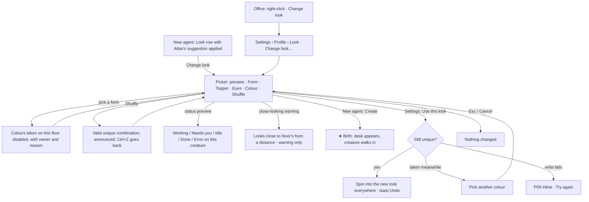

# Creature picker: choosing an agent's look

Part of the [office UX](README.md). It **replaces the v0.4 avatar customizer** (UX package F11, screen 6, task T7: shapes with eyes only), which belonged to the archived "Look" direction (coherence finding CO-03). The library itself (the forms, toppers and eye styles as art) is the UI designer's; this file fixes the parts, the choices, the rules and the behaviour.

## 1. Screen card

| | |
|---|---|
| **Intent** | Do (give an agent its look), with a little delight (ownership, the IKEA effect) |
| **Primary** | **Use this look** (in Settings) · in New agent the dialog's own **Create Lumen** stays the one primary; the picker has no primary of its own there |
| **Use cases** | UC-02, UC-04, CR-001 (animated, customizable avatars), design doc §2.5 and §4.2 |
| **Evidence** | The live preview changes as you pick; the sentence under it names the look; on save, the creature spins into its new look in the office and a toast offers Undo |
| **Consequence preview** | Before you pick a part: which combinations are taken on this floor and by whom; after: "Unique on Bench" |
| **Intelligence deposit** | The parts you keep and the ones you change tune Atlas's next suggestions (no chore, no prompt) |
| **Hierarchy test** | The preview → the parts → Use this look |
| **Worst moment** | Every colour of the form you love is taken on this floor; or the library fails to load |
| **Ending** | The creature arrives at its desk (new agent) or spins into its new look (existing agent) |

## 2. Where it lives

| Entry | How it opens | Notes |
|---|---|---|
| **New agent** (dialog, unchanged otherwise) | A **Look** row in the draft card: preview + one-line description + *Change look* · *Shuffle*. *Change look* expands the picker **inline in the dialog** (no dialog on top of a dialog) | Atlas's suggestion is already applied, so you can press Create without ever opening the picker |
| **First run, step 3** (your main agent) | The same Look row under the name field | Optional; "You can change it later in Atlas › Settings › Profile" |
| **Settings › Profile** (agent page, unchanged nav) | A **Look** row: the creature at 64 px with its status badge and word, the description, *Change look…* → the picker in the settings pane, which widens (existing pattern) | Saves only on **Use this look** (it changes how the agent appears everywhere, so it isn't a save-as-you-go toggle); Undo in the toast |
| **Office** | Right-click an agent → **Change look** → opens Settings › Profile › Look in the agent page panel | Same picker |
| **New project / template preview** | Each role row shows Atlas's suggested creature; a row's *Details* has *Change look* | All suggestions are unique on the new floor by construction |

## 3. The parts

The client chose **form + topper + eyes + colour** (design doc §4.2). Library target for v0.1: ≥ 12 forms × ≥ 8 toppers × 4 eye styles × 10 hues. Names below are the working set for the UI library sheet; the art is UI's call, inside the anti-goals (no soft blob with a slanted eye-stroke pair; adult, not childish; small noodle arms on every form).

| Part | Options (working names) | Control |
|---|---|---|
| **Form** (the body) | Star · Cloud · Mug · TV · Frog · Bean · Drop · Pebble · Kettle · Cactus · Moon · Lamp (≥ 12; the client's creature sheet is the reference) | A grid of thumbnails, 4 per row, each with its name under it; radio group |
| **Topper** (what's on top: the 16 px tell, Pikmin lesson) | None · Antenna · Ears · Sprout · Horn · Steam · Halo · Spiral · Flower · Propeller (≥ 8 + None) | Grid with names; some forms suggest a natural topper (Mug → Steam, TV → Antenna) and list it first, but any topper fits any form |
| **Eyes** | Dot · Round · Ring · Half-moon (4; never a slanted stroke pair) | Four large swatches with names |
| **Colour** | The design system's ten hues, by name: Coral · Tangerine · Honey · Pear · Mint · Teal · Aqua · Lavender · Orchid · Cocoa | Swatches **with their names visible** (never colour alone) |

**Not parts:** uploading your own picture (v0.4 allowed it; a photo can't sit at a desk in a 3D office; client question Q-O5), initials overlays, mouths as a choice (a small mouth appears only for Done and the greeting, the same on every creature), accessories with brands.

**Fixed per agent (not chosen):** the **temperament** (tempo and bounce offset from the agent id), so two agents never move identically even with the same parts on different floors.

## 4. Atlas's suggestion

- **When:** every new agent (New agent, New project, first run) arrives with a suggested look **already applied**.
- **How Atlas picks** (rules, in order): (1) **unique on the target floor** (form + colour, §6); (2) a colour **not adjacent** on the wheel to a teammate with the same form anywhere in Bench (R9, softer); (3) avoids the forms and colours you changed away from in the last suggestions (learned, §8); (4) otherwise varied: no two consecutive hires share a form.
- **Not by role.** Creatures aren't tied to roles (client: *"I might add new agents for different roles"*). Atlas never says "a TV because it's a developer".
- **Copy:** a chip above the preview: **Atlas suggests** "a honey cloud with a propeller and dot eyes · nobody on Bench has a honey cloud" · *Use suggestion* (shown only after you've changed something, to go back).
- **Offline / week used up:** the suggestion is a **local rule**, not an LLM call, so it always works. Copy doesn't change.

## 5. Shuffle

- A **Shuffle** button beside the preview (and `S` while the picker has focus, listed in its keyboard hint).
- Shuffles **all four parts** at once, only into valid, unique combinations, and never into the current one.
- **Lock a part:** each part's header has a small lock toggle ("Keep this form while shuffling"), so you can shuffle colours on a mug you like (Notion Faces lesson, with control).
- Each shuffle is announced: live region "Shuffled: a pear frog with a sprout and round eyes. Unique on Bench."
- **Undo shuffle:** `Ctrl+Z` or *Back* (the previous look) for the last 10 shuffles in this session. No randomness touches anything but the look.

## 6. Uniqueness: no two identical form + colour pairs on a floor

- **Scope:** a **floor**: a project's floor, or the Lobby. It counts every agent whose home desk is on that floor, including paused agents and freelancers (they have desks). Archived agents are ignored.
- **In the picker:** when a form is selected, each **colour already used with that form on this floor** is **disabled** with the owner's mini creature on the swatch and the reason in the tooltip and accessible name: "Coral is taken on Bench: Noor is a coral mug." Picking a colour first disables the forms already paired with it, the same way.
- **The rule explained in place** (UX principle 5): under the colour row, when anything is disabled: "On one floor, each form and colour pair belongs to one agent, so you can tell them apart at a glance."
- **Toppers and eyes don't count** for uniqueness (they're too small at office distance to be the only difference), but the picker **warns** when only they differ from a teammate's look *and* the colours are wheel-neighbours: "Looks close to Noor's from a distance. Try a colour further from coral." (a warning, not a block).
- **All colours of a form are taken** (10 agents on one floor share it): the form tile shows "All 10 colours used on Bench" and is disabled.
- **Loan copies** may clash on the borrowing floor: they keep the original's look (it's the same agent), and the guest lanyard plus the LOAN tag tell them apart. The hover says so: "Noor (on loan from Bench) · looks like Tala's coral mug; the lanyard marks the guest." No forced change.
- **Moving an agent to another floor's team** (if ever allowed): if its look clashes there, the move asks first: "Noor's coral mug is taken on InterviewKit by Tala. Pick a new look for Noor, or keep both (the floor will have two coral mugs)." Default: pick a new look.
- **Edits elsewhere:** if a teammate takes a combination while your picker is open (rare), your selection shows the conflict inline when you press Use: "Jade just took the honey cloud on Bench. Pick another colour." Nothing is saved until it's unique.

## 7. Preview

| Preview | What it shows | Why |
|---|---|---|
| **Hero** (160 px, soft 3D) | The creature idling (breathing, a blink on each change you make) | The look at its best |
| **At its desk** | A small office vignette: the creature at a desk in its team's area on its floor, at office distance, with its two nearest neighbours as they really are | It must read in the office, next to the real team (this is where clashes are felt) |
| **Small sizes** | The flat render at 16, 24 and 32 px on a row of the sidebar and a chat line | It must read in lists and mentions |
| **Status** | A segmented control: **Working · Needs you · Idle · Done · Error**; the hero and the vignette play that state; the status word shows beside it | You see the mark, the work pose and the concern pose on *this* creature |
| **Description** | One sentence under the preview, live: "**Lumen:** a honey cloud with a propeller and dot eyes. Unique on Bench." | The text equivalent; also the creature's accessible description everywhere |

Reduced motion: the hero and vignette hold still poses per status; the shuffle swaps without the spin.

## 8. What happens on save

- **New agent:** nothing is saved until **Create**; then the birth in the office (flows F-O6, ★ M-O4).
- **Settings › Profile:** **Use this look** → the picker closes; the profile row shows the new creature; in the office (visible in the strip) the creature **spins once into the new look** (300 ms); every list, mention, chat line and hero updates at once. Toast: **Noor's new look is saved.** `Undo` (10 s). Saved to `agents/noor/look.json` (`form`, `topper`, `eyes`, `hue`), a plain file like every agent setting.
- **Cancel / Esc:** "Nothing changed." (no toast; the old look stays).
- **Learning (automatic, no prompt):** the parts you change away from Atlas's suggestion are counted locally to tune future suggestions (§4 rule 3). Shown in Memory › About you as "Look preferences: you often pick round eyes and cooler colours", with Forget, like any learned preference (R6).

## 9. States

| State | What you see | Copy | Actions |
|---|---|---|---|
| **Default** | Preview with Atlas's suggestion; parts with the current selection | **Atlas suggests** "a honey cloud with a propeller and dot eyes · nobody on Bench has a honey cloud" | *Shuffle* · **Use this look** (Settings) |
| **Loading** (library assets) | Part grids show their names in flat placeholder tiles at their final size; the preview shows the flat render | "Loading the creature library…" (after 1 s) | — |
| **Empty** | N/A: the library ships with the app; there's always a suggestion | — | — |
| **Partial** | Some 3D parts failed to load (a corrupt asset) | On the affected tile: **This one didn't load.** "Bench is missing `topper-propeller`. Reinstalling Bench fixes it." Tile disabled | *Pick another* |
| **Error: clash at save** | §6 last bullet | "Jade just took the honey cloud on Bench. Pick another colour." | — |
| **Error: write failed** (P09) | Inline in the footer | **Didn't save: Bench couldn't write `agents/noor/look.json`** (another app has it open). "Your choice is still here." | **Try again** · *Open folder* |
| **No GPU** (Simple view) | The hero and the vignette use the flat render; the vignette becomes a still | "Showing a flat preview: the live office is off on this PC." | as usual |
| **Offline / week used up** | No change (the picker and Atlas's suggestion are local) | — | as usual |
| **Denied** | Archived agent: the Look row is read-only | "Noor is archived. Restore Noor to change her look." | *Restore* |
| **Success** | §8 | **Noor's new look is saved.** `Undo` | *Undo* |

## 10. Flow

## 11. Accessibility

- **Each part is a radio group** (`role="radiogroup"`, labelled "Form", "Topper", "Eyes", "Colour") with roving focus: arrows move, Space/Enter selects, Home/End jump. Tab moves between groups, then Shuffle, then the status preview, then the footer.
- **Every option has a visible text name** (forms, toppers, eye styles and colours). Colour is never the only cue: swatches carry their names, and the description sentence repeats the choice.
- **Disabled options stay focusable** (`aria-disabled="true"`) so screen-reader users hear why: "Coral, unavailable: Noor is a coral mug on Bench."
- **Live region** (polite) announces the description after each change, throttled to the last change within 500 ms.
- **The preview** has a text alternative (the description) and the status segmented control states the word ("Previewing: Needs you").
- **Contrast:** names under thumbnails are Ink on white (AAA); selection is shown by an Ink ring plus a check glyph, never by a colour (design-system rule: selection is never Cobalt).
- **Targets:** thumbnails ≥ 56 px, swatches ≥ 32 px with 8 px gaps (desktop adaptation: ≥ 32 px).
- **Colour-vision:** the near-neighbour warning (§6) also protects people who can't tell adjacent hues apart; the topper is the shape-based tell.
- **Reduced motion:** no spin, no idle breathing; state previews as still poses.
- **Keyboard shortcut** `S` (Shuffle) works only while focus is inside the picker (WCAG 2.1.4), and it's shown in the button's tooltip.

## 12. Client tasks (part of T11 in the README)
- Create an agent without opening the picker (Atlas's suggestion) in ≤ 30 s from the open desk (Grok Bot parity: "create a bot in under 30 seconds").
- Change Noor's look to a different form, say why one colour is unavailable, preview her **Needs you** state, and save. Success: names the reason from the text (not by guessing), finds Undo.
