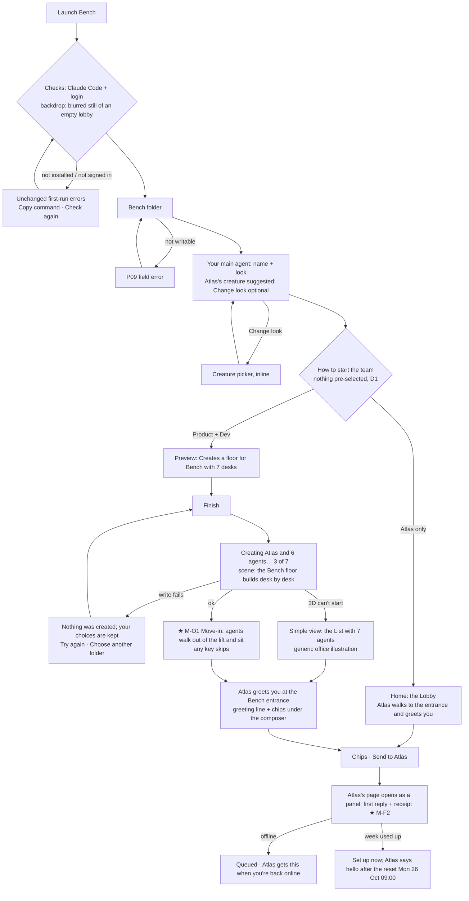
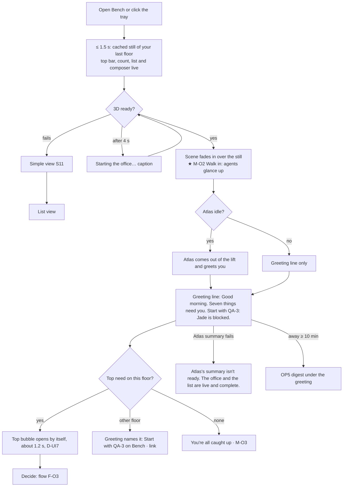
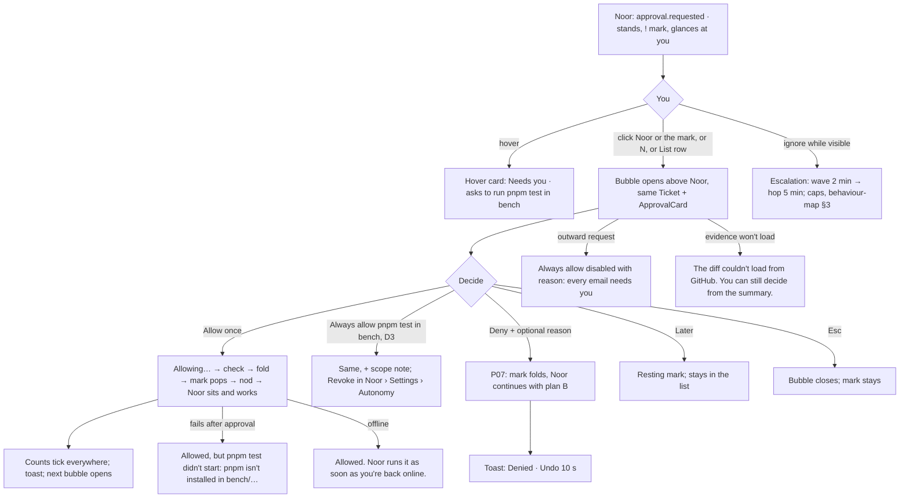
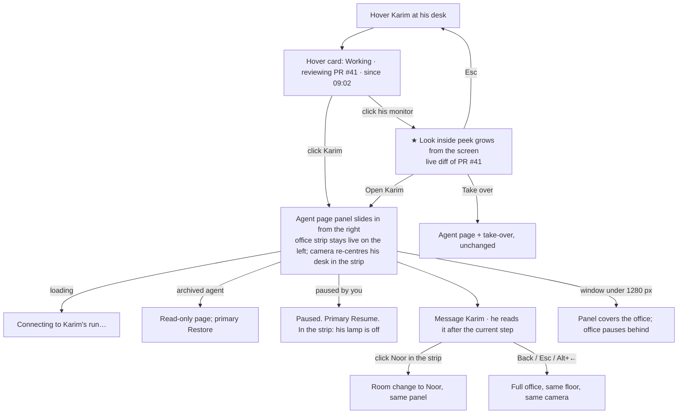
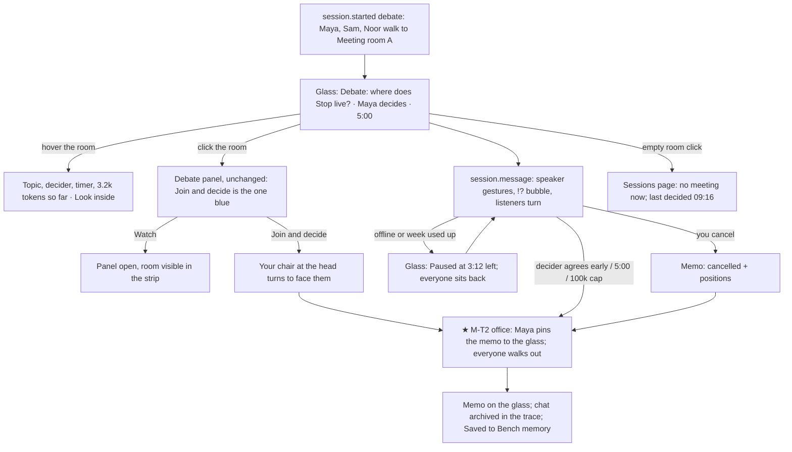
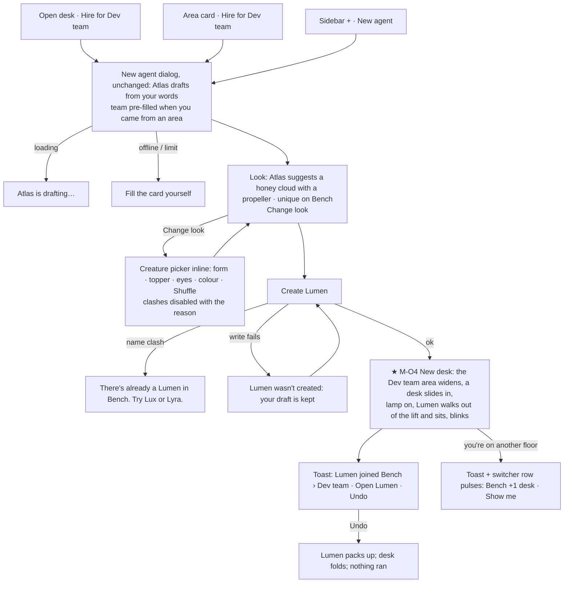
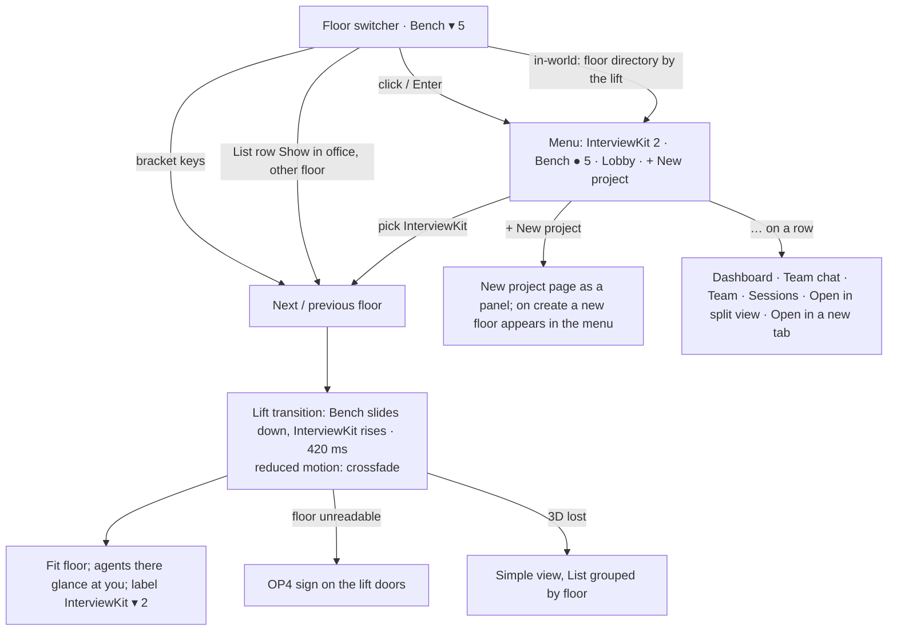
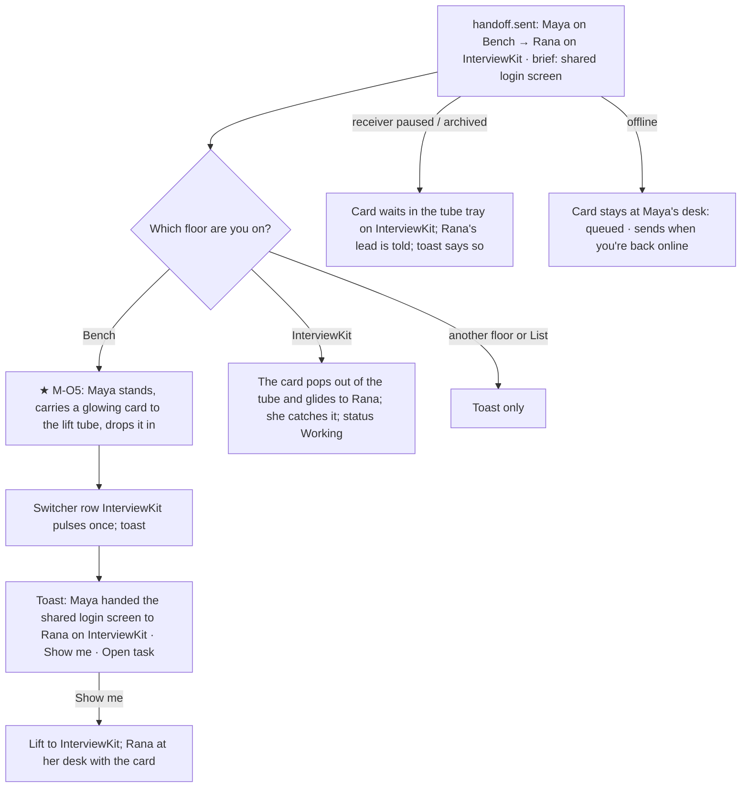
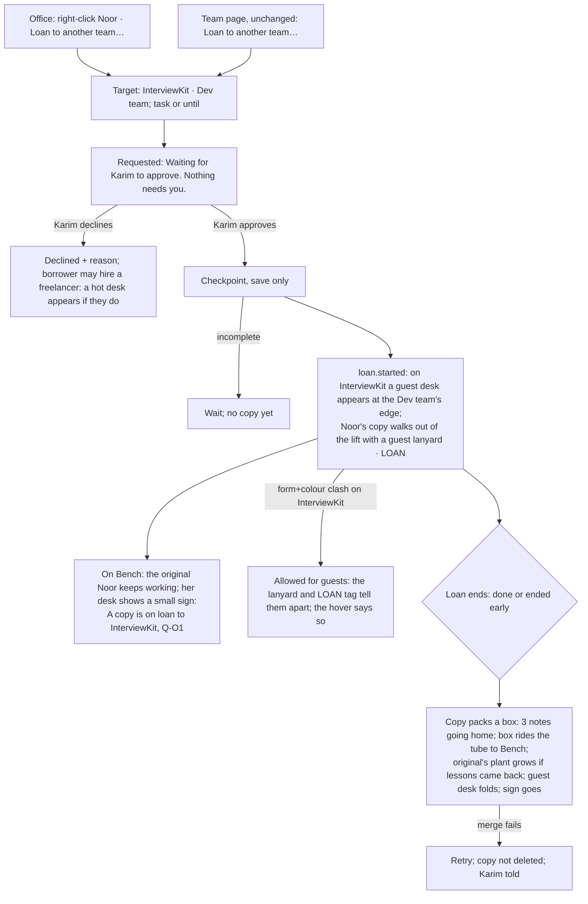
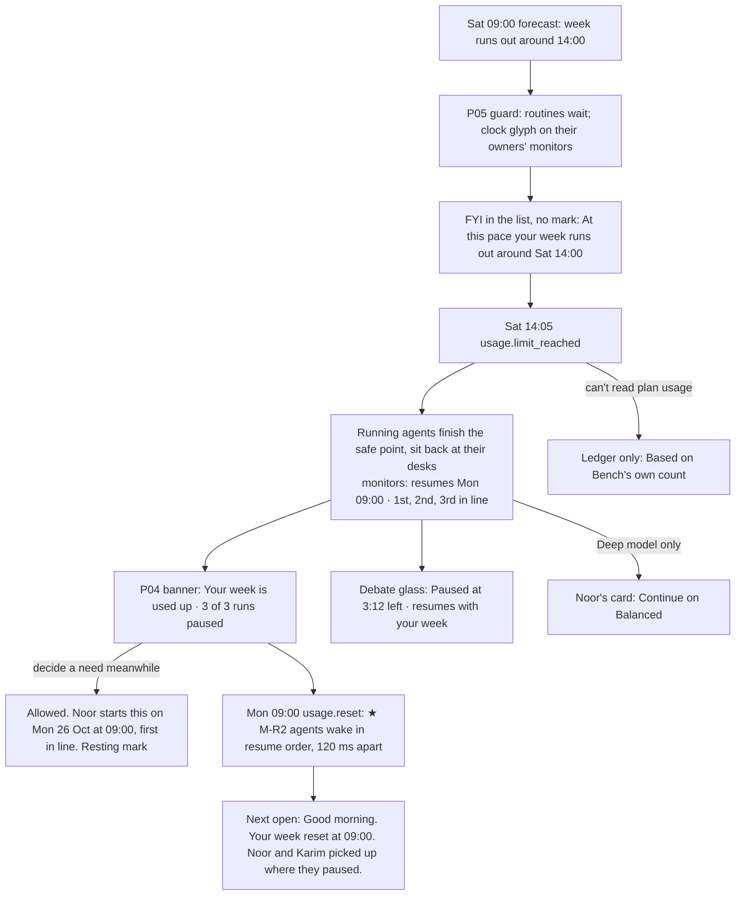

# Office flows: end to end

Part of the [office UX](README.md). Ten core flows. Each has a diagram with its empty, loading, error and denied branches, then the steps: what you do, what the office shows, the exact copy, and the **evidence** (what just happened · can you take it back · what next). Pinned emotional moments are marked **★** with their storyboard. Unchanged screens (agent page, sessions, inbox, New agent dialog, project pages) are referenced, not redrawn. Example data as in [office-states.md](office-states.md).

| # | Flow | Use cases |
|---|---|---|
| F-O1 | First run: empty office → Atlas greets → first agents get desks | UC-06, UC-08, BR-04, BR-54, CR-001 |
| F-O2 | Morning open | UC-25, UC-29, BR-36 |
| F-O3 | A needs-you decision from the office | UC-23, UC-22, BR-15, BR-57, BR-58 |
| F-O4 | Opening an agent's chat from its desk (and Look inside) | UC-09, UC-27, UC-28 |
| F-O5 | Watching a debate in a meeting room | UC-11, UC-24, BR-59, BR-60 |
| F-O6 | Hiring a new agent and watching its desk appear | UC-02, UC-04, CR-001 |
| F-O7 | Switching floors | UC-26, UC-43 |
| F-O8 | A handoff across floors | UC-13 |
| F-O9 | An agent loan | UC-47, UC-01 A7 |
| F-O10 | A usage-limit pause seen in the office | UC-40, UC-41, UC-42 |

---

## F-O1 · First run: empty office → Atlas greets → first agents get desks

| # | You | Office shows | Copy | Evidence |
|---|---|---|---|---|
| 1 | Launch | First-run steps over a blurred still of an empty lobby | Unchanged (state-matrix 3.13) | Each check says what it found |
| 2 | Name your main agent | A large preview of Atlas's suggested creature (a lavender star with a spiral topper) under the name field | **Name your main agent** · "Atlas suggests this look. You can change it now or later in Atlas › Settings › Profile." · *Change look* | Live preview; nothing created yet |
| 3 | Choose **Product + Dev** | The preview lists 7 roles and the floor | **Creates a floor for Bench with 7 desks.** "Each agent gets a look Atlas picks; change any of them later." | Finish enabled; "Nothing is created until you press Finish" |
| 4 | Finish | The scene comes into focus: the Bench floor is **built**: rugs unroll per area, desks appear in order (lead first), 110 ms apart | **Creating Atlas and 6 agents…** `3 of 7` | A count, then the floor |
| 5 | Watch (≤ 4 s) | **★ M-O1 Move-in:** agents walk out of the lift one by one and sit at their desks; each blinks once as it sits; when the last sits, all 7 glance at you together | Live region: "Your Bench floor is ready: 7 desks." | Any key or click skips to the end state |
| 6 | — | Atlas comes out of the lift (Atlas lives in the Lobby; it came up to meet you), stops at the entrance, waves | Greeting line: **Good evening.** "Your team is ready. Tell Atlas what you're working on." · chips | Atlas walks back to the lift after 2 s |
| 7 | Send a chip | Atlas's page slides in as a panel; the composer moves into it | Atlas: *"hi. i'm Atlas. i'll run your team and bring you only what needs you. what are you working on?"* then the reply with `09:41 · 1.2k tokens · 0.04 % of your week · Look inside` | ★ M-F2 (unchanged); Back returns to the full office |

**Goal and targets:** Atlas's first reply < 3 min; the first useful finished task < 5 min (R10). The move-in never blocks input.

---

## F-O2 · Morning open

| # | You | Office shows | Copy | Evidence |
|---|---|---|---|---|
| 1 | Open | The still of Bench (last viewed floor) with live chrome; you can already open the count | Count **Needs you 7** (0 tokens, BR-36) | Instant |
| 2 | — | **★ M-O2 Walk in:** the scene fades in; free agents glance up and wave (staggered 60 ms), working agents glance and go back to work (≤ 600 ms), Atlas steps out of the lift and greets you if idle (first open today) | Greeting line: `Thursday, 22 October` · **Good morning.** "Seven things need you. Start with QA-3: Jade is blocked." · "Your team learned 7 things this week · See what" | The office is the status: who works, who debates, who has a mark |
| 3 | — | Jade's bubble opens by itself (current floor) | Bubble: **QA-3 is blocked: E2E failed twice** … **Use nightly E2E** | One blue on screen |
| 4 | Decide → F-O3 | | | |
| 5 | Leave | Nothing to save; the floor you're on is remembered | — | — |

**Goal:** relief in 3 seconds. **Hierarchy:** bubble title → its blue → greeting line.

---

## F-O3 · A needs-you decision from the office

| # | You | Office shows | Copy | Evidence |
|---|---|---|---|---|
| 1 | — | Noor stands up at her desk; amber **"!"** mark appears with a small hop; she glances at you | Live region: "Noor needs you: asks to run pnpm test." · Toast: **Noor needs you** · `Open` | Count **Needs you 7 → 8**, switcher **Bench 6** |
| 2 | Hover Noor | Hover card | **Noor** · Developer · Dev team / **Needs you** · asks to run `pnpm test` in bench · 2 min ago | — |
| 3 | Click | If off-screen, the camera pans first; the bubble grows from the mark | **Noor asks to run `pnpm test`** · Work request · `in repo bench` · "The full suite, 214 tests in about 3 minutes, before Noor opens the pull request for S1-4. It stays inside bench/. ≈ 0.08 % of your week." · **Allow once** · *Always allow `pnpm test` in bench* · *Deny* | Consequence before the click |
| 4 | Allow once | **★ M-H2 office:** "Allowing…" → check → the bubble folds into the mark → the mark pops → Noor nods, sits, types (Working, terminal on her monitor) | Toast: **Allowed once. Noor is running `pnpm test` in bench.** "(can't be undone once it's running)" | Counts tick (top bar, switcher, sidebar, area card); the next bubble opens |
| 4b | Deny | The mark folds (no pop), Noor sits, carries on; her line shows on hover for 6 s | *"ok. no full suite. i'll open the pr with the chat tests only and say so in the description."* · Toast **Denied.** `Undo` | Undo 10 s; never asked again in this task |
| 4c | Later | Mark shrinks to a resting mark | Hover: "Needs you · later (you snoozed it at 09:20)" | Stays in the list |
| 5 | (last one) | **★ M-O3 All caught up:** the floor gives one shared nod | Greeting: **You're all caught up.** "The team is working on 7 things." | Count reads **All caught up** |

---

## F-O4 · Opening an agent's chat from its desk (and Look inside)

| # | You | Office shows | Copy | Evidence |
|---|---|---|---|---|
| 1 | Hover Karim | Hover card | **Karim** · Tech lead · Dev team · LEAD / **Working** · reviewing PR #41 · since 09:02 / `This run 14.2k tokens · 0.47 % of your week` | — |
| 2 | Click his monitor | **Look inside peek** grows out of the screen | Live line: "reviewing `run.ts` · 3 of 7 files" · *Open Karim* · *Take over* | Read-only; Esc shrinks it back into the monitor |
| 3 | Open Karim | The peek becomes the panel (shared element: the screen becomes the workspace pane); the strip on the left shows Karim at his desk | Panel header: **Bench › Karim** (crumb) · Back on the left · Stop in the header (unchanged) | You can still see the floor working |
| 4 | Type a message, Send | In the strip, Karim glances at his screen (your message arrived) | Receipt under your bubble; Karim: *"got it. i'll keep the date library in run.ts."* | — |
| 5 | Back | Panel slides out right; the full office returns at the same camera position | — | Spatial continuity |

---

## F-O5 · Watching a debate in a meeting room

| # | You | Office shows | Copy | Evidence |
|---|---|---|---|---|
| 1 | — | Maya, Sam and Noor stand, walk to Meeting room A, sit (decider at the head); the glass lights with the topic | Glass label: **Debate: where does Stop live?** · "Maya decides · 5:00" | Real `session.started`; hover names the participants |
| 2 | Watch from the floor | Each message: the speaker gestures, a "!?" bubble over them; listeners turn | Hover the room: "4:12 left · 3.2k tokens so far · the chat is archived when it closes; the memo stays" | Timer on the glass, tabular |
| 3 | Click the room | Debate panel (state-matrix 3.3) | **Join and decide** · *Watch* | One blue |
| 4 | Let time run out | **★ M-T2 office:** the timer finishes, Maya stands and pins a memo card to the glass, everyone walks back to desks (the word changes first, H3) | Memo: **Decided: Stop lives in the composer and replaces Send while an agent runs.** "Maya decided at 09:16 · Sam and Noor agreed · 6.1k tokens (0.2 % of your week). Saved to Bench memory. The debate chat is archived in the trace." | The memo stays on the glass (prop); click opens it in Memory |

---

## F-O6 · Hiring a new agent and watching its desk appear

| # | You | Office shows | Copy | Evidence |
|---|---|---|---|---|
| 1 | Click the **Open desk** in Dev team | New agent dialog rises (team = Dev team) | Draft agent: *"good to meet you. what do you want me around for?"* · "Draft by Atlas · nothing is created until you press Create" | — |
| 2 | Describe ("release notes every Friday") | Atlas drafts; the draft card shows name, team, model, routine, cost | **Lumen** · Release notes · Dev team · Balanced · "≈ 0.12 % of your week each Friday" · **Lumen starts knowing 18 things about how you work** | Consequence before Create |
| 3 | Look at the **Look** row | Preview of Atlas's suggestion at hero size and at office size at a desk | **Look:** "a honey cloud with a propeller and dot eyes" · "Atlas suggests this one: nobody on Bench has a honey cloud." · *Change look* · *Shuffle* | creature-picker.md |
| 4 | Change look → pick a mug | **Coral** is disabled for Mug with Noor's mini creature beside it | "Noor is a coral mug on Bench. Pick another colour, or another form." | The rule is visible where it applies |
| 5 | Create Lumen | Dialog falls away; **★ M-O4 New desk:** the camera (if Dev team is on screen) sees the area widen by one desk, the desk slides in, lamp on, Lumen walks from the lift, sits, blinks once, glances at you | Toast: **Lumen joined Bench › Dev team.** `Open Lumen` · `Undo` | Undo removes Lumen (nothing has run) |
| 6 | Open Lumen | Agent page panel; first-use state | Lumen: *"lumen here. i'm new, but i already know 18 things about how you work from your team's memory. what's first?"* | — |

---

## F-O7 · Switching floors

| # | You | Office shows | Copy | Evidence |
|---|---|---|---|---|
| 1 | Open the switcher | The building directory menu, top floor first | Rows: **InterviewKit** "2 need you · 3 working · Sprint 1 · day 2 of 3" · **Bench** ● "5 need you · 4 working · debate" · **Lobby** "Atlas · Iris" | Counts per floor |
| 2 | Pick InterviewKit | Lift transition; fit floor | Live region: "InterviewKit floor. 2 need you, 3 working." | Switcher label **InterviewKit ▾ 2**, plus "Bench 5" beside it (marks elsewhere) |
| 3 | `[` | Back to Bench at the camera position you left it in | — | Each floor remembers its own camera |

---

## F-O8 · A handoff across floors

| # | You | Office shows | Copy | Evidence |
|---|---|---|---|---|
| 1 | Watching Bench | **★ M-O5:** Maya picks up a small glowing card from her desk, walks to the lift tube, drops it in | Hover the card in transit: "Maya → Rana · brief: shared login screen · acceptance: 3 criteria" | Real `handoff.sent` |
| 2 | — | The InterviewKit row in the switcher pulses once | Toast: **Maya handed the shared login screen to Rana on InterviewKit.** `Show me` · `Open task` | The receiver never gets Maya's transcript (only the brief): the card says "brief" |
| 3 | Show me | Lift to InterviewKit; the card pops out of the tube and glides to Rana; she catches it (bounce), reads, starts typing | Rana's hover: **Working** · starting "shared login screen" from Maya's brief | Two places, one fact: the task's owner changed on both floors |

---

## F-O9 · An agent loan

| # | You | Office shows | Copy | Evidence |
|---|---|---|---|---|
| 1 | Right-click Noor → Loan to another team… | The Team page's loan step opens as a panel (unchanged) | Target **InterviewKit · Dev team** · "Until S2-3 is done" | — |
| 2 | Request | Nothing in the scene yet (a request isn't a loan) | **Requested.** "Waiting for Karim to approve. Nothing needs you." | Honest: no guest desk until it's real |
| 3 | (Karim approves) | On InterviewKit: a guest desk appears at the edge of Dev team; **Noor's copy** walks out of the lift wearing a guest lanyard. On Bench: Noor keeps working; a small sign appears on her desk | Copy's label: **Noor** · LOAN · "On loan from Bench · Dev team" · Sign: "A copy of Noor is on loan to InterviewKit · Dev team until S2-3 is done" | Toast: **Noor's copy started on InterviewKit.** `Show me` |
| 4 | (Loan ends) | The copy packs a box, rides the tube home; the box lands on Noor's desk and opens; her plant grows a leaf if lessons came back | Toast: **Noor's loan to InterviewKit ended. 3 notes and 1 lesson came home to Noor.** `See what` | Merge-back visible (BR-75) |

---

## F-O10 · A usage-limit pause seen in the office

| # | You | Office shows | Copy | Evidence |
|---|---|---|---|---|
| 1 | (Sat morning) | Guard on: nothing changes in the scene except clocks on two monitors | **Keeping 30 % of your week free.** "At this pace you'd have 24 % left by Monday, so 2 routines wait…" | The ring tooltip: **41 % of your week · guard on** |
| 2 | (14:05) | Noor, Karim and Maya's routine reach a safe point; they sit back, eyes half-closed and calm; monitors show their place in line | Banner **Your week is used up.** "3 runs paused at a safe point and resume **Mon 26 Oct at 09:00**, in the order they paused." `3 of 3 runs paused` · *See paused work* · Noor's monitor: "resumes Mon 09:00 · 1st in line" | You can see the order without opening anything |
| 3 | Hover Noor | Hover card | **Paused · week used up** · "Kept: her session, the diff and your pending approval. Resumes S1-4 Mon 26 Oct at 09:00, first in line." | What's safe, said |
| 4 | (Mon 09:00) | **★ M-R2:** they wake in resume order, 120 ms apart, and start typing | Next open, greeting line: **Good morning. Your week reset at 09:00.** "Noor and Karim picked up where they paused; the standup digest ran at 09:02. Nothing was lost." | No dead end, no API-key nudge (D5) |
