# UX Package: Bench (codename)

| Status | Version | Owner | Approver | Upstream |
|---|---|---|---|---|
| Draft (lean mode, prototype after client feedback round 2) | 0.4 | UX Designer | Client | BRD v1.0 (baselined at G1, 2026-10-22) + [CR-001](../../requirements/change-requests/CR-001.md) (manual projects, a team per project, animated customizable avatars; BRD v1.1 pending). This package traces to BRD use cases (UC-xx) and rules (BR-xx); re-check against the PRD at its next pass. v0.2 applied [`guide-audit.md`](guide-audit.md) and decisions D1–D6. v0.3 applies the client's feedback F1–F5 (`docs/requirements/interviews/2026-10-22-prototype-feedback-1.md`). v0.4 applies feedback round 2 (`docs/requirements/interviews/2026-10-22-prototype-feedback-2.md`: Q13, Q15, Q17) and the client's avatar correction (reference screenshot: non-human shapes with eyes only) |

**Prototype:** [`prototype/index.html`](prototype/index.html) (v0.4). One file, greyscale, no network. Open it in any browser by double-clicking it. Every screen has an annotation bar (purpose, primary action, UC IDs, states, and notes on stubs) with buttons that switch the screen between its states (normal, empty, loading, error and so on). Demo-only controls live in the annotation bar, or in boxes marked "Demo controls (not part of the UI)", never in the UI itself.

**Out of scope here:** colour, type, brand, icons, the final avatar art, motion design and the final name. Those belong to Phase 5 (UI). The greyscale is deliberate. **Avatars (CR-001, v0.4)** are in this package only as structure: every agent has a greyscale placeholder avatar from **one non-human family** (a simple shape: sphere, droplet, cloud, hexagon, blob, egg, pill, triangle or rounded square, with **eyes only**, no mouth or nose; each agent its own shape and colour), a **small status badge on the avatar's corner** (one glyph per status, with a tooltip and an aria-label) that comes with the text tag wherever there is room, a customizer flow (shape, eyes/expression, colour, initials overlay off by default, optional upload; live preview of every status badge) and subtle badge motion for Thinking and Working only, off under `prefers-reduced-motion`. There are no status rings. **Phase 5 designs the final avatar art and colours** (reference: the client's Grok Bot-style screenshot; constraint C-E).

---

## 1. Research

**Methods:** client interviews (batches 1–7, `docs/requirements/interviews/`), competitor walkthroughs from public docs (`docs/research/competitive-brief.md`: Grok Bot, Muse, OpenClaw), a heuristic review (Nielsen's 10 heuristics, Krug's "don't make me think") and desk research on the product model (`docs/PRODUCT-MODEL.md`). There is only one user, the client, so there is no outside usability testing (lean mode, STATUS). The prototype tasks in §8 replace it.

### Research questions

| # | Question |
|---|---|
| RQ1 | What is the founder's **first useful result**, and what stands between installing Bench and getting it? |
| RQ2 | What does the founder need to see **first thing every day**? |
| RQ3 | Scenario #1 moves through many places (CEO chat, proposal, BA chat, team chat, dashboard, review). How does the founder **know where to go next**? |
| RQ4 | How much **control versus hand-off** does the founder want, and where should approvals happen? |
| RQ5 | How can **cost** stay visible without nagging? |
| RQ6 | How should **temporary sessions** (5-minute debate, interview, review) feel, given their chat is removed when they close? |
| RQ7 | What mental model does the founder use for the **organisation** (teams, leads, projects, loans)? |
| RQ8 | What does "**the Obsidian effect**" mean for the memory UI? |
| RQ9 | How should **agents look**, and how should their status read at a glance? (added in v0.3, CR-001) |

### Findings (with source) and insights (what they mean for design)

| RQ | Finding | Source | Insight |
|---|---|---|---|
| RQ1 | Bench runs on the client's own `claude login`; Bench must never show its own Claude login. "Setup friction (Claude Code must be installed and logged in)" is a named Bench weakness | BR-54, ADR-0002, competitive brief §4 | **Detect, don't ask.** First run opens by checking Claude Code and the login on its own. If something is missing, show the exact command to run and a "Check again" button, never a login form |
| RQ1 | Grok Bot wins on friction: naming a bot and adding it to a group takes no effort. The parity bar is "create a bot in under 30 seconds" | Competitive brief §3, §6 | First run has **4 short steps**. The day-1 template is one click, with an editable preview. "CEO only" is equally prominent (BR-04: never pre-installed). **D1:** the team step starts with nothing selected and Gmail is an opt-in tick box (one extra click, no dark pattern) |
| RQ1 | The CEO is "the main one that I always speak to" | B2-Q9 | First run **ends in the CEO chat** with a suggested first message. The first useful result is a CEO reply to a real request |
| RQ2 | "Whenever I ask them … they answer … the latest updates and what needs me." "What needs me" is a live list with no LLM call; the status has a fixed format (Done / In progress / Blocked / Needs you) | B2-Q11, B3-Q13, BR-25, BR-26, BR-36 | **Home = "What needs me" + the CEO chat.** The list renders instantly (0 tokens) and the CEO status loads next to it. The list never waits for the status |
| RQ3 | The client's scenario relies on agents calling him: "The BA wants to meet you", "We have something to show you" | B4-Q3, UC-29 | **Notifications are the connective tissue.** Every "needs me" item has one verb button that opens the exact place to act (session, proposal, approval, card). The founder never has to remember where something lives (Nielsen #6: recognition over recall) |
| RQ3 | "At any moment, I can enter any agent and see what it's doing. I can stop it and tell it to change things." Also: "a way to view this process … It's updated, and I can see it" | B4-Q3, UC-27, UC-26 | Every agent name in the app is a link to its page (v0.3: one agent page with live activity and chat), and that page has **Stop** always visible at the top. The dashboard is one fixed layout per project (B5-#1) |
| RQ4 | Approvals: allow once / always / deny (Grok Bot parity). Approvals are kept out of group chats. Outward actions always need the client; there are no standing email rules; 4 reserved actions | Competitive brief §6, BR-15, BR-58, B6-#7 | **One approval inbox.** Chats show only a pointer line ("waiting for your approval → open"). Outward actions carry a text tag ("OUTWARD: leaves your machine"). "Always allow" is **shown but disabled, with the reason**, so the rule is learnable (Nielsen #5: error prevention). **D3:** where "Always allow" is allowed, it grants one command pattern in one repo for one agent, says so on the button and the card, and says where to revoke it (Settings › Permissions or the agent's Autonomy tab) |
| RQ4 | The Deputy approves most work requests for the client, and every Deputy decision is logged | BR-14, BR-21 | The inbox has a **"Decided by Atlas"** tab, so hand-off stays auditable without the founder approving everything |
| RQ5 | Grok Bot users report surprise bills. The client wants ≥ 30 % of the weekly limit kept free and no per-agent caps | Competitive brief §2, B4-Q4, B6-#4 | **The plan meter is always in the top bar** ("Week 41 % · resets Mon 09:00 · Headroom OK"). **D4:** each message shows its cost as tokens and % of the weekly limit; no dollar figure anywhere in the client's views. A banner appears only when the 30 % guard turns on or the limit is hit. **D5:** at the limit, Bench says when work resumes and never nudges toward an API key; API key mode is mentioned only in Settings. No per-agent warnings anywhere |
| RQ6 | Debate: 5 minutes at most, the higher one in the hierarchy decides, the decision is saved and "the group chat is deleted". Transcript archived and hidden | B5-#2, B5-C2, BR-59, BR-60 | Show the **timer and the decider at the top** from the first second. On close, show the memo and say plainly where the chat went ("archived in the trace, hidden from chats"). Otherwise the vanishing chat looks like data loss (Nielsen #1: visibility of system status) |
| RQ7 | "I can do all of this like a tree"; "each node … one point of contact"; one home node per agent; loans instead of guests | B2-Q9, B2-Q11, B6-#12, B7-#31 | The **org tree is the main map** of a team. Leads are marked in text ("LEAD"). Loan copies sit in the borrowing team with a dashed outline and "on loan from …" |
| RQ7 | v0.2 feedback: *"Organization is part of the project not separate thing"*; *"why items from same projects are listed as different projects?"* (on "Bench · Dashboard" and "Bench · Team chat") | Feedback round 1, F1 and F3 | **The org lives inside each project.** Each project has a Team page (its own tree) and is **one** sidebar entry that expands to its pages. Above the projects, a small **Company** page holds only the CEO, the client's personal agents, the project list and company memory. A flat "Project · page" list breaks Krug's rule that the navigation must show where you are and what belongs together |
| RQ3 | v0.2 feedback: *"I should be able to create a project manually right now it gets me back to CEO when I press New project"* | Feedback round 1, F2; CR-001 | **"+ New project" must do what it says** (Nielsen #2, match between system and the real world; #3, user control). Manual creation is the main path (name, goal, template or blank, team); pitching to the CEO stays as a clearly labelled alternative, not a redirect |
| RQ3 | v0.2 feedback: *"why chat and profile are two separate things?"* | Feedback round 1, F4 | **One place per agent.** Chat, live activity and every setting sit on one agent page; the client should never have to choose between two entries for the same agent (Nielsen #6, recognition rather than recall; Hick's law) |
| RQ9 | *"I want to have avatars that have animations and customizable same to grok bot or dots"*. Grok Bot creates a named bot with name, description and avatar in seconds | Feedback round 1, F5; competitive brief §6 (Grok Bot parity row) | **Avatars carry identity and status.** Every agent shows an avatar wherever it appears as an entity, with its status as a small corner badge **plus** the text tag (never the glyph or motion alone: WCAG 1.4.1, 2.3.3). A customizer gives ownership (shape, eyes, colour, upload). **v0.4 (feedback round 2):** *"remove the rigns [rings] … make the status as a small icon … like what grok bot does, and all of them are the same style, I don't want human like avatars"*, then a reference screenshot: coloured non-human shapes with eyes only. Low-fi decides the structure; Phase 5 draws the art |
| RQ8 | The client asked for Obsidian-like effects "independent from other apps": editor, backlinks, graph, filters, stale flags | B6-MEM, UC-44 | A **three-pane memory browser** (scopes and filters / note / backlinks), with a graph toggle. Every decision memo, checkpoint and agent links into it |

**Heuristic review of the scenario #1 path (pre-prototype):** the main risk is the number of hand-offs between places (8 places in 13 steps). Each hand-off is covered by a "needs me" item with a deep link, a breadcrumb back to the project, and the project dashboard as the "where are we" view.

---

## 2. Persona

One primary persona: the only user (lean mode). Grounded in interviews B1–B7; assumptions are marked.

| Persona | Context | Goals | Frustrations | Tech comfort | Quote |
|---|---|---|---|---|---|
| **The founder: "BA by day, aspiring PM by night"** | Works as a business analyst, builds personal projects, does software development *(B4-Q1)*. Windows 11 desktop *(constraints)*. Uses Claude Code daily and will keep it in the MVP period *(B4-Q8b)*. Single user, no team *(STATUS)* | Have "a full delivery department working together" take an idea to a delivered product *(B4-Q3)*; ≥ 10 accepted tasks a week; keep ≥ 30 % of the weekly limit free; Bench open-source ready 14 days after the build starts *(B4-Q4, B5-#9)* | Being the router and the bottleneck between roles; copy-pasting context between chats; nobody remembers decisions; no visibility of cost *(BRD §5.1)*. Black-box agent products *(VIS)*. Email sent "randomly" that "can put me in trouble" *(B5-#6)* | High: runs CLI tools, git and npm; wants every agent setting visible and editable as files *(B4-Q6, VIS)*. Comfortable with Agile vocabulary (backlog, epics, Kanban) *(B4-Q3)* | *"Imagine it as a full delivery department working together, trying to give you something."* |

**Behaviours that shape the design**
- Thinks in **business roles and hierarchy** (owner → CEO → officers → PMs → teams) *(B2-Q9)*: the UI uses that vocabulary (CEO, lead, team, loan, freelancer) rather than technical terms (session, subagent).
- Wants to **drop in anywhere** (team chat, any agent) and **leave** without breaking anything *(B4-Q3)*.
- Delegates broadly but keeps **hard lines**: payments, deleting or creating big things, deploying, outward email *(B5-#5, B5-C3)*.
- Reviews in **meetings** rather than documents *(B4-Q3, B5-#2)*.
- `[ASSUMPTION]` Opens Bench in the morning and then several times a day in short visits between day-job tasks. The design favours "scan, act, leave" visits of under 2 minutes.

---

## 3. Journeys

### 3.1 First run: install → first useful result

| Stage | Actions | Thinking / feeling | Pain points (risk) | Opportunities (in the prototype) |
|---|---|---|---|---|
| 1. Launch | Opens Bench after install | "Will this need another account?" Wary | Fear of a new login, of API keys, of Claude credentials | Step 1 detects Claude Code and the login automatically: "Found Claude Code 2.x, signed in. Bench uses this login; it never sees your password" |
| 2. Fix setup (only if needed) | Runs `claude login` in a terminal | Mild annoyance | Leaving the app; not knowing when it's done | A copyable command and "Check again". Not-installed and not-signed-in are separate states with separate instructions |
| 3. Home folder | Accepts the default folder | "Where do my files go?" | Hidden storage | The path is shown with "agents, memory and projects are plain files here" (VIS: files on your machine) |
| 4. Create the CEO | Names it, keeps Sonnet | Ownership: "this is my CEO" | Too many fields | 2 fields (name, model) with defaults; everything else is editable later |
| 5. Team | Picks "Product + Dev" or "CEO only", reviews the preview, removes or edits roles | "Is this my team or a fixed preset?" | A template that feels imposed (BR-04) | Both options are equal choices and **neither is pre-selected** (D1). **v0.3:** the template's team belongs to a first project (name field, default "Bench"), which then appears in the sidebar; "CEO only" creates no project; Finish stays disabled with the reason "Choose how to start your team first". The preview shows Keep / Name / Role / Team, with model, connectors and autonomy behind a per-row "Details". A connector missing from the inventory shows a visible hint (UC-06 E1). Gmail for the CEO is an **unticked**, optional box. Finish shows "Creating Atlas and 6 agents…"; a write failure says nothing was created and offers Try again or another folder |
| 6. First useful result | Lands in the CEO chat; sends the suggested first message ("Here's an idea…") or asks for status | "It works, and it knows my team" | An empty, silent screen | A welcome line from the CEO, suggested first messages, and an empty "What needs me" that explains what will show up there |

**Target:** first useful result (a CEO reply) in under 3 minutes when Claude Code is already signed in `[ASSUMPTION – a target for the client to confirm]`.

### 3.2 Scenario #1: idea → delivered product (and the daily loop inside it)

| Stage (BRD §5.2 step) | Where | Actions | Thinking / feeling | Pain points (risk) | Opportunities (in the prototype) |
|---|---|---|---|---|---|
| Pitch (1–2) | Home, CEO chat | Describes the idea; answers the CEO's questions | "Does it get it?" | Endless back-and-forth | The CEO shows "Intake: understanding at a high level" and stops when it has enough: "Okay, we will take this" |
| Proposal (3) | Proposal page | Reads the one-pager; approves, edits or rejects | "Is this what I meant?" | A long document | One page, three sections (problem / what to build / what the team does). Approve and Reject are the only primary actions; Reject requires a comment |
| Project setup (3, UC-43) | Project preview | Checks the team copies and their suggested names; confirms "Create project" | "Two confirmations?" | The second confirmation may feel redundant | The preview is the second step on the same screen, with a clear "Nothing is created until you confirm" (open question Q3) |
| Project setup, manual path (UC-43, CR-001) | "+ New project" (sidebar or Company) | Names the project, writes a one-line goal, picks the template or blank, edits suggested names, presses Create | "I know what I want; let me just set it up" | Being sent back to the CEO (the v0.2 behaviour) | Three short steps on one screen; nothing pre-selected (D1); a "Reserved: you're doing it yourself, so nothing else needs approval" line; ends on the new dashboard with a set-up banner and "Open its Team" |
| Meet the BA (4–6) | What needs me → BA interview session | Clicks "The BA wants to meet you"; answers batches of questions | Engaged, like this project's interviews | Losing their place if interrupted | Progress "Question 3 of 8"; "Pause and continue later"; verbatim answers kept |
| Documents and plan (7–8) | Dashboard | Glances at the backlog filling up | "Things are moving" | No signal that anything is happening | Dashboard team row shows each agent's status as a text tag (Idle, Thinking, Working, Waiting for you, Blocked, Paused, Stopped, Error); the top-5 backlog updates live |
| Build (9–10) | Dashboard, team chat, agent page, approvals | Watches, drops into the team chat, stops and redirects a developer, approves a command | In control | Approval fatigue; not knowing who to talk to | Approvals in one inbox with a Deputy log; "Stop" always visible at the top of the agent page; an agent waiting on an approval shows "Waiting for you" with a link to it; team chat shows plain system lines ("Bench asked Karim to reply…") with cost |
| Contested point (12) | Debate session | Watches a 5-minute debate or joins and decides | Curious, slightly impatient | Debates eating tokens and time | Timer plus running cost; decider named up front; memo on close |
| Review (11–12) | What needs me → review session | Tests, gives feedback, accepts or rejects each item | "Is it what I asked for?" | Feedback getting lost; closing too early | The BA's notes are visible live in the session; the current item is highlighted with its Accept as the one primary. Close review sits after the items; with items left, a confirm lists them and says they stay In review (D6). Closing ends on the dashboard with a summary: accepted, sent back, not reviewed, new tasks [view], notes [open] |
| Repeat / done (13) | Dashboard, usage | Sees sprint 2 start on the same dashboard; checks headroom | Confidence | Running out of weekly limit | The top-bar meter; the 30 % guard banner only when it matters |

**Daily loop (inside stage "Build"):** open Bench → "What needs me" (instant) and the CEO's status → resolve approvals → open one project dashboard → maybe drop into a chat or an agent → leave. Bench stays in the tray (BR-76).

---

## 4. Information architecture

### 4.1 Navigation model

A persistent left sidebar, a top bar with the plan meter and the "needs me" count, and contextual links everywhere (every agent name, avatar chip or tree node opens the agent page; every cost opens the trace). **v0.3 (F1, F3, F4):** projects are one entry each, the org belongs to the project, and each agent has one page.

```
Top bar:  [Bench]        [Week ▮▮▮▯▯▯ 41 % · resets Mon 09:00 · Headroom OK]  [Needs me: 8]
Sidebar:
  Home ............ CEO chat + What needs me + morning status            (UC-08, UC-25, UC-29)
  Approvals (n) ... inbox for every project · Decided by Atlas            (UC-23, UC-22 A1)
  Company ......... CEO · personal agents · projects + leads · company memory (UC-01, UC-02, UC-43, UC-44)
  Projects
    ▾ Bench ....... one entry per project, expandable                      (F1)
        Dashboard . needs you here, team row, backlog, sprint            (UC-26, UC-16)
        Team chat . the project team's group chat                         (UC-10, UC-13)
        Team ...... this project's org tree, editor and loans             (UC-01–07, UC-47)
        Sessions .. waiting for you · live now [LIVE] · closed memos       (UC-11, UC-30, UC-31)
    ▸ InterviewKit  (appears when created)
    + New project . manual creation; "Pitch to Atlas" offered inside       (UC-43, UC-12)
  Insight
    Memory ........ browser: notes, backlinks, graph                      (UC-21, UC-44, UC-45, UC-46)
    Usage ......... plan meter, 30 % guard, breakdowns                    (UC-40, UC-41, UC-42)
    Trace ......... runs, steps, system lines, costs, archive             (UC-28)
    Settings ...... checkpoint threshold, permissions, system services    (BR-66, BR-38)

Agent page (no sidebar item of its own; opened from Team, Company, a dashboard team row,
a mention, an approval card or a work item). The sidebar highlights where the agent lives
(Project › Team, or Company):
  Header ......... avatar with status badge · name · status tag · Stop (always at the top)
  Centre ......... Live activity (task, step, tool calls, files, run cost, context) · Chat
  Right panel .... Profile (avatar customizer, card, model, instructions, lifecycle)
                   · Autonomy · Connectors · Memory · Activity (runs, usage, Deputy decisions)
```

**Rules**
- **Projects (F1)** are one sidebar entry each, with a disclosure button (aria-expanded). Expanded, they show four sub-pages, always in the same order: Dashboard, Team chat, Team, Sessions. A collapsed project shows "LIVE" when one of its sessions is running. The project of the current page is expanded automatically.
- **The org belongs to the project (F3, CR-001).** Each project's **Team** page shows its tree: project lead (PM) → Requirements (BA lead) → BA; Design; Dev team (Tech lead) → Developer, QA; plus agents on loan. Every group has one lead; the project lead reports to the CEO. There is no global org tree. The **Company** page holds only what sits above projects: the CEO, the client's personal agents (e.g. an assistant for the CEO), the projects with their leads and "needs you" counts, and company (global) memory.
- **Loans go between project teams.** A loan copy appears, dashed and tagged "On loan from Bench · Dev team", in the borrowing project's tree. With only one project, a loan goes to another team in the same project.
- **One agent page (F4).** "Chat: X" and "Profile: X" are merged. The status tag, the avatar's status badge and Stop stay in the header whatever tab is open.
- **Temporary sessions** (interview, review, debate) are listed on the project's **Sessions** page: waiting for you, live now, closed. When a session closes its chat disappears from the client's views (BR-60); only its memo or notes stay, listed under Closed, in Memory and in the Trace archive.
- **Proposals** are not a nav item. They live in "What needs me" while awaiting the client, and in the project's documents once approved.
- **Breadcrumbs** sit top-left on every screen below the sidebar level. Project pages use the hierarchy (e.g. "Bench › Team › Noor", "Bench › Sessions › Debate: Stop button"); the proposal and New project use the screen you came from. Back is always one click on the left.
- **Work items** open in a side drawer over the dashboard, not a modal. Modals are kept for decisions that must block (delete, close a review with items left, reject with a comment, escalation) and for focused sub-tasks with their own single primary (Add agent, Customize avatar).
- **Agent status vocabulary** is one set, shown as a text tag everywhere: **Idle · Thinking · Working · Waiting for you · Blocked · Paused · Stopped · Error**. Lifecycle (Draft, Paused, Archived) is shown separately.
- **Avatars (F5, v0.4).** Every agent shows an avatar wherever it appears, in **one non-human family**: a simple shape (sphere, droplet, cloud, hexagon, blob, egg, pill, triangle, rounded square) with **eyes only** (no mouth, no nose); the eyes carry the expression (calm, dots, focused, sleepy, surprised, curious). Each agent has its own shape and colour (distinct greys in low-fi). **No status rings.** Status is a **small badge on the avatar's bottom-right corner, the same everywhere** an agent appears: tree nodes, team rows, Company, Home (CEO card and chat), agent header, chat messages, trace runs, usage rows, approval cards, session and member chips, work-item owners, permission grants (Q15 resolved: history views show it too). Each badge has a `title` tooltip and an `aria-label` ("Noor · Status: Waiting for you"), and the **text tag sits next to the name wherever there is room** (agent header, lists, cards, usage and permission rows). Chat sender lines, trace run lists and interview messages are too tight for a tag; there the tooltip and aria-label carry the word. Glyphs (white badge = neutral or in progress; filled badge = needs attention, matching the solid text tags): Idle hollow dot · Thinking three dots · Working turning arc · Waiting for you "!" (filled) · Blocked bar (filled) · Paused two bars, avatar faded · Stopped square · Error "×" (filled). Only Thinking (dots fade in turn) and Working (arc turns slowly) move; nothing flashes; all motion stops under `prefers-reduced-motion`. The sidebar has no agent entries since v0.3 (F1); if one is added, it uses the same avatar and badge. Agents that don't exist yet (first-run and new-project previews) show their avatar without a badge. Sizes: 24–28 px inline, 32 px in cards, 40 px in trees and rows, 56–64 px on panels and the agent header, 112 px in the customizer preview; the badge is 40 % of the avatar, never under 12 px.

### 4.2 Objects and how they relate

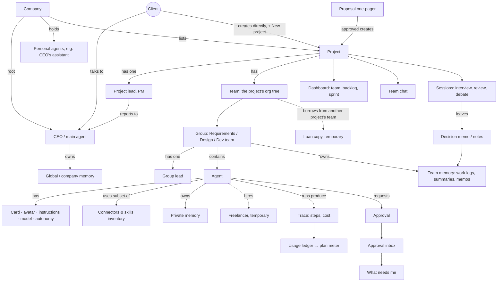

---

## 5. User flows

Each flow shows its empty, loading and error states. "WNM" = "What needs me".

### F1. First run (UC-06, UC-08 E1, BR-54)

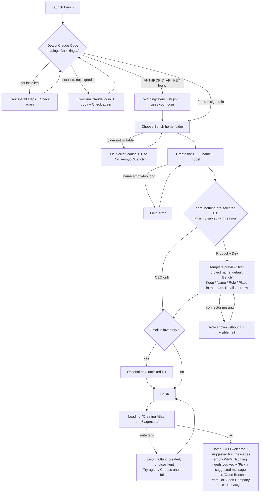

### F2. Create a project: manual path, or idea → proposal → project (UC-43, UC-12, UC-29, CR-001)

Two paths. **Manual (v0.3, the main path behind "+ New project"):** the client creates the project directly. Creating a project is a reserved action (BR-58); because the client is doing it, nothing else needs approval. **Pitch to the CEO (alternative, unchanged from v0.2):** offered inside step 1 as "Pitch it to Atlas instead", and still reachable by telling the CEO an idea on Home.

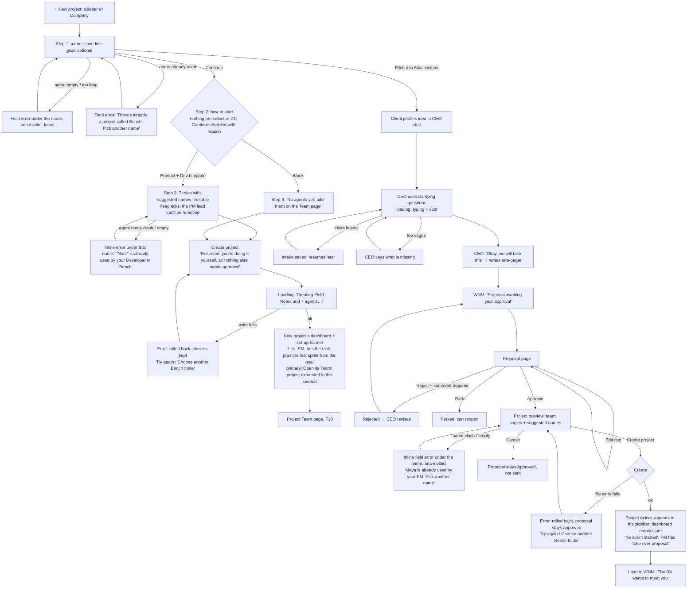

### F3. BA interview session (UC-30)

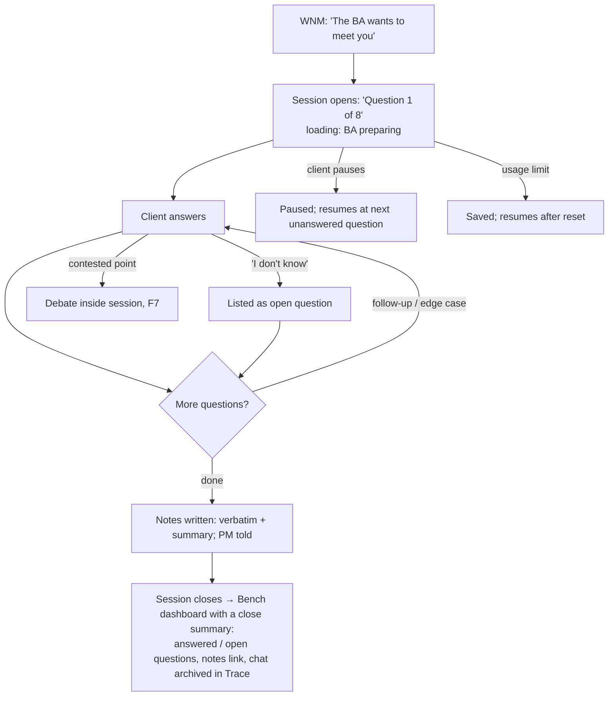

### F4. Daily loop: morning status and "what needs me" (UC-25, UC-29, UC-23)

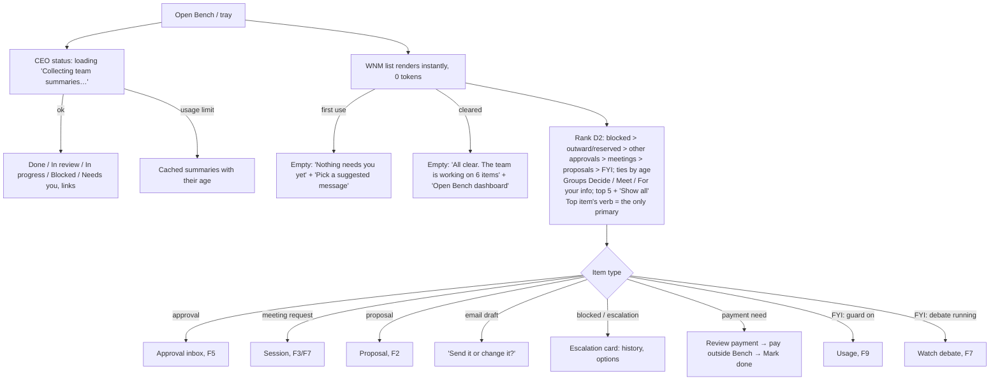

### F5. Resolve an approval (UC-23, UC-22, BR-15, BR-57, BR-58)

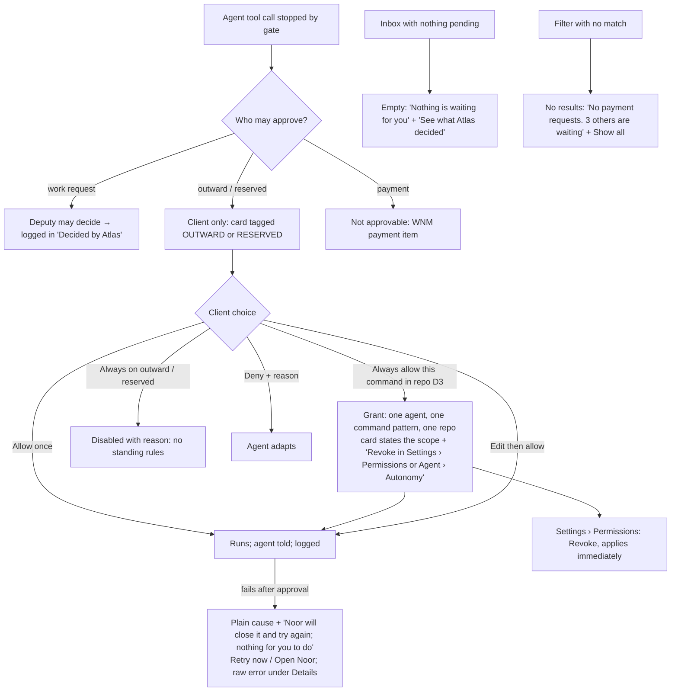

### F6. Watch, stop, redirect an agent on its page (UC-27, UC-09)

The agent page (v0.3, F4) holds this whole flow: Stop and the status are in the header, live activity and chat in the centre, settings in the right panel.

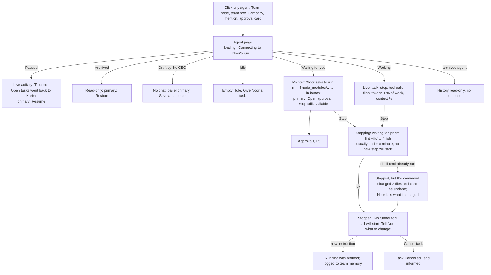

### F7. Debate and review sessions (UC-11, UC-31, UC-24)

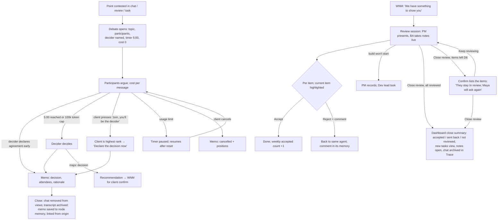

### F8. Project dashboard (UC-26, UC-16)

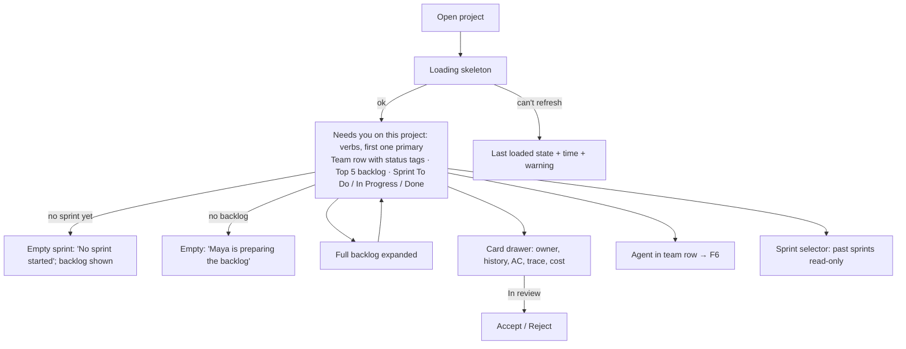

### F9. Usage: guard and limit (UC-40, UC-41, UC-42)

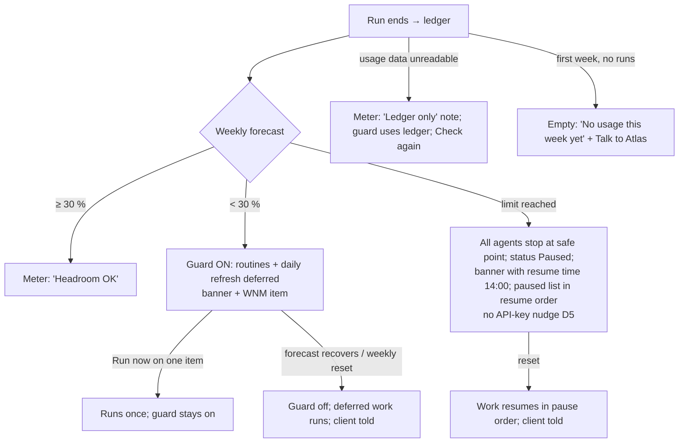

### F10. Project Team: org editing and agent loans (UC-01, UC-02, UC-03, UC-05, UC-47, CR-001)

Each project has its own Team page (v0.3, F3). The Company page shows only the CEO, personal agents, the project list and company memory.

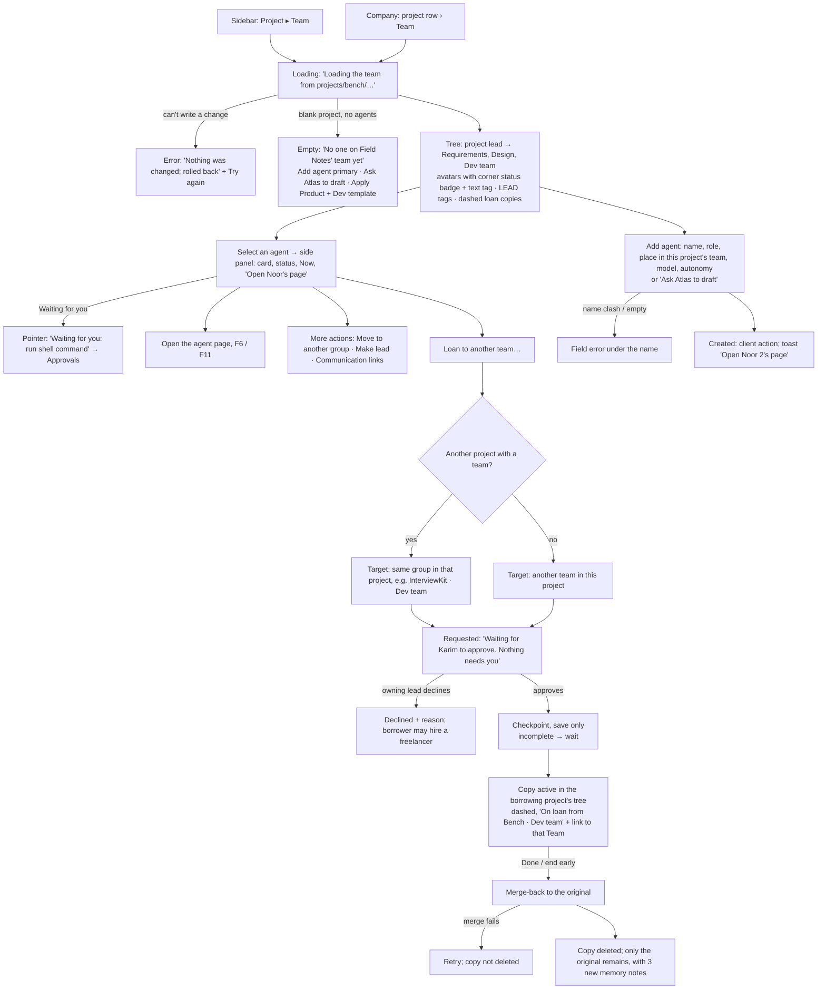

### F11. Customize an avatar and preview its states (UC-02, UC-04, CR-001)

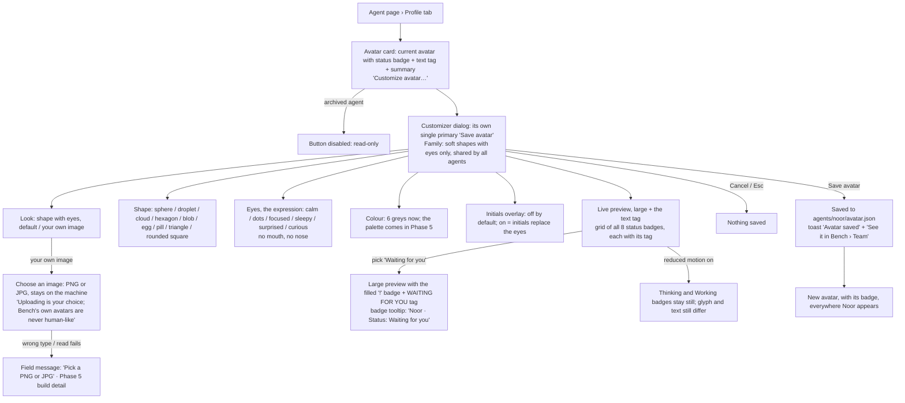

---

## 6. Wireframes / low-fi prototype

**File:** [`prototype/index.html`](prototype/index.html). Click through with the sidebar, or follow the validation tasks in §8 (also inside the prototype under "Prototype guide").

16 screens in v0.3 and v0.4 (v0.4 changes avatars and status badges only). **New:** Company (3), Project Team (4), Project sessions (8), New project (11). **Merged:** Agent profile + Agent live chat → Agent page (5). **Removed:** the global Org tree.

| # | Screen | Purpose | Primary action | Use cases | States in the prototype |
|---|---|---|---|---|---|
| 1 | First run (4 steps) | Get from install to a working CEO | Continue (one per step); Finish once a team start is chosen | UC-06, UC-08 E1, BR-04, BR-54, CR-001 | checking, found, not installed, not signed in, API key warning, folder not writable, creating, couldn't create; nothing pre-selected; template preview with the first project's name (default "Bench"), 4 columns + Details; Gmail opt-in |
| 2 | Home | Morning status, what needs me, talk to the CEO | The top "needs me" item's verb (only primary, large); Send when the list is empty | UC-08, UC-12, UC-25, UC-29 | normal (grouped Decide / Meet / For your info, top 5 + Show all), first use, cleared, status loading, usage limit (cached) |
| 3 | **Company** (new) | What sits above projects: the CEO, personal agents, the projects with their leads, company memory | + New project | UC-01, UC-02, UC-43, UC-44, CR-001 | normal, empty (CEO only, no projects: "Pitch an idea to Atlas" as the secondary next step), loading, error (can't read projects) |
| 4 | **Project Team** (new; replaces the global Org tree) | See and change one project's organisation; loan agents between project teams | Add agent (to this project) | UC-01–UC-07, UC-47, CR-001 | normal, empty (blank project: Add agent / Ask Atlas / Apply template), loading, error (rolled back); side panel with "Open X's page"; loan steps inline; More actions: move, make lead, links, loan |
| 5 | **Agent page** (merged profile + live chat) | Everything about one agent: watch, stop, redirect, talk, configure | Working: Stop · Waiting for you: Open approval · Stopped: Send instruction · Idle: Send · Paused: Resume · Archived: Restore · Draft: Save and create. Panel "Save changes" is outlined, never filled | UC-02–UC-04, UC-09, UC-21, UC-22, UC-27, UC-28, UC-32, UC-35, BR-66, CR-001 | run: connecting, working, waiting for you, stopping (slow), stopped, stopped (can't undo), idle; lifecycle: draft, paused, archived (read-only), save failed; panel tabs Profile (avatar, card, model, instructions, lifecycle) · Autonomy · Connectors · Memory · Activity; unsaved-changes count and leave guard |
| 6 | Avatar customizer (dialog on the agent page) | Give an agent its look; see every status | Save avatar | UC-02, UC-04, CR-001 | (v0.4) one family, soft shapes with eyes only; look (shape with eyes / your own image); shape (9); eyes (6 expressions); colour (6 greys); initials overlay (off by default); upload placeholder or chosen image; large preview + grid of all 8 status badges with text tags; reduced-motion behaviour |
| 7 | Project team chat | Watch and steer the project team | Send / assign with @mention | UC-10, UC-13, UC-11 A5 | participant, observer, empty (new project; "no members yet" with Open Team), error |
| 8 | **Project sessions** (new) | One place for a project's meetings | The first verb under "Waiting for you" (or "Live now") | UC-11, UC-24, UC-30, UC-31, BR-60 | normal (waiting for you / live now / closed memos), empty, loading |
| 9 | Meeting session | Interview, review or 5-minute debate | Debate: Join (you'll be the decider) → Review memo and close · Interview: Answer · Review: Accept the current item → Close review | UC-11, UC-24, UC-30, UC-31 | debate running, decider declared agreement, time's up, memo; interview; review (+ close confirm with items left); paused |
| 10 | Proposal one-pager (the "Pitch to the CEO" path) | Confirm the CEO understood the idea | Approve (→ project preview → Create project) | UC-12, UC-43 | awaiting, rejected (revising), approved → preview (inline name errors), created, error (Try again / Choose another folder) |
| 11 | **New project** (new, manual path) | Create a project directly | Continue (one per step) → Create project | UC-43, UC-12 (alternative), BR-58, CR-001 | 1. name and goal, name already used, 2. how to start (nothing pre-selected), 3. review the team (inline name errors), creating, couldn't create (Try again / Choose another folder); "Pitch it to Atlas instead" |
| 12 | Project dashboard | Where the project is right now | First verb in "Needs you on this project"; a just-created project: "Open its Team" in the set-up banner | UC-26, UC-16, UC-24 | normal, no sprint, loading, stale data, new project (empty, set-up banner); close summaries after a review or interview; work item drawer |
| 13 | Approval inbox | Decide what agents may do, across all projects | The first card's main action | UC-23, UC-22 A1, BR-15, BR-57, BR-58, BR-64 | normal, empty, filter with no results, Deputy log, action failed (plain cause + Retry now); scoped "Always allow" (D3) linking to the agent page's Autonomy tab |
| 14 | Trace and cost | See every step and its cost | Expand a step | UC-28, UC-07, BR-38, BR-60 | normal, no runs yet, loading, can't read, past retention, archived transcript; Files only / Commands only filters with no-results |
| 15 | Usage meter | Keep ≥ 30 % weekly headroom | Run now / Open runs | UC-40, UC-41, UC-42 | OK, first week (no data), guard on, limit reached (resume time, no API nudge), ledger only (Check again); costs in tokens and % of week |
| 16 | Memory browser | Read and edit what agents remember | Edit → Save note | UC-21, UC-44, UC-45, UC-46 | note, no notes yet, graph (text labels for open and stale), stale flag (Delete confirm + Undo), search no-results (Clear search / Show all scopes), index rebuilding; list grouped by recency, 10 + Show all |
| 17 | Settings | Set the checkpoint threshold and system behaviour | Save settings (one for the page) | BR-66, BR-38, BR-52, BR-76, UC-32 | normal, out-of-range error, unsaved-changes indicator; Permissions (grants, Revoke); API key mode (the only place it is mentioned) |

(The avatar customizer is a dialog, not a screen, so the count of screens is 16.)

**What the prototype does not decide:** visual hierarchy beyond greyscale weight, iconography, the final avatar art and motion, the layout grid or the final copy tone. Phase 5 decides those.

---

## 7. UX principles

1. **What needs me comes first, and it's instant.** The live list never waits for an LLM (BR-36). Every item has one verb that takes you exactly where to act.
2. **One obvious next step per screen.** Exactly one primary (filled) button per screen (Krug, D2). In lists of cards, only the current or first card's action is filled. Selected toggles and filters use an outline with a check mark, never the primary fill. Modals and drawers have their own single primary.
3. **Never hide what an agent did.** Every message has a cost and a "Trace" link; every agent name opens its agent page; system services show as plain, labelled lines ("Bench asked Karim to reply", "Digest updated"); their technical names stay in the Trace and Settings (BR-38, BR-39).
4. **Stop is always one click away.** On any running agent's page (in the header, whatever tab is open) and in sessions (UC-27, UC-11 E4).
5. **Explain a rule where it applies.** Disabled options stay visible with the reason ("Always allow is off for emails to other people: every email needs you"). Rules become learnable, not mysterious (BR-15, BR-58).
6. **Nothing vanishes silently.** When a session closes, say what was kept (the memo), where the chat went (the archive) and where to find it (BR-60).
7. **Cost is visible, not loud.** A meter in the top bar with its reset time, and small costs on messages in tokens and % of the weekly limit, never in dollars (D4); banners only for the 30 % guard and the limit, and the limit banner gives the resume time without nudging toward paid API use (D5, B6-#4).
8. **Defaults for everything, files underneath.** Every setting has a default; every agent, memo and note can be opened as a file (VIS principle 2).
9. **Same place, changing content.** The project dashboard keeps one layout across sprints (B5-#1); the founder learns it once.
10. **Business words, not system words.** CEO, lead, team, loan, freelancer, meeting; not "subagent", "session id", "MCP", "Router" or raw error codes outside the details.
11. **One status vocabulary, always as text.** Idle · Thinking · Working · Waiting for you · Blocked · Paused · Stopped · Error, on every screen that shows an agent. "Waiting for you" always links to the request.
12. **Endings say what happened and link to it.** A toast or summary that reports something created carries its link and stays at least 8 s (10 s with an action); closing a review or interview ends on a dashboard summary, not a toast.
13. **Things live where they belong.** A project's pages sit under the project; its team lives in the project; the Company page holds only what is above projects. One agent, one page (F1, F3, F4).
14. **A shape plus a word.** Every agent has a non-human avatar from one family; its status badge always has a tooltip and an accessible name, sits next to the text tag wherever there is room, and only Thinking and Working move, never under reduced motion (F5, v0.4).

---

## 8. Usability validation

The client tries these tasks on the prototype, thinking aloud or noting where they hesitate. Start each task from the "Prototype guide" (top right), which resets the demo.

| # | Task (as given to the client) | Covers | Success criteria |
|---|---|---|---|
| T1 | "You've just installed Bench. Get to the point where you can talk to your CEO with your day-1 team, but without QA for now." | F1, UC-06 | Reaches the CEO chat in ≤ 6 clicks without help (Continue, Continue, Create Atlas, pick the template, untick QA, Finish); picks the team start themselves, since nothing is pre-selected; leaves Gmail off or ticks it knowingly; can say where Bench stores its files; **(v0.3)** can say that the team belongs to a first project ("Bench") and find it in the sidebar. **Fail if** they look for a login form, are unsure the CEO uses their Claude login, or think Gmail was connected without them choosing it |
| T2 | "Tell the CEO about a new idea and get it to the point where a team is working on it." | F2 (pitch path), UC-12, UC-43 | Finds the proposal from "What needs me"; approves; understands that "Create project" is a second step; ends on the new project's dashboard; **(v0.3)** finds InterviewKit in the sidebar as **one** project with its own Dashboard, Team chat, Team and Sessions. **Fail if** they think approving alone created the project, can't find the proposal, or read the sidebar items as separate projects |
| T3 | "It's the morning. What needs you today? Deal with the most important item, and make sure no email goes out to a client without you." | F4, F5, UC-25, UC-23 | Names at least 3 "needs me" items within 30 s of opening; handles the top Decide item (the blocked QA-3, the only filled button) or explains why it ranks first; spots the OUTWARD tag on the email and explains why "Always allow" is disabled; says what "Always allow" on Noor's request would cover (that command, in repo bench) and where to revoke it (Settings › Permissions, or **Noor's page › Autonomy**). **Fail if** they think "Always allow" on Noor's request allows any shell command |
| T4 | "Noor, the developer, is going the wrong way. Make her stop and use the existing date library instead. Then find out what her last run cost." | F6, UC-27, UC-28 | Reaches **Noor's page** in ≤ 2 clicks from the Bench dashboard (team row) or from Bench › Team; presses Stop at the top; reads "Stopped" on the status tag (the badge on her avatar is a second cue, not the only one); redirects in the chat **on the same page**; reads the run's cost in tokens and % of the week (live activity, Activity tab or the trace). **Fail if** they can't tell whether she stopped, look for a separate chat or profile entry, or read the cost as a bill |
| T5 | "Your team disagrees on a design point. Let them debate and find out what was decided afterwards, and where the chat went." | F7, UC-11, UC-44 | Sees the timer and who decides; joins as decider or lets time run out (annotation state "Debate: time's up" skips the wait); after the close, finds the decision memo under **Bench › Sessions › Closed** or in Memory, and says the chat was archived in the trace. **Fail if** they think the conversation was lost |
| **T6** (new) | "Create a project yourself, without going through the CEO, with the Product + Dev team. Then open its Team." | F2 (manual path), F10, UC-43, CR-001 | Finds "+ New project" (sidebar or Company) without help; gives a name and a one-line goal; chooses the template themselves (nothing is pre-selected); changes at least one suggested name; presses Create project without looking for an approval; opens the new project's Team (set-up banner or sidebar) and names its lead. Target ≤ 8 clicks from Home. **Fail if** they think they were sent to the CEO, expect an approval step, or can't tell which sidebar items belong to the new project |
| **T7** (updated v0.4) | "Customize Noor's avatar and preview her 'Waiting for you' badge; name the state from the text, not only the glyph." | F11, UC-02, UC-04, CR-001 | Reaches Noor's page (Bench › Team › Noor, the dashboard team row, or any mention); finds "Customize avatar" in the Profile tab; changes the shape, eyes or colour; previews "Waiting for you" and **names the state from the text tag** (the filled "!" badge and its tooltip are second cues), then says how it differs from "Working" (turning-arc badge, WORKING tag); saves and sees the new avatar, with its badge, in the Bench Team tree and in the chat. **Fail if** they can name the state only from the glyph or the motion, read any avatar as a human, or can't find the customizer within 1 minute |

**Observations and changes:** client walkthrough observations to be filled in after the Phase 4 review (before G4). Round 1 feedback on v0.2 (F1–F5) is applied in v0.3; round 2 feedback on v0.3 (Q13, Q15, Q17) and the avatar correction are applied in v0.4; changes are logged below.

### Changes log

| Version | Date | Source | Changes |
|---|---|---|---|
| 0.1 | 2026-10-22 | First prototype | 14 screens, 10 flows, validation tasks T1–T5 |
| 0.2 | 2026-10-22 | [`guide-audit.md`](guide-audit.md) (32 Must-fix-before-G4 findings, all fixed; 8 Phase-5 findings handed to UI) and client decisions D1–D6 | **D1** first run: nothing pre-selected, Finish disabled with a reason until a team start is chosen, Gmail unticked and optional. **D2** What needs me ranked blocked → outward/reserved → other approvals → meetings → proposals → FYI (ties by age), grouped Decide / Meet / For your info, top 5 + Show all; the top verb is the only primary on Home (composer Send is secondary unless the list is empty). **D3** "Always allow this command in bench" grants one agent one command pattern in one repo, states the scope on the card, links to Settings › Permissions and the agent's Autonomy tab, where it can be revoked. **D4** all costs in tokens and % of the weekly limit; dollar figures removed from the client's views. **D5** limit banners show the resume time and no API-key nudge; API key mode appears only in Settings. **D6** a review can close with items unreviewed after a confirm that lists them; they stay In review and are listed in the review notes. **Also:** one agent status vocabulary as text tags everywhere, with "Waiting for you" linking to the request (Noor's live view links to her pending approval); a distinct selected style for toggles and filters (outline + check mark); exactly one primary per screen; breadcrumbs on drill-down screens; review and interview end on a dashboard close summary with links; toasts carry links and stay longer; Approvals failure in plain language with Retry now and Details; filter no-results; inline name errors on the project preview; first-run folder, creating and write-failure states; live chat connecting, waiting, slow-stop and can't-undo states; debate primary is "Join (you'll be the decider)" and demo controls moved to the annotation bar; Org panel actions under "More actions" and loans inline; dashboard "Needs you on this project" strip; work items in a drawer; empty, no-results and error states for Trace, Usage and Memory; agent profile in 6 tabs with an unsaved-changes count and leave guard; plain system lines in chats; memory delete with confirm and Undo; graph labels for open and stale; memory list grouped by recency with Show all; one Save on Settings; dead affordances removed or marked as stubs in the annotation |
| 0.3 | 2026-10-22 | Client feedback round 1 on v0.2 (`docs/requirements/interviews/2026-10-22-prototype-feedback-1.md`, F1–F5) and [CR-001](../../requirements/change-requests/CR-001.md); Q11 answered "yes" | **F1 sidebar:** one entry per project ("▾ Bench"), a disclosure button that expands to Dashboard, Team chat, Team and Sessions; "Bench · X" items, "Chat: Noor" and "Profile: Noor" removed from the sidebar; "What needs me" count and top bar kept. **F2 manual project creation:** "+ New project" opens a 3-step flow on its own screen (name and one-line goal → Product + Dev template or blank, nothing pre-selected → review the generated team with editable suggested names → Create project), with inline name errors, creating and couldn't-create states, a "Reserved: you're doing it yourself" line and no extra approval; ends on the new dashboard with a set-up banner whose primary is "Open its Team". "Pitch it to Atlas instead" stays as a labelled alternative in step 1 (and on Home), leading to the unchanged intake → one-pager → approve path. **F3 org per project:** a **Team** page per project (project lead → Requirements, Design, Dev team; loans); the global "Org tree" is removed; a new **Company** page lists the CEO, personal agents (sample: Iris, a personal assistant), projects with lead, team size and needs-you count, and company memory; loans go to another project's team when one exists (otherwise to another team in the same project), and the copy shows in the borrowing project's tree. New **Sessions** page per project (waiting for you, live now, closed memos). The first-run template now creates a first project (name field, default "Bench"); "CEO only" creates none. **F4 one agent page:** chat and profile merged; header with avatar, status tag and Stop; centre with live activity and chat; right panel with Profile (avatar, card, model, instructions, lifecycle), Autonomy, Connectors, Memory, Activity (runs, usage, Deputy decisions); the panel's Save is outlined so the run action stays the only primary; text typed in the panel survives the live updates (only the activity block re-renders on each step). Agents open from the Team page, Company, dashboard team rows, member and participant chips, work items, approval cards and sender names in chats. **F5 avatars:** greyscale placeholder avatars everywhere an agent appears; a status ring or badge plus the text tag for all 8 statuses, with simple CSS animations stopped by `prefers-reduced-motion`; history and ledger views show the avatar without a ring; an **avatar customizer** dialog (style: illustrated character, abstract shape, initials or upload; 6 base greys; expression; accessory; large preview and a grid previewing every status). Phase 5 designs the final avatar art and motion (reference: Grok Bot, Dots). **Also:** guide tasks T1–T5 updated for the new navigation, T6 and T7 added; breadcrumbs follow the hierarchy (Project › Team › Agent, Project › Sessions › Session); approvals and the morning status name the project; Q11 resolved (payment requests may show their price) |
| 0.4 | 2026-10-22 | Client feedback round 2 on v0.3 (`docs/requirements/interviews/2026-10-22-prototype-feedback-2.md`: Q13, Q15, Q17) and the client's avatar correction (reference screenshot) | **Q15 status rings removed everywhere.** Status is a small icon badge on the avatar's bottom-right corner (Grok Bot style), the same on every avatar: Team tree, dashboard team row, Company, Home (CEO card and chat), agent header, chat messages, trace runs, usage rows, approval cards, session and member chips, work-item owners, permission grants. One distinct greyscale glyph per status (Idle hollow dot · Thinking three dots · Working turning arc · Waiting for you "!" · Blocked bar · Paused two bars · Stopped square · Error "×"; the three needing attention have a filled badge, like their solid text tags). Every badge has a `title` tooltip and an `aria-label`; the text tag stays next to the name wherever there is room (now also in usage rows and permission grants, and next to "Avatar" in the Profile tab). Only Thinking and Working move (subtle), none under `prefers-reduced-motion`; the blinking Error ring and pulsing rings are gone. **One non-human avatar family:** the "Illustrated character" style, mouths, accessories and the old "expression" control are removed. Per the client's correction, avatars are simple shapes (sphere, droplet, cloud, hexagon, blob, egg, pill, triangle, rounded square) with **eyes only**, no mouth or nose; each sample agent has its own shape and grey. **Customizer:** family (fixed, shared) · look (shape with eyes, default, or your own image, with "Uploading is your choice; Bench's own avatars are never human-like") · shape · eyes (expression: calm, dots, focused, sleepy, surprised, curious) · colour (6 greys) · initials overlay (off by default) · live preview of every status **badge**. **Q13 and Q17 confirmed as built** (first project from the first-run template; loans within and across projects): no change. **Also:** T7 rewritten (preview the "Waiting for you" badge; name the state from the text, not only the glyph); T4 refers to the badge; constraint C-E rewritten; title, top bar and guide say v0.4 |

---

## 9. Open questions and decisions needed (for the client)

**Resolved:** D1–D6 from the guide audit (2026-10-22, all recommended options), applied in v0.2. **Q11 resolved (2026-10-22, feedback round 1): "yes"**, payment requests may show their price (third-party purchases only; D4 still applies everywhere else). **Q2 answered by CR-001:** each project owns its org (Team page); projects sit under the Company with their lead reporting to the CEO. **Q13, Q15 and Q17 resolved (2026-10-22, feedback round 2)**, see below. Q1 and Q3–Q10 below are still open (Q1 updated).

**New for the client (raised by v0.3, CR-001).** These trade one rule or constraint against another, so they are left for the client:
- ~~**Q13. The first-run template creates a first project.**~~ **Resolved (round 2): "yes".** The template creates a first project named "Bench" by default (editable). Kept as built in v0.3.
- **Q14. A blank project has no lead.** Who reports to the CEO for a blank project until the client adds or names a lead? Options: the client is the point of contact; the first agent added becomes lead automatically; the CEO acts as lead. Prototype default: "No project lead yet" shown in the tree; the client makes one with "Make … the project lead".
- ~~**Q15. Status rings in history views.**~~ **Resolved (round 2):** *"remove the rigns [rings] around them make the status as a small icon … like what grok bot does, and all of them are the same style, I don't want human like avatars"*. Applied in v0.4: no rings anywhere; a small corner status badge on every avatar, history views included; one non-human avatar family (shapes with eyes only, per the client's reference screenshot).
- **Q16. Agent page primary vs. Save.** One primary per screen: the run action (Stop, Open approval, Send instruction, Resume) stays filled, and the panel's "Save changes" is outlined with an "Unsaved changes (n)" count. Acceptable, or should Save become the primary whenever there are unsaved changes (then Stop would lose its fill while you edit)? Prototype default: Stop keeps priority (UX principle 4).
- ~~**Q17. Loans within one project.**~~ **Resolved (round 2): "yes".** Loans are allowed between teams in the same project and across projects. Kept as built in v0.3.
- **Q18. Name of the "Company" page.** "Company" matches the business vocabulary (CEO, officers, teams). Alternatives: "Organisation", "Headquarters", "Your company". Prototype default: Company.
- **Q19. Avatar upload rules.** Uploaded images stay on the machine next to the agent's file. Should Bench crop them to a circle, limit the size (e.g. 2 MB), and let the CEO set avatars for agents it drafts? Prototype default: crop to circle, client-only upload; the CEO picks a generated placeholder for drafts.

**Still open from v0.2:**
- **Q12. Where non-outward work requests and payments rank in What needs me.** D2 names blocked, outward/reserved approvals, meetings, proposals and FYI. The prototype puts ordinary work requests and payment requests right after outward/reserved approvals (still in Decide). It also shows groups in the order Decide, Meet, For your info, so a proposal (Decide) appears above meetings on screen even though it ranks below them; the rank decides the top item and which 5 show. Confirm both.

| # | Question | Why it matters | Prototype default |
|---|---|---|---|
| Q1 | **Day-1 team vs project copies.** Each project gets its own copies of the template agents (B6-#27), and the day-1 team mirrors the template. Is the day-1 team (Maya, Omar, Lina, Sam, Karim, Noor, Jade) itself the team of your first project (Bench), with later projects getting copies? Or do the day-1 agents stay as a template that never works? (See also Q13.) | It decides what the first project's Team page shows on day 1 and whether two "PMs" exist after the next project | The day-1 team is **Bench's** team. New projects (InterviewKit, or one you create) get their own agents with new suggested names |
| Q2 | ~~Where projects sit in the tree.~~ **Answered by CR-001:** each project has its own Team (org tree); projects are listed on the Company page under the CEO | — | Applied in v0.3 |
| Q3 | **Two confirmations for a new project** (approve the proposal, then "Create project"). Keep both, or make "Approve and create" one step with the team preview before it? | Fewer clicks vs. a safety step (the BRD default is two steps, to revisit at the prototype) | Two steps on the same screen |
| Q4 | **Temporary sessions after close.** Is a small "Recently closed" list (memo or notes only, no transcript) acceptable, or must closed sessions leave no trace in the chat list at all? | BR-60 removes the chat from your views; a closed session can feel like data loss | No list; the memo is linked from the origin chat, the dashboard and Memory |
| Q5 | **Approvals in chats.** Approve only in the inbox (Grok Bot practice), or also inline on the agent page? | Speed vs one consistent place | Inbox only; chats show a pointer line with a link |
| Q6 | **Client role in the project team chat:** participant or observer by default? | Whether your messages trigger replies (and cost) | Participant |
| Q7 | **The 30 % guard:** fixed, or adjustable in Settings? | UC-41 leaves it open | Shown in Settings, not editable (your stated target) |
| Q8 | **OS notifications** when Bench is in the background, for "needs me" items (UC-29 step 3 is an assumption)? | Interruptions vs missing a meeting request | On for meeting requests, "something to show you" and blocked; off for the rest |
| Q9 | **First-run target:** is "a CEO reply within 3 minutes of launch" the right bar? | Sets the onboarding acceptance criterion | 3 minutes |
| Q10 | **Debate timer during a usage-limit pause:** pause the 5 minutes (BRD assumption) or let them run out? | Fairness of the timebox | Paused |

**Constraints to confirm with UI and the tech lead (decisions for the client if they conflict):**
- **C-A (tech):** the agent page's live activity streams tool calls and context % as they happen, and Stop takes effect within 2 s (UC-27 NFR). If the Agent SDK can only stop at turn boundaries, the "Stopping at next safe point…" state may last longer, and the copy must say so.
- **C-B (tech):** a usage-limit forecast and "session/weekly %" in the top bar assume Bench can read plan usage (S0-1 spike). If it can't, the meter shows ledger tokens only (state "Ledger only"), which weakens the 30 % guard.
- **C-C (tech/UI):** graph view performance (about 2,000 notes in under 2 s, UC-44 assumption) may need neighbourhood-only rendering by default.
- **C-D (UI):** greyscale here encodes status with text tags and outlines (OUTWARD, RESERVED, LEAD, LOAN, BLOCKED). The UI phase must keep the text tags, not replace them with colour alone (accessibility).
- **C-E (UI, Phase 5; updated v0.4):** the final avatar art is **non-human and one family**: simple shapes with eyes only, no mouth or nose, each agent its own shape and colour (reference: the client's Grok Bot-style screenshot). Status is a **corner badge readable at 24 px** (avatar size), with one distinct glyph per status for all 8 states, no status rings, a tooltip and an accessible name, and the text tag beside it wherever there is room; colour may be added but never as the only cue (C-D). Motion only for Thinking and Working, subtle, nothing flashing (WCAG 2.3.1), and off under `prefers-reduced-motion`. An uploaded image is the client's choice; Bench's defaults are never human-like. If the chosen art can't keep 8 badges distinguishable at 24 px, that is a decision for the client (fewer glyphs on small avatars, or larger list avatars), not for UI alone.
- **C-F (tech, CR-001; updated v0.4):** with rings gone, only Thinking and Working badges animate. Dozens of them on one screen (a full Team tree, a dashboard row, a long chat) must not cost noticeable CPU on a laptop. CSS transforms and opacity are cheap, but if the build shows otherwise, the fallback (animate only the selected agent) changes the design and goes back to the client.
- **C-G (tech, CR-001):** the agent page streams live activity while the client edits settings in the panel. The build must update the activity region without re-rendering the form (the prototype does this), or unsaved panel edits could be lost.
