# UX Package: Bench (codename)

| Status | Version | Owner | Approver | Upstream |
|---|---|---|---|---|
| Draft (lean mode, early prototype) | 0.1 | UX Designer | Client | BRD v1.0 (baselined at G1, 2026-10-22). PRD not yet written: it runs in parallel (STATUS), so this package traces to BRD use cases (UC-xx) and rules (BR-xx). Re-check against the PRD when it lands |

**Prototype:** [`prototype/index.html`](prototype/index.html). One file, greyscale, no network. Open it in any browser by double-clicking it. Every screen has an annotation bar (purpose, primary action, UC IDs, states) with buttons that switch the screen between its states (normal, empty, loading, error and so on).

**Out of scope here:** colour, type, brand, icons, avatars, motion and the final name. Those belong to Phase 5 (UI). The greyscale is deliberate.

---

## 1. Research

**Methods:** client interviews (batches 1–7, `docs/requirements/interviews/`), competitor walkthroughs from public docs (`docs/research/competitive-brief.md`: Grok Bot, Muse, OpenClaw), a heuristic review (Nielsen's 10 heuristics, Krug's "don't make me think") and desk research on the product model (`docs/PRODUCT-MODEL.md`). There is only one user, the client, so there is no outside usability testing (lean mode, STATUS). The prototype tasks in §8 replace it.

### Research questions

| # | Question |
|---|---|
| RQ1 | What is the founder's **first useful result**, and what stands between installing Bench and getting it? |
| RQ2 | What does the founder need to see **first thing every day**? |
| RQ3 | Scenario #1 moves through many places (CEO chat, proposal, BA chat, team chat, dashboard, review). How does the founder **know where to go next**? |
| RQ4 | How much **control versus hand-off** does the founder want, and where should approvals happen? |
| RQ5 | How can **cost** stay visible without nagging? |
| RQ6 | How should **temporary sessions** (5-minute debate, interview, review) feel, given their chat is removed when they close? |
| RQ7 | What mental model does the founder use for the **organisation** (teams, leads, projects, loans)? |
| RQ8 | What does "**the Obsidian effect**" mean for the memory UI? |

### Findings (with source) and insights (what they mean for design)

| RQ | Finding | Source | Insight |
|---|---|---|---|
| RQ1 | Bench runs on the client's own `claude login`; Bench must never show its own Claude login. "Setup friction (Claude Code must be installed and logged in)" is a named Bench weakness | BR-54, ADR-0002, competitive brief §4 | **Detect, don't ask.** First run opens by checking Claude Code and the login on its own. If something is missing, show the exact command to run and a "Check again" button, never a login form |
| RQ1 | Grok Bot wins on friction: naming a bot and adding it to a group takes no effort. The parity bar is "create a bot in under 30 seconds" | Competitive brief §3, §6 | First run has **4 short steps** and every one has a default. The day-1 template is one click, with an editable preview. "CEO only" is equally prominent (BR-04: never pre-installed) |
| RQ1 | The CEO is "the main one that I always speak to" | B2-Q9 | First run **ends in the CEO chat** with a suggested first message. The first useful result is a CEO reply to a real request |
| RQ2 | "Whenever I ask them … they answer … the latest updates and what needs me." "What needs me" is a live list with no LLM call; the status has a fixed format (Done / In progress / Blocked / Needs you) | B2-Q11, B3-Q13, BR-25, BR-26, BR-36 | **Home = "What needs me" + the CEO chat.** The list renders instantly (0 tokens) and the CEO status loads next to it. The list never waits for the status |
| RQ3 | The client's scenario relies on agents calling him: "The BA wants to meet you", "We have something to show you" | B4-Q3, UC-29 | **Notifications are the connective tissue.** Every "needs me" item has one verb button that opens the exact place to act (session, proposal, approval, card). The founder never has to remember where something lives (Nielsen #6: recognition over recall) |
| RQ3 | "At any moment, I can enter any agent and see what it's doing. I can stop it and tell it to change things." Also: "a way to view this process … It's updated, and I can see it" | B4-Q3, UC-27, UC-26 | Every agent name in the app is a link to its live view, and the live view has **Stop** always visible. The dashboard is one fixed layout per project (B5-#1) |
| RQ4 | Approvals: allow once / always / deny (Grok Bot parity). Approvals are kept out of group chats. Outward actions always need the client; there are no standing email rules; 4 reserved actions | Competitive brief §6, BR-15, BR-58, B6-#7 | **One approval inbox.** Chats show only a pointer line ("waiting for your approval → open"). Outward actions carry a text tag ("OUTWARD: leaves your machine"). "Always allow" is **shown but disabled, with the reason**, so the rule is learnable (Nielsen #5: error prevention) |
| RQ4 | The Deputy approves most work requests for the client, and every Deputy decision is logged | BR-14, BR-21 | The inbox has a **"Decided by Atlas"** tab, so hand-off stays auditable without the founder approving everything |
| RQ5 | Grok Bot users report surprise bills. The client wants ≥ 30 % of the weekly limit kept free and no per-agent caps | Competitive brief §2, B4-Q4, B6-#4 | **The plan meter is always in the top bar** (one number + bar). Each message shows its cost in small text. A banner appears only when the 30 % guard turns on or the limit is hit. No per-agent warnings anywhere |
| RQ6 | Debate: 5 minutes at most, the higher one in the hierarchy decides, the decision is saved and "the group chat is deleted". Transcript archived and hidden | B5-#2, B5-C2, BR-59, BR-60 | Show the **timer and the decider at the top** from the first second. On close, show the memo and say plainly where the chat went ("archived in the trace, hidden from chats"). Otherwise the vanishing chat looks like data loss (Nielsen #1: visibility of system status) |
| RQ7 | "I can do all of this like a tree"; "each node … one point of contact"; one home node per agent; loans instead of guests | B2-Q9, B2-Q11, B6-#12, B7-#31 | The **org tree is the main map** of the organisation. Leads are marked in text ("LEAD"). Loan copies sit in the borrowing team with a dashed outline and "on loan from …" |
| RQ8 | The client asked for Obsidian-like effects "independent from other apps": editor, backlinks, graph, filters, stale flags | B6-MEM, UC-44 | A **three-pane memory browser** (scopes and filters / note / backlinks), with a graph toggle. Every decision memo, checkpoint and agent links into it |

**Heuristic review of the scenario #1 path (pre-prototype):** the main risk is the number of hand-offs between places (8 places in 13 steps). Each hand-off is covered by a "needs me" item with a deep link, a breadcrumb back to the project, and the project dashboard as the "where are we" view.

---

## 2. Persona

One primary persona: the only user (lean mode). Grounded in interviews B1–B7; assumptions are marked.

| Persona | Context | Goals | Frustrations | Tech comfort | Quote |
|---|---|---|---|---|---|
| **The founder: "BA by day, aspiring PM by night"** | Works as a business analyst, builds personal projects, does software development *(B4-Q1)*. Windows 11 desktop *(constraints)*. Uses Claude Code daily and will keep it in the MVP period *(B4-Q8b)*. Single user, no team *(STATUS)* | Have "a full delivery department working together" take an idea to a delivered product *(B4-Q3)*; ≥ 10 accepted tasks a week; keep ≥ 30 % of the weekly limit free; Bench open-source ready 14 days after the build starts *(B4-Q4, B5-#9)* | Being the router and the bottleneck between roles; copy-pasting context between chats; nobody remembers decisions; no visibility of cost *(BRD §5.1)*. Black-box agent products *(VIS)*. Email sent "randomly" that "can put me in trouble" *(B5-#6)* | High: runs CLI tools, git and npm; wants every agent setting visible and editable as files *(B4-Q6, VIS)*. Comfortable with Agile vocabulary (backlog, epics, Kanban) *(B4-Q3)* | *"Imagine it as a full delivery department working together, trying to give you something."* |

**Behaviours that shape the design**
- Thinks in **business roles and hierarchy** (owner → CEO → officers → PMs → teams) *(B2-Q9)*: the UI uses that vocabulary (CEO, lead, team, loan, freelancer) rather than technical terms (session, subagent).
- Wants to **drop in anywhere** (team chat, any agent) and **leave** without breaking anything *(B4-Q3)*.
- Delegates broadly but keeps **hard lines**: payments, deleting or creating big things, deploying, outward email *(B5-#5, B5-C3)*.
- Reviews in **meetings** rather than documents *(B4-Q3, B5-#2)*.
- `[ASSUMPTION]` Opens Bench in the morning and then several times a day in short visits between day-job tasks. The design favours "scan, act, leave" visits of under 2 minutes.

---

## 3. Journeys

### 3.1 First run: install → first useful result

| Stage | Actions | Thinking / feeling | Pain points (risk) | Opportunities (in the prototype) |
|---|---|---|---|---|
| 1. Launch | Opens Bench after install | "Will this need another account?" Wary | Fear of a new login, of API keys, of Claude credentials | Step 1 detects Claude Code and the login automatically: "Found Claude Code 2.x, signed in. Bench uses this login; it never sees your password" |
| 2. Fix setup (only if needed) | Runs `claude login` in a terminal | Mild annoyance | Leaving the app; not knowing when it's done | A copyable command and "Check again". Not-installed and not-signed-in are separate states with separate instructions |
| 3. Home folder | Accepts the default folder | "Where do my files go?" | Hidden storage | The path is shown with "agents, memory and projects are plain files here" (VIS: files on your machine) |
| 4. Create the CEO | Names it, keeps Sonnet | Ownership: "this is my CEO" | Too many fields | 2 fields (name, model) with defaults; everything else is editable later |
| 5. Team | Picks "Product + Dev" or "CEO only", reviews the preview, removes or edits roles | "Is this my team or a fixed preset?" | A template that feels imposed (BR-04) | Both options are equal buttons. The preview is a table where each role can be removed; a connector missing from the inventory shows a hint (UC-06 E1). Gmail offer for the CEO |
| 6. First useful result | Lands in the CEO chat; sends the suggested first message ("Here's an idea…") or asks for status | "It works, and it knows my team" | An empty, silent screen | A welcome line from the CEO, suggested first messages, and an empty "What needs me" that explains what will show up there |

**Target:** first useful result (a CEO reply) in under 3 minutes when Claude Code is already signed in `[ASSUMPTION – a target for the client to confirm]`.

### 3.2 Scenario #1: idea → delivered product (and the daily loop inside it)

| Stage (BRD §5.2 step) | Where | Actions | Thinking / feeling | Pain points (risk) | Opportunities (in the prototype) |
|---|---|---|---|---|---|
| Pitch (1–2) | Home, CEO chat | Describes the idea; answers the CEO's questions | "Does it get it?" | Endless back-and-forth | The CEO shows "Intake: understanding at a high level" and stops when it has enough: "Okay, we will take this" |
| Proposal (3) | Proposal page | Reads the one-pager; approves, edits or rejects | "Is this what I meant?" | A long document | One page, three sections (problem / what to build / what the team does). Approve and Reject are the only primary actions; Reject requires a comment |
| Project setup (3, UC-43) | Project preview | Checks the team copies and their suggested names; confirms "Create project" | "Two confirmations?" | The second confirmation may feel redundant | The preview is the second step on the same screen, with a clear "Nothing is created until you confirm" (open question Q3) |
| Meet the BA (4–6) | What needs me → BA interview session | Clicks "The BA wants to meet you"; answers batches of questions | Engaged, like this project's interviews | Losing their place if interrupted | Progress "Question 3 of 8"; "Pause and continue later"; verbatim answers kept |
| Documents and plan (7–8) | Dashboard | Glances at the backlog filling up | "Things are moving" | No signal that anything is happening | Dashboard team row shows working / idle per agent; the top-5 backlog updates live |
| Build (9–10) | Dashboard, team chat, agent live view, approvals | Watches, drops into the team chat, stops and redirects a developer, approves a command | In control | Approval fatigue; not knowing who to talk to | Approvals in one inbox with a Deputy log; "Stop" always visible in the live view; team chat shows router lines with cost |
| Contested point (12) | Debate session | Watches a 5-minute debate or joins and decides | Curious, slightly impatient | Debates eating tokens and time | Timer plus running cost; decider named up front; memo on close |
| Review (11–12) | What needs me → review session | Tests, gives feedback, accepts or rejects each item | "Is it what I asked for?" | Feedback getting lost | The BA's notes are visible live in the session; each feedback item becomes a task, shown on close |
| Repeat / done (13) | Dashboard, usage | Sees sprint 2 start on the same dashboard; checks headroom | Confidence | Running out of weekly limit | The top-bar meter; the 30 % guard banner only when it matters |

**Daily loop (inside stage "Build"):** open Bench → "What needs me" (instant) and the CEO's status → resolve approvals → open one project dashboard → maybe drop into a chat or an agent → leave. Bench stays in the tray (BR-76).

---

## 4. Information architecture

### 4.1 Navigation model

A persistent left sidebar with 8 destinations, a top bar with the plan meter and the "needs me" count, and contextual links everywhere (every agent name opens its profile or live view; every cost opens the trace).

```
Top bar:  [Bench]                          [Plan: week 41 % used ▮▮▮▯▯▯]  [Needs me: 6]
Sidebar:
  Home ............ CEO chat + What needs me + morning status        (UC-08, UC-25, UC-29)
  Approvals (n) ... inbox · Decided by Atlas (Deputy log)             (UC-23, UC-22 A1)
  Projects
    Bench ......... Dashboard · Team chat · (sessions appear while open) (UC-26, UC-10, UC-11, UC-30, UC-31)
    + New project
  Org ............. tree view and editor → Agent profile → Live chat  (UC-01–07, UC-47, UC-09, UC-27)
  Memory .......... browser: notes, backlinks, graph                  (UC-21, UC-44, UC-45, UC-46)
  Usage ........... plan meter, 30 % guard, breakdowns                (UC-40, UC-41, UC-42)
  Trace ........... runs, steps, system lines, costs, archive         (UC-28)
  Settings ........ checkpoint threshold, system services, folders   (BR-66, BR-38)
```

**Rules**
- **Temporary sessions** (interview, review, debate) appear under their project only while they are open, marked "LIVE". When they close they disappear from navigation, as BR-60 requires; their memo or notes are reachable from the dashboard, from memory and from the trace archive.
- **Projects** are nodes under the CEO in the org tree (AS-6) and also have their own sidebar entry, because the dashboard is a daily destination.
- **Proposals** are not a nav item. They live in "What needs me" while awaiting the client, and in the project's documents once approved.
- **Direct chats** are reached from the org tree, an agent card, the dashboard team row or a task card. A "Recent chats" list under Org `[ASSUMPTION]` keeps the sidebar short.

### 4.2 Objects and how they relate

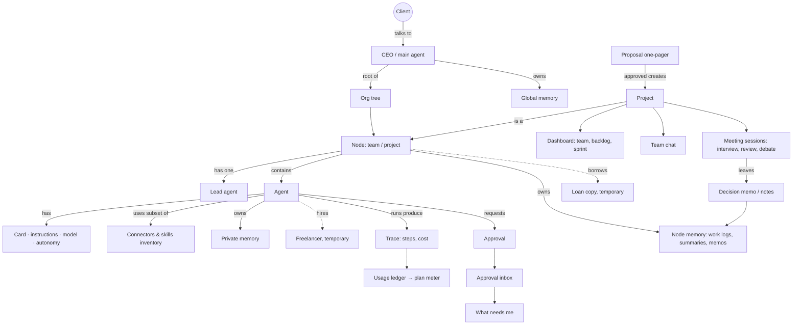

---

## 5. User flows

Each flow shows its empty, loading and error states. "WNM" = "What needs me".

### F1. First run (UC-06, UC-08 E1, BR-54)

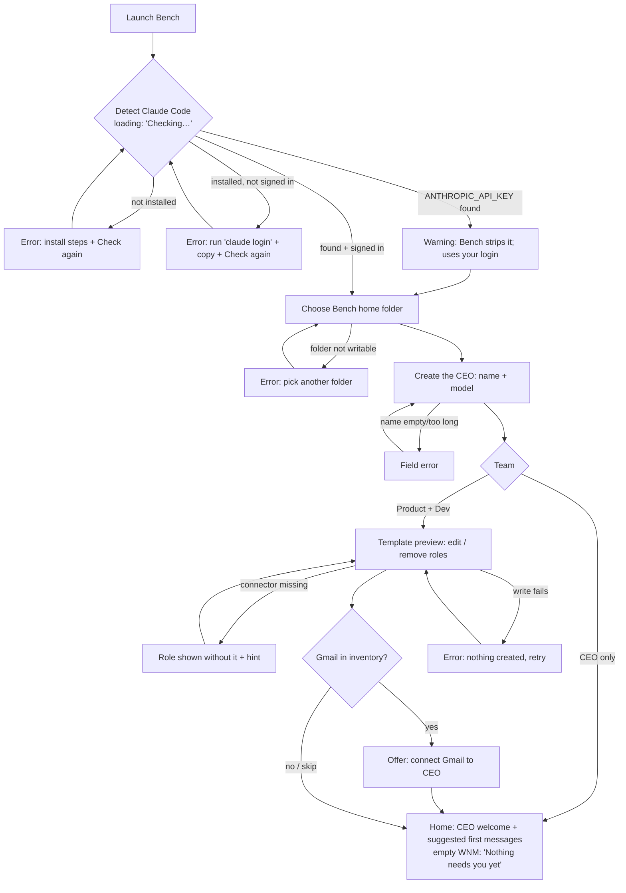

### F2. Idea → proposal → project (UC-12, UC-43, UC-29)

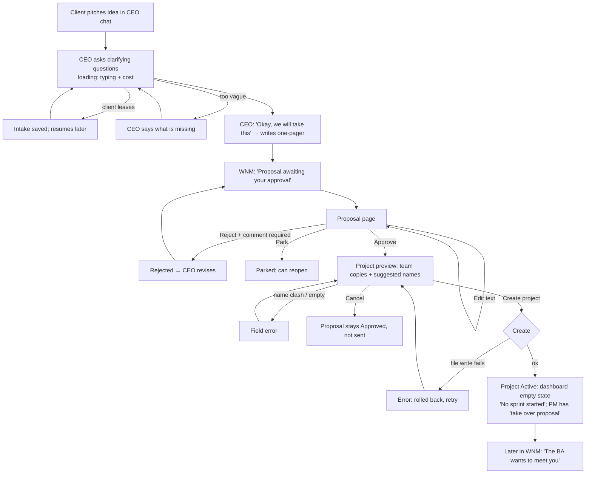

### F3. BA interview session (UC-30)

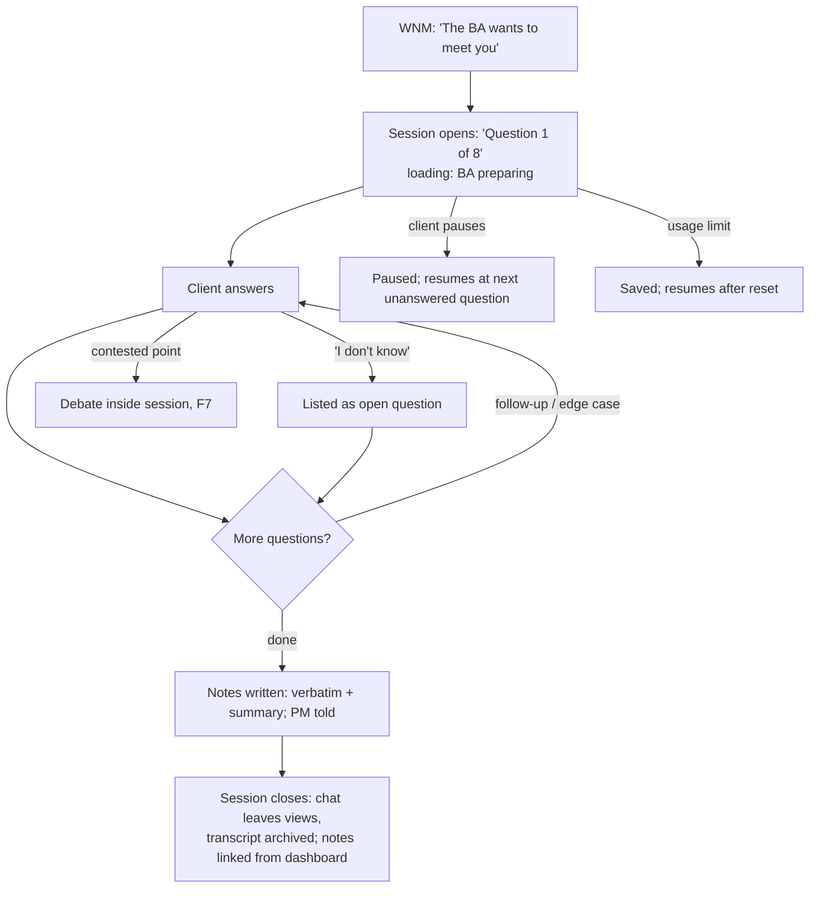

### F4. Daily loop: morning status and "what needs me" (UC-25, UC-29, UC-23)

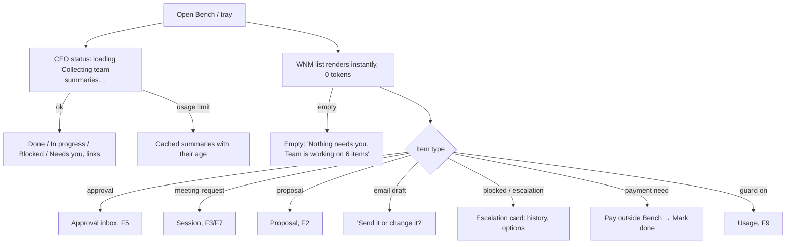

### F5. Resolve an approval (UC-23, UC-22, BR-15, BR-57, BR-58)

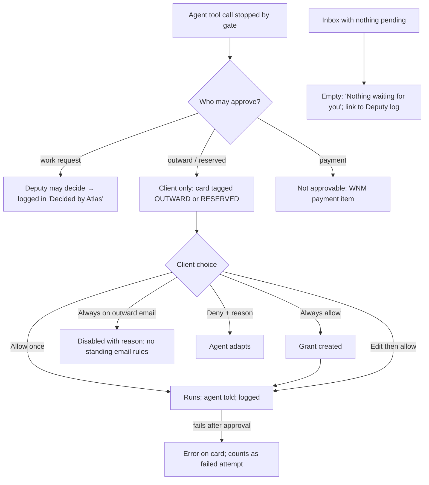

### F6. Watch, stop, redirect an agent (UC-27, UC-09)

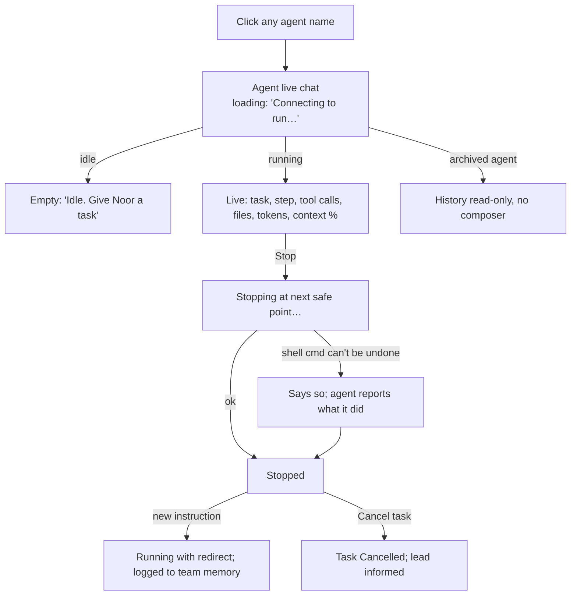

### F7. Debate and review sessions (UC-11, UC-31, UC-24)

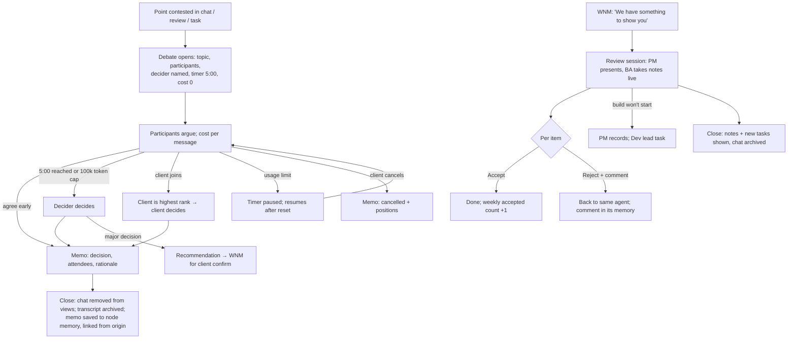

### F8. Project dashboard (UC-26, UC-16)

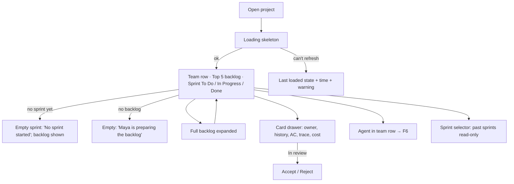

### F9. Usage: guard and limit (UC-40, UC-41, UC-42)

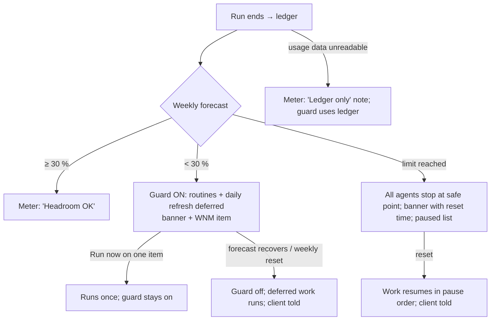

### F10. Org editing and agent loan (UC-01, UC-02, UC-03, UC-47)

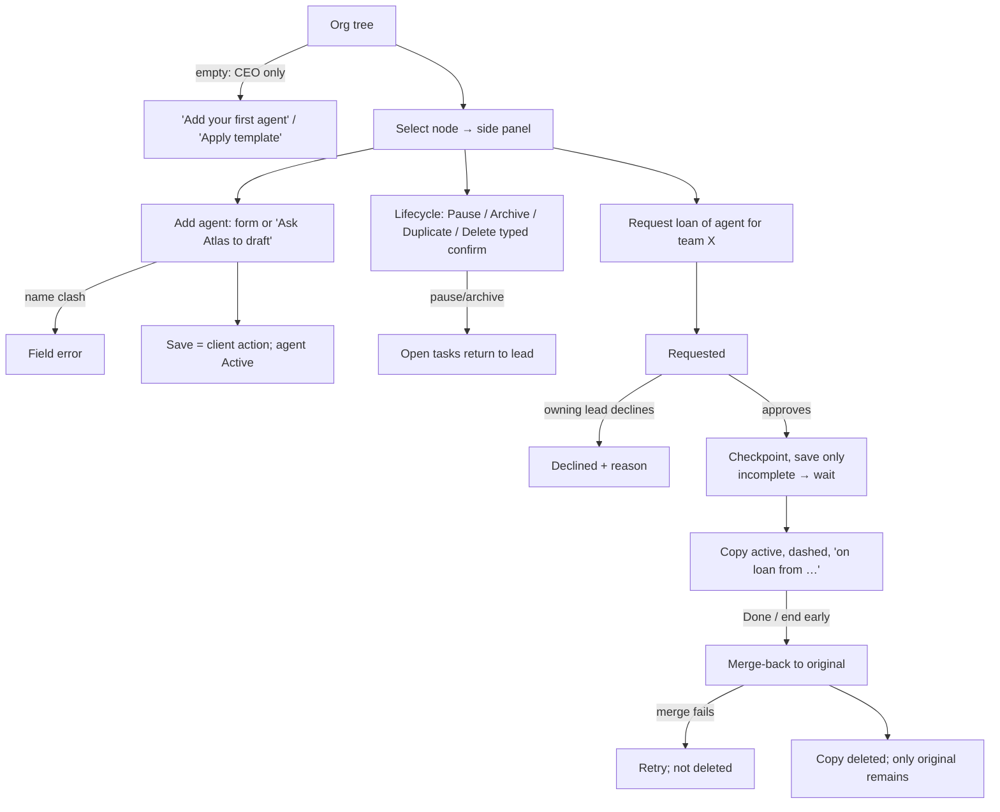

---

## 6. Wireframes / low-fi prototype

**File:** [`prototype/index.html`](prototype/index.html). Click through with the sidebar, or follow the validation tasks in §8 (also inside the prototype under "Prototype guide").

| # | Screen | Purpose | Primary action | Use cases | States in the prototype |
|---|---|---|---|---|---|
| 1 | First run (4 steps) | Get from install to a working CEO | Continue | UC-06, UC-08 E1, BR-54 | checking, found, not installed, not signed in, API key warning; template preview; Gmail offer |
| 2 | Home | Morning status, what needs me, talk to the CEO | Act on the top "needs me" item / send to CEO | UC-08, UC-12, UC-25, UC-29 | normal, empty (first day), status loading, usage limit (cached) |
| 3 | Org tree and editor | See and change the organisation | Add agent | UC-01–UC-07, UC-43, UC-47 | normal, CEO only (empty), loading, error (rolled back); loan stepper |
| 4 | Agent profile | See and change everything about one agent | Save changes | UC-02–UC-04, UC-21, UC-22, UC-32, UC-35, BR-66 | normal, draft (from CEO), paused, archived (read-only), delete confirm |
| 5 | Agent live chat | Watch, stop and redirect an agent | Stop / Send instruction | UC-09, UC-27, UC-28 | running, stopping, stopped, idle (empty), archived |
| 6 | Project team chat | Watch and steer the project team | Send / assign with @mention | UC-10, UC-13, UC-11 A5 | participant, observer, empty, error |
| 7 | Meeting session | Interview, review or 5-minute debate | Answer / Accept-Reject / Agree | UC-11, UC-24, UC-30, UC-31 | debate running, decider decides, memo; interview; review; paused |
| 8 | Proposal one-pager | Confirm the CEO understood the idea | Approve (→ project preview) | UC-12, UC-43 | awaiting, rejected (revising), approved → preview, created, error |
| 9 | Project dashboard | Where the project is right now | Open card / Full backlog | UC-26, UC-16, UC-24 | normal, no sprint, loading, stale data, new project (empty) |
| 10 | Approval inbox | Decide what agents may do | Allow once | UC-23, UC-22 A1, BR-15, BR-57, BR-58, BR-64 | normal, empty, Deputy log, action failed |
| 11 | Trace and cost | See every step and its cost | Expand a step | UC-28, UC-07, BR-38, BR-60 | normal, archived transcript, past retention, loading |
| 12 | Usage meter | Keep ≥ 30 % weekly headroom | Run now / Open runs | UC-40, UC-41, UC-42 | OK, guard on, limit reached, ledger only |
| 13 | Memory browser | Read and edit what agents remember | Save note | UC-21, UC-44, UC-45, UC-46 | note, graph, stale flag, search, index rebuilding |
| 14 | Settings | Set the checkpoint threshold and system behaviour | Save | BR-66, BR-38, BR-52, BR-76, UC-32 | normal, out-of-range error |

**What the prototype does not decide:** visual hierarchy beyond greyscale weight, iconography, motion, the layout grid or the final copy tone. Phase 5 decides those.

---

## 7. UX principles

1. **What needs me comes first, and it's instant.** The live list never waits for an LLM (BR-36). Every item has one verb that takes you exactly where to act.
2. **One obvious next step per screen.** One primary button per screen and per card (Krug). Secondary actions are text links.
3. **Never hide what an agent did.** Every message has a cost and a "Trace" link; every agent name opens its live view; system services show as labelled lines (BR-38, BR-39).
4. **Stop is always one click away.** On any running agent, live view and session (UC-27, UC-11 E4).
5. **Explain a rule where it applies.** Disabled options stay visible with the reason ("Always allow is off for emails to other people: every email needs you"). Rules become learnable, not mysterious (BR-15, BR-58).
6. **Nothing vanishes silently.** When a session closes, say what was kept (the memo), where the chat went (the archive) and where to find it (BR-60).
7. **Cost is visible, not loud.** A meter in the top bar and small costs on messages; banners only for the 30 % guard and the limit (B6-#4).
8. **Defaults for everything, files underneath.** Every setting has a default; every agent, memo and note can be opened as a file (VIS principle 2).
9. **Same place, changing content.** The project dashboard keeps one layout across sprints (B5-#1); the founder learns it once.
10. **Business words, not system words.** CEO, lead, team, loan, freelancer, meeting; not "subagent", "session id" or "MCP" outside the details.

---

## 8. Usability validation

The client tries these tasks on the prototype, thinking aloud or noting where they hesitate. Start each task from the "Prototype guide" (top right), which resets the demo.

| # | Task (as given to the client) | Covers | Success criteria |
|---|---|---|---|
| T1 | "You've just installed Bench. Get to the point where you can talk to your CEO with your day-1 team, but without QA for now." | F1, UC-06 | Reaches the CEO chat in ≤ 6 clicks without help; removes QA in the template preview; can say where Bench stores its files. **Fail if** they look for a login form or are unsure the CEO uses their Claude login |
| T2 | "Tell the CEO about a new idea and get it to the point where a team is working on it." | F2, UC-12, UC-43 | Finds the proposal from "What needs me"; approves; understands that "Create project" is a second step; ends on the new project's dashboard. **Fail if** they think approving alone created the project, or can't find the proposal |
| T3 | "It's the morning. What needs you today? Deal with the most important item, and make sure no email goes out to a client without you." | F4, F5, UC-25, UC-23 | Names at least 3 "needs me" items within 30 s of opening; resolves an approval; spots the OUTWARD tag on the email and explains why "Always allow" is disabled |
| T4 | "Noor, the developer, is going the wrong way. Make her stop and use the existing date library instead. Then find out what her last run cost." | F6, UC-27, UC-28 | Reaches Noor's live view in ≤ 2 clicks from the dashboard; stops; redirects; opens the trace and reads the run's cost. **Fail if** they can't tell whether she stopped |
| T5 | "Your team disagrees on a design point. Let them debate and find out what was decided afterwards, and where the chat went." | F7, UC-11, UC-44 | Sees the timer and who decides; after the close, can find the decision memo in Memory and says the chat was archived in the trace. **Fail if** they think the conversation was lost |

**Observations and changes:** to be filled in after the client's walkthrough (Phase 4 review, before G4).

---

## 9. Open questions and decisions needed (for the client)

| # | Question | Why it matters | Prototype default |
|---|---|---|---|
| Q1 | **Day-1 team vs project copies.** Each project gets its own copies of the template agents (B6-#27), and the day-1 team mirrors the template. Is the day-1 team (Maya, Omar, Lina, Sam, Karim, Noor, Jade) itself the team of your first project (Bench), with later projects getting copies? Or do the day-1 agents stay as a template that never works? | It decides what the org tree shows on day 1 and whether two "PMs" exist after the first project | The day-1 team works on project **Bench**. New projects (e.g. InterviewKit) get copies with new suggested names |
| Q2 | **Where projects sit in the tree.** Are projects nodes directly under the CEO (AS-6), with Product and Dev teams inside each project? | Shapes the tree view and the roll-up | Project nodes under the CEO; the day-1 teams are shown as the Bench project's teams |
| Q3 | **Two confirmations for a new project** (approve the proposal, then "Create project"). Keep both, or make "Approve and create" one step with the team preview before it? | Fewer clicks vs. a safety step (the BRD default is two steps, to revisit at the prototype) | Two steps on the same screen |
| Q4 | **Temporary sessions after close.** Is a small "Recently closed" list (memo or notes only, no transcript) acceptable, or must closed sessions leave no trace in the chat list at all? | BR-60 removes the chat from your views; a closed session can feel like data loss | No list; the memo is linked from the origin chat, the dashboard and Memory |
| Q5 | **Approvals in chats.** Approve only in the inbox (Grok Bot practice), or also inline on the agent's live view? | Speed vs one consistent place | Inbox only; chats show a pointer line with a link |
| Q6 | **Client role in the project team chat:** participant or observer by default? | Whether your messages trigger replies (and cost) | Participant |
| Q7 | **The 30 % guard:** fixed, or adjustable in Settings? | UC-41 leaves it open | Shown in Settings, not editable (your stated target) |
| Q8 | **OS notifications** when Bench is in the background, for "needs me" items (UC-29 step 3 is an assumption)? | Interruptions vs missing a meeting request | On for meeting requests, "something to show you" and blocked; off for the rest |
| Q9 | **First-run target:** is "a CEO reply within 3 minutes of launch" the right bar? | Sets the onboarding acceptance criterion | 3 minutes |
| Q10 | **Debate timer during a usage-limit pause:** pause the 5 minutes (BRD assumption) or let them run out? | Fairness of the timebox | Paused |

**Constraints to confirm with UI and the tech lead (decisions for the client if they conflict):**
- **C-A (tech):** the live view streams tool calls and context % as they happen, and Stop takes effect within 2 s (UC-27 NFR). If the Agent SDK can only stop at turn boundaries, the "Stopping at next safe point…" state may last longer, and the copy must say so.
- **C-B (tech):** a usage-limit forecast and "session/weekly %" in the top bar assume Bench can read plan usage (S0-1 spike). If it can't, the meter shows ledger tokens only (state "Ledger only"), which weakens the 30 % guard.
- **C-C (tech/UI):** graph view performance (about 2,000 notes in under 2 s, UC-44 assumption) may need neighbourhood-only rendering by default.
- **C-D (UI):** greyscale here encodes status with text tags and outlines (OUTWARD, RESERVED, LEAD, LOAN, BLOCKED). The UI phase must keep the text tags, not replace them with colour alone (accessibility).
