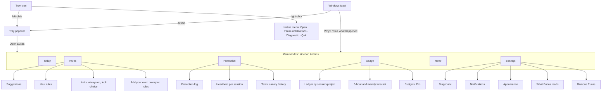
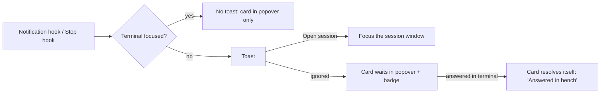
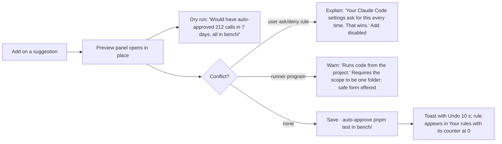
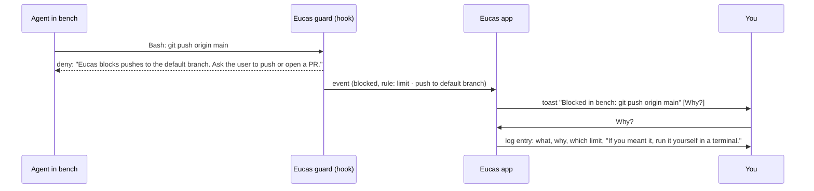

# Information architecture and core flows: the Eucas companion

> **Partly superseded 2026-10-26 by [notch-and-panel.md](notch-and-panel.md)** ([CR-011](../../../requirements/change-requests/CR-011.md)): the surfaces (tray popover as home, six-section main window), the map and the screen layouts are retired. The trust rules, honest copy, needs-you and same-file rules, the tripwire content, the diagnostic, the Pro rules and the edge paths still apply where the new file is silent. Kept as history.

| Date | Author | Status | Read with |
|---|---|---|---|
| 2026-10-26 | Lead UX researcher (Claude) | Draft for the UI designer and the client | [ux-research.md](ux-research.md) · [onboarding-flow.md](onboarding-flow.md) · [DESIGN-SYSTEM](../../ui/system/DESIGN-SYSTEM.md) |

> Links to `docs/research/…` point at the 25–26 Oct research files, which are not merged into `dev` yet (see [ux-research.md](ux-research.md), Inputs).

**Scope:** the companion's v0.1 as briefed: the guard and its heartbeat, the rules editor (from suggestions, plus prompted rules and the lock choice on the four limits, in v0.1, Free: CR-010, founder 2026-10-26), the live ledger and forecast, the same-file warning with the guided merge (in v0.1, Free: CR-010, founder 2026-10-26), the needs-you inbox in the tray with Windows notifications, the one-button diagnostic, and Pro moments (shown as a waitlist until Pro exists). Windows first; dark first, light as an option; calm UI (panels closed by default).

**What the companion can and can't do (shapes every flow).** It attaches through hooks and the status line to sessions you start anywhere: terminal, the Claude desktop app's Code tab, VS Code. It can **watch, warn, block and explain**. It can't pause an idle session, inject a message into it, create worktrees for it, or (unproven) answer a terminal prompt from outside ([execution pre-mortem](../../../research/teardowns/eucas-premortem-execution.md) F41–F46). So every "fix" button either blocks the next call, stops the process, or takes you to the session. The one exception is **Merge safely** on the same-file card (§3.4), which is plain-code git housekeeping, not the agent (CR-010, founder 2026-10-26). Copy promises **watch, warn, guard**, never "manage".

---

## 1. Surfaces

Eucas has four surfaces, from glance to depth. Each one answers one question.

| Surface | Question it answers | Opened by | Size | Default |
|---|---|---|---|---|
| **Tray icon** | Is it on, and does anything need you? | Always there (once pinned) | 16 px icon + badge | Visible (after the first-run pin step) |
| **Windows notification (toast)** | Something needs you now | Eucas, only for needs-you, blocks and the guard going off | Native toast | On; respects Focus |
| **Tray popover** | What is happening across your sessions right now? | Left-click the tray icon, or the global shortcut (optional, off by default) | 380 × up to 560, anchored to the tray | Closed |
| **Main window** | A closer look, or a change | "Open Eucas" in the popover, a toast action, or the Start menu | 1040 × 720, resizable, min 880 × 600 | Closed; never opens itself after first run |

**Why a popover, not a window, is "home":** the job is a glance ([ux-research §2](ux-research.md): tray utilities that feel good answer in one click and get out of the way). The main window is for rules, history and settings. That is the calm-UI rule: panels closed by default, less on screen at once.

**Right-click on the tray icon:** a native Windows menu (Jakob's law), short:
- Open Eucas
- Pause notifications › 1 hour · Until tomorrow · (Resume)
- Run the diagnostic
- Quit Eucas…

There is **no "Turn off protection" in the tray menu**: turning the guard off is a deliberate act in Settings › Protection, with its consequence spelled out. Quit confirms: "Protection stays on while Eucas is closed. The heartbeat and notifications stop until you open it again."

### 1.1 Tray icon states

One glyph (the Quartet mark simplified to 16 px, monochrome) plus at most one badge. **Never colour alone:** each state has a tooltip sentence, and the popover header repeats it in words.

| State | Icon | Badge | Tooltip (draft) | When |
|---|---|---|---|---|
| Guarded, all calm | Mark, Text 2 tone | none | "Eucas · guard on · 3 sessions · checked 2 s ago" | Every running session reported a heartbeat in the last interval |
| Needs you | Mark | Amber count "2" | "Eucas · 2 things need you" | Inbox count > 0 |
| Guard off or unproven | Mark with a red slash | none (the slash is the badge) | "Eucas · bench isn't guarded: no check for 40 s" | Any session running tools without our hook firing, canary failed, guard binary missing |
| Not verified | Mark | Amber "!" | "Eucas · not verified for Claude Code 2.1.314 yet" | CC updated, canary not yet rerun or failed to run |
| Paused notifications | Mark, dimmed | small moon | "Eucas · notifications paused until 15:00 · guard on" | User paused notifications (guard is unaffected) |
| Setting up | Mark, dimmed | none | "Eucas · finishing setup" | First run before screen 6 |

**Priority when several are true:** Guard off > Needs you > Not verified > Paused > Calm. The popover lists every true state; the icon shows the most important one.

### 1.2 Notification policy (toasts)

Notifications are the only thing that interrupts. Budget: **one toast per event, at most one per 2 minutes per session, grouped beyond that** ("3 more things need you"). Presence-aware: if the session's terminal is focused, no toast (the user is already looking; `CLAUDE_CLIENT_PRESENCE_FILE` per the companion brief).

| Event | Toast? | Text (draft) | Actions | Stays |
|---|---|---|---|---|
| A session needs input (permission prompt, question) | Yes | "bench needs you · wants to run `pnpm build`" | **Open session** · Allow once* | Until acted on or the session moves on |
| A session finished and is waiting | Yes, only if it ran ≥ 2 min | "bench is done and waiting for you" | Open session | 6 s |
| Eucas blocked a call | Yes | "Blocked in bench: `git push origin main`" | **Why?** (opens the log entry) | 6 s |
| Mass-delete tripwire stopped a session | Yes, high priority (ignores grouping, not Focus) | "Stopped bench: it deleted 1,240 files in 20 s" | **See what happened** | Until acted on |
| Same-file warning | Yes | "bench and api-docs are both editing `src/router.ts`" | **Show both** | 10 s |
| Guard off in a session | Yes | "bench isn't guarded: Eucas hasn't seen a check for 40 s" | **Fix it** (diagnostic) | Until acted on |
| Approaching the 5-hour limit | Once per window, at your threshold (default 85 %) | "85 % of your 5-hour limit · resets 15:40" | none | 6 s |
| Pro moments | **Never as a toast** | — | — | — |

\* "Allow once" from the toast exists only if spike S-2 proves the app can answer a waiting PermissionRequest hook without racing the terminal prompt (open unknown U3). Otherwise the toast has **Open session** only, and the copy says "answer in the terminal". Never "Allow" for anything the limits cover; those are blocked, not asked.

---

## 2. Map

### 2.1 Tray popover (the glance)

Top to bottom, everything optional collapses when empty (quiet empty: one line of Text 3, or nothing).

1. **Status line** (always): heartbeat glyph + the state sentence. "Guard on · 3 sessions · checked 2 s ago". Clicking it opens Protection.
2. **What needs you · 2** (only when > 0): up to 3 cards, newest first; "+2 more" opens Today. Each card is the shared **needs-you card** (§3.1).
3. **Sessions** (collapsed by default to one line: "3 sessions · bench working · api-docs waiting · notes idle"): expands to one row per session with project, state word, last activity, tokens this session. Session states map one-to-one onto Claude Code agent view's six states so nothing has to be relearned, in Eucas's voice: **Working · Needs you** (agent view: Needs input) **· Idle · Done** (Completed) **· Failed · Stopped**, plus Eucas's own guard word on each row (Guarded / Not guarded).
4. **Usage strip** (always one line): "5-hour: 46 % · resets 15:40 · Week: 62 %". Clicking opens Usage. Turns amber with the word "close" at your threshold.
5. **Footer:** Open Eucas · settings glyph.

**Hierarchy test:** status line first, needs-you second, usage third. The popover has **no Cobalt fill unless a needs-you card is present** (then that card's primary is the one blue).

### 2.2 Main window (6 sidebar items, ≤ 7 by Hick/Miller)

| Item | Purpose | Primary action | Default content |
|---|---|---|---|
| **Today** | Everything happening now: needs-you, sessions, today's blocks and warnings | The top needs-you card's primary, else none | "You're all caught up. 3 sessions are guarded." |
| **Rules** | Suggestions from your history, your rules, and the fixed limits | **Add** on a suggestion | Suggestions first (with counts), then your rules |
| **Protection** | Is the guard on, proven, and what did it do | **Run the test again** (canary) | Heartbeat per session, last canary, log |
| **Usage** | Tokens and plan share now, forecast, by session and project | none (read view); Pro: Set a budget | 5-hour and weekly meters with forecast |
| **Retro** | Your week, rebuilt every Monday (7 days free; older weeks are Pro) | none | This week's 4 cards (same as first run) |
| **Settings** | Notifications, appearance, what Eucas reads, diagnostic, remove | per section | — |

Keyboard: `Ctrl+1…6` switch sections; `/` focuses search in Rules and Protection; `↑/↓` move through lists; `Enter` opens; `Esc` closes a panel; `Ctrl+K` command search (optional, post-v0.1).

---

## 3. Core flows

Every flow below follows the same skeleton: **trigger → evidence → one primary → after (what happened, undo, next)**.

### 3.1 The needs-you inbox

**What counts as "needs you":** a session waiting on a permission prompt or a question; a session that finished a long run and is idle; a guard problem (off, unverified); a tripwire stop; for Pro users, a budget that ran out: "**Budget reached for this task. Continue?**" (CR-010, founder 2026-10-26; §3.3). **Not** "needs you": blocks that already happened (they're in the log), usage (it's a meter), tips, Pro moments.

**The needs-you card (one pattern everywhere: popover, Today, the toast's landing):**
- Head: project name (the session's folder) + the state word + time ("bench · needs you · 2 min").
- Evidence: what it wants, in mono when it's a command or path (`pnpm build` in `bench/`); for a question, its first line.
- Consequence line (one quiet Text 2 line, dots): "Runs in bench/ · you've allowed this 14 times".
- Actions: **Open session** (primary: focuses the terminal window or the desktop app's session; if Eucas can't find the window, names it: "It's the Windows Terminal tab titled bench") · Allow once* · Not now (snooze 15 min).
- After: the card collapses to one line for 10 s with Undo: "Opened bench" / "Snoozed until 14:20".

**States:** empty ("You're all caught up. 3 sessions are guarded."), several (grouped by session, oldest waiting first in Today), stale (session ended while waiting: "bench ended before you answered. Nothing ran."), window not found (names it), presence unknown (toast anyway).

### 3.2 Rules from suggestions

The rules editor is mostly an **accept screen, not a write screen** (execution §3 Q1). v0.1 has suggestions + 5 templates, and **prompted rules, in v0.1, Free** (CR-010, founder 2026-10-26; replaces "no free-text compiler"): even a rule you describe ends as a preview you accept.

**Rules screen layout:**
1. **Limits** (top, collapsed to one line): "4 limits always on: delete · push to your default branch · send · pay. No rule can change them." Expanding shows exactly which commands and tools each covers, the promise (fixed copy), and the honest gap line ("Eucas sees tool calls, not what a program does once it runs"). **Lock choice (D-4, CR-010, founder 2026-10-26):** the four limits are always on and can never be switched off; per limit the only choice is **Locked** (managed settings, with admin) or **Not locked** (user scope, labelled "not locked"). The same choice as first-run screen 3b. Changing which limits are locked asks for admin again.2. **Suggestions · 3** (from the last 7 days, refreshed daily): rows like the retro card. Each row: command (mono) · scope · "you allowed it 212 times" · **Add**.
3. **Your rules** (list): command · scope · "auto-approved 1,204 times since 12 Oct" · last used · switch (on/off) · overflow (Edit scope, Delete).
   - **Add your own** (prompted rules, in v0.1, Free; CR-010, founder 2026-10-26): describe a rule in plain words → the preview shows exactly what it allows or blocks → **Confirm**. Drafted by the provider-hosted model through the Eucas server; only your sentence is sent; it counts toward the supervisor budget. No drafted rule can make Eucas auto-approve one of the four limits.
4. **Templates** (only while "Your rules" has fewer than 3): five starters, e.g. "Read-only git (`git status`, `git diff`, `git log`) in all projects".

**Adding a suggestion (the one flow that writes):**

**Rules for rules (fixed, from trust PM-T5):** exact commands, never globs; scope is a folder (default: the project it came from); runner programs never pre-selected and never "everywhere"; no rule can touch the limits; each rule shows its live counter ("auto-approved 1,204 times") so its effect stays visible (intelligence layer: the deposit is automatic, the evidence is on the rule).

### 3.3 Usage meter and forecast

**Sources:** the status-line wrapper's JSON (`cost`, `rate_limits` when present) and hook counts; never `.credentials.json` or an OAuth endpoint (ADR-0002, brief P1).

**Usage screen:**
- **Two meters**, side by side, same component as DESIGN-SYSTEM §11.16:
  - **5-hour window:** "46 % · resets 15:40" with a tick at your warning threshold.
  - **Weekly:** "62 % · resets Mon 09:00".
  - Each shows freshness: "updated 20 s ago" (Claude's own usage page does this; [references](references/README.md)).
- **Forecast, as one sentence per meter, with certainty over ranges** (premium-craft heuristic): "At today's pace you'll reach the 5-hour limit around **15:10**, 30 min before it resets." Hover shows the range and the basis ("based on the last 45 minutes").
- **Work left, not just percent** (Luma pattern): "That's about 6 more runs like your last one in bench."
- **Ledger table:** by session, then by project, for today / 7 days. Tokens, plan share, cost if API. Tabular figures, right-aligned.
- **States:** no plan data (tokens only, with why; onboarding edge G) · stale (no session running: "Last updated 13:02, when bench stopped") · at limit (worst moment, below) · API mode (cost in $ instead of plan %).
- **Budgets (Pro; CR-010, founder 2026-10-26):** when a budget you set runs out, Eucas **stops the session before its next step** (it blocks the next tool call) and adds a needs-you item: "**Budget reached for this task. Continue?**" Copy says "stops before the next step", never "pauses".

**Worst moment: the 5-hour limit is hit.** Eucas didn't cause it and can't fix it, so it informs and gets out of the way: "**5-hour limit reached.** Claude Code pauses new requests until 15:40. Your sessions keep their work. Weekly: 64 %." No upsell on this card. One line under it, only if Pro exists and the user hasn't dismissed it: see §4.

### 3.4 The same-file warning

**Trigger:** session B writes (Edit/Write/MultiEdit, or a Bash command whose target is resolvable) to a file that session A wrote in the last 15 minutes (default; adjustable 5–60), in the same working tree. Different worktrees of one repo: warn only when both later touch the same path **and** neither has committed it, as "may conflict when you merge" (lower priority, no toast).

**What it says (plain words, one sentence, then the facts):**
- Toast: "bench and api-docs are both editing `src/router.ts`."
- Card (Today and the popover): "**Two sessions are editing the same file.** api-docs changed `src/router.ts` 4 minutes after bench did. If both keep going, one may overwrite the other's work." Facts: each session's last edit time and lines changed.
- Actions: **Show both** (opens a side-by-side of the two sessions' recent edits to that file, read-only) · **Merge safely** · Open bench · Open api-docs · "Don't warn for this file today".
- **Merge safely (guided merge, in v0.1, Free; CR-010, founder 2026-10-26):** runs a plain-code rebase, runs your tests and opens the PR, with no AI. On a conflict or a failing test it stops and names the files.
- What it never does: block the edit (a warning tool that blocks surprises people), or say "conflict" when git would merge cleanly.

**States:** first warning (the toast + card), repeated (the card updates its count: "3 edits each since 14:02"; no new toast), resolved (one session committed or stopped: "Resolved: bench committed `src/router.ts` at 14:20").

### 3.5 Protection status: heartbeat, log, tests, tripwire

**The heartbeat (the "is it on?" signal).** For each running session, Eucas expects its hook to fire on every tool call. The heartbeat is **evidence, not a timer**: "checked 2 s ago" means a real tool call was checked 2 s ago. When a session is idle, the line says so ("idle since 13:40 · guard ready") rather than pretending to tick.
- **Off detection:** a session shows tool activity in the transcript or status line but no matching hook event → within one tool call, the session turns **Not guarded** (red, with the word), the tray icon gets the slash, a toast fires (trust PM-T3, kill criterion §5.2).
- **After every Claude Code update:** the canary reruns automatically (same as onboarding screen 5, silent when it passes). Pass: "Verified for Claude Code 2.1.314 · 09:12". Fail or can't run: amber "Not verified for 2.1.314" until it passes.

**Protection screen layout:**
1. **Status card:** the state sentence, heartbeat glyph, "Verified for Claude Code 2.1.314 · canary passed at 09:12", the install level ("Limits in admin settings" or "user level, weaker"), **Run the test again**.
2. **Sessions:** one row per running session with its guard word and last check.
3. **Log** (the glass box): every block, warning, tripwire and guard state change, newest first. Row: time (mono) · session · what (mono) · why in plain words ("push to your default branch") · rule or limit that decided it. Expand for the raw hook decision. Filter by session / kind; export as CSV or Markdown (Stripe security history pattern; [references](references/README.md)).
4. **What Eucas can't see** (collapsed, always present): the honest gap list, one line each.

**A block, end to end:**

The deny message goes **to the agent** too, worded so it stops trying routes around the block and hands back to you (trust F35: never nudge after a deny). **There is no "Allow anyway" button.** The honest promise says no rule can change it; the only path is you running it yourself, outside the agent. The log entry offers **Copy command** for that.

**The mass-delete tripwire (worst moment of the whole product).**
- Trigger: a session's process tree deletes more than N files (default 200) or N MB in a short window, under its folders or your profile (trust PM-T4).
- Eucas **stops the session's process tree**, verifies it stopped, and only then tells you.
- Full-window card (this is the one modal-weight moment): "**Eucas stopped bench.** It deleted 1,240 files in 20 seconds, starting with `C:/Users/…/bench/node_modules`. Eucas stopped it at 14:02:31 and checked it's no longer running." Then: what was deleted (list, grouped by folder, exportable) · "How to get them back": File History / OneDrive / git restore, whichever is on, as numbered steps · **Open the folder** (primary) · "This was expected (for example, cleaning `node_modules`)": adds the folder to the tripwire's allowed list for this project, with its consequence spelled out.
- If the delete kept going after the stop (reported in the field: 5–45 min, trust F18): the card updates live with the count and says so plainly; it never claims "stopped" until the count stops moving.

### 3.6 Diagnostic (one button)

Settings › Diagnostic, the tray menu, and every error card's secondary action open the same thing. **Run the diagnostic** produces a report in about 5 s: Claude Code version and install type(s), shell (Git Bash / PowerShell), hook sources and whether ours fire, status-line chain, managed-policy flags, canary result, last 20 guard events (commands redacted to their program name), Eucas version. Shown as a checklist (same pattern as onboarding screen 1), each line green / amber / red with a word.

Actions: **Copy report** (redacted, Markdown) · Save as file · "Open an issue" (opens the GitHub new-issue page with the report as body for you to review; never sends anything itself). A line states: "The report has no prompts, file contents, paths outside Claude Code's folder, or tokens. Read it before you share it."

---

## 4. Pro moments that never nag

**Status:** Pro doesn't exist yet, so v0.1 shows these moments as a **waitlist** ("Get notified"), never a checkout. Decision D-2. Amended (CR-010, founder 2026-10-26): Pro can charge once it is built, because the supervisor doesn't use your Claude plan; only the cloud beta waits for Anthropic's written OK. This replaces the pre-mortem line "no paid tier before Anthropic's written OK".

**The five rules:**
1. **Never touch safety.** Limits, the heartbeat, the tripwire, same-file warnings and the needs-you inbox work for **every** session on the free plan (execution PT-7: never meter safety). If "up to 3 sessions" stays in Free, it caps the **ledger detail and the sessions list**, never the guard (decision D-1).
2. **Only where the free answer runs out.** A Pro line appears only at a moment where Pro would change what happens next, and says what it would do in that moment.
3. **Never in a worst moment.** Not on a block, a tripwire stop, a guard-off state, an error, or the limit-reached card. Not in toasts. Not in first run.
4. **Once, then quiet.** Each moment shows at most once per week, at most one Pro line per day across the app, and "Not interested" hides that moment for good.
5. **Same look as everything else.** A single Text 2 line with a text link; no gold pills, no badges, no "Upgrade" in the chrome.

**The moments:**

| Moment | Where | Line (draft) | Why it's honest |
|---|---|---|---|
| A long task is on pace to hit the 5-hour limit (forecast, not the limit itself) | Usage meter, 30+ min before | "Pro stops bench before the next step when it reaches a budget you set, before the limit does. Get notified when it's ready." (CR-010, founder 2026-10-26) | Budgets that stop before the next step are the one Pro feature that saves real money (strategy §3) |
| A session stopped and has been idle 10+ min, **and** it didn't stop because of a block or an error | Session row in Today | "Pro's supervisor can nudge stopped sessions within a budget. It never nudges after a block." | Says the safety rule in the pitch |
| Looking at last week in Retro | Retro, below the 7-day cards | "Older weeks are kept with Pro." | History is the plain metered value |
| A 4th session starts (only if D-1 keeps the cap) | Sessions list | "Showing details for 3 sessions. All 4 are guarded. Pro shows every session's details." | Makes clear the 4th is still protected |
| Laptop-closed work | Settings › About, only | "Coming to Pro (beta): runs that continue in Claude's cloud. Eucas's limits don't apply there." | Cloud is labelled honestly (trust PM-T7) |

---

## 5. States, worst moments, coherence (premium-craft)

**State matrix, main surfaces:**

| Surface | Default | Working | Empty | Partial | Error | Offline | Usage limit | Permission denied | Success |
|---|---|---|---|---|---|---|---|---|---|
| Tray popover | Status + sessions + usage | Session rows show "working" | "No sessions running. Guard ready." | Some sessions not guarded (red rows) | Guard off (red status line + Fix it) | Unaffected (local); Pro waitlist link hidden | Usage strip "limit reached · resets 15:40" | Org policy: "Blocked by your organisation" status | Needs-you resolved → collapse with Undo |
| Today | Needs-you + sessions + today's events | — | "You're all caught up. 3 sessions are guarded." | — | Event stream couldn't load: "Couldn't read today's events. Last good at 14:02. Retry" | Unaffected | Limit card (no upsell) | Policy banner | — |
| Rules | Limits line + suggestions + yours | Dry run computing ("checking 7 days…") | No suggestions yet: templates | Suggestion conflicts (disabled rows with why) | Couldn't save: "Your settings file is locked by another program. Nothing changed. Retry" | Unaffected | N/A | Org policy: rules read-only, why | Saved toast + Undo |
| Protection | Status + sessions + log | Canary running | Log empty: "Nothing blocked yet. Every block shows here with why." | Some sessions unguarded | Canary failed (J) | Canary needing a model turn can't run: "Hook-only check passed; full test reruns when you're online" | Canary uses hook-only check | Org policy | "Verified for 2.1.314" |
| Usage | Meters + forecast + ledger | — | No sessions yet: "Usage appears after your first session." | Tokens only (no `rate_limits`) | Status line not reporting: Diagnostic | Unaffected | Limit-reached card | N/A | — |
| Retro | 4 cards | Rebuilding (Mondays) | Thin history (templates) | Parse errors counted | Couldn't read folder: Diagnostic | Unaffected | N/A | Folder unreadable | — |

**Worst-moment pass (each recovery names the cause, what is safe, one next step):**
- **Tripwire stop:** designed in §3.5. Recovery paradox: the restore steps and the "Eucas stopped it at 14:02:31" timestamp make the tool's value undeniable.
- **Guard off mid-session:** the red row, tray slash and toast within one tool call; Fix it runs the diagnostic and offers the specific repair (restore quarantined file, reinstall plugin, restart session). Never green until a real check passes.
- **Fail-closed brick** (our guard crashes and blocks every call, the CrowdStrike shape, trust failure #4): the agent's deny message says "Eucas's guard failed, not your command"; the app shows "**Eucas's guard is failing and blocking every tool call in 3 sessions.** Your work is safe. Repair (one click) or turn the guard off for 15 minutes." This is the one place a temporary off switch is offered, with its consequence and an automatic return.
- **Claude Code update breaks hooks:** canary fails after update → amber "Not verified for 2.1.315", then red if real calls go unchecked; the toast links the diagnostic; the website's known-good table is linked.
- **Long names and big numbers:** project names ellipsize in the middle (`claude-…-afc419`), commands wrap in mono up to 3 lines then "show all"; counts above 9,999 abbreviate ("12.4 k") with the exact number on hover.
- **Slow (10 s+):** retro rebuild and dry runs stream partial results with a caption; nothing blocks the window.

**Coherence (one pattern per situation):**
- One **needs-you card** in the popover, Today and toast landing.
- One **checklist** component (lines that tick, each with Look inside) for onboarding, protection install, diagnostic.
- One **heartbeat line** in onboarding screen 6, the popover status line and the Protection status card.
- One **log row** for blocks, warnings, tripwire and guard changes.
- One **status vocabulary**: sessions use Working · Needs you · Idle · Done · Failed · Stopped (agent view's six states); the guard uses Guarded · Not guarded · Not verified · Blocked by your organisation. No synonyms ("protected" appears only in the sentence "You're protected" at the end of first run and on the status card).
- One **honest promise string**, stored once, used in onboarding screens 3b (CR-010, founder 2026-10-26) and 4, Rules › Limits, Protection and the website.
- One **lock choice** (Locked / Not locked) per limit, the same control in first-run screen 3b and Rules › Limits (CR-010, founder 2026-10-26).

**Intelligence layer:** suggestions get better as history grows; each rule shows its counter; the weekly Retro compares to last week ("2 fewer same-file clashes than last week"); the forecast learns your pace. **Exit question:** what would you rebuild elsewhere? Your rules and their history. They are plain files you can export (Settings › Export rules), so the value is visible and nothing is locked in.
