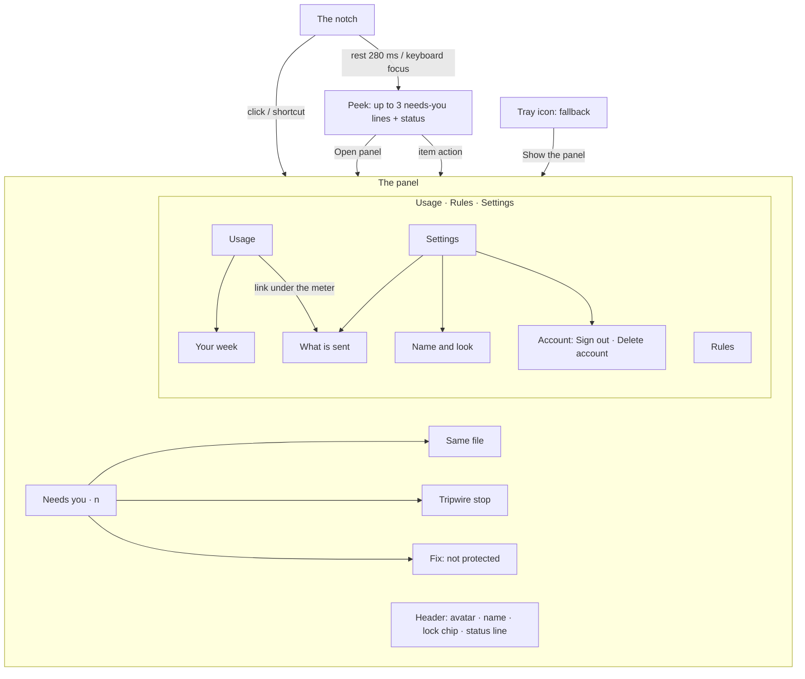

# The notch and the panel: IA, flows and states

| Date | Author | Status | Read with |
|---|---|---|---|
| 2026-10-26 | PM + UX (Claude), `ux-designer` role standards | **§1–§8 approved by the founder 26 Oct** (D-1 to D-8 as recommended) · **§9 "New since approval" needs approval** · **§10 CR-012 / always-on (account, What is sent) approved 26 Oct** with decisions U-1 – U-8 (*"don't allow to access without sign in"*: signed out, the panel shows only sign-in) · **2026-10-26, setup reordered** (founder, *"okay do that"*): the four limits are locked before sign-in; setup step numbers below follow the new order · **2026-10-26 (later), no account (founder): Eucas works without an account: safety plus a small supervisor taste, in a minimal notch and panel** (§11; **needs approval**; open questions (a), (b) and (c) in §11.6; the minimal surface is pending (a)). Signed out or deleted now returns to this state instead of a sign-in-only panel | [CR-012](../../../requirements/change-requests/CR-012.md) · [CR-011](../../../requirements/change-requests/CR-011.md) · [setup-flow.md](setup-flow.md) · [UI DESIGN.md](../../ui/companion/DESIGN.md) · [the 2026-10-25 notch design](../2026-10-25-atlas-notch-design.md) |

**Replaces** the surfaces, map and flows in [ia-and-flows.md](ia-and-flows.md) (tray popover as home, six-section main window). **Keeps** from it: the honest promise, the notification budget idea, the needs-you rules, the same-file rules, the heartbeat as evidence, the tripwire's content, the diagnostic, the Pro rules that never nag, and the edge paths. Where this file is silent, those still apply.

> **Founder decisions applied (26 Oct, later the same day):** the four limits are **always on**, locked or not locked per limit; **guided merge** stays in Free as a needs-you item; **budgets** stop the agent before its next step; drafting a described rule **uses the supervisor and counts on the meter**; the app says **"your default branch"**, never "main"; v0.1 is **unsigned** and shows no "signed" badge.

> **CR-012 / always-on, 2026-10-26 (founder):** everyone has a **Eucas account** (email plus a 6-digit code, no password). The **supervisor is always on** with no off switch; **Level 1/2 is retired** everywhere. Settings gets a permanent **What is sent** page and an **Account** section; a **What is sent** link sits under the supervisor meter. The meter never shows dollars. Details in §10; changed lines below are marked.

**The product in one line (founder, 26 Oct):** *one agent the user creates at setup, with rules and settings; then it is very simple: settings, rules and usage, and it sits as a notch. It never codes; it is just an agentsitter.*

**What the Euca can and can't do** (unchanged, shapes every flow): it watches, warns, blocks and explains. It can't answer a terminal prompt from outside, inject a message or pause an idle session. So every action in the notch and the panel either **takes you to the session**, **opens the evidence**, or **changes Eucas's own rules and settings**.

---

## 1. Surfaces

There is one character and two surfaces. No main window.

| Surface | Question it answers | Opened by | Size | Takes focus? |
|---|---|---|---|---|
| **The notch** | Is my Euca on, are sessions working, does anything need me? | Always there (top centre of the primary display) | 124 × 32 at rest; 164 with a marker; wider only for "Not protected" and a tripwire stop | **Never** |
| **The peek** (part of the notch) | What needs me, in one line each? | Resting the pointer on the notch for 280 ms, or focusing it with the keyboard | 372 wide, grows down from the notch | Never |
| **The panel** | Everything else: needs-you, Usage, Rules, Settings | A click on the notch (or the peek's "Open panel"), the global shortcut, or the tray menu | 400 × up to 640, 8 px under the notch | Yes: you asked for it |
| Tray icon (fallback only, with or without an account) | Is Eucas running at all? | Right-click: Show the panel · Show the notch as a thin line / pill · Quit Eucas… (no account: the menu in §11.4) | 16 px + count badge (no account: **never a badge**) | — |
| Windows notification (fallback only) | Something serious while the notch is hidden | Only when a full-screen app hides the notch **and** the event is a tripwire stop or "not protected" | Drawn by Windows | — |

**Why no main window.** The founder's picture is one character and three plain sections. Everything the old six-section window held fits the panel: Today becomes the needs-you list, Protection becomes the header line plus Rules and Settings › Protection, Retro becomes a page under Usage. Less to open, nothing to manage.

**Why the notch never opens by itself** (founder rule, carried from the 25 Oct design): something arriving gets one small nudge and a marker that stays. You choose when to look. A popup that opens over your work trains you to dismiss it unread.

---

## 2. Map

### 2.1 The panel, top to bottom

1. **Header** (always): the Euca's soft avatar (its eyes follow you), its name, the lock chip (**Locked** / **Not locked**, opens Rules), and the status line: "Protected · 3 sessions · checked 2 s ago" or, in red, "Not protected · bench: no check for 40 s". This is the heartbeat; it moves only when a real check happened.
2. **Needs you · n** (only when n > 0): up to 3 items, then "Show n more". When empty: one quiet line, "Nothing needs you." (kept by the removal test: you opened the panel to find out).
3. **Tabs: Usage · Rules · Settings.** The panel remembers the last tab; the first open shows Usage.
4. **Sub-pages** replace the panel's content in place, with a back arrow: Your week, Same file, Tripwire stop, Fix it, Name and look, and (*CR-012 / always-on, 2026-10-26*) What is sent, ~~Sign in,~~ Sign out, Delete account (*2026-10-26, no account:* signing in happens in the setup window, opened from the minimal panel or the tray, §11.5). Esc goes back, then closes.

**Tab order (decision D-1 for the founder).** The founder named them "settings, rules, and usage". The prototype orders them by how often you'll open them: **Usage** (every day), **Rules** (now and then), **Settings** (rarely). Switching to the founder's order is a one-line change.

### 2.2 What each tab holds

| Tab | Holds | Primary action | Empty / first state |
|---|---|---|---|
| **Usage** | 5-hour and weekly meters with a one-sentence forecast; where it went (today / 7 days, by project); the **supervisor meter** with the **What is sent** link under it (*CR-012 / always-on*); Your week | none (read view) | "Usage appears after your first session." |
| **Rules** | the honest promise; the lock row; **Limits** (the four, always on, no switch: each shows Locked or Not locked); Safety rules (tested library, switches, lock glyphs); Your rules (from approvals and described); **Describe a rule** → drafted exact rule → Add | **Add rule** (only while a draft is open) | Your rules empty: "Rules you add show up here with how often they were used." |
| **Settings** | Name and look; What Pip knows; Protection (admin lock, safety test); Privacy: **What is sent** (*CR-012 / always-on*: was the Level 1/2 radio); The notch (Pill / Thin line, sounds, theme); Help (diagnostic); **Account** (*CR-012 / always-on*: email, plan, Sign out, Delete account; replaces "Plan"); Quit | per row | ~~Account when signed out: "Not signed in" + Sign in~~ N/A: without an account the panel is the minimal panel, with no tabs (§11.2) |

---

## 3. The notch: behaviour rules

Carried from the approved 25 Oct design (hover not pop, the eyes, the glow, sounds) and adapted to an agentsitter.

### 3.1 One notch, many truths: what it shows

Only one state shows at a time. **Priority:** Not protected › Tripwire stop › Needs you › Working › Resting › Dozing.

| State | Eyes | Glow | Marker / words | When |
|---|---|---|---|---|
| **Resting** | Open, follow the pointer (≤ 2.5 px), blink every 3.8–7.2 s | none | none | Protected; no session is running a tool |
| **Working** | Same | The composer's voice glow gathered into a **beam that sweeps** under the eyes, in the Euca's colour | none | At least one session ran a tool in the last 20 s |
| **Needs you** | Glance at the marker once, then back | as above | **Amber count**, stays until dealt with | Any needs-you item |
| **Not protected** | **Concerned** | off | "**Not protected**" in red, red ring | The heartbeat failed: tool activity with no matching check, the guard missing, or the safety test failed |
| **Tripwire stop** | Concerned | off | Red marker "**Stopped: notes**" (the project after a colon) | The tripwire stopped a session |
| **Dozing** | **Sleepy** (closed arcs, dimmed) | off | none | No input for 5 min **and** nothing running. Pointer movement or a session starting wakes it with a blink |
| Before setup ends | Closed, grey | off | none | First run, until the Euca is made |

**Why dozing can't be misread as "off".** The Euca only dozes when there is nothing to watch. If any session runs while you're away, the eyes stay open. And "off" has its own unmistakable state with words. (BRAND §8: idle is calm; only paused sleeps.)

**Never colour alone:** each state has an eye shape, and the serious ones have words. The notch is readable in a 1-bit render.

### 3.2 Something needs you (the founder's rule: never opens by itself)

1. **Arrives:** the notch drops 3 px and settles (spring, 640 ms, the only overshoot), the marker pops in, the eyes glance at it, and the soft **needs-you** sound plays once (BRAND §11; not in full-screen apps or calls; Windows Focus silences it). Then everything is still.
2. **Waits:** the count stays. With several items, the count is the total.
3. **You hover:** after 280 ms of rest the notch grows into the **peek**: up to 3 items (glyph, one line, one action) and a footer with the status and "Open panel ›". Moving away folds it back after 360 ms; the marker stays.
4. **You act or not:** each item's one action takes you somewhere (Open session, Show both, See what happened, See why). "Not now" lives in the panel only (snoozes 15 min). An item answered in the terminal resolves itself.

**The 280 ms rule.** The top centre is where browser tabs and title bars live. A peek that opens on a passing pointer would be the notch opening by itself in all but name, so it needs a resting pointer.

**What the peek never has:** an Allow or Deny. Eucas can't answer prompts from outside (v0.1), and a hover surface must never be one stray click from approving anything.

### 3.3 What counts as "needs you"

| Kind | Severity | Line (Pip is the example name) | Action | Resolves when |
|---|---|---|---|---|
| A session waits on a prompt or a question | amber | "bench is waiting for you · wants to run `pnpm build`" | Open session | Answered in the terminal, or the session ends ("bench ended before you answered. Nothing ran.") |
| A long run finished and waits (≥ 2 min) | calm | "api-docs finished and is waiting · ran 14 min, changed 3 files" | Open session | You type in it |
| Two sessions edit one file | amber | "Two sessions are editing one file · bench and api-docs · `src/router.ts`" | Show both | One commits or stops |
| **Tripwire stop** | red | "Pip stopped the notes session · deleted 1,240 files in 20 s" | See what happened | You open it (the record stays in the log) |
| **Not protected** | red | "bench isn't protected · no check for 40 s while it ran tools" | See why | A real check passes |
| **Guided merge** offer: a session finished on a branch | calm | "search is ready · It finished on its branch. Update it from your default branch, run the tests and open the PR?" | Update, test, open PR | You run it (the item becomes its result) or snooze it |
| Guided merge result | green (a real result) | "search: PR #71 is open · Updated from your default branch, 128 tests passed, PR #71 opened. Nothing was merged." · or "Tests failed: 2 of 128. Nothing was pushed." | Open the PR · or Open session | You open it |
| **Budget reached** (Pro) | amber | "Budget reached for this session. Continue? · Pip stopped bench before its next step. The session used the 4% of your week you gave it." | Continue · Open session | You choose |
| Not verified after an update | amber | "Claude Code 2.1.315 isn't verified yet" | Run the test | The safety test passes |
| (Pro / trial) the supervisor wasn't sure | amber | the session-waiting line plus "Pip didn't answer: not sure" | Open session | as the first row |

**Not** needs-you: blocks that already happened (they're in Rules' counters and the log), usage (a meter), the supervisor meter running out (Usage says so), Pro, tips.

### 3.4 The panel opens on a click

- Grows from the notch: 8 px below it, scale 0.97 → 1 and fade on `--spring-smooth`, 320 ms.
- Takes keyboard focus (you clicked). Light-dismiss on a click outside; Esc closes and returns focus to the notch.
- **Never opens itself**, not even for a tripwire stop.

### 3.5 Thin-line mode (Settings › The notch › Look)

For laptops with a thick top bezel, or if you want less. The notch becomes a 96 × 4 line at the top edge; the working beam runs along the line; a needs-you item adds a dot at its right end. **Hover grows it into the full pill and peek.** **Not protected always overrides thin line** and shows the full pill with words: safety beats preference.

### 3.6 Windows constraints (for the build, SP-ST1)

- A floating, always-on-top window at the top centre of the primary display; it never takes focus at rest; **clicks pass through outside its visible shape** (the hit region grows and shrinks with the peek).
- **Steps aside for full-screen apps** (games, video, presentations). While hidden, markers wait; only a tripwire stop or "not protected" sends one Windows notification.
- Multi-monitor: primary display by default (the display choice is left to the build). DPI: sizes are CSS px at 100 % and scale with the display.
- Keyboard: a global shortcut opens the panel (default left to the build: must not clash with Windows, IMEs or common editors). Tab moves through the peek's actions when the notch has focus.
- Idle budget: near zero CPU when nothing moves; the beam and blink are the only loops.

---

## 4. Core flows

Each follows **trigger → evidence → one primary → after (what happened, undo, next)**.

### 4.1 A session waits for you
Trigger: the Notification/Stop hook. → Notch: nudge, marker, sound. → Hover: "bench is waiting for you · wants to run `pnpm build`" [Open session]. → Open session focuses the terminal or the desktop app's session; if Eucas can't find the window it names it ("It's the Windows Terminal tab titled bench"). → After: the item leaves; a toast in the panel "Opened bench in Windows Terminal".

### 4.2 Two sessions, one file
Trigger: session B writes a file A wrote in the last 15 min. → Item: "Two sessions are editing one file". → Show both opens the sub-page: both sessions' last edits side by side, Open bench / Open api-docs, "Don't warn for this file today". Never blocks; never says "conflict" when git would merge cleanly.

### 4.3 Tripwire stop (the worst moment)
Eucas stops the process tree, **verifies it stopped**, then: red notch marker "Stopped: notes", concerned eyes, the sound. Hover: one line + See what happened. Sub-page: "Pip stopped notes at 14:02:31", what was deleted (grouped by folder, exportable), how to get it back (git restore / File History / OneDrive, whichever is on), **Open the folder**, "This was expected" (adds the folder to the tripwire's allowed list, consequence spelled out). If deletes continue after the stop, the page updates live and never claims "stopped" until the count stops moving.

### 4.4 Not protected
Trigger: tool activity with no check, within one tool call. → The notch widens with "Not protected", red ring, concerned eyes; overrides thin line. → Item "bench isn't protected" [Fix it]. → Sub-page: a checklist (what's fine, what isn't, why), the specific repair ("Restart bench to protect it. Nothing it did was lost."), Run the diagnostic. Never green until a real check passes. **Fail-closed brick** (our guard crashes and blocks every call) keeps the old design: the only place a 15-minute off switch is offered, with an automatic return.

### 4.5 Describe a rule (prompted rules, D-4)
Drafting uses the supervisor model and **counts on the meter** (founder, 26 Oct); the draft card says so ("Drafted with supervisor help · counts on the meter"). When the meter is empty or you're offline (*CR-012 / always-on*: was "at Level 1"; ~~signed out, the panel shows only sign-in, so there is no composer~~ without an account the minimal panel has no composer, §11.2), the composer turns into a guided form ("Write it as an exact rule: block / allow · tools · folder") so you can still add rules without the model.

In Rules (or setup step 7; *reordered 2026-10-26*: was step 5, and step 4 before CR-012): "Describe a rule in your own words" → **Draft it** → a draft card: *You wrote: "…"*, the exact rule in mono (`block Edit, Write · in api-docs/migrations/ and everything in it`), what it would have done last week ("would have blocked 3 calls, all from api-docs"), "It can't loosen a locked rule." → **Add rule** · Reword · ☑ Lock it too (asks for admin; **in Rules only**: setup has one admin prompt, at step 4, so setup's draft card has no Lock it too). Drafts are checked against the bypass suite; anything that would relax a hard limit can't be added.

### 4.6 The four limits, and changing a locked rule
**The four limits are always on** (founder, 26 Oct): never auto-approve a delete, a push to your default branch, a send or a payment. They have **no switch**. Each shows **Locked** (with admin) or **Not locked** (amber, press to lock); in setup step 4 (*reordered 2026-10-26, founder*: before sign-in, all four ticked by default; it was step 6, and step 5 before CR-012) you lock them with setup's only admin prompt. The rules you choose at setup step 7 start **Not locked** (user scope); lock them here any time, and Windows asks once more.
A locked rule's switch shows a lock. Pressing it says "Locked rules change with admin. Windows will ask." → UAC → the change. Declined: nothing changes.

### 4.7 Guided merge (Free)
When a session finishes on a branch, a needs-you item offers the plain-code housekeeping: **update from your default branch, run the tests, open the PR**. One button runs those three steps as fixed commands (no model, no code written); the item becomes its result: "search: PR #71 is open · 128 tests passed" with **Open the PR**, or "Tests failed: 2 of 128. Nothing was pushed." with **Open session**. A conflict stops at once: "The update hit a conflict in `src/router.ts`. Nothing was pushed. Open session to resolve it." It never merges into your default branch.

### 4.8 Budget reached (Pro)
When a session's budget runs out, the Euca **stops the agent before its next step** and adds "Budget reached for this session. Continue?" with **Continue** (gives it more of your week) and Open session. The copy says "stops before the next step", never "pauses": Eucas can't pause an idle session, it can only refuse the next tool call.

### 4.9 The supervisor meter runs out
Usage › Supervisor shows "Help left this month · 0% · Resets 1 Dec" and, in bold, **"Pip will check with you more often until 1 Dec."** + "Your rules and protection don't change." One Pro line only here (where the free answer runs out): "Pro keeps it going all month: $20/month, $15 for the first 200. See Pro". Never a needs-you item, never in the notch, never a Windows notification.

---

## 5. The supervisor meter, trial and taste (CR-011 §4–5)

- **What it shows:** help left this month as a percentage and a bar in the Euca's colour, plus the reset date (trial: the end date). **Never dollars, never a call count.** The limit behind it is a hidden per-user cost budget.
- **Value line under it**, to make the deposit visible (premium-craft gate 6): "Answered your agents 41 times so far, so they didn't wait for you. It never approves a tool call."
- **States:** trial ("Trial · 12 days left", ends 9 Nov) · trial ended (100 %, "From now on Pip gets a small amount of supervisor help each month") · taste (55 %) · running low (9 %, "When it's empty, Pip asks you instead until 1 Dec") · empty (above) · Pro and Founders' price (64 %, resets on the renewal date) · supervisor unreachable ("The supervisor isn't reachable right now. Pip asks you until it's back.") · ~~**not signed in**: the chip "Not signed in", no bar…~~ *(removed 2026-10-26: signed out, the panel shows only sign-in, so the meter has no signed-out state)*.
- **What is sent** (*CR-012 / always-on*): a quiet link under every meter state, opening the same page as Settings › What is sent.
- **Trial start** (*CR-012 / always-on*; replaces D-3): one trial per **account**, started **when setup finishes**. ~~A Sign in later user starts it when they sign in (decision U-3).~~ (U-3 is moot: sign-in is mandatory.) *(2026-10-26, no account, pending (b) in §11.6:)* someone who finishes setup without an account starts the trial when they create one, at the end of the account steps (setup-flow edge W), so no trial days pass without an account; the no-account taste (§11.3) doesn't count against it. The meter never shows dollars.

---

## 6. State matrix

Every cell is designed or marked N/A with why. *(proto)* = drawn in the prototype; *(spec)* = specified here.

| Surface | Default | Working | Empty | Partial | Error | Offline | Usage limit | Permission denied | Success |
|---|---|---|---|---|---|---|---|---|---|
| **Notch** | Resting *(proto)* | Beam *(proto)* | Before setup: grey closed eyes *(proto)* | Some sessions not protected → Not protected wins *(proto)* | Not protected *(proto)*; tripwire *(proto)* | Unaffected: the guard is local *(spec)* | Unaffected; the peek status shows "5-hour limit reached · 15:40" *(spec)* | Org policy blocks hooks: a permanent "Not protected" with "Blocked by your organisation" in the peek *(spec)* | Item resolved: marker count drops, no sound *(spec)* |
| **Peek** | Items + status *(proto)* | — | Status only *(proto)* | "+2 more" in the footer *(spec)* | Danger item first, white button *(proto)* | Supervisor line "unreachable" *(spec)* | Status line says so *(spec)* | Org line *(spec)* | — |
| **Panel header** | Protected line *(proto)* | — | "Protected · no sessions running" *(proto)* | — | Red line *(proto)* | Unaffected | — | "Blocked by your organisation" *(spec)* | Not locked → Locked chip after UAC *(spec)* |
| **Needs you** | List *(proto)* | — | "Nothing needs you." *(proto)* | Show n more *(spec)* | Stale: "bench ended before you answered. Nothing ran." *(spec)* | — | — | — | Opened/snoozed toast *(proto)* |
| **Usage** | Meters + where + supervisor *(proto)* | — | "Usage appears after your first session." *(spec)* | Tokens only, no plan data: "Claude Code hasn't reported plan limits yet" *(spec)* | Status line not reporting → Diagnostic *(spec)* | Supervisor unreachable line *(spec)* | "5-hour limit reached. Claude Code pauses new requests until 15:40. Your sessions keep their work." No upsell *(spec)* | API key mode: cost in $ (it's your bill, not ours) *(spec)* | — |
| **Supervisor meter** | Trial *(proto)* | — | Empty *(proto)* | Low *(proto)* | Unreachable *(spec)* | Unreachable *(spec)* | Empty *(proto)* | ~~Not signed in~~ (removed 2026-10-26: ~~signed out, the panel shows only sign-in~~ without an account the minimal panel shows the install's taste instead, §11.3) | Trial ended → taste *(proto)* |
| **Rules** | Promise + lock + lists *(proto)* | Drafting ("Drafting…" on the button, ≤ 3 s) *(spec)* | Your rules empty line *(spec)* | Not locked *(proto)* | Couldn't save: "Your settings file is locked by another program. Nothing changed. Retry" *(spec)* | Drafting needs the supervisor: offline, not signed in (CR-012) or an empty meter → the guided "Write it as an exact rule" form *(spec)* | N/A | Locked rule toast *(proto)*; org policy: read-only with why *(spec)* | Added toast + Undo *(proto)* |
| **Settings** | Groups *(proto)* | Safety test running *(spec)* | — | — | Diagnostic red lines *(spec)* | Account row: "Can't check your plan offline. Pro keeps working for 7 days." *(spec)* | — | — | — |
| **What is sent** *(CR-012)* | Your last session, redacted *(proto)* | — | No session yet: the labelled sample, "Nothing sent yet" *(proto)* | — | Can't redact: the sample, and nothing is sent for that question *(spec)* | Unaffected: it's local *(spec)* | — | — | — |
| **Account** *(CR-012)* | Email + plan (Free trial / Free / Pro / Founders') *(proto)* | Signing out, deleting: the button reads "Signing out…" / "Deleting…" *(spec)* | ~~Not signed in + Sign in~~ ~~signed out, the panel shows only sign-in~~ signed out or deleted: the panel becomes the minimal panel, no account (§11.2) *(spec, 2026-10-26)* | — | Delete failed: "Couldn't reach the Eucas server, so nothing was deleted. Try again" *(spec)* | "Can't sign out or delete while offline. Your account is unchanged." *(spec)* | — | — | Signed out toast *(proto)*; deleted toast, no Undo *(proto)* |
| ~~**Sign in (panel)**~~ *(CR-012; superseded 2026-10-26 by setup step 6, opened from the minimal panel or the tray, §11.5; the row is kept for the record)* | Email + the unticked news box + what keeps guarding *(proto)* | Code *(proto)* | — | — | Same states as setup step 6 *(spec here; proto in setup)* | "You need to be online to sign in. Pip keeps guarding while you wait." *(spec; revised 2026-10-26: the guard and the four limits never wait for sign-in)* | — | — | Toast "Signed in as …"; a different account: the warning first *(proto)* |
| **Minimal panel, no account** *(2026-10-26, pending (a))* | Header + Needs you + taste + the Create an account block *(proto: `p-noacct`)* | — (as with an account) | "Nothing needs you." *(proto)* | Not locked chip (amber, press to lock) *(spec)* | Not protected, tripwire stop: the same items as §3.3 *(spec)* | Taste waits: "The supervisor can't be reached offline. Pip asks you instead." *(spec)* | **Taste used up:** "0 of 10 left · Pip asks you instead" + the one-time line *(proto: `p-noacct-empty`)* | Org policy: "Blocked by your organisation", as with an account *(spec)* | Account created: the full panel with tabs, Pip blinks once *(spec)* |
| **Tray, no account** *(fallback)* | "Protected · 4 limits locked · tripwire on" *(proto: `t-noacct`)* | — | N/A: the menu always has its items | Not locked: "Protected · 4 limits on, not locked · tripwire on" *(spec)* | "Not protected · {cause}" + the icon's red dot *(proto: `noacct-tray-off-d`)* | Unaffected *(spec)* | N/A | Org policy: "Not protected · blocked by your organisation" *(spec)* | — |
| **Setup** | see [setup-flow.md §4](setup-flow.md) |

---

## 7. Worst moments, coherence, intelligence

**Worst moments** (each names the cause, what is safe, one next step): tripwire stop (§4.3), not protected (§4.4), the safety test not blocked in setup (setup J), admin declined (setup H: "Not locked" everywhere it matters), the meter empty (§4.9), a guided merge that fails its tests or hits a conflict (§4.7), the 5-hour limit (Usage, no upsell), the session ended before you answered ("Nothing ran"), a long project name (middle ellipsis: `claude-…-afc419`), a 3-line command (mono, wraps, "show all").

**Coherence: one pattern per situation.**
- One **needs-you item** in the peek (compact) and the panel (full), same words, same order, same action.
- One **status line** (the heartbeat) in the peek footer, the panel header and setup's last step.
- One **rule row** in setup and in Rules; one **draft card** in both.
- One **Name and look** editor in setup step 2 and Settings.
- One status vocabulary: **Protected / Not protected / Locked / Not locked**. (The old "Guarded" is retired: CR-011 uses "protected", and one word is easier.)
- The honest promise is one string, used in Rules and on the website.

**Intelligence layer:** suggestions from your approvals; every rule shows its counter ("used 212 times", "blocked 3 times"); the supervisor meter's value line; the forecast learns your pace; Your week compares to the last. **Exit question:** what would you rebuild elsewhere? Your rules and their history: plain files you can export.

---

## 8. Validation tasks for the founder (prototype, then build)
1. "Set up Eucas and give your Euca a name." Success: under 5 minutes, no help.
2. "Is your Euca protecting you right now? How do you know?" Success: points at the eyes, hovers, reads "checked 2 s ago".
3. "Something needs you. What, and where do you go?" Success: hovers, reads the line, presses the one action.
4. "Make Pip block edits to a folder you care about." Success: describes it, reads the draft, adds it.
5. "How much supervisor help is left, and what happens when it's gone?" Success: finds Usage › Supervisor and reads the reset date.
6. *(CR-012 / always-on, 2026-10-26)* "What does Pip send off this PC? Show me." Success: finds What is sent (under the meter or in Settings) and says "the last message, without code, paths or secrets".

---

## 9. New since approval (26 Oct): the full app's UX features, for the companion

The founder approved this design with the 8 recommendations and asked for *"the same ux features we planned for in the full app like the undo or learns you by time"*. Sources: [premium/README §4](../premium/README.md) (signatures), [intelligence-layer.md](../premium/intelligence-layer.md), [moments-and-motion.md §3](../premium/moments-and-motion.md), [worst-moments.md §0](../premium/worst-moments.md), [state-matrix.md §1](../premium/state-matrix.md) (P01–P10), [coherence-audit.md](../premium/coherence-audit.md) C-18 and C-22. **Calm rule:** learning shows as quiet lines in the panel, never as a new tab (except What Pip knows, inside Settings), and nothing opens by itself.

### 9.1 Pip learns you, and shows its work

Every deposit comes from something you already did: an allow, a deny or an answer. Nothing is learned from file contents or from other people.

| Feature | Where | Copy |
|---|---|---|
| **Ongoing rule suggestions** (not only the setup retro) | A quiet item in the panel's list, **never counted in the notch** and never a sound; after 3 identical allows in a week; never for the four limits | "You've allowed `pnpm test` in bench 3 times this week. Make it a rule?" · the exact rule first: `allow pnpm test · in bench/` · "Other commands still ask." · **Allow pnpm test in bench** (blue) · Keep asking (never suggested again) |
| **"Pip learned" line**, with Undo | Top of the panel, once, where it happened | "**Pip learned:** you answer “use .env.example” to secrets questions." · "From 2 of your answers, 24 Oct and today · See it" · **Undo** |
| **Applied chip** | Wherever something learned shaped a decision: the away digest, the Why page | "Applied: how you answer secrets questions · 24 Oct" (neutral, never the Euca's colour) |
| **Ledger line** | Settings › What Pip knows (row and page) | "Together since 28 Sep · 1,204 checks · 9 rules learned" |
| **Monthly compounding line** | Top of Usage, only after 4+ weeks of data; shown the same way if it gets worse | "Pip asked you **40% less** this month than in September. See why" |
| **What Pip knows** | Settings › What Pip knows (the one new page) | Grouped: *From what you allowed* · *From how you answer* · *From what you denied*; each item with its source, how often it was used, and **Forget**; the switch "Learn from what you allow, deny and answer"; **Export as Markdown** · Open the folder; "Forget everything · forgets 12 things; your rules stay as they are." |
| **The honest zero** | Setup step 9 (*CR-012*: was step 8), and What Pip knows when empty | "Pip knows nothing about how you work yet. It learns from what you allow, deny and answer. You can read and delete all of it in Settings." |

### 9.2 Undo everywhere (C-18)

Every reversible change gets a **10-second Undo** with a thin timer line in the toast: a rule switched on or off, a rule added (also from a suggestion), a learned item forgotten, **Not now**, Keep asking, a lock change ("Undo asks for admin again"), Forget. What can't be undone says so: "bench continues with 2% more of your week. It can't be taken back once bench takes its next step." Guided merge offers **Close the PR** on its result ("The branch and its commits stay as they were"). Nothing that happened is hidden: a hidden item says when it comes back ("Hidden until 14:21. It comes back if it's still waiting.").

### 9.3 The Receipt (the glass box)

One meta line under everything Pip **did or decided**, one format everywhere: `time · tokens (supervisor) · rule or reason · Why?`, mono, Text 3. Examples: `14:02:31 · no supervisor · rule: stop a session that deletes 200+ files · Why?` and `13:52 · 0.6k tokens (supervisor) · rule: block reading secrets · learned 24 Oct · Why?`. **Why?** opens one page: what Pip sent (the trimmed question with code, paths and secrets removed; never files; *CR-012 / always-on*: "at Level 2" removed), the rule that decided first, what you taught it (Applied), the decision ("It never approves a tool call"), the receipt, and **That was wrong** (forgets the learned item, with Undo).

### 9.4 Moments

- **All caught up** (peak-end): when the last item folds, the list becomes "**You're all caught up.** Pip is watching 3 sessions." with pleased eyes in the notch for 1.6 s and the done sound.
- **While you were away**: when you come back after 30+ min, the peek and the panel show a digest the next time you look (never opening by themselves): "While you were away · 1 h 12 min: answered your agents 6 times from your rules and what you taught it (Applied …) · blocked `git push --force` in site at 13:10 · search finished; it's waiting below", a receipt and **Got it**.
- **Back to normal** (P10): after an outage, one card: "Back online · 18 min offline: the guard kept checking the whole time (212 checks, 1 block) · the supervisor couldn't be reached, so Pip asked you 2 times instead · usage caught up. Nothing was lost." · Got it.

### 9.5 Worst moments, with the recovery recipe

Each says the cause, what's safe, one next step, and catches you up after (9.4).

| Moment | Where | Copy | Next step |
|---|---|---|---|
| **Offline** | Panel banner (neutral); peek status | "You're offline. The guard keeps working: it runs on this PC. The supervisor can't be reached, so Pip asks you instead. Usage catches up when you're back." | none needed; Back to normal after |
| **Your Claude login expired** | Needs-you item | "Your sessions can't reach Claude until you sign in. Pip keeps guarding. Run `claude /login` in a terminal; Pip never handles your login." (ADR-0002) | **Copy the command** |
| **The weekly limit** | Panel banner + the week meter at 100% (amber, with the word) | "Your week is used up. Claude Code pauses new requests until Mon 26 Oct at 09:00. Your sessions keep their work, and Pip keeps guarding." (Claude's own pause, not ours) | none; no upsell |
| **Claude isn't answering** | Panel banner | "Claude isn't answering right now. Your sessions wait and retry on their own. Pip keeps guarding and tells you when they're moving again." | none |
| **Not protected** | §4.4 | unchanged | See why |
| **The supervisor meter empty** | §4.9 | unchanged | none; Pro line |
| **A write failed** | Inline, where it happened (Rules draft) | "**Didn't save:** Pip couldn't write your Claude Code settings (another app has the file open). Your rule is still here." | **Try again** |

### 9.6 Eye grammar for the notch (moments-and-motion §3, adapted)

| Eyes | When | Motion |
|---|---|---|
| **Calm** | Protected, nothing running | follows the pointer; blinks every 4–7 s |
| **Focused** (narrower) | Sessions are working | reads left to right with the beam (2.4 s), the only loop |
| **Glance** | Something just arrived | one look at the marker, 900 ms |
| **Toward you** (up and front) | Something waits for you | follows the pointer; no bobbing |
| **Concerned** (softened, looking down) | Not protected; Pip stopped a session | still; never alarmed, no shake |
| **Sleepy** | You're away and nothing runs | wakes with a blink |
| **Pleased** | You're all caught up | 1.6 s, then calm |
| **Closed** (grey) | Before you make your Euca | — |

### 9.7 Coherence rules

- **One blue means your call (R1):** blue only on a decision only you can make (Allow pnpm test in bench, Open a PR for search · tests first, Continue · +2% of your week, Add rule · blocks about 3 a week, Lock 4 limits + 4 rules). Navigation (Open session, Show both, See why) is never blue.
- **Primaries are a verb plus its object, with the consequence before commit (C-22).**
- **One time format:** `14:02` for events; dates as `24 Oct`; relative time only for the heartbeat ("checked 2 s ago").
- **One status vocabulary:** Protected / Not protected · Locked / Not locked · and the session words from §3.3.

### 9.8 Sounds (BR-89 family)

**Needs you** (A4 → D5) when an item arrives · **Done** (F♯5) for caught up, the safety test and the homecoming · **Stopped** (F5 → C5, falling) for a tripwire or budget stop. On by default, one mute in Settings, quiet in full-screen apps and calls; Windows Focus silences all three; every sound has a visible twin.

### 9.9 New states in the matrix
Suggestion (quiet item) · learned line · undo toast · Why page · What Pip knows (full and empty) · away digest (peek and panel) · all caught up · back to normal · offline · login expired · weekly limit · Claude not answering · write failed. All drawn in the prototype (jump menu: *Learns you, undo, receipts* and *Worst moments*).

---

## 10. CR-012 / always-on, 2026-10-26: your account and what is sent

Founder decisions (26 Oct): accounts for everyone (email + a 6-digit code, no password); the supervisor is always on, with no off switch; Level 1/2 is retired; a permanent What is sent page; Settings › Account. Setup's side is in [setup-flow.md](setup-flow.md) (steps 6 and 8, edges S, T and U; sign-in moved from step 4 to step 6 on 2026-10-26, after the limits are locked). **Founder decisions, 2026-10-26 (U-1 – U-8, approved):** ~~sign-in is mandatory (*"don't allow to access without sign in"*); signed out (Sign out or Delete account), the panel shows **only sign-in**;~~ *(partly reversed 2026-10-26, no account, §11: safety and a small supervisor taste work without an account; signed out or deleted, Eucas returns to the no-account state, the minimal notch and panel)*; the guard, the four limits and your locked rules keep protecting the PC, because the locks live in the PC's managed settings and turning safety off on sign-out would be unsafe (founder, 2026-10-26, *"yes"*); the supervisor, drafting, Usage and Rules editing need sign-in; switching accounts keeps each account's data on the PC, nothing is wiped (U-2); a deleted account leaves a keyed hash of the email and "trial used", and the delete page says so (U-4); deleting on Pro stops Pro at once with no partial refund (U-5); only the redacted, trimmed last message is sent (U-6); an unticked "Send me product news" box (U-7); never the unredacted original (U-8). Locks from the PC show in another account's Rules as **"Locked on this PC"**, read-only; **only block rules can be locked**. **Calm rule, unchanged:** nothing about the account ever reaches the notch, the peek or a sound. An account problem is never a needs-you item: it only changes what the supervisor can do, and the meter already says that.

### 10.1 The approved privacy line (stored once)

> "When Pip isn't sure, it sends the waiting session's last message, trimmed and with code, paths and secrets removed, to the supervisor. Nothing else about your work leaves this PC. Your account holds only your email, your plan and how much supervisor help you've used."

(Revised 2026-10-26, tech lead recommendation accepted: the account line names the supervisor help used; no device count is stored.)

Used verbatim (with your Euca's name) as the lede of setup step 8 and of Settings › What is sent. It replaces the old line "Nothing about your work leaves this PC unless you turn it on." everywhere. The website's privacy section should quote it too (one string, like the promise).

### 10.2 What is sent (Settings › Privacy › What is sent, and the link under the meter)

| Part | Content |
|---|---|
| Row in Settings | "What is sent" · "The last message when Pip isn't sure, with code, paths and secrets removed" › |
| Link | "What is sent", quiet, under every supervisor meter state (Usage) |
| Page | Title "What is sent" · the privacy line · **the example card** (same as setup step 8: your last session, redacted, or the labelled sample) · "Sent 41 times this month · last at 13:52" (or "Nothing sent yet") · "There's no off switch. Your rules always decide first; the supervisor only sees a message like this one." |
| Example refresh | Rebuilt from the most recent session each time the page opens; redaction runs on this PC; the original is never shown |
| Glass box | Every supervisor answer already carries a Receipt with "tokens (supervisor)"; its Why? page says "What Pip sent: the question, trimmed to 240 characters, with code, paths and secrets removed. No files." |

**Why no off switch is said out loud:** the first question a careful user asks on this page is "can I turn it off?". The answer, said plainly, is the Staff-level copy move (anticipate the next question) and it is honest: rules decide first, and only a message like the one shown ever goes.

### 10.3 Account (Settings › Account; replaces Settings › Plan)

| State | Rows |
|---|---|
| Signed in | `sam@example.com` · "Holds only your email, your plan and how much supervisor help you've used" · **Sign out** · then the plan card: **Free trial** "12 days left" ("The full supervisor until 9 Nov. Then Free: a small amount each month.") / **Free** "monthly taste" / **Pro** "$20/month · renews 26 Nov" / **Pro · Founders' price** "$15/month for life" ("Renews 26 Nov. The price stays yours for as long as you keep Pro.") · under the group, a quiet link **Delete account** |
| Not signed in | ~~"Not signed in" row~~ **Revised 2026-10-26:** there is no signed-out Settings: the **whole panel shows only sign-in** (header "Pip · Protected · signed out", "Sign in to use Pip", the email field, the unticked news box, **Send a code**, then two lines: "Pip keeps guarding while you're signed out: the four limits and your locked rules still block." and "The supervisor, drafting rules, Usage and Rules come back when you sign in."). The notch keeps its eyes (the guard's state). **Revised again 2026-10-26 (no account, pending (a)):** ~~the whole panel shows only sign-in~~ signed out, the panel is the **minimal panel** (§11.2), whose quiet block reads **Sign in** instead of Create an account; the notch keeps Pip |

Dollars appear only on the plan card (a price you choose), never on the meter.

### 10.4 Flows

**Sign in.** ~~Signed out, the panel itself is the sign-in (revised 2026-10-26): the same lede, field and unticked news box as setup step 6 → **Send a code** → "Check your email" with the six cells → the 6th digit signs in → back to where you were, toast "Signed in as sam@example.com".~~ *Revised 2026-10-26 (no account):* the minimal panel's **Sign in** (or **Create an account**) opens the setup window at step 6: the same lede, field and unticked news box → **Send a code** → the six cells → the 6th digit signs in → step 7 for a new account, **Done** for a returning one (setup-flow edge W). Wrong code and an address that expires: the same copy as setup step 6. Offline: "You need to be online to sign in. Pip keeps guarding while you wait."

**Sign out.** Account › Sign out → sub-page "Sign out of sam@example.com" with three lines (the evidence before the click):
- ✓ "Pip keeps guarding · The four limits, the tripwire and your locked rules keep working while you're signed out."
- ◷ ~~"Everything else waits for you to sign in · Until then the panel shows only sign-in: no supervisor, drafting, Usage or Rules."~~ *(revised 2026-10-26, no account)* "The rest waits for you to sign in · Pip still shows what needs you, with a few supervisor answers to try. Usage, Rules, drafting and learning come back when you sign in."
- ▤ "Your rules, what Pip knows and your history stay on this PC · Sign back in with this email to pick up where you left off. A different account starts with no learned items, rules or history."
→ **Sign out** · Stay signed in. After: toast "Signed out. Pip keeps guarding." ~~The panel shows only sign-in.~~ *(revised 2026-10-26, no account)* The panel becomes the minimal panel (§11.2), with **Sign in** in its quiet block. No Undo (signing back in is the undo, and it needs a code).

**Switching account** (founder: warn on sign-out and on switch). Signing in with an email that isn't the last account on this PC shows, under the field, before any code is sent: "**A different account from last time.** It starts with no learned items, rules or history. sam@example.com's stay on this PC for when you sign back in. Nothing is wiped." (U-2) (amber tint, the Not locked pattern: a consequence, not an error).

**Delete account.** Account › Delete account → sub-page "Delete your Eucas account" · "This removes sam@example.com from the Eucas server." · three lines:
- ✕ "Removed from the server · Your email, your plan and your trial. Eucas keeps only a scrambled form of your email, so signing up again with it doesn't start a new trial." (U-4) (Pro: "Pro stops now. Nothing more is charged, and the rest of this month isn't refunded." (U-5) Founders': "+ The Founders' price ends with this account.")
- ✓ "Stays on this PC until you uninstall · Your rules, what Pip knows and your history."
- ✓ "Pip keeps guarding · The four limits and your locked rules keep working. ~~Everything else waits until you sign in.~~ Pip stays in the notch without an account." *(revised 2026-10-26, no account)*
→ **Delete account · can't be taken back** (danger tint, the only red button in the panel) · Keep my account. After: ~~the panel shows only sign-in;~~ the panel becomes the minimal panel (§11.2; *revised 2026-10-26, no account*); toast "Account deleted. Your rules and history stay on this PC." (no Undo: the button already said it can't be taken back). The no-account taste is per install: whatever is left of it stays; deleting doesn't refill it. This is your own action on your own server record, not an agent delete (CR-008).

### 10.5 Removed: Level 1/2 everywhere

| Where | Before | Now |
|---|---|---|
| Setup step 7 | Level 1 / Level 2 cards, trial email | Step 8 What is sent (no choice) |
| Settings › Privacy | Level radio | What is sent row |
| Supervisor meter | "The supervisor needs Level 2" | ~~Not signed in~~ no state: ~~signed out, the panel shows only sign-in~~ without an account, the minimal panel shows the install's taste (§11.3) |
| Rules (§4.5) | guided form "at Level 1" | guided form when offline or the meter is empty |
| Why page (§9.3) | "at Level 2, the trimmed question" | "the trimmed question with code, paths and secrets removed" |
| D-3 (trial email optional at Level 2) | approved | **replaced** by CR-012 (email at sign-in, now step 6, for everyone) |

### 10.6 New for approval

| # | Screen or state | Prototype route |
|---|---|---|
| 1 | Settings › What is sent (your last session) | `p-sent` |
| 2 | What is sent, the labelled sample ("Nothing sent yet") | `p-sent-sample` |
| 3 | Usage: the What is sent link under the meter | `p-sent-link` |
| 4 | Settings › Account, Free trial | `p-account` |
| 5 | Settings › Account, Founders' $15 for life | `p-account-founders` |
| 6 | Account › Sign out (the three consequences) | `p-signout` |
| 7 | Account › Delete account (can't be taken back) | `p-delete` |
| 8 | Account deleted: ~~the panel shows only sign-in~~ the minimal panel + toast *(revised 2026-10-26, §11)* | `p-deleted` |
| 9 | Signed out: ~~the panel shows only sign-in~~ the minimal panel, with Sign in + toast *(revised 2026-10-26, §11)* | `p-signedout` |
| ~~10~~ | ~~Sign in (the signed-out panel)~~ superseded 2026-10-26: sign-in is setup step 6, opened from the minimal panel (§11.5) | `p-signin` |
| ~~11~~ | ~~Sign in: the code (panel)~~ superseded 2026-10-26, as row 10 | `p-signin-code` |
| 12 | Sign in with a different account: the warning (*2026-10-26:* now shown on setup step 6 opened from the minimal panel; same words) | `p-switch` |
| ~~13~~ | ~~The meter sheet gains "Not signed in"~~ removed 2026-10-26 | `sheet-meter` |
| — | Spec only: delete failed, offline sign-out/delete, Account offline plan check | — |

Plus the ten setup screens in [setup-flow.md §7](setup-flow.md). Decisions U-1 to U-8 are in [SELF-REVIEW.md §5b](../../ui/companion/SELF-REVIEW.md), answered by the founder on 2026-10-26.

---

## 11. No account: safety and a taste of Pip (2026-10-26, needs approval)

**Founder decisions, 2026-10-26 (later):** *"we make people have a small taste without sign up and then they have to create account or buy pro"*, then *"Let the no account also have to try the supervisor also but like small number of usage"*. Setup can finish without an account ([setup-flow.md](setup-flow.md) steps 6 → 8 → 9, edges V and W). **Why:** Show HN and the awesome-claude-code list exclude sign-up-gated tools. **Partly reverses U-1** (BRD §10 #57, ~~*"don't allow to access without sign in"*~~): safety and a small taste of the supervisor work without an account; the rest of Pip needs one.

| Without an account | Needs an account (email + 6-digit code), or Pro |
|---|---|
| The four limits, locked (or Not locked if the UAC prompt was declined) · the mass-delete tripwire · your locked rules, if you had an account before · Pip in a **minimal notch and panel** (pending (a)) with what needs you · **a supervisor taste: about 10 answers per install, in total** (size pending (c)) · What is sent · the update check | The 14-day supervisor trial, then the monthly taste or Pro · your own rules, drafting and the tested library rules beyond the four limits · learning (What Pip knows) · receipts and the ledger · Usage · the full panel with its tabs |

**What talks to the server without an account:** only a supervisor answer from the taste, signed with an **install token** for a random **install ID** made at setup (no hardware fingerprint). The server keeps that ID and how much of the taste was used, nothing else; abuse is held by a per-IP rate limit and the global daily spend cap. Once the taste is used up, Eucas makes no server calls without an account (the update check aside). The guard, the limits and the tripwire never need the network. The tripwire needs the app running, with or without an account.

### 11.1 The surface: a minimal notch *(recommendation, flipped when the taste was added; pending founder answer (a), §11.6)*

Pip lives in the notch exactly as with an account: the **full eye grammar** (the eight faces of the eyes sheet, no new ones), the working beam, the needs-you marker and the **peek**. Why: the supervisor's questions, and "Pip asks you instead" when it isn't sure or the taste is gone, need a place you can see; a tray menu can't hold a needs-you item. Nothing in the notch is about the account: no marker, no word, no sound (§10's calm rule). The peek is unchanged except its quiet status line: "Protected · 3 sessions · checked 2 s ago" stays, and the meter line reads only "supervisor 7 of 10 answers left" (the 5-hour and week figures belong to Usage, which needs an account).

**What the notch never does without an account:** show a count for the taste, change face because the taste is low, or open by itself. A notch that sulked when you didn't sign up would be nagging with eyes.

### 11.2 The minimal panel

The same frame (400 wide, from the notch, `--spring-smooth`), **no tabs**. Top to bottom:

1. **Header:** the avatar, the name, the lock chip (**Locked**; or amber **Not locked**, which here locks: "Locked rules change with admin. Windows will ask." → UAC), and the status line ("Protected · 3 sessions · checked 2 s ago").
2. **Needs you · n**, the same items as §3.3, guided merge included (rule suggestions aside: they come from learning). Empty: "Nothing needs you."
3. **Supervisor**, one row: "**7 of 10** supervisor answers left" with a thin bar in the Euca's colour, the value line "Answered your agents 3 times so far, so they didn't wait for you.", and the quiet **What is sent** link (the same page as §10.2; its privacy line uses the no-account last sentence, setup-flow step 8).
4. **One quiet block** at the bottom (sunken, never a banner): "With an account, Pip gets 14 days of the supervisor, turns your words into rules and learns how you work." · a link-style **Create an account** (signed out: **Sign in**). No Cobalt in this block: the panel's one blue stays on the first needs-you action.
5. **Footer:** the existing quiet row "Quit Eucas…".

**Not in the minimal panel:** Usage and the ledger (account features in the founder's decision), Rules editing and drafting (account), Settings (thin line and sounds are in the tray menu, §11.4; the theme stays on its dark default; Name and look waits for the account), the honest zero, receipts.

### 11.3 The taste

- **Size:** about 10 supervised answers per install, in total, not monthly (pending (c)). Counted as answers, not a percentage: the account meter shows % because its budget is monthly and hidden; a fixed small allowance reads better as a count. **This is the one place a count appears on a supervisor meter**, a deliberate exception to §5's "never a call count". The cost limit behind it stays hidden.
- **Low:** at 2 left the bar is amber with the words "2 left"; no other change.
- **Used up** (`p-noacct-empty`): the row reads "**0 of 10** · Pip asks you instead", and when Pip isn't sure, it puts the question in Needs you as usual (§3.3: "Pip didn't answer: not sure" becomes "Pip asks you: the supervisor answers are used up"). **One calm line, once:** the first time you open the panel after the last answer, above the Supervisor row: "**Sign up for 14 more days of the supervisor**" (a link; it opens setup step 6) with **Got it**. After Got it it's gone for good; the bottom block stays as it was. Never in the notch, the peek, a sound or a Windows notification.
- **Offline:** "The supervisor can't be reached offline. Pip asks you instead." (the §5 unreachable line); the taste isn't spent.
- **Reinstall:** a new install ID and a new taste (accepted by the founder: a few cents).
- **Signing up:** the taste ends and the 14-day trial starts at the end of the account steps (pending (b)); answers used from the taste don't count against the trial.

### 11.4 The tray (fallback, Windows draws it: Segoe UI, Windows metrics, Windows theme)

As with an account (§1), it's a fallback: is Eucas running, is the PC protected. Never a badge.

| Item | Kind | Copy |
|---|---|---|
| Header | disabled text (Narrator reads it) | "**Protected · 4 limits locked · tripwire on**" · Not locked: "Protected · 4 limits on, not locked · tripwire on" · not yet tested: "Protected · not yet tested · tripwire on" · problem: "**Not protected** · the guard isn't answering" / "· blocked by your organisation" · signed out with locked rules: "Protected · 4 limits + 3 rules locked · tripwire on" |
| Show the panel | item | Opens the minimal panel (§11.2) |
| Show the notch as a thin line / pill | item | As with an account |
| Sounds | checkable item | On by default; the only sound setting without an account (with an account it lives in Settings › The notch) |
| — | separator | |
| Create an account | item, **one, no badge, no bold** | Opens the setup window at step 6 (setup-flow edge W). Signed out it reads **Sign in** |
| — | separator | |
| Quit Eucas… | item | As with an account. Its confirmation says the consequence: "The tripwire stops until you open Eucas again. The four limits stay locked." |

**Not protected** (`noacct-tray-off-d`): the icon gains a small red dot (never colour alone: the tooltip and the header say it in words) and the header reads "**Not protected** · the guard isn't answering" (or "· blocked by your organisation"). The notch shows Not protected as usual; the tray only mirrors it.

### 11.5 Flows

- **Finish setup without an account:** step 6 → **Continue without an account** → 8 What is sent → 9 Pip is watching (no account) → the flight → the minimal notch and panel + the coach mark (setup-flow V).
- **Create an account later:** the panel's **Create an account** (or the one-time taste line, or the tray item) → the setup window at step 6 → 7 Choose your rules → the window fades, Pip blinks once in the notch with the done sound; the panel now has its tabs (setup-flow W). Step 8 and the flight aren't repeated. From here everything in §1–§10 applies; the trial starts here (pending (b)).
- **Sign back in after signing out:** the panel's **Sign in** → step 6 → "Welcome back" → **Done** (step 7 skipped: the rules are already on this PC). A different account: the §10.4 warning first.
- **Sign out / Delete account:** §10.4, then this state.

**Never nags** (founder): one quiet block in the panel, one tray item, and the one-time line when the taste runs out. No badge, no timed prompt, no reminder, no countdown, no Windows notification about the account, no change to the notch's face or marker because you haven't signed up.

### 11.6 Open questions for the founder

| # | Question | Recommended (designed, marked pending) | Alternative |
|---|---|---|---|
| **(a)** | The no-account surface | **A minimal notch and panel** (§11.1–§11.2): Pip in the notch with the full eye grammar, the marker and the peek; a panel with what needs you, protection, the taste and one quiet Create an account block. The recommendation **flipped** when the taste was added: the supervisor's asks need a visible place | **The tray only**: the icon and a menu in words ("Protected · 4 limits locked · tripwire on", Create an account, Quit). Calmest, and the notch would stay the reward for signing up, but "Pip asks you instead" would have nowhere to show, so the taste would be hard to notice |
| **(b)** | When the 14-day trial starts | **When you create an account**, at the end of the account steps, in setup or months later. A no-account user never spends trial days, and the taste doesn't count against the trial. One trial per account (BR-123 (9): the email hash still stops re-trials); an existing account on a new PC keeps its plan or trial. The approved line "Your 14-day supervisor trial starts when setup finishes" stays true on both paths | At install (simpler, but a person who signs up in month two finds the trial gone, which punishes exactly the people the no-account path is for) |
| **(c)** | The size of the no-account taste | **About 10 answers per install, in total** (not monthly), on the hidden budget model (~$0.002 each; a few cents at worst per install) | **5** (cheaper, but one busy session can use it before you notice Pip working) · **25** (a fuller try, more cost per throwaway install, less reason to sign up) |

### 11.7 New for approval

| # | Screen or state | Prototype route |
|---|---|---|
| 1 | The minimal panel, dark and light | `p-noacct` (`panel-noacct-d` / `-l`) |
| 2 | The minimal panel, taste used up, with the one-time line | `p-noacct-empty` (`panel-noacct-empty-d`) |
| 3 | The tray menu without an account, dark and light, and Not protected | `t-noacct` (`noacct-tray-d` / `-l`, `noacct-tray-off-d`) |
| 4 | Setup step 9 without an account | `s-noacct-done` (`setup-9-noacct-d` / `-l`), in [setup-flow §7](setup-flow.md) |
| — | Spec only: the peek's "7 of 10 answers left" line; low taste (2 left); offline taste; signed out (Sign in in the block); Lock from the Not locked chip without an account | — |
