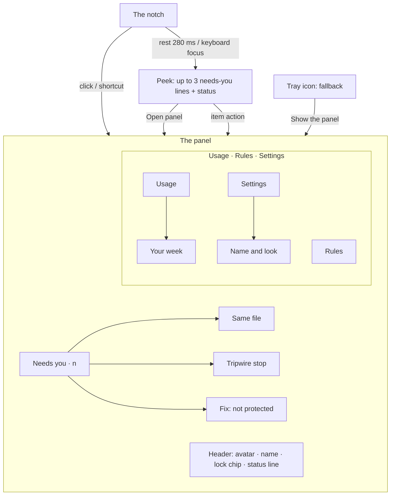

# The notch and the panel: IA, flows and states

| Date | Author | Status | Read with |
|---|---|---|---|
| 2026-10-26 | PM + UX (Claude), `ux-designer` role standards | **Needs founder design approval** (CR-011 §6) | [CR-011](../../../requirements/change-requests/CR-011.md) · [setup-flow.md](setup-flow.md) · [UI DESIGN.md](../../ui/companion/DESIGN.md) · [the 2026-10-25 notch design](../2026-10-25-atlas-notch-design.md) |

**Replaces** the surfaces, map and flows in [ia-and-flows.md](ia-and-flows.md) (tray popover as home, six-section main window). **Keeps** from it: the honest promise, the notification budget idea, the needs-you rules, the same-file rules, the heartbeat as evidence, the tripwire's content, the diagnostic, the Pro rules that never nag, and the edge paths. Where this file is silent, those still apply.

**The product in one line (founder, 26 Oct):** *one agent the user creates at setup, with rules and settings; then it is very simple: settings, rules and usage, and it sits as a notch. It never codes; it is just an agentsitter.*

**What the Euca can and can't do** (unchanged, shapes every flow): it watches, warns, blocks and explains. It can't answer a terminal prompt from outside, inject a message or pause an idle session. So every action in the notch and the panel either **takes you to the session**, **opens the evidence**, or **changes Eucas's own rules and settings**.

---

## 1. Surfaces

There is one character and two surfaces. No main window.

| Surface | Question it answers | Opened by | Size | Takes focus? |
|---|---|---|---|---|
| **The notch** | Is my Euca on, are sessions working, does anything need me? | Always there (top centre of the primary display) | 124 × 32 at rest; 164 with a marker; wider only for "Not protected" and a tripwire stop | **Never** |
| **The peek** (part of the notch) | What needs me, in one line each? | Resting the pointer on the notch for 280 ms, or focusing it with the keyboard | 372 wide, grows down from the notch | Never |
| **The panel** | Everything else: needs-you, Usage, Rules, Settings | A click on the notch (or the peek's "Open panel"), the global shortcut, or the tray menu | 400 × up to 640, 8 px under the notch | Yes: you asked for it |
| Tray icon (fallback only) | Is Eucas running at all? | Right-click: Show the panel · Show the notch as a thin line / pill · Quit Eucas… | 16 px + count badge | — |
| Windows notification (fallback only) | Something serious while the notch is hidden | Only when a full-screen app hides the notch **and** the event is a tripwire stop or "not protected" | Drawn by Windows | — |

**Why no main window.** The founder's picture is one character and three plain sections. Everything the old six-section window held fits the panel: Today becomes the needs-you list, Protection becomes the header line plus Rules and Settings › Protection, Retro becomes a page under Usage. Less to open, nothing to manage.

**Why the notch never opens by itself** (founder rule, carried from the 25 Oct design): something arriving gets one small nudge and a marker that stays. You choose when to look. A popup that opens over your work trains you to dismiss it unread.

---

## 2. Map

### 2.1 The panel, top to bottom

1. **Header** (always): the Euca's soft avatar (its eyes follow you), its name, the lock chip (**Locked** / **Not locked**, opens Rules), and the status line: "Protected · 3 sessions · checked 2 s ago" or, in red, "Not protected · bench: no check for 40 s". This is the heartbeat; it moves only when a real check happened.
2. **Needs you · n** (only when n > 0): up to 3 items, then "Show n more". When empty: one quiet line, "Nothing needs you." (kept by the removal test: you opened the panel to find out).
3. **Tabs: Usage · Rules · Settings.** The panel remembers the last tab; the first open shows Usage.
4. **Sub-pages** replace the panel's content in place, with a back arrow: Your week, Same file, Tripwire stop, Fix it, Name and look. Esc goes back, then closes.

**Tab order (decision D-1 for the founder).** The founder named them "settings, rules, and usage". The prototype orders them by how often you'll open them: **Usage** (every day), **Rules** (now and then), **Settings** (rarely). Switching to the founder's order is a one-line change.

### 2.2 What each tab holds

| Tab | Holds | Primary action | Empty / first state |
|---|---|---|---|
| **Usage** | 5-hour and weekly meters with a one-sentence forecast; where it went (today / 7 days, by project); the **supervisor meter**; Your week | none (read view) | "Usage appears after your first session." |
| **Rules** | the honest promise; the lock row; Safety rules (tested library, switches, lock glyphs); Your rules (from approvals and described); **Describe a rule** → drafted exact rule → Add | **Add rule** (only while a draft is open) | Your rules empty: "Rules you add show up here with how often they were used." |
| **Settings** | Name and look; Protection (admin lock, safety test); Privacy (Level 1/2); The notch (Pill / Thin line, sounds, theme); Help (diagnostic); Plan (trial, taste, Pro); Quit | per row | — |

---

## 3. The notch: behaviour rules

Carried from the approved 25 Oct design (hover not pop, the eyes, the glow, sounds) and adapted to an agentsitter.

### 3.1 One notch, many truths: what it shows

Only one state shows at a time. **Priority:** Not protected › Tripwire stop › Needs you › Working › Resting › Dozing.

| State | Eyes | Glow | Marker / words | When |
|---|---|---|---|---|
| **Resting** | Open, follow the pointer (≤ 2.5 px), blink every 3.8–7.2 s | none | none | Protected; no session is running a tool |
| **Working** | Same | The composer's voice glow gathered into a **beam that sweeps** under the eyes, in the Euca's colour | none | At least one session ran a tool in the last 20 s |
| **Needs you** | Glance at the marker once, then back | as above | **Amber count**, stays until dealt with | Any needs-you item |
| **Not protected** | **Concerned** | off | "**Not protected**" in red, red ring | The heartbeat failed: tool activity with no matching check, the guard missing, or the safety test failed |
| **Tripwire stop** | Concerned | off | Red marker "**Stopped notes**" | The tripwire stopped a session |
| **Dozing** | **Sleepy** (closed arcs, dimmed) | off | none | No input for 5 min **and** nothing running. Pointer movement or a session starting wakes it with a blink |
| Before setup ends | Closed, grey | off | none | First run, until the Euca is made |

**Why dozing can't be misread as "off".** The Euca only dozes when there is nothing to watch. If any session runs while you're away, the eyes stay open. And "off" has its own unmistakable state with words. (BRAND §8: idle is calm; only paused sleeps.)

**Never colour alone:** each state has an eye shape, and the serious ones have words. The notch is readable in a 1-bit render.

### 3.2 Something needs you (the founder's rule: never opens by itself)

1. **Arrives:** the notch drops 3 px and settles (spring, 640 ms, the only overshoot), the marker pops in, the eyes glance at it, and the soft **needs-you** sound plays once (BRAND §11; not in full-screen apps or calls; Windows Focus silences it). Then everything is still.
2. **Waits:** the count stays. With several items, the count is the total.
3. **You hover:** after 280 ms of rest the notch grows into the **peek**: up to 3 items (glyph, one line, one action) and a footer with the status and "Open panel ›". Moving away folds it back after 360 ms; the marker stays.
4. **You act or not:** each item's one action takes you somewhere (Open session, Show both, See what happened, Fix it). "Not now" lives in the panel only (snoozes 15 min). An item answered in the terminal resolves itself.

**The 280 ms rule.** The top centre is where browser tabs and title bars live. A peek that opens on a passing pointer would be the notch opening by itself in all but name, so it needs a resting pointer.

**What the peek never has:** an Allow or Deny. Eucas can't answer prompts from outside (v0.1), and a hover surface must never be one stray click from approving anything.

### 3.3 What counts as "needs you"

| Kind | Severity | Line (Pip is the example name) | Action | Resolves when |
|---|---|---|---|---|
| A session waits on a prompt or a question | amber | "bench is waiting for you · wants to run `pnpm build`" | Open session | Answered in the terminal, or the session ends ("bench ended before you answered. Nothing ran.") |
| A long run finished and waits (≥ 2 min) | calm | "api-docs finished and is waiting · ran 14 min, changed 3 files" | Open session | You type in it |
| Two sessions edit one file | amber | "Two sessions are editing one file · bench and api-docs · `src/router.ts`" | Show both | One commits or stops |
| **Tripwire stop** | red | "Pip stopped notes · deleted 1,240 files in 20 s" | See what happened | You open it (the record stays in the log) |
| **Not protected** | red | "bench isn't protected · no check for 40 s while it ran tools" | Fix it | A real check passes |
| Not verified after an update | amber | "Claude Code 2.1.315 isn't verified yet" | Run the test | The safety test passes |
| (Pro / trial) the supervisor wasn't sure | amber | the session-waiting line plus "Pip didn't answer: not sure" | Open session | as the first row |

**Not** needs-you: blocks that already happened (they're in Rules' counters and the log), usage (a meter), the supervisor meter running out (Usage says so), Pro, tips.

### 3.4 The panel opens on a click

- Grows from the notch: 8 px below it, scale 0.97 → 1 and fade on `--spring-smooth`, 320 ms.
- Takes keyboard focus (you clicked). Light-dismiss on a click outside; Esc closes and returns focus to the notch.
- **Never opens itself**, not even for a tripwire stop.

### 3.5 Thin-line mode (Settings › The notch › Look)

For laptops with a thick top bezel, or if you want less. The notch becomes a 96 × 4 line at the top edge; the working beam runs along the line; a needs-you item adds a dot at its right end. **Hover grows it into the full pill and peek.** **Not protected always overrides thin line** and shows the full pill with words: safety beats preference.

### 3.6 Windows constraints (for the build, SP-ST1)

- A floating, always-on-top window at the top centre of the primary display; it never takes focus at rest; **clicks pass through outside its visible shape** (the hit region grows and shrinks with the peek).
- **Steps aside for full-screen apps** (games, video, presentations). While hidden, markers wait; only a tripwire stop or "not protected" sends one Windows notification.
- Multi-monitor: primary display by default (the display choice is left to the build). DPI: sizes are CSS px at 100 % and scale with the display.
- Keyboard: a global shortcut opens the panel (default left to the build: must not clash with Windows, IMEs or common editors). Tab moves through the peek's actions when the notch has focus.
- Idle budget: near zero CPU when nothing moves; the beam and blink are the only loops.

---

## 4. Core flows

Each follows **trigger → evidence → one primary → after (what happened, undo, next)**.

### 4.1 A session waits for you
Trigger: the Notification/Stop hook. → Notch: nudge, marker, sound. → Hover: "bench is waiting for you · wants to run `pnpm build`" [Open session]. → Open session focuses the terminal or the desktop app's session; if Eucas can't find the window it names it ("It's the Windows Terminal tab titled bench"). → After: the item leaves; a toast in the panel "Opened bench in Windows Terminal".

### 4.2 Two sessions, one file
Trigger: session B writes a file A wrote in the last 15 min. → Item: "Two sessions are editing one file". → Show both opens the sub-page: both sessions' last edits side by side, Open bench / Open api-docs, "Don't warn for this file today". Never blocks; never says "conflict" when git would merge cleanly.

### 4.3 Tripwire stop (the worst moment)
Eucas stops the process tree, **verifies it stopped**, then: red notch marker "Stopped notes", concerned eyes, the sound. Hover: one line + See what happened. Sub-page: "Pip stopped notes at 14:02:31", what was deleted (grouped by folder, exportable), how to get it back (git restore / File History / OneDrive, whichever is on), **Open the folder**, "This was expected" (adds the folder to the tripwire's allowed list, consequence spelled out). If deletes continue after the stop, the page updates live and never claims "stopped" until the count stops moving.

### 4.4 Not protected
Trigger: tool activity with no check, within one tool call. → The notch widens with "Not protected", red ring, concerned eyes; overrides thin line. → Item "bench isn't protected" [Fix it]. → Sub-page: a checklist (what's fine, what isn't, why), the specific repair ("Restart bench to protect it. Nothing it did was lost."), Run the diagnostic. Never green until a real check passes. **Fail-closed brick** (our guard crashes and blocks every call) keeps the old design: the only place a 15-minute off switch is offered, with an automatic return.

### 4.5 Describe a rule (prompted rules, D-4)
In Rules (or setup step 4): "Describe a rule in your own words" → **Draft it** → a draft card: *You wrote: "…"*, the exact rule in mono (`block Edit, Write · in api-docs/migrations/ and everything in it`), what it would have done last week ("would have blocked 3 calls, all from api-docs"), "It can't loosen a locked rule." → **Add rule** · Reword · ☑ Lock it too (asks for admin). Drafts are checked against the bypass suite; anything that would relax a hard limit can't be added.

### 4.6 Change a locked rule
A locked rule's switch shows a lock. Pressing it says "Locked rules change with admin. Windows will ask." → UAC → the change. Declined: nothing changes.

### 4.7 The supervisor meter runs out
Usage › Supervisor shows "Help left this month · 0% · Resets 1 Dec" and, in bold, **"Pip will check with you more often until 1 Dec."** + "Your rules and protection don't change." One Pro line only here (where the free answer runs out): "Pro keeps it going all month: $20/month, $15 for the first 200. See Pro". Never a needs-you item, never in the notch, never a Windows notification.

---

## 5. The supervisor meter, trial and taste (CR-011 §4–5)

- **What it shows:** help left this month as a percentage and a bar in the Euca's colour, plus the reset date (trial: the end date). **Never dollars, never a call count.** The limit behind it is a hidden per-user cost budget.
- **Value line under it**, to make the deposit visible (premium-craft gate 6): "Answered your agents 41 times so far, so they didn't wait for you. It never approves a tool call."
- **States:** trial ("Trial · 12 days left", ends 9 Nov) · trial ended (100 %, "From now on Pip gets a small amount of supervisor help each month") · taste (55 %) · running low (9 %, "When it's empty, Pip asks you instead until 1 Dec") · empty (above) · Pro (64 %, resets on the renewal date) · supervisor unreachable ("The supervisor isn't reachable right now. Pip asks you until it's back.") · Level 1 (the meter is replaced by one line: "The supervisor needs Level 2. At Level 1, Pip asks you." with a link to Privacy).
- **Trial start:** at setup, Level 2 shows an optional email field ("One trial per email. No card."). Skipping it is fine; the trial can start later from Usage (decision D-3).

---

## 6. State matrix

Every cell is designed or marked N/A with why. *(proto)* = drawn in the prototype; *(spec)* = specified here.

| Surface | Default | Working | Empty | Partial | Error | Offline | Usage limit | Permission denied | Success |
|---|---|---|---|---|---|---|---|---|---|
| **Notch** | Resting *(proto)* | Beam *(proto)* | Before setup: grey closed eyes *(proto)* | Some sessions not protected → Not protected wins *(proto)* | Not protected *(proto)*; tripwire *(proto)* | Unaffected: the guard is local *(spec)* | Unaffected; the peek status shows "5-hour limit reached · 15:40" *(spec)* | Org policy blocks hooks: a permanent "Not protected" with "Blocked by your organisation" in the peek *(spec)* | Item resolved: marker count drops, no sound *(spec)* |
| **Peek** | Items + status *(proto)* | — | Status only *(proto)* | "+2 more" in the footer *(spec)* | Danger item first, white button *(proto)* | Supervisor line "unreachable" *(spec)* | Status line says so *(spec)* | Org line *(spec)* | — |
| **Panel header** | Protected line *(proto)* | — | "Protected · no sessions running" *(proto)* | — | Red line *(proto)* | Unaffected | — | "Blocked by your organisation" *(spec)* | Not locked → Locked chip after UAC *(spec)* |
| **Needs you** | List *(proto)* | — | "Nothing needs you." *(proto)* | Show n more *(spec)* | Stale: "bench ended before you answered. Nothing ran." *(spec)* | — | — | — | Opened/snoozed toast *(proto)* |
| **Usage** | Meters + where + supervisor *(proto)* | — | "Usage appears after your first session." *(spec)* | Tokens only, no plan data: "Claude Code hasn't reported plan limits yet" *(spec)* | Status line not reporting → Diagnostic *(spec)* | Supervisor unreachable line *(spec)* | "5-hour limit reached. Claude Code pauses new requests until 15:40. Your sessions keep their work." No upsell *(spec)* | API key mode: cost in $ (it's your bill, not ours) *(spec)* | — |
| **Supervisor meter** | Trial *(proto)* | — | Empty *(proto)* | Low *(proto)* | Unreachable *(spec)* | Unreachable *(spec)* | Empty *(proto)* | Level 1 *(spec)* | Trial ended → taste *(proto)* |
| **Rules** | Promise + lock + lists *(proto)* | Drafting ("Drafting…" on the button, ≤ 3 s) *(spec)* | Your rules empty line *(spec)* | Not locked *(proto)* | Couldn't save: "Your settings file is locked by another program. Nothing changed. Retry" *(spec)* | Drafting needs no network (local templates + exact grammar); if a model is used it falls back to "Write it as an exact rule" *(spec)* | N/A | Locked rule toast *(proto)*; org policy: read-only with why *(spec)* | Added toast + Undo *(proto)* |
| **Settings** | Groups *(proto)* | Safety test running *(spec)* | — | — | Diagnostic red lines *(spec)* | Plan row: "Can't check your plan offline. Pro keeps working for 7 days." *(spec)* | — | — | — |
| **Setup** | see [setup-flow.md §4](setup-flow.md) |

---

## 7. Worst moments, coherence, intelligence

**Worst moments** (each names the cause, what is safe, one next step): tripwire stop (§4.3), not protected (§4.4), the safety test not blocked in setup (setup J), admin declined (setup H: "Not locked" everywhere it matters), the meter empty (§4.7), the 5-hour limit (Usage, no upsell), the session ended before you answered ("Nothing ran"), a long project name (middle ellipsis: `claude-…-afc419`), a 3-line command (mono, wraps, "show all").

**Coherence: one pattern per situation.**
- One **needs-you item** in the peek (compact) and the panel (full), same words, same order, same action.
- One **status line** (the heartbeat) in the peek footer, the panel header and setup's last step.
- One **rule row** in setup and in Rules; one **draft card** in both.
- One **Name and look** editor in setup step 2 and Settings.
- One status vocabulary: **Protected / Not protected / Locked / Not locked**. (The old "Guarded" is retired: CR-011 uses "protected", and one word is easier.)
- The honest promise is one string, used in Rules and on the website.

**Intelligence layer:** suggestions from your approvals; every rule shows its counter ("used 212 times", "blocked 3 times"); the supervisor meter's value line; the forecast learns your pace; Your week compares to the last. **Exit question:** what would you rebuild elsewhere? Your rules and their history: plain files you can export.

---

## 8. Validation tasks for the founder (prototype, then build)
1. "Set up Eucas and give your Euca a name." Success: under 5 minutes, no help.
2. "Is your Euca protecting you right now? How do you know?" Success: points at the eyes, hovers, reads "checked 2 s ago".
3. "Something needs you. What, and where do you go?" Success: hovers, reads the line, presses the one action.
4. "Make Pip block edits to a folder you care about." Success: describes it, reads the draft, adds it.
5. "How much supervisor help is left, and what happens when it's gone?" Success: finds Usage › Supervisor and reads the reset date.
