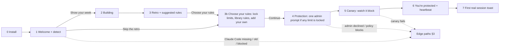

# First run in under 5 minutes: the Eucas companion

> **Partly superseded 2026-10-26 by [setup-flow.md](setup-flow.md)** ([CR-011](../../../requirements/change-requests/CR-011.md)): the screen sequence is replaced (make your Euca, choose and lock rules, privacy, the notch). The evidence, the timing method, the validation tasks and edge paths A–Q still apply and are referenced by letter. Kept as history.

| Date | Author | Status | Read with |
|---|---|---|---|
| 2026-10-26 | Lead UX researcher (Claude) | Draft for the UI designer and the client; no gate yet | [ux-research.md](ux-research.md) (evidence), [ia-and-flows.md](ia-and-flows.md) (the app after first run) |

> Links to `docs/research/…` point at the 25–26 Oct research files, which are not merged into `dev` yet (see [ux-research.md](ux-research.md), Inputs).

**Goal.** In under 5 minutes, without an account, you see your own week with Claude Code, turn on protection, and watch it block a test push with your own eyes. The finish line is a visible, ticking heartbeat, not a promise.

**Why this shape (from the evidence).**
- An empty first screen kills a watcher tool: nothing happens until two sessions collide or an agent asks something ([execution pre-mortem](../../../research/teardowns/eucas-premortem-execution.md) F10). ccusage shows that history already on disk is instant value (F1, F2). So the **7-day retro is the first real screen**, not a tour.
- Trust is earned by proof, not by a green word. The canary test (a harmless blocked call, shown live) turns "protected" from a claim into something you saw ([trust pre-mortem](../../../research/teardowns/eucas-premortem-trust.md) PM-T3).
- The honest promise is about **Eucas's own behaviour**, plus a guard that tells you when it's off. No absolute "never" about the agent (trust pre-mortem §6).
- No login: Eucas inherits your Claude Code setup and never reads credentials (ADR-0002).

**Copy rules applied:** second person, the app speaking as your main agent ("What needs you", never "me/my"); sentence case; numbers first, reassurance second, one next step last ([BRAND §4](../../ui/brand/BRAND.md)); every line passes the removal test. Copy below is a **draft** for the UI designer to fit, not final.

---

## 1. The happy path at a glance

| # | Screen | Clock (cumulative) | What you do | What Eucas does |
|---|---|---|---|---|
| 0 | Download and install | 0:00 → 0:50 | Run the installer; pass SmartScreen (More info → Run anyway: v0.1 isn't code-signed) | Per-user install, no admin; tray icon appears |
| 1 | Welcome: "Let's look at your week" | 0:50 → 1:10 | Read one paragraph, press **Show your week** | Detects Claude Code, version, history, existing hooks and status line (in parallel, already running) |
| 2 | Building your week | 1:10 → 1:40 | Watch (≤ 30 s) | Reads 7 days of local history, counts only; cards appear as each is ready |
| 3 | Your week with Claude Code (the retro) | 1:40 → 3:00 | Skim 4 cards; tick suggested rules; press **Choose your rules** | Nothing written yet |
| 3b | Choose your rules (CR-010, founder 2026-10-26) | to re-measure | Choose which of the 4 limits to lock; switch library rules on or off; optionally add your own | Nothing written yet |
| 4 | Turn on protection | 3:00 → 3:40 | Read what changes; approve **one** Windows admin prompt (only if you locked at least one limit) | Installs the hooks plugin at user scope, wraps your status line, writes the locked limits as managed settings |
| 5 | Watch it work (the canary) | 3:40 → 4:05 | Watch a test call get blocked | Runs a harmless test session: a push to `main` in a throwaway repo, blocked and logged |
| 6 | You're protected | 4:05 → 4:30 | Pin the tray icon; close the window | Heartbeat starts; waits for your sessions |
| 7 | First real session (any time later) | — | Keep working in Claude Code | Toast: "Guarding bench" the first time a session is seen |

**Budget:** 4:30 on a machine with Claude Code already installed, with the **unsigned** v0.1 installer, so SmartScreen's More info → Run anyway is part of screen 0 (CR-010, founder 2026-10-26). The "Choose your rules" step (3b) is new and not yet timed; the under-5-minute goal holds only if it takes about 30 s or less (to re-measure). Screens 1–6 are one window (720 × 560, centred, dark by default) with a slim step indicator ("1 of 5"); it never opens a second window. Back is always available until screen 4 writes anything.

---

## 2. Screens, step by step

Each screen card follows `ui-ux-guide` + `premium-craft`: intent, one primary action, evidence (what happened / how to take it back / what's next), consequence preview, states.

### Screen 0: Download and install (0:00 → 0:50)

- **Intent:** Do. **Primary:** none of ours (Windows owns this moment).
- **Design decisions:**
  - **Per-user install, no admin** for the app itself (`%LOCALAPPDATA%`), so the only elevation in the whole first run is the one in screen 4, where it is explained.
  - **Unsigned in v0.1** (CR-010, founder 2026-10-26; replaces "signed from the first public build", trust PM-T10, decision D-3). No Authenticode signing until revenue covers it. What stands in for it: the installer's **SHA-256 is published on the site**, and **updates are signed** with the updater's key, so a tampered update is rejected. Consequences the copy must own: SmartScreen **will** show "Windows protected your PC" for every early user, and the UAC prompt in screen 4 is **yellow, "Unknown publisher"**. The download page says so before you run anything, with a screenshot of the real dialog and "More info → Run anyway", so the warning matches what you were told.
  - The installer has **no choices** (no folder picker, no "launch at login" checkbox): defaults are right, and each is reversible in Settings.
  - On finish, the app opens screen 1 and the **tray icon appears** (grey "setting up" state).
- **Download-page copy (draft, CR-010, founder 2026-10-26):** "Eucas isn't code-signed yet, so Windows shows 'Windows protected your PC' when you run the installer. Choose More info, then Run anyway. To check the file is the one we published, compare its SHA-256 with the one on this page: in PowerShell, run `Get-FileHash <installer file>`. Updates are signed, so a changed update is refused."

### Screen 1: Welcome, "Let's look at your week" (0:50 → 1:10)

- **Intent:** Go. **Primary:** **Show your week**. **Secondary:** Skip the retro (text button).
- **Layout (Z pattern ending on the button):** the Quartet mark small, top left; headline; one paragraph; a **detection checklist** that fills in by itself; the primary bottom right.
- **Copy (draft):**
  - Headline: **Let's look at your week with Claude Code**
  - Body: "Eucas reads the last 7 days of Claude Code history on this PC and shows what your sessions did. It keeps counts, never the text of your prompts or files, and nothing leaves this PC."
  - Checklist (each line ticks as it resolves, ≤ 3 s total):
    - "Claude Code 2.1.312 found"
    - "312 sessions in the last 7 days"
    - "Your status line: ccstatusline (it stays)" · or "No status line yet"
    - "2 hooks of your own (they keep working)" · or nothing if none
  - Button: **Show your week**
  - Link under the paragraph: "What Eucas reads" → a popover listing the exact folders and fields (paths in mono), and what is never read (`.credentials.json`, OAuth tokens, prompt text stored).
- **Evidence:** each tick is a fact you can verify; nothing is written yet (said by omission: there is no "install" word on this screen).
- **Why the consent sits here, not on its own screen:** the removal test. A separate "privacy" screen adds a click and a page; one sentence plus the "What Eucas reads" popover carries the same information.
- **States:** detecting (lines show a quiet spinner glyph, not a page spinner) · found (ticks) · edge paths A–E (§3) replace the checklist line that failed and change the primary.

### Screen 2: Building your week (1:10 → 1:40, ≤ 30 s)

- **Intent:** Know (wait well). **Primary:** none while building; the retro takes over the same window.
- **Design:** the four retro cards appear **as each finishes**, in a fixed order (usage → risky commands → same-file clashes → your approvals), so the screen is never empty and never jumps. A one-line progress caption: "Reading 312 sessions · 4 of 7 days" (tabular figures).
- **Performance rule for engineering:** stream; show the first card within 5 s even if the rest take 30. Above 30 s (very heavy history), show what's ready and keep reading in the background: "Showing 5 of 7 days. The rest fills in as you read."
- **Emotional moment #1 (pinned): the reveal.** Cards settle in on a short spring; the numbers count up once (≤ 400 ms, off under reduced motion). This is the "it already knows my work" moment.

### Screen 3: Your week with Claude Code (the retro) (1:40 → 3:00)

- **Intent:** Know, then Do. **Primary:** **Choose your rules** (leads to screen 3b; CR-010, founder 2026-10-26. The count of rules you ticked moves to 3b's primary).
- **Hierarchy test:** the headline number (your week) first, the risky-commands card second, the suggested rules third.
- **Headline (draft):** "**Your week: 41 sessions in 6 projects, about 62 % of your weekly limit.**" (Plan share only if the status line ever recorded `rate_limits`; otherwise tokens only, see edge path G.)

**The four cards (copy drafts, real numbers from the user's history):**

| Card | Headline | Body | Action |
|---|---|---|---|
| 1. Usage | "1.9 M tokens · busiest on Thursday" | A 7-bar day chart, one bar per day, the busiest project named. "bench used 58 % of it." | Look inside (opens the per-project table) |
| 2. Risky commands that ran | "3 commands this week would have been stopped" | Each as one mono line with project and time: `git push origin main` · bench · Thu 14:02. "Eucas never auto-approves these. With protection on, they're blocked and shown to you." | None (it feeds the primary) |
| 3. Same-file clashes | "2 sessions edited `src/router.ts` 4 minutes apart" | "This happened 4 times this week. Eucas would have warned you the moment the second session touched the file." | Look inside (the four moments) |
| 4. Your approvals, as rules | "You approved these by hand most often" | A list of up to 5 suggestions, each a checkbox row: `pnpm test` · "you allowed it 212 times" · scope "in bench". Pre-ticked only if read-only or exact (see rules below). | The ticks feed the primary |

**Rules for suggested rules (from trust PM-T5):**
- Suggestions are **exact commands with a scope** (a folder), never globs like `git *`.
- Commands that run other code (`npm install`, `npx`, `pip install`, `python`, `node`, `make`, test runners, `bash -c`, `powershell -c`) are **shown but never pre-ticked**, with a quiet line: "Runs code from the project. Tick only if you trust every repo here." Package installs are offered only in safe forms (for example `--ignore-scripts`).
- Each row shows its **blast radius before saving**: "Would have auto-approved 212 calls in the last 7 days, all in bench/."
- If your own Claude Code settings already have an `ask` or `deny` rule for the same command, the row says so: "Your Claude Code settings ask for this every time. That wins; this rule would do nothing." and is not tickable (execution F22, F23).
- Nothing in this list can ever allow a delete, a push to your default branch, a send or a payment: those commands don't appear here.

**Empty and thin history:** see edge path F. **Copy removal check:** no "Welcome to your dashboard", no feature tour; every card is the user's own data.

**Secondary actions:** "Skip rules for now" (text) · Back.

### Screen 3b: Choose your rules (CR-010, founder 2026-10-26; spec, not drawn yet)

Resolves decision D-4 ([ux-research §7](ux-research.md)). Sits **before** the UAC step, so the admin prompt only ever asks for what you chose to lock.

- **Intent:** Do. **Primary:** **Continue** to screen 4 (carries the count: "Continue · 3 rules"). **Secondary:** Back.
- **Three parts, top to bottom:**
  1. **The four limits, always on.** Delete · push to your default branch · send · payment. Each row is shown on, with **no off switch**, ever. The one choice per limit is **Locked** (written as managed settings, with admin) or **Not locked** (user scope, labelled "not locked" here and everywhere afterwards). The promise sits under the four rows, as fixed copy: "**Eucas never auto-approves a delete, a push to your default branch, a send or a payment, and no rule can change that.**"
  2. **Library rules**, each with an on/off switch. The suggestions you ticked in screen 3 arrive here switched on.
  3. **Add your own** (prompted rules, in v0.1, Free): describe a rule in plain words → a preview shows exactly what it allows or blocks → **Confirm**. The draft comes from the provider-hosted model through the Eucas server; only your sentence is sent, and it counts toward the supervisor budget. No rule you write or confirm can make Eucas auto-approve one of the four limits.
- **What it changes on screen 4:** if at least one limit is locked, screen 4 raises the one admin prompt for the locked limits only. If none is locked, screen 4 has no admin prompt and every limit shows "not locked". The old secondary "Without admin (weaker)" on screen 4 is replaced by this per-limit choice.
- **Later:** the same choices live in Rules › Limits. Changing which limits are locked asks for admin again.
- **Step indicator:** the first-run window gains one step (was "of 5").
- **Open (not in decisions.md):** the default lock choice per limit (the earlier D-4 recommendation was admin), and the offline state of "Add your own" (it needs the Eucas server).

### Screen 4: Turn on protection (3:00 → 3:40)

- **Intent:** Do. **Primary:** **Turn on protection**. **Secondary:** Back (CR-010, founder 2026-10-26: the "Without admin (weaker)" text button is replaced by the per-limit lock choice in screen 3b).
- **Consequence preview, before the click (draft):**
  - Title: **Turn on protection**
  - "This adds to your Claude Code setup on this PC:"
    - "A Eucas plugin that checks every tool call in every local session, including ones already running."
    - "Your status line, wrapped so it still shows exactly as before."
    - "3 rules you chose."
    - "The 4 limits, always on. The ones you locked are written where an agent can't switch them off. Windows asks for permission once for this." (CR-010, founder 2026-10-26; if none is locked: "The 4 limits, always on, in your user settings (not locked).")
  - The promise, worded honestly (fixed copy, see [ux-research §4.2](ux-research.md)): "**Eucas never auto-approves a delete, a push to your default branch, a send or a payment, and no rule can change that.**"
  - The limit of the promise, one line, Text 2: "Eucas sees tool calls, not what a program does once it runs, and nothing in the cloud. Keep git and backups on."
  - "Undo any time: Settings › Remove Eucas puts everything back as it was."
- **The one admin prompt.** Pressing the primary raises the Windows UAC dialog for the managed-settings write of the **locked** limits only (trust PM-T2); with no limit locked, there is no prompt. Before it appears, the button's label changes to "Waiting for Windows…" and a line sets up what you'll see, so the UAC dialog is expected, not a surprise.
  - **v0.1 copy (CR-010, founder 2026-10-26; replaces "It will name [publisher]"):** "Windows is asking for permission. Because Eucas isn't code-signed yet, it shows a yellow box that says 'Unknown publisher'. Check that it names `eucas-elevate.exe`, from Eucas's folder, then choose Yes."
  - No copy anywhere tells you to press No on "Unknown publisher": in v0.1 that is what Eucas's own prompt looks like. What you check instead is the program name and its folder.
  - Before raising the prompt, the app checks the elevate helper against a pinned SHA-256 hash built into the app (not an Authenticode check).
- **Working state:** a checklist that ticks: "Plugin added" · "Status line wrapped" · "Limits written" · "3 rules saved". Each line links to the exact file it touched (Look inside).
- **States:** default · waiting for UAC · writing · done → screen 5 · UAC declined (edge H) · policy blocks (edge D) · write failed (edge I).
- **Emotional moment: none here on purpose.** Elevation is a sober moment; no animation beyond the ticks.

### Screen 5: Watch it work, the canary (3:40 → 4:05)

- **Intent:** Know. **Primary:** **Done** (appears when the test finishes).
- **What happens:** Eucas starts a tiny, throwaway Claude Code check in a temporary folder with a local test repo and asks it to run `git push origin main`. The guard blocks it. Nothing touches your projects or the network; the folder is deleted after.
  - Engineering note: whether this needs a real model turn (tokens) or can call the hook directly with a synthetic tool call is a spike question (S-1 in [ux-research §8](ux-research.md)). The UX is the same either way; the copy changes only in the cost line.
- **Copy (draft), shown as a three-line live log:**
  - "Starting a test session in a temporary folder…"
  - "It tried: `git push origin main`"
  - "**Blocked by Eucas** · 0.3 s · logged"
  - Then: "That's what happens in your real sessions. You'll see every block in Protection." If a real model turn is needed: "· used about 400 tokens".
- **Emotional moment #2 (pinned): the proof.** The blocked line lands with the "blocked" glyph and a single soft sound (sound on by default per DESIGN-SYSTEM §8.5, off under Windows Focus). This is the trust moment the whole product rests on.
- **States:** running · blocked (success) · canary not blocked (edge J, the most important failure in this flow) · canary couldn't start (edge K).

### Screen 6: You're protected (4:05 → 4:30)

- **Intent:** Go. **Primary:** **Close** (the window closes to the tray; it doesn't quit).
- **Copy (draft):**
  - Headline: **You're protected**
  - The heartbeat line, live: a small pulse glyph + "Guard on · checked 2 s ago". It ticks while you read, which is the point.
  - "Sessions appear here within a few seconds of starting. You have 2 running now: both guarded." (or "None running now. Start or continue one in Claude Code.")
  - "**Eucas lives in the taskbar corner.**" With an inline illustration of the Windows 11 overflow (^) and one button: **Keep it visible** (opens Settings › Personalization › Taskbar › Other system tray icons, if the deep link exists; otherwise numbered steps). Windows 11 hides new tray icons in the overflow by default (see [ux-research §2.3](ux-research.md)).
  - "Eucas tells you when something needs you, with a Windows notification. [Send a test notification]" (shows a real toast; if Focus is on, says so: "Focus is on, so notifications wait. Eucas shows a count on its icon instead.")
- **Emotional moment #3 (pinned): the first heartbeat.** The pulse begins once and keeps a slow, steady rhythm (never faster than every 2 s visually; reduced motion: the timestamp alone updates).
- **Ending (peak-end):** confirmation + next step in one line. Closing shows a single tray balloon/toast: "Eucas is in the taskbar corner. Click it any time."

### Screen 7: The first real session (any time later)

- **Toast (draft):** "Guarding bench · protection checked" (no action; auto-hides in 6 s). Only for the **first** session of each project, then never again; later sessions appear silently in the tray popover.
- **If the session started before install and the guard can't yet see it** (file watcher didn't pick up the plugin, open unknown U7): the tray shows that session as "Not guarded yet · restart it to guard" (amber, with the word). Never assume.

---

## 3. Edge and error paths

Each names the cause, what is safe, and one next step. Letters are referenced from the screens.

| # | Situation | Where it shows | What you see (draft) | Primary action | Notes |
|---|---|---|---|---|---|
| A | **Claude Code not found** | Screen 1 checklist | "Claude Code isn't on this PC yet. Eucas watches Claude Code sessions, so it needs it first." | **Get Claude Code** (opens the official install page) · then "Check again" | Also checks the desktop app's bundled CLI and npm/native installs; lists the paths it looked in (Look inside) |
| B | **Old Claude Code** (below the known-good version for Windows hooks, currently 2.1.310) | Screen 1 checklist, then Protection forever | "Claude Code 2.1.297 is older than the version Eucas has tested on Windows (2.1.310). On older versions, the guard can fail without telling you." | **Update Claude Code** (shows `claude update` in mono with Copy) · secondary "Continue, not guaranteed" | If you continue, the status stays amber "Not verified for 2.1.297" everywhere, never green (execution PT-5) |
| C | **Two Claude Code installs** (native + npm on PATH) | Screen 1 | "Two copies of Claude Code are installed. Sessions may start from either, and hooks have broken this way before." | **Show both** (paths, versions) · "Continue" | Known regression class (execution F16) |
| D | **Managed policy blocks hooks** (`allowManagedHooksOnly` or `disableAllHooks` set by an organisation) | Screen 1, before any promise | "Your organisation's Claude Code policy only allows its own hooks, so Eucas can't guard sessions on this PC. You can still see your retro and usage." | **Show your week** (retro only) · "Copy a note for your IT team" | Eucas never writes into an employer's managed policy (trust F17). Protection screens show "Blocked by your organisation" permanently |
| E | **Existing status line** | Screen 1 + 4 | Screen 1: "Your status line: ccstatusline (it stays)". Screen 4: a before/after preview line showing it unchanged | — | Wrap and chain, never replace; restore exactly on uninstall (PT-6) |
| E2 | **Existing hooks of your own** | Screen 1 + 4 | "2 hooks of your own keep working. Eucas's run alongside them." If one of them is a PreToolUse hook that can allow calls: "One of your hooks can allow tool calls. Eucas's limits still win: a deny always beats an allow." | — | Precedence deny > ask > allow (trust F3) |
| F | **No or thin history** (fresh install, or < 3 sessions in 7 days) | Screen 3 | Headline: "Not much to look back on yet." Body: "Your retro builds itself as you work. Here are the five rules most people start with." Shows 5 templates as the rules card | **Turn on protection** (unchanged) | Never a blank card; the templates replace the suggestions (execution PT-2) |
| G | **No plan data** (`rate_limits` absent: API key, or no response yet) | Screen 3 usage card | "Tokens only: Claude Code hasn't reported plan limits on this PC yet. Your 5-hour and weekly forecast starts after your next session." | — | The status line sends `rate_limits` only for Pro/Max and only after the first response (execution F28). If `ANTHROPIC_API_KEY` is set: "Claude Code is using an API key here, so it bills per token, not your plan." |
| H | **Admin prompt declined** | Screen 4 | "Protection is on, but weaker: without admin, the limits sit in your user settings, where an agent could change them. Eucas watches for that and tells you." | **Try again with admin** · "Keep it weaker" | Status everywhere: "Guard on · user level" with the word, amber dot; one tap to upgrade later. CR-010, founder 2026-10-26: the limits stay on; the ones you chose to lock show "not locked" until admin is given |
| I | **Couldn't write a setting** (file locked, permissions, antivirus) | Screen 4 checklist line turns red | "Couldn't add the plugin: the file is locked by another program. Nothing else was changed." | **Retry** · "Run the diagnostic" | Writes are atomic per file with a backup; partial installs roll back |
| J | **Canary not blocked** (the guard let the test push through in the sandbox) | Screen 5 | "**The test wasn't blocked.** Eucas is not protecting your sessions on this PC yet. Nothing outside the test folder was touched." | **Run the diagnostic** (prefilled report) · "Show what happened" | Never show "You're protected" after this. Tray stays red. This is a kill-criterion signal (trust §5.2) and is reported (opt-in) |
| K | **Canary couldn't start** (no Git, no network for a model turn, Claude Code login expired) | Screen 5 | "The test couldn't run: Git isn't installed. Your protection is on, but it hasn't been proven on this PC yet." | **Retry** · "Skip the test" | Status: "Guard on · not yet tested" (amber) until a real block or a later canary passes |
| L | **SmartScreen blocks** | Before screen 0 | Handled on the download page (screen 0). If the user lands in the app later via "Run anyway", no special state | — | 10 % abort rate is a kill signal (trust §5.6). With the unsigned v0.1 (CR-010, founder 2026-10-26), every early user meets this dialog, so the signal is measured from the first download |
| M | **Antivirus quarantines the guard binary** | Any time; first at screen 5 | "Your antivirus moved Eucas's guard into quarantine, so sessions are not guarded right now." | **How to restore it** (vendor-specific steps) · Run the diagnostic | The heartbeat catches this within one tool call (trust PM-T3) |
| N | **Sessions already running during install** | Screen 6 | Each running session listed with its own state: "Guarded" or "Not guarded yet · restart it to guard" | — | Depends on whether the file watcher picks up a new plugin (U7) |
| O | **No Git Bash** (hooks run under PowerShell) | Silent unless it matters | Doctor shows the shell; Protection shows "Tested with PowerShell" | — | Fail-open bugs here were fixed in 2.1.309/310 (execution F15) |
| P | **Notifications off or Focus on** | Screen 6 | "Windows notifications are off for Eucas. You'll still see a count on the tray icon." | **Turn them on** (opens Settings › Notifications) | Never nag again after this |
| Q | **Quit during first run** | Any screen | Before screen 4: nothing was written; reopening resumes at screen 1. After screen 4: protection stays on (it lives in Claude Code); reopening resumes at screen 5 | — | Say it on the quit confirmation: "Protection stays on while Eucas is closed. Only the heartbeat and notifications stop." |

**Uninstall (the last impression):** Settings › Remove Eucas shows exactly what will be restored (plugin removed, status line restored to `<your command>`, managed settings removed with one admin prompt, rules deleted, local counts wiped), then one button. The Windows uninstaller calls the same routine. A final line: "Removed. Claude Code is exactly as it was on 26 Oct."

---

## 4. Timing assumptions and how to test them

| Step | Budget | Assumption | Test |
|---|---|---|---|
| Install | 50 s | ~120 MB Electron installer on broadband; SmartScreen adds ~15 s (always shown in v0.1: unsigned, CR-010, founder 2026-10-26) | Time it on a clean Windows 11 VM with the unsigned build |
| Choose your rules (3b) | not budgeted | New step (CR-010, founder 2026-10-26); "Add your own" waits on the Eucas server | Moderated test with the founder |
| Detection | 3 s | Reading version and settings files is local | Instrument |
| Retro | ≤ 30 s, first card ≤ 5 s | 7 days of JSONL for a heavy user is tens of MB | Benchmark on the founder's own history (largest real case we have) |
| Reading the retro | 80 s | 4 cards, ≤ 5 rule rows | Moderated test with the founder (task 1 below) |
| Protection + UAC | 40 s | One UAC prompt | Instrument |
| Canary | 25 s | Hook-only call is near-instant; a model turn adds ~10 s | Spike S-1 |
| Close | 25 s | Pinning the tray icon is optional | Instrument |

**Validation tasks for the client (run on the prototype, then on the build):**
1. "Install Eucas and tell me what your sessions did last week." Success: under 3 minutes to the retro headline, no help.
2. "Make Eucas stop asking you about your test command in bench." Success: ticks the suggested rule and can say which folder it covers.
3. "Is Eucas protecting you right now? How do you know?" Success: points at the heartbeat line or the tray icon and reads its timestamp.
4. "Something was blocked. Find out what and why." Success: reaches the Protection log entry in ≤ 2 clicks from the toast or tray.
5. "Take Eucas off this PC and check Claude Code is back to normal." Success: finds Remove Eucas and reads the restore list.

Activation metric (opt-in, local count first): **reached screen 6 with the canary blocked**, and **at least one real session guarded within 24 h** (execution §6: < 30 % reaching "first protected session" is a stop signal).

---

## 5. Premium-craft outputs for this flow

**State matrix (first-run window):**

| Screen | Default | Working | Empty | Partial | Error | Offline | Usage limit | Permission denied | Success |
|---|---|---|---|---|---|---|---|---|---|
| 1 Welcome | Checklist ticks | Spinner glyph per line | N/A (always has detection lines) | Some lines unresolved after 3 s: shown as "Still checking…" | A, B, C, D | N/A: nothing needs the network | N/A | D (policy) | All ticked |
| 2 Building | Cards streaming | Caption "4 of 7 days" | F | > 30 s: shows ready days | Parse error: "Couldn't read 3 sessions (format changed). Showing the other 309." | N/A | N/A | Folder unreadable: "Can't read your Claude Code folder" + Doctor | All 4 cards |
| 3 Retro | 4 cards | — | F (templates) | G (tokens only) | Rule conflicts with user `ask` rule (row disabled + why) | N/A | Shows plan share, no warning tone | N/A | Primary carries rule count |
| 3b Choose your rules (CR-010) | 4 limits on + lock choice, library rules, Add your own | Drafting a prompted rule | No library rules ticked: the 4 limits alone | Some limits not locked (labelled) | Draft couldn't be made: open (not in decisions.md) | Add your own needs the Eucas server: open | Prompted drafts count toward the supervisor budget | N/A | Continue · n rules |
| 4 Protection | Consequence list | Ticks + "Waiting for Windows…" (Unknown publisher, v0.1) | N/A | H (weaker) | I | N/A | N/A | D, H | All ticked → 5 |
| 5 Canary | Live log | Running | N/A | K (not yet tested) | J | K (model turn needs network) | If a model turn is needed and the plan is at its limit: hook-only check, or "Skip the test; it reruns later" | N/A | Blocked |
| 6 Protected | Heartbeat + sessions | — | No sessions running (quiet line) | N (some not guarded yet) | P | Heartbeat keeps working (local) | Shows usage line only if near a limit | P | Close to tray |

**Emotional-moment map (3 pinned, why):**
1. **The reveal** (screen 2→3): relief + "it already knows my work". Goal: activation.
2. **The proof** (screen 5): the block you watched. Goal: trust. The only sound in first run.
3. **The first heartbeat** (screen 6): calm control. Goal: the habit of glancing at the tray.
Not chosen: confetti on finish (wrong tone for a safety tool), an animated tour (explains UI instead of showing data).

**Worst-moment pass:** the worst moment of first run is **J (canary not blocked)**. It is designed first: it says the plain truth, says what was not touched, never shows a green state, and hands over a prefilled diagnostic. Second worst: **D (organisation policy)**: it fails *before* any promise is made, and still gives value (retro and usage). Service-recovery chance: in B (old version), one copyable command fixes it and the status turns green on the next heartbeat, a visible "fixed it" moment.

**Coherence notes:** the checklist pattern (lines that tick, each with Look inside) is the same in screens 1, 4 and Settings › Doctor; the heartbeat line is the same component in screen 6, the tray popover and Protection; the honest promise is one fixed string used in screen 4, Protection and the website.

**Rubric:** see [ux-research.md §9](ux-research.md) (scored once for the whole companion package).
