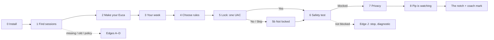

# Setup: make your Euca in about 5 minutes

| Date | Author | Status | Read with |
|---|---|---|---|
| 2026-10-26 | PM + UX (Claude), `ux-designer` role standards | **Approved by the founder 26 Oct**; the honest zero in step 8 is new since approval | [CR-011](../../../requirements/change-requests/CR-011.md) · [CR-010](../../../requirements/change-requests/CR-010.md) (D-4, D-5, copy) · [notch-and-panel.md](notch-and-panel.md) · [onboarding-flow.md](onboarding-flow.md) (edge paths A–Q, still valid) |

**Replaces** the screen sequence of [onboarding-flow.md](onboarding-flow.md). **Keeps** its evidence, its timing method, its validation tasks and its edge paths **A–Q** (referenced by letter below; their copy changes only where noted).

**Goal.** In about five minutes, without an account, you **make your Euca**, see your own week, choose and lock your rules, watch your Euca block a test with your own eyes, choose what it may read, and send it to its place at the top of your screen.

> **Founder decisions applied (26 Oct, later the same day):** the four limits are **always on**, locked or not locked per limit; **guided merge** stays in Free as a needs-you item; **budgets** stop the agent before its next step; drafting a described rule **uses the supervisor and counts on the meter**; the app says **"your default branch"**, never "main"; v0.1 is **unsigned** and shows no "signed" badge.

**What changed from the old first run, and why.**
- **"Create your Euca" is step 2** (CR-011 §1). The character is made before it does anything, so every later step can speak as it ("Pip turns them into exact rules", "Watch Pip block a test").
- **"Choose your rules" comes before the admin prompt** (CR-010 D-4): tested library on/off, suggestions from your week, and your own described rules.
- **A privacy step** (Level 1/2) with the optional trial email, because the supervisor needs Level 2 (CR-011 §5).
- **The end is a place, not a window:** the Euca flies up into the notch, and a one-time coach mark says how it works.
- The tray pin step is gone: the notch is the surface; the tray is a fallback.

---

## 1. The path at a glance

One window, **760 × 600**, centred, dark by default, a slim progress line ("Step 3 of 8"). Back is available until step 5 writes anything.

| # | Step | Clock | You | Eucas |
|---|---|---|---|---|
| 0 | Install | 0:00 → 0:50 | Run the installer (unsigned in v0.1: SmartScreen "More info → Run anyway", explained on the site) | Per-user install, no admin |
| 1 | **Find your sessions** | 0:50 → 1:05 | Read, press **Make your Euca** | Detects Claude Code, version, 7-day history, your status line and hooks (already running) |
| 2 | **Make your Euca** | 1:05 → 1:50 | Name it, pick a shape and a colour | Live preview: eyes follow you; it blinks when you choose (birth) |
| 3 | **Your week** | 1:50 → 2:40 | Skim 4 cards | Built from local history while you were on step 2 |
| 4 | **Choose your rules** | 2:40 → 3:30 | Keep the tested rules, tick suggestions, maybe describe one | Drafts described rules as exact rules |
| 5 | **Lock your rules** | 3:30 → 4:00 | Tick which to lock, approve **one** Windows prompt | Writes the locked set to managed settings; the rest at user scope |
| 6 | **Watch it block a test** | 4:00 → 4:20 | Watch | Throwaway session tries to push to its default branch (`git push origin main`); blocked, logged |
| 7 | **What it may read** | 4:20 → 4:45 | Level 1 (default) or Level 2 (+ optional trial email) | Nothing leaves the PC at Level 1 |
| 8 | **Pip is watching** | 4:45 → 5:00 | Press **Send Pip to the top** | The window fades; the Euca flies into the notch; coach mark once |

---

## 2. Steps

Each card: intent · one primary · evidence (what happened / how to take it back / what's next) · consequence preview · states.

### Step 1 · Find your sessions
- **Intent:** Go. **Primary:** **Make your Euca**.
- **Headline:** "First, let's find your sessions"
- **Lede:** "Eucas watches the Claude Code sessions you already run. It never writes code. It guards them, tells you what needs you, and shows where your usage goes."
- **Checklist** (ticks as each resolves, ≤ 3 s): "Claude Code 2.1.312 found · In the desktop app and in your terminal" · "41 sessions in the last 7 days · Eucas keeps counts, never the text of your prompts or files" · "Your status line stays as it is" · "2 hooks of your own keep working".
- **Footer hint:** "About 5 minutes. Nothing is changed until step 5." (the consequence preview for the whole flow)
- **States:** detecting · found · edges A (not found), B (old), C (two installs), D (organisation policy: no lock or protection possible; Make your Euca still works and the Euca says so later).

### Step 2 · Make your Euca (the birth moment)
- **Intent:** Do. **Primary:** **Continue** (disabled until it has a name and a look; the hint says which is missing).
- **Headline:** "Make your Euca" · **Lede:** "It sits at the top of your screen and minds your sessions. Pick a name and a look. You can change both later."
- **Left: the stage.** A soft-dimensional avatar (BRAND §8) on a faint wash of its colour, its name under it, and a **mini notch** showing its eyes where it will live ("Where Pip will sit"). Before you choose: the grey Unassigned shape with closed eyes, "No name yet".
- **Right:** Name (16 characters, suggestions Pip · Moss · Juno · Kit), Shape (the 9 brand shapes), Colour (the 10 hues). Choosing a shape or colour gives birth: the eyes open, it squashes and settles (spring), one blink.
- **Copy note:** if you pick coral, honey or tangerine (close to red and amber), one quiet line: "Fine to keep: Pip's warnings always come with words, never colour alone."
- **Intelligence deposit:** the name is used in every later line; the colour becomes the working beam in the notch and the supervisor meter.
- **States:** before (grey) · born · name only (Continue disabled: "Pick a shape or a colour") · look only ("Give it a name").

### Step 3 · Your week
- **Intent:** Know. **Primary:** **Choose your rules**.
- **Headline (one sentence, real numbers):** "Your week: 41 sessions in 6 projects, about 62% of your weekly limit."
- **Four cards** (same as before, shorter): tokens + the 7-day bars ("bench used 58% of it") · "3 commands would have been stopped" (mono lines with project and time) · "2 sessions edited one file 4 minutes apart" · "You approved `pnpm test` 212 times · It can become a rule in the next step."
- **States:** building (cards stream in, first ≤ 5 s; it started on step 1) · thin history (edge F: "Not much to look back on yet" + 5 starter rules) · tokens only (edge G).

### Step 4 · Choose your rules (D-4)
- **Intent:** Do. **Primary:** **Continue · 7 rules** (the count is the consequence).
- **Headline:** "Choose your rules" · **Lede:** "The four limits are always on, and so are the tested rules. Add your own in plain words: Pip turns them into exact rules you confirm."
- **Left: Limits** (the four, "Always on", no switch) above **Safety rules** (tested library, switches, on by default except "Ask before installing packages"). **Right: Your own** (the composer and the draft card) above **From your week** (suggestions as checkboxes; read-only ones pre-ticked; anything that runs project code shown unticked with "Runs code from the project").
- **The draft card:** *You wrote: "don't let agents touch the migrations in api-docs"* → `block Edit, Write · in api-docs/migrations/ and everything in it` → "Last week it would have blocked 3 calls, all from api-docs. It can't loosen a locked rule." → **Add rule** · Reword · ☑ Lock it too. A quiet line: "Drafted with supervisor help · counts on the meter" (the trial covers it in setup).
- **Rules for rules** (unchanged from PM-T5): exact commands, never globs; scope is a folder; runners never pre-ticked or "everywhere"; nothing can allow a delete, a push to the default branch, a send or a payment; a conflict with your own Claude Code `ask`/`deny` rule disables the row with why.
- **States:** default · drafting · draft shown · draft rejected ("That would loosen a locked rule, so Pip can't add it. Try describing what to block instead.") · thin history (5 starters).

### Step 5 · Lock your limits and rules (the one admin prompt)
- **Intent:** Do. **Primary:** **Lock 4 limits + 4 rules** (count = ticked rows). **Secondary:** Skip the lock.
- **Headline:** "Lock your limits and rules" · **Lede:** "Locked ones live where no agent or repo can change them. The limits stay on either way. Changing a lock later asks for admin again."
- **Two lists:** the four **Limits** (ticked to lock by default; you may untick one, it stays on but Not locked) and **Your rules** (safety rules ticked by default), each with a lock glyph.
- **Consequence preview:** "Windows asks for permission once. It will say **Unknown publisher**: this first version isn't signed yet." · "Without the lock, the limits and your rules still run, labelled Not locked." (CR-010: v0.1 ships unsigned; the UAC dialog is yellow and says Unknown. Saying it first makes the dialog expected.)
- **Waiting:** the button reads "Waiting for Windows…" while the UAC dialog is up.
- **Declined or skipped (edge H, new copy):** "**Your limits and rules are on, but not locked.** Windows didn't give permission, so they sit in your user settings. An agent or a repo could change them. Pip watches for that and tells you the moment it happens. You can lock them any time from Rules." → Continue · Try again. Everywhere after: the **Not locked** chip in the panel header and an amber row in Rules.
- **Write failed (edge I):** unchanged.
- **Emotional moment: none on purpose.** Elevation is sober.

### Step 6 · Watch it block a test (D-5, the proof moment)
- **Intent:** Know. **Primary:** **Continue** (appears when the test finishes).
- **Headline:** "Watch Pip block a test" · **Lede:** "A throwaway session in a temporary folder tries to push to your default branch. Nothing touches your projects or the network."
- **Live log** (mono): "› Starting a test session in a temporary folder" · "› It tried: git push origin main" · "✓ **Blocked by Pip · 0.3 s · logged**" + the **done** sound once. Then "That's what happens in your real sessions. Every block shows up in the panel with why." (Uses the mock-API path from S-1: zero tokens.)
- **Not blocked (edge J, worst moment of setup):** "✕ Not blocked" + "**The test wasn't blocked.** Pip is not protecting your sessions on this PC yet. Nothing outside the test folder was touched." → **Run the diagnostic** · Show what happened. The flow doesn't continue to "watching"; the notch, when it appears, shows **Not protected**.
- **Couldn't start (edge K):** unchanged; status "Protected · not yet tested" (amber in the panel) until a real block or a later test.

### Step 7 · What Pip may read (privacy, CR-010 copy)
- **Intent:** Do. **Primary:** **Start watching**.
- **Headline:** "What Pip may read" · **Lede (approved copy):** "Nothing about your work leaves this PC unless you turn it on."
- **Two cards:** **Level 1 · signals only** (Default): "Which tool ran, where and when, and whether a rule matched. Nothing leaves this PC." + "The supervisor can't help at this level, so Pip asks you instead." · **Level 2 · and the last message**: "When Pip isn't sure, the waiting session's last message, trimmed, goes to the supervisor: an open model hosted with zero data retention." + "No files, no paths to your projects. Needed for the 14-day supervisor trial."
- **Level 2 adds:** "Email for your free trial" + Send a code · "One trial per email. No card. You can skip this and start the trial later from Usage." (decision D-3).
- **States:** Level 1 · Level 2 · code sent · code wrong ("That code didn't match. Send a new one") · offline ("Can't send a code offline. Start the trial later from Usage.").

### Step 8 · Pip is watching (peak-end: the homecoming)
- **Intent:** Go. **Primary:** **Send Pip to the top**.
- **Content:** the avatar, "**Pip is watching**", "2 sessions running, both protected. Pip lives at the top of your screen and never opens by itself.", the heartbeat chip "Checked 2 s ago" (pulses every 2.4 s). Under it, **the honest zero** (new since approval): "Pip knows nothing about how you work yet. It learns from what you allow, deny and answer. You can read and delete all of it in Settings."
- **The flight:** the window fades; the avatar shrinks and flies to the top centre (900 ms, `--spring-smooth`) and becomes the eyes in the notch, which open with a blink; the done sound. Reduced motion: a crossfade.
- **Coach mark, once:** under the notch: "**Pip lives here.** Hover to peek at what needs you. Click to open the panel. Nothing here opens by itself." [Got it]. It leaves on Got it, on the first click of the notch, or after the first peek.

---

## 3. Edge paths (changes to onboarding A–Q)

| # | Change |
|---|---|
| A–C | Unchanged; they sit on step 1. |
| D | Organisation policy: steps 4–6 become one screen, "Your organisation's Claude Code policy only allows its own hooks, so Pip can't guard sessions on this PC. Pip can still show your week and your usage." The notch shows **Not protected** with "Blocked by your organisation" in the peek, permanently. |
| H | New copy above (step 5, "Not locked"). |
| N | Sessions already running: step 8 says "2 running: bench is protected; api-docs will be when you restart it." The notch shows the needs-you item for api-docs ("api-docs isn't protected yet · restart it"). SP-H1 found running sessions don't pick up a new plugin; settings-file hooks hot-reload in ~3 s, so this may shrink. |
| P | Notifications off: no longer asked in setup (the notch is the surface). Settings shows it only if a full-screen notification was missed. |
| Q | Quit during setup: before step 5 nothing was written; after step 5 protection stays on and reopening resumes at step 6. |
| New: R | **Closing the window at step 2–4** (no Euca yet): reopening starts at step 2 with the name and look you had. The notch doesn't appear until step 8. |

---

## 4. State matrix (setup window)

| Step | Default | Working | Empty | Partial | Error | Offline | Usage limit | Permission denied | Success |
|---|---|---|---|---|---|---|---|---|---|
| 1 Find | Checklist | Spinner glyph per line | N/A (always has lines) | "Still checking…" after 3 s | A, B, C | N/A: local | N/A | D | All ticked |
| 2 Make | Born *(proto)* | — | Before: grey, closed eyes *(proto)* | Name or look only (hint) *(proto)* | Name too long: capped at 16 | N/A | N/A | N/A | Birth blink |
| 3 Week | 4 cards *(proto)* | Streaming | F | G (tokens only) | Parse errors counted | N/A | Plan share shown, no warning tone | Folder unreadable → Diagnostic | — |
| 4 Rules | Lists *(proto)* | Drafting | Thin history → starters | — | Draft rejected (loosens a lock) | Offline: the guided exact-rule form | N/A | Conflicts with your own `ask` rule | Draft shown *(proto)* |
| 5 Lock | List + consequences *(proto)* | Waiting for Windows *(proto)* | N/A | Some unticked | I (write failed) | N/A | N/A | H: declined *(proto)* | → 6 |
| 6 Test | Live log | Running | N/A | K (not yet tested) | J *(proto)* | Mock path needs no network | Mock path uses no tokens | N/A | Blocked *(proto)* |
| 7 Privacy | Level 1 *(proto)* | Code sending | N/A | Level 2 without email (trial later) | Wrong code | Can't send a code | N/A | N/A | Level 2 + email *(proto)* |
| 8 Watching | Heartbeat *(proto)* | The flight | No sessions: "None running now. Start one and Pip will watch it." | N | J carried: Not protected | Heartbeat local | Shows usage only if near a limit | D carried | Coach mark *(proto)* |

## 5. Emotional moments (three, pinned)
1. **Birth** (step 2): the first blink of a character you made. Goal: belonging.
2. **The proof** (step 6): a block you watched. Goal: trust. The done sound.
3. **The homecoming** (step 8): it flies to its place. Goal: you know where it lives, and that it stays quiet there.
Not chosen: confetti (wrong tone for a safety tool), a tour of the panel (the coach mark is one sentence).

## 6. Timing assumptions
As in [onboarding-flow §4](onboarding-flow.md), plus: step 2 ~45 s (naming is the longest choice; suggestions cap it), step 7 ~25 s at Level 1, ~60 s with an email code (that's why the email is optional and skippable). **Activation:** reached step 8 with the test blocked, and one real session protected within 24 h.
