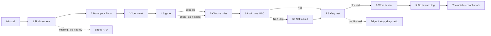

# Setup: make your Euca in about 5 minutes

| Date | Author | Status | Read with |
|---|---|---|---|
| 2026-10-26 | PM + UX (Claude), `ux-designer` role standards | **Approved by the founder 26 Oct**; the honest zero in step 9 is new since approval · **CR-012 / always-on (26 Oct): step 4 "Sign in" and step 8 "What is sent" need approval** (§7) | [CR-012](../../../requirements/change-requests/CR-012.md) · [CR-011](../../../requirements/change-requests/CR-011.md) · [CR-010](../../../requirements/change-requests/CR-010.md) (D-4, D-5, copy) · [notch-and-panel.md](notch-and-panel.md) · [onboarding-flow.md](onboarding-flow.md) (edge paths A–Q, still valid) |

**Replaces** the screen sequence of [onboarding-flow.md](onboarding-flow.md). **Keeps** its evidence, its timing method, its validation tasks and its edge paths **A–Q** (referenced by letter below; their copy changes only where noted).

**Goal.** In about five minutes you **make your Euca**, see your own week, **sign in with your email**, choose and lock your rules, watch your Euca block a test with your own eyes, see exactly what is sent, and send it to its place at the top of your screen.

> **Founder decisions applied (26 Oct, later the same day):** the four limits are **always on**, locked or not locked per limit; **guided merge** stays in Free as a needs-you item; **budgets** stop the agent before its next step; drafting a described rule **uses the supervisor and counts on the meter**; the app says **"your default branch"**, never "main"; v0.1 is **unsigned** and shows no "signed" badge.

> **CR-012 / always-on, 2026-10-26 (founder):** **accounts for everyone**: email plus a 6-digit code, no password, asked **after "Your week" and before "Choose your rules"**. **The supervisor is always on** with no off switch; **Level 1/2 is retired** and the privacy step becomes **"What is sent"**, a real redacted example from your own last session. **The trial starts when setup finishes.** The approved privacy line is used verbatim.

**What changed from the old first run, and why.**
- **"Create your Euca" is step 2** (CR-011 §1). The character is made before it does anything, so every later step can speak as it ("Pip turns them into exact rules", "Watch Pip block a test").
- **Sign in is step 4** (CR-012 / always-on): after you've seen your week (value first), before choosing rules, because drafting a described rule is the first thing that needs the server.
- **"Choose your rules" comes before the admin prompt** (CR-010 D-4): tested library on/off, suggestions from your week, and your own described rules.
- **"What is sent" replaces the Level 1/2 privacy step** (CR-012 / always-on): no choice to make, only proof. The optional trial email is gone; the email is now asked once, at step 4.
- **The end is a place, not a window:** the Euca flies up into the notch, and a one-time coach mark says how it works.
- The tray pin step is gone: the notch is the surface; the tray is a fallback.

---

## 1. The path at a glance

One window, **760 × 600**, centred, dark by default, a slim progress line ("Step 4 of 9"). Back is available until step 6 writes anything.

| # | Step | Clock | You | Eucas |
|---|---|---|---|---|
| 0 | Install | 0:00 → 0:50 | Run the installer (unsigned in v0.1: SmartScreen "More info → Run anyway", explained on the site) | Per-user install, no admin |
| 1 | **Find your sessions** | 0:50 → 1:05 | Read, press **Make your Euca** | Detects Claude Code, version, 7-day history, your status line and hooks (already running) |
| 2 | **Make your Euca** | 1:05 → 1:50 | Name it, pick a shape and a colour | Live preview: eyes follow you; it blinks when you choose (birth) |
| 3 | **Your week** | 1:50 → 2:30 | Skim 4 cards | Built from local history while you were on step 2 |
| 4 | **Sign in** *(CR-012)* | 2:30 → 3:10 | Type your email, then the 6-digit code from your inbox | Sends the code; creates or finds your account; nothing on this PC changes |
| 5 | **Choose your rules** | 3:10 → 3:55 | Keep the tested rules, tick suggestions, maybe describe one | Drafts described rules as exact rules |
| 6 | **Lock your rules** | 3:55 → 4:20 | Tick which to lock, approve **one** Windows prompt | Writes the locked set to managed settings; the rest at user scope |
| 7 | **Watch it block a test** | 4:20 → 4:35 | Watch | Throwaway session tries to push to its default branch (`git push origin main`); blocked, logged |
| 8 | **What is sent** *(CR-012)* | 4:35 → 4:55 | Read one redacted example | Built from your own last session, redacted on this PC |
| 9 | **Pip is watching** | 4:55 → 5:10 | Press **Send Pip to the top** | The trial starts; the window fades; the Euca flies into the notch; coach mark once |

---

## 2. Steps

Each card: intent · one primary · evidence (what happened / how to take it back / what's next) · consequence preview · states.

### Step 1 · Find your sessions
- **Intent:** Go. **Primary:** **Make your Euca**.
- **Headline:** "First, let's find your sessions"
- **Lede:** "Eucas watches the Claude Code sessions you already run. It never writes code. It guards them, tells you what needs you, and shows where your usage goes."
- **Checklist** (ticks as each resolves, ≤ 3 s): "Claude Code 2.1.312 found · In the desktop app and in your terminal" · "41 sessions in the last 7 days · Eucas keeps counts, never the text of your prompts or files" · "Your status line stays as it is" · "2 hooks of your own keep working".
- **Footer hint:** "About 5 minutes. Nothing on this PC changes until step 6." (the consequence preview for the whole flow; *CR-012 / always-on, 2026-10-26:* "on this PC" because step 4 creates your account on the server)
- **States:** detecting · found · edges A (not found), B (old), C (two installs), D (organisation policy: no lock or protection possible; Make your Euca still works and the Euca says so later).

### Step 2 · Make your Euca (the birth moment)
- **Intent:** Do. **Primary:** **Continue** (disabled until it has a name and a look; the hint says which is missing).
- **Headline:** "Make your Euca" · **Lede:** "It sits at the top of your screen and minds your sessions. Pick a name and a look. You can change both later."
- **Left: the stage.** A soft-dimensional avatar (BRAND §8) on a faint wash of its colour, its name under it, and a **mini notch** showing its eyes where it will live ("Where Pip will sit"). Before you choose: the grey Unassigned shape with closed eyes, "No name yet".
- **Right:** Name (16 characters, suggestions Pip · Moss · Juno · Kit), Shape (the 9 brand shapes), Colour (the 10 hues). Choosing a shape or colour gives birth: the eyes open, it squashes and settles (spring), one blink.
- **Copy note:** if you pick coral, honey or tangerine (close to red and amber), one quiet line: "Fine to keep: Pip's warnings always come with words, never colour alone."
- **Intelligence deposit:** the name is used in every later line; the colour becomes the working beam in the notch and the supervisor meter.
- **States:** before (grey) · born · name only (Continue disabled: "Pick a shape or a colour") · look only ("Give it a name").

### Step 3 · Your week
- **Intent:** Know. **Primary:** **Sign in** *(CR-012 / always-on, 2026-10-26; was "Choose your rules")*.
- **Headline (one sentence, real numbers):** "Your week: 41 sessions in 6 projects, about 62% of your weekly limit."
- **Four cards** (same as before, shorter): tokens + the 7-day bars ("bench used 58% of it") · "3 commands would have been stopped" (mono lines with project and time) · "2 sessions edited one file 4 minutes apart" · "You approved `pnpm test` 212 times · It can become a rule in the next step."
- **States:** building (cards stream in, first ≤ 5 s; it started on step 1) · thin history (edge F: "Not much to look back on yet" + 5 starter rules) · tokens only (edge G).

### Step 4 · Sign in *(new: CR-012 / always-on, 2026-10-26)*
- **Intent:** Do. **Primary:** **Send a code**, then **Sign in** (enabled at 6 digits; the 6th digit or a paste submits by itself), then **Choose your rules**.
- **Why here:** you've just seen what Eucas found in your week (value first), and the next step is the first that needs the server (drafting a described rule).
- **Email screen.** Headline "Sign in with your email" · Lede "No password: Eucas emails you a 6-digit code. Your account holds only your email and your plan." · one field, **Email** (prefilled from nothing; `autocomplete=email`) · two consequence lines (the same `conseq` list as the lock step): "Your 14-day supervisor trial starts when setup finishes. No card." and "Your Claude login stays as it is. Eucas never sees it." (ADR-0002: the second line answers the question everyone asks here.)
- **Code screen.** Headline "Check your email" · "Eucas sent a 6-digit code to **sam@example.com**. Change" · six cells (one input in the build: `inputmode=numeric`, `autocomplete=one-time-code`, paste fills all six) · "Didn't get it? Check your spam folder, or send a new one." · After resending: "A new code is on its way. The old one no longer works." The resend link waits 30 s between sends ("Send a new one in 0:24"). A code works for 10 minutes.
- **Signed in, a new account.** Headline "You're signed in" · checklist: "Signed in as sam@example.com · A new account. It holds only your email and your plan." and "Your 14-day supervisor trial · Starts when setup finishes. No card." → **Choose your rules**.
- **Signed in, an existing account** (it keeps its plan and trial). Headline "Welcome back" · "Signed in as sam@example.com · Your account since 2 Oct" · the plan that carries over, one of: "Your plan carries over: Pro, Founders' price · $15/month for life · renews 26 Nov" / "Pro · renews 26 Nov" / "Your trial carries over · 9 days left, ends 4 Nov" / "Your trial was used on 2 Oct · Pip gets a small amount of supervisor help each month" · and "This PC starts fresh · Your rules and what Pip knows live on each PC, never in your account."
- **Wrong code** (founder copy): the six cells take a red ring (no shake: the eye grammar never alarms) and one line: "**That code didn't match.** Send a new one" (the link resends). After 5 wrong tries the code stops working and the same line shows (spec).
- **Expired code** *(spec)*: "That code has expired. Send a new one".
- **An address that expires** (disposable email, founder copy): under the field, "Please use an address you'll keep. This one expires." **Send a code** stays disabled until the address changes.
- **Offline or the server can't be reached:** a neutral banner (the offline pattern): "**You're offline, so Eucas can't send a code.** Pip still guards your sessions and runs your rules. Drafting rules and the supervisor wait until you sign in." → **Sign in later** (primary) · Try again. Sign in later is offered **only** here (accounts are for everyone); see edge S.
- **Evidence:** what happened (the checklist names the account and the plan) · how to take it back (Settings › Account: Sign out, Delete account) · what's next (the primary names it).
- **Consequence preview:** the trial line, before you send anything; nothing on this PC changes.
- **Emotional moment: none on purpose.** A sign-in is a chore; it should feel short.

### Step 5 · Choose your rules (D-4)
- **Intent:** Do. **Primary:** **Continue · 7 rules** (the count is the consequence).
- **Headline:** "Choose your rules" · **Lede:** "The four limits are always on, and so are the tested rules. Add your own in plain words: Pip turns them into exact rules you confirm."
- **Left: Limits** (the four, "Always on", no switch) above **Safety rules** (tested library, switches, on by default except "Ask before installing packages"). **Right: Your own** (the composer and the draft card) above **From your week** (suggestions as checkboxes; read-only ones pre-ticked; anything that runs project code shown unticked with "Runs code from the project").
- **The draft card:** *You wrote: "don't let agents touch the migrations in api-docs"* → `block Edit, Write · in api-docs/migrations/ and everything in it` → "Last week it would have blocked 3 calls, all from api-docs. It can't loosen a locked rule." → **Add rule** · Reword · ☑ Lock it too. A quiet line: "Drafted with supervisor help · counts on the meter" (the trial covers it in setup).
- **Signed in later (edge S)** *(CR-012 / always-on, 2026-10-26)*: the composer is the guided exact-rule form ("Write it as an exact rule: block / allow · tools · folder"), the same one used offline.
- **Rules for rules** (unchanged from PM-T5): exact commands, never globs; scope is a folder; runners never pre-ticked or "everywhere"; nothing can allow a delete, a push to the default branch, a send or a payment; a conflict with your own Claude Code `ask`/`deny` rule disables the row with why.
- **States:** default · drafting · draft shown · draft rejected ("That would loosen a locked rule, so Pip can't add it. Try describing what to block instead.") · thin history (5 starters) · not signed in (guided form).

### Step 6 · Lock your limits and rules (the one admin prompt)
- **Intent:** Do. **Primary:** **Lock 4 limits + 4 rules** (count = ticked rows). **Secondary:** Skip the lock.
- **Headline:** "Lock your limits and rules" · **Lede:** "Locked ones live where no agent or repo can change them. The limits stay on either way. Changing a lock later asks for admin again."
- **Two lists:** the four **Limits** (ticked to lock by default; you may untick one, it stays on but Not locked) and **Your rules** (safety rules ticked by default), each with a lock glyph.
- **Consequence preview:** "Windows asks for permission once. It will say **Unknown publisher**: this first version isn't signed yet." · "Without the lock, the limits and your rules still run, labelled Not locked." (CR-010: v0.1 ships unsigned; the UAC dialog is yellow and says Unknown. Saying it first makes the dialog expected.)
- **Waiting:** the button reads "Waiting for Windows…" while the UAC dialog is up.
- **Declined or skipped (edge H, new copy):** "**Your limits and rules are on, but not locked.** Windows didn't give permission, so they sit in your user settings. An agent or a repo could change them. Pip watches for that and tells you the moment it happens. You can lock them any time from Rules." → Continue · Try again. Everywhere after: the **Not locked** chip in the panel header and an amber row in Rules.
- **Write failed (edge I):** unchanged.
- **Emotional moment: none on purpose.** Elevation is sober.

### Step 7 · Watch it block a test (D-5, the proof moment)
- **Intent:** Know. **Primary:** **Continue** (appears when the test finishes).
- **Headline:** "Watch Pip block a test" · **Lede:** "A throwaway session in a temporary folder tries to push to your default branch. Nothing touches your projects or the network."
- **Live log** (mono): "› Starting a test session in a temporary folder" · "› It tried: git push origin main" · "✓ **Blocked by Pip · 0.3 s · logged**" + the **done** sound once. Then "That's what happens in your real sessions. Every block shows up in the panel with why." (Uses the mock-API path from S-1: zero tokens.)
- **Not blocked (edge J, worst moment of setup):** "✕ Not blocked" + "**The test wasn't blocked.** Pip is not protecting your sessions on this PC yet. Nothing outside the test folder was touched." → **Run the diagnostic** · Show what happened. The flow doesn't continue to "watching"; the notch, when it appears, shows **Not protected**.
- **Couldn't start (edge K):** unchanged; status "Protected · not yet tested" (amber in the panel) until a real block or a later test.

### Step 8 · What is sent *(replaces "What Pip may read": CR-012 / always-on, 2026-10-26)*
- **Intent:** Know. **Primary:** **Start watching**. No choice on this screen: the supervisor is always on.
- **Headline:** "What is sent"
- **Lede (approved privacy line, verbatim):** "When Pip isn't sure, it sends the waiting session's last message, trimmed and with code, paths and secrets removed, to the supervisor. Nothing else about your work leaves this PC. Your account holds only your email and your plan."
- **The example** (one card, the same component as Settings › What is sent): header "From your last session · bench · today, 13:52" with the chip **Yours, redacted** · the message **exactly as it would leave the PC**, with each removal shown in place as a neutral mono tag (`path removed`, `secret removed`, `6 lines of code removed`) and a trailing "…" where it was trimmed · a footer: "Removed 6 lines of code, 2 paths, 1 secret · trimmed from 1,830 to 240 characters" and "Goes to the supervisor: an open model hosted with zero data retention."
- **The original is never shown.** It's your own session, and showing it would put a real secret on screen in setup. The counts say what was taken out; the session itself is one click away in your terminal.
- **No session yet** (edge F, or every session is older than history): the same card with a **labelled sample**: header "Not from your work: you have no sessions yet", chip **Sample**, a made-up message with the same kinds of removals. Settings › What is sent switches to your real example after your first session.
- **Redaction fails or can't parse the last message** *(spec)*: show the sample, and the build sends nothing for that question (Pip asks you instead). Never show an unredacted message.
- **Footer hint:** "Always in Settings › What is sent" (the evidence that this isn't a one-time promise).
- **Removed:** the Level 1 / Level 2 cards, "Default" chip, "Needed for the 14-day supervisor trial", the trial email field and its code. Nothing else from this step survives.
- **Emotional moment: trust, without motion.** The example is the moment; animating it would make it feel like marketing.

### Step 9 · Pip is watching (peak-end: the homecoming)
- **Intent:** Go. **Primary:** **Send Pip to the top**.
- **Content:** the avatar, "**Pip is watching**", "2 sessions running, both protected. Pip lives at the top of your screen and never opens by itself.", the heartbeat chip "Checked 2 s ago" (pulses every 2.4 s). Under it, **the honest zero** (new since approval): "Pip knows nothing about how you work yet. It learns from what you allow, deny and answer. You can read and delete all of it in Settings."
- **Signed in later (edge S)** *(CR-012 / always-on, 2026-10-26)*: one more quiet line: "You're not signed in yet. The supervisor starts when you sign in from Usage or Settings."
- **The trial starts here** *(CR-012 / always-on, 2026-10-26)*: when you press the primary, the 14-day trial starts (ends 9 Nov in the example). The meter shows it the first time you open Usage; no line here (the removal test: you were told at step 4).
- **The flight:** the window fades; the avatar shrinks and flies to the top centre (900 ms, `--spring-smooth`) and becomes the eyes in the notch, which open with a blink; the done sound. Reduced motion: a crossfade.
- **Coach mark, once:** under the notch: "**Pip lives here.** Hover to peek at what needs you. Click to open the panel. Nothing here opens by itself." [Got it]. It leaves on Got it, on the first click of the notch, or after the first peek.

---

## 3. Edge paths (changes to onboarding A–Q)

| # | Change |
|---|---|
| A–C | Unchanged; they sit on step 1. |
| D | Organisation policy: steps 5–7 become one screen, "Your organisation's Claude Code policy only allows its own hooks, so Pip can't guard sessions on this PC. Pip can still show your week and your usage." The notch shows **Not protected** with "Blocked by your organisation" in the peek, permanently. Sign in (step 4) and What is sent (step 8) are unchanged. |
| H | New copy above (step 6, "Not locked"). |
| N | Sessions already running: step 9 says "2 running: bench is protected; api-docs will be when you restart it." The notch shows the needs-you item for api-docs ("api-docs isn't protected yet · restart it"). SP-H1 found running sessions don't pick up a new plugin; settings-file hooks hot-reload in ~3 s, so this may shrink. |
| P | Notifications off: no longer asked in setup (the notch is the surface). Settings shows it only if a full-screen notification was missed. |
| Q | Quit during setup: before step 6 nothing was written on this PC; after step 6 protection stays on and reopening resumes at step 7. *(CR-012 / always-on, 2026-10-26)* If you signed in at step 4, the account exists but the trial hasn't started; reopening resumes where you were, signed in. |
| R | **Closing the window at steps 2–5** (no Euca in the notch yet): reopening starts at step 2 with the name and look you had (and signed in, if you were). The notch doesn't appear until step 9. |
| **New: S** *(CR-012 / always-on, 2026-10-26)* | **Sign in later** (offline or server unreachable at step 4): setup continues; step 5 uses the guided rule form; step 8 shows What is sent as usual (it's local); step 9 adds the not-signed-in line. After setup, the Usage › Supervisor block reads "The supervisor starts when you sign in" with **Sign in**, and Settings › Account shows "Not signed in". Never a needs-you item, never in the notch. The trial starts when you sign in (decision U-3). |
| **New: T** *(CR-012 / always-on, 2026-10-26)* | **The code email never arrives**: the resend line after 30 s, then after a second resend: "Still nothing? Check that sam@example.com is right, or Sign in later." (Sign in later appears here too, so a broken mail provider can't block setup.) |

---

## 4. State matrix (setup window)

| Step | Default | Working | Empty | Partial | Error | Offline | Usage limit | Permission denied | Success |
|---|---|---|---|---|---|---|---|---|---|
| 1 Find | Checklist | Spinner glyph per line | N/A (always has lines) | "Still checking…" after 3 s | A, B, C | N/A: local | N/A | D | All ticked |
| 2 Make | Born *(proto)* | — | Before: grey, closed eyes *(proto)* | Name or look only (hint) *(proto)* | Name too long: capped at 16 | N/A | N/A | N/A | Birth blink |
| 3 Week | 4 cards *(proto)* | Streaming | F | G (tokens only) | Parse errors counted | N/A | Plan share shown, no warning tone | Folder unreadable → Diagnostic | — |
| **4 Sign in** *(CR-012)* | Email *(proto)* | "Sending…" on the button; code screen *(proto)* | N/A (the field starts empty) | Code partly typed *(proto)* | Wrong code *(proto)* · expired *(spec)* · address that expires *(proto)* · email never arrives (T) *(spec)* | Sign in later *(proto)* | N/A | Too many tries: the code stops working *(spec)* | New account *(proto)* · existing account keeps its plan *(proto)* |
| 5 Rules | Lists *(proto)* | Drafting | Thin history → starters | — | Draft rejected (loosens a lock) | Offline or not signed in: the guided exact-rule form | N/A | Conflicts with your own `ask` rule | Draft shown *(proto)* |
| 6 Lock | List + consequences *(proto)* | Waiting for Windows *(proto)* | N/A | Some unticked | I (write failed) | N/A | N/A | H: declined *(proto)* | → 7 |
| 7 Test | Live log | Running | N/A | K (not yet tested) | J *(proto)* | Mock path needs no network | Mock path uses no tokens | N/A | Blocked *(proto)* |
| **8 What is sent** *(CR-012)* | Your last session, redacted *(proto)* | Redacting (≤ 1 s, local) | No session: the labelled sample *(proto)* | Message shorter than 240: "not trimmed" in the footer *(spec)* | Can't redact: the sample, and nothing is sent for that question *(spec)* | N/A: local | N/A | N/A | → 9 |
| 9 Watching | Heartbeat *(proto)* | The flight | No sessions: "None running now. Start one and Pip will watch it." | N · not signed in (S) | J carried: Not protected | Heartbeat local | Shows usage only if near a limit | D carried | Coach mark *(proto)* |

## 5. Emotional moments (three, pinned)
1. **Birth** (step 2): the first blink of a character you made. Goal: belonging.
2. **The proof** (step 7): a block you watched. Goal: trust. The done sound.
3. **The homecoming** (step 9): it flies to its place. Goal: you know where it lives, and that it stays quiet there.
Not chosen: confetti (wrong tone for a safety tool), a tour of the panel (the coach mark is one sentence), any motion on sign-in or What is sent (*CR-012 / always-on, 2026-10-26*: a chore should feel short, and proof should feel plain).

## 6. Timing assumptions
As in [onboarding-flow §4](onboarding-flow.md), plus: step 2 ~45 s (naming is the longest choice; suggestions cap it); *CR-012 / always-on, 2026-10-26:* step 4 ~40 s (typing an email, switching to the inbox, the code; the 6th digit submits), step 8 ~20 s (reading one card, no choice). The total stays about 5 minutes because step 8 lost its choice and its email field. **Activation:** reached step 9 with the test blocked, and one real session protected within 24 h. **New measure:** share of installs that choose Sign in later, and of those, signed in within 7 days.

---

## 7. New for approval (CR-012 / always-on, 2026-10-26)

| # | Screen or state | Route in the prototype |
|---|---|---|
| 1 | Step 4 · Sign in: your email (with the trial and Claude-login lines) | `s-signin` |
| 2 | Step 4 · the 6-digit code | `s-signin-code` |
| 3 | Step 4 · wrong code ("That code didn't match. Send a new one") | `s-signin-wrong` |
| 4 | Step 4 · an address that expires ("Please use an address you'll keep. This one expires.") | `s-signin-disposable` |
| 5 | Step 4 · offline, Sign in later | `s-signin-offline` |
| 6 | Step 4 · signed in, a new account (the trial starts when setup finishes) | `s-signin-done` |
| 7 | Step 4 · signed in, an existing account keeps its plan ("Welcome back") | `s-signin-back` |
| 8 | Step 8 · What is sent, from your last session | `s-sent` |
| 9 | Step 8 · What is sent, the labelled sample | `s-sent-sample` |
| 10 | Step 9 · the not-signed-in line (edge S) | spec + `s-done` after Sign in later |
| — | Spec only: expired code, too many tries, resend cooldown, email never arrives (T), can't redact | — |

**Removed:** the Level 1 / Level 2 choice (old step 7, routes `s-privacy` and `s-privacy-2`), the optional trial email and decision D-3 (replaced by step 4). The panel's new states are listed in [notch-and-panel.md §10](notch-and-panel.md).
