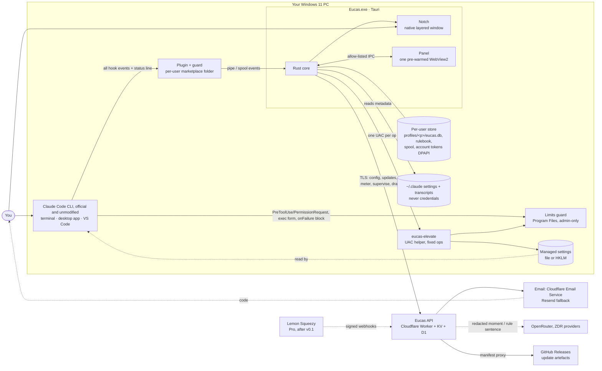

# Software Requirements Specification (SRS): Eucas companion v0.1

| Status | Version | Owners | Approver | Upstream |
|---|---|---|---|---|
| Draft for G3 | 0.1 | BA (functional), Tech Lead (non-functional, interfaces, data) | Client | [BRD](BRD.md) v1.5, [PRD](PRD.md) v0.6, [CR-010](change-requests/CR-010.md), [CR-011](change-requests/CR-011.md), [CR-012](change-requests/CR-012.md), [founder answers](interviews/2026-10-26-v1.4-open-items.md), ADR-0007 – ADR-0018 |

Audience: developers, designers and QA. Every requirement is **testable** and traces to a use case (UC-54 – UC-67), a business rule (BR-98 – BR-129) and its acceptance criteria. **Scope: the Eucas companion v0.1 only.** The team app (UC-01 – UC-53, BR-01 – BR-97) comes later and gets its own SRS.

**How to read it.** §2 says *what* the companion does: one row is one testable behaviour. §3 says *how well*: every NFR has a number or a pass/fail check. §4 – §6 fix the interfaces, data and constraints. §7 maps everything back to use cases and tests. §8 resolves the BRD's `[ASSUMPTION – confirm]` tags. **§9 lists the decisions you make at G3**, each with a recommendation; until you answer, the SRS follows the recommendation.

**Founder decisions of 2026-10-26 applied here (newer than BRD v1.5 / PRD v0.6), cited as `FD-n`:**
- FD-1: the waitlist is "weak" with under 100 sign-ups one week after the page goes live.
- FD-2: kill if no user pays within 2 weeks of Pro going on sale (replaces the +12-week payer test).
- FD-3: **no export** of the Protection log or rules, Free and Pro, so a setup can't move to a new account. Its wider reach is G3-2.
- FD-4: the build estimate of about 48 days, plus 2 – 3 for "learns you", is accepted.
- FD-5: the tech lead proposes extra library safety rules from the bypass suite and the founder approves them ([Appendix A](#appendix-a-proposed-library-safety-rules-for-founder-approval), G3-7).
- FD-6: the [G6 manual checklist](../spikes/G6-MANUAL-CHECKLIST.md) passed in full.
- FD-7: the SP-SUP2 recorder is installed (50 of 200 – 300 moments so far); the supervisor stays gated on SP-SUP2.
- FD-8: **no supporter tier.** Support is through GitHub Sponsors only, from launch, with no payment code.

FD-1, FD-2 and FD-4 are product and plan decisions (PRD §8 – §9) and add no functional requirement.

## Contents
1. [System overview](#1-system-overview) · 2. [Functional requirements](#2-functional-requirements) · 3. [Non-functional requirements](#3-non-functional-requirements) · 4. [Interfaces](#4-interfaces) · 5. [Data model](#5-data-model) · 6. [Constraints and compliance](#6-constraints-and-compliance) · 7. [Traceability](#7-traceability-matrix) · 8. [Assumptions resolved](#8-assumptions-resolved) · 9. [Open questions for G3](#9-open-questions-for-g3) · 10. [Sign-off](#10-sign-off) · Appendix [A](#appendix-a-proposed-library-safety-rules-for-founder-approval) (library safety rules) · Appendix [B](#appendix-b-source-conflicts-this-srs-settles-owners-fix-their-documents) (source conflicts)

---

## 1. System overview

| Component | Role | Trust boundary | Detail |
|---|---|---|---|
| Claude Code + hooks | The user's own sessions; starts our guards per hook event | TB1: stdin JSON from a process running untrusted model output | ADR-0007, ADR-0009 |
| Limits guard | Enforces the locked limits; limits only; no rulebook, no network | Admin-only folder | ADR-0007 |
| Plugin guard | All four limits, user rules, events, status-line wrapper, Stop → supervisor | Per-user folder (user-writable) | ADR-0009, SP-H1 |
| Elevate helper | Fixed operations under UAC; payload embedded; pinned SHA-256 at first run | TB: user → admin (T7) | ADR-0013, SECURITY-PRIVACY T7 |
| Core | Heartbeat, tripwire, rules compiler, canary, ledger, supervisor client, account, updater | TB2: guard ↔ app pipe (same user, SID-scoped); TB3: core ↔ renderer IPC | SYSTEM-DESIGN §4 |
| Notch | Native layered window; no focus at rest; no keyboard hook | — | ADR-0016 |
| Panel | The only webview; pixels only; no Node, no secrets | TB3 (Tauri capability allow-list) | ADR-0008 |
| Local store | Counts and metadata per account profile; tokens in DPAPI blobs | Per-user ACLs | ADR-0015, ADR-0017 |
| Worker + D1 + KV | Config, updates proxy, accounts, budget/meter, supervise, draft-rule, waitlist, telemetry | TB4: app ↔ Worker (TLS, signed config, tokens) | ADR-0012, ADR-0017, ADR-0018 |
| OpenRouter (ZDR) | Model calls for the supervisor and rule drafting | TB5 | ADR-0011 |
| Email provider | One-time codes | TB6 | ADR-0017 |
| Lemon Squeezy | Pro plan by signed webhook (after v0.1) | TB6 | ADR-0012 |
| Updater | Tauri updater; Ed25519-signed manifests from GitHub Releases via the Worker | TB4 | ADR-0013, CI-CD §5 |

**Core safety invariant:** every tool-call decision is made on the PC by the guard from local files only; nothing in the decision path reads the network, the Worker, the account or the app (ADR-0009, ADR-0017).

---

## 2. Functional requirements

**Conventions.** One row = one testable behaviour. "Your Euca" is named `<name>` (the design's example is Pip); quoted copy uses Pip. Priority: Must / Should / Could / Won't (v0.1). `[default (CR-010 design)]` / `[default (CR-011 design)]` mark design defaults the tech lead may tune in the NFRs; all other numbers are cited.

**Out of scope for this SRS:** the team app (UC-01 – UC-53, BR-01 – BR-97) and its notch and voice; Cursor and Codex; macOS and Linux installers; voice, a global keyboard hook, a phone feature, paid packs, AI conflict resolution, launching sessions, a main window, passwords (BRD §2, BR-118).

**Retired rules:** BR-111 as written (10,000 model calls a month) and BR-112 (Level 1 / Level 2) are retired. What survives of them (a hidden cost budget with a ~2,000-token prompt cap; the payload that "Level 2" sent) is now carried by BR-122, BR-123 and BR-129, and the FRs cite those. No FR implements a call count or a level.

### 2.1 Setup and first run (UC-54)

| ID | Requirement | UC | BR | Priority | Acceptance / verification |
|---|---|---|---|---|---|
| FR-001 | The system shall install per user, with no admin rights and no questions, and open one setup window (760 × 600, "Step n of 9"); the notch shall not appear until step 9. | UC-54 | BR-120, BR-121 | Must | G a clean Windows 11 profile W the installer runs T no UAC prompt, the setup window opens, no notch window exists. PRD 18.4, 24.1 |
| FR-002 | The system shall check Smart App Control at step 1 and, if it is on or in evaluation, install nothing and show "Windows is blocking Pip's guard" with "Nothing was installed" and **Close setup**. | UC-54 (A17) | BR-100 | Must | G SAC in evaluation W setup starts T the screen shows, no plugin or settings written. SET edge U; PRD 24.1 |
| FR-003 | The system shall detect Claude Code (version per install and host), 7 days of history (counts only), the user's own hooks and status line, and show each as a ticking checklist line; the footer shall say "About 5 minutes. Nothing on this PC changes until step 4." | UC-54 | BR-115, BR-119 | Must | Test: checklist resolves on a fixture; no prompt text in `eucas.db` after detection. SET step 1; PRD 24.1 |
| FR-004 | If Claude Code is missing, the system shall offer "Get Claude Code" and "Check again"; if it is older than 2.1.310, it shall offer "Update Claude Code" with the command to copy, or continue "not guaranteed", and that host's sessions shall show "Not verified", never green. | UC-54 (A1) | BR-100 | Must | G CLI 2.1.303 W setup continues T every surface shows Not verified for it. AS-9; ADR-0014 |
| FR-005 | If two Claude Code installs exist, the system shall list both with path and version and let setup continue. | UC-54 (A2) | — | Must | Test: two-install fixture shows both rows. SET edge C |
| FR-006 | If an organisation policy blocks Eucas's hooks, the system shall say so before any protection claim, merge steps 4 – 5 into one screen saying Pip can't guard sessions on this PC, skip step 7, still require sign-in, never write into the organisation's policy, and show the notch as Not protected with "Blocked by your organisation". | UC-54 (A3, A14), UC-55 (E4) | BR-99, BR-102 | Must | G `allowManagedHooksOnly` set by an org W setup runs T no limits written, step 7 absent, notch shows the org line. SET edge D |
| FR-007 | The system shall let you make your Euca: a name (up to 16 characters, suggestions Pip · Moss · Juno · Kit), one of 9 shapes and one of 10 colours, with a live mini-notch preview and a birth blink; **Continue** stays disabled until it has both, and the hint says which is missing ("Give it a name" / "Pick a shape or a colour"). | UC-54 | BR-120 | Must | G a name only W you look at Continue T disabled with "Pick a shape or a colour". PRD 27.4 |
| FR-008 | The system shall build the retro ("Your week") while you make your Euca and stream four cards (usage, commands that would have been stopped, same-file clashes, your approvals as suggested rules), the first within 5 s and all within 30 s for 7 days / 300 sessions / 500 MB `[default (CR-010 design)]`. | UC-54 | BR-115 | Must | Perf fixture; no prompt text stored. PRD 24.1, C8 |
| FR-009 | With thin or no history, the retro shall say "Not much to look back on yet." and offer 5 tested starter rules instead of suggestions; you may skip the retro to step 4. | UC-54 (A4, A5) | BR-103 | Must | G an empty history T the starter rules show. SET edge F |
| FR-010 | Step 4 ("Lock the four limits") shall show, before anything is written, the four limits (delete, a push to your default branch, a send, a payment) all ticked to lock, the honest promise and gap line, "Undo any time: Settings › Remove Eucas", and "Windows asks for permission once. It will say **Unknown publisher**: this first version isn't signed yet."; unticking a limit leaves it on, Not locked. | UC-54 | BR-99, BR-102 (9), (13) | Must | G step 4 T four rows ticked, no off switch on any; untick one → its row reads Not locked. PRD 19.7 |
| FR-011 | Before raising UAC the system shall compare `eucas-elevate.exe`'s SHA-256 with the hash pinned in the app build, and on a mismatch stop with nothing elevated. | UC-54 | BR-102 | Must | G a tampered helper W you press Lock T no UAC prompt, an error line, nothing written. SD §5.6; ADR-0013 |
| FR-012 | Setup shall raise exactly **one** UAC prompt (step 4, the four limits only); if you lock none, no prompt is raised. | UC-54 | BR-102 (13) | Must | e2e: count UAC prompts across setup = 1 (0 if all unticked). PRD 19.7 |
| FR-013 | On accept, the system shall install the plugin at user scope with an empty rulebook (limits only), chain the status line, write the four limits and lock the ticked ones in managed settings, ticking a checklist line per step linked to the file it touched; from here the PC is protected with no account. | UC-54 | BR-102, BR-106, BR-124 (5) | Must | G step 4 done and no account W a session runs `git push origin main` T it is blocked. PRD 19.6, 24.1 |
| FR-014 | If you decline UAC, the system shall keep the four limits running at user scope, show "**The four limits are on, but not locked**" with **Continue** and **Try again**, and label them Not locked on every later surface. | UC-54 (A6) | BR-102 (5) | Must | G UAC declined T Rules, panel header chip and Protection all say Not locked; a limit still blocks. SET edge H |
| FR-015 | Every setup write shall be atomic per file and recorded as a key-level patch; any failure shall roll back the steps already done, turn that line red and offer Retry and Run the diagnostic; quitting before step 4 shall leave nothing written. | UC-54 (E1, A9) | BR-119 | Must | G the settings file locked by another process W step 4 writes T rollback, red line, settings byte-equal to before. SD §5.6 |
| FR-016 | Step 5 shall start a throwaway session in a temporary folder that tries `git push origin main` through the real hook path with 0 tokens and no network, show "Blocked by Pip · 0.3 s · logged" and play the Done sound. | UC-54 | BR-105 | Must | e2e: deny receipt, `usage` 0/0. S-1 GO; PRD 17.3, 24.1 |
| FR-017 | If the hook-only test can't run and a model turn is needed, the system shall run one and say "used about 400 tokens". | UC-54 (A7) | BR-105 | Could | Fallback only; S-1 passed hook-only. Test: forced fallback shows the line |
| FR-018 | If the test isn't blocked, the system shall show "**The test wasn't blocked.** Pip is not protecting your sessions on this PC yet. Nothing outside the test folder was touched.", offer Run the diagnostic, not continue to sign-in, and never show "Protected". | UC-54 (E2) | BR-100 | Must | G the guard disabled W step 5 T the flow stops; "Protected" absent everywhere. SET edge J; O8 |
| FR-019 | If the test can't start, status shall read "Protected · not yet tested" (amber) until a real block or a later test passes. | UC-54 (E3) | BR-100 | Must | Test: no Git on PATH → amber state. SET edge K |
| FR-020 | Step 6 (Sign in) shall be mandatory: there is no "Sign in later", and nothing after step 6 is written or started until sign-in succeeds (sign-in behaviour: §2.11). | UC-54, UC-65 | BR-124 (12) | Must | G offline at step 6 T no "Sign in later" control exists; step 7 unreachable. PRD 28.2 |
| FR-021 | While setup waits at sign-in, the setup window shall stay on step 6 with "**You need to be online to sign in.** Setup carries on once you're connected. Pip is already guarding: the four limits are locked." (declined: "…the four limits run, not locked."), **Retry** and **Back**; the tray icon shall show Protected or Not protected in words; closing the window shall keep the guard running, and reopening shall return to sign-in. | UC-54 (A13) | BR-121 (1), BR-124 (12) | Must | G offline at step 6 W a session pushes to the default branch T blocked; tray tooltip reads Protected. BRD §10 #65 |
| FR-022 | Step 7 (Choose your rules) shall show the four limits read-only (Locked, or Always on if declined), the tested safety rules with switches (on by default except "Ask before installing packages"), suggestions from your week with 7-day counts, and **Add your own**; the primary shall name the count ("Continue · 7 rules"). | UC-54 | BR-102, BR-103 | Must | G step 7 T layout as specified; limits have no switch. SET step 7; PRD 19.7 |
| FR-023 | Rules chosen at step 7 shall be written at user scope and shown Not locked, with the hint "Not locked yet. Lock them from Rules any time; Windows asks once more."; setup's draft card shall have no "Lock it too". | UC-54 | BR-102 (13) | Must | e2e: rules in user settings only; no second UAC prompt. PRD 19.7 |
| FR-024 | No suggestion in setup or later shall allow a delete, a push to your default branch, a send or a payment; anything that runs project code shall show unticked with "Runs code from the project". | UC-54, UC-57 | BR-102, BR-103 (5) | Must | Test: retro fixture with 212 `rm -rf` approvals yields no such suggestion |
| FR-025 | Drafts made during setup shall draw on the account's small setup allowance (the `pending` period), not on the trial. | UC-54 | BR-103 (13), BR-123 | Must | G a new account at step 7 W you draft T the Worker debits `setupMicroUsd`; trial not started. ADR-0018 §1 |
| FR-026 | Step 8 (What is sent) shall use the approved privacy line as its lede, show one example card built from your own last session and redacted on the PC (removals as in-place tags, a footer with what was removed and "trimmed from X to Y characters", "Goes to the supervisor: an open model hosted with zero data retention."), say "The supervisor is always on and can't be switched off. Your rules always decide first.", and offer no choice; primary **Start watching**. | UC-54 | BR-129 (3), (9), BR-115 | Must | G step 8 T no toggle exists; the card is from the fixture's last session. PRD 27.11 |
| FR-027 | Step 8 shall never show the unredacted original; with no session yet, or if redaction fails, it shall show a card labelled **Sample** ("Not from your work: you have no sessions yet"), and a failed redaction shall cause nothing to be sent for that question. | UC-54 | BR-129 (9) | Must | Test: grep the rendered DOM for the fixture's secret → absent. SET step 8; U-8 |
| FR-028 | Step 9 (Pip is watching) shall show your Euca, each running session with Protected or "will be when you restart it", the heartbeat "Checked 2 s ago", and the honest zero: "Pip knows nothing about how you work yet. It learns from what you allow, deny and answer. You can read and delete all of it in Settings." | UC-54 (A8) | BR-100, BR-125 (6) | Must | G a session started before install T it reads "…when you restart it". AS-10; SET edge N |
| FR-029 | Pressing **Send Pip to the top** shall start the 14-day trial (unless the account used it), destroy the setup window, fly the avatar into the notch (crossfade with reduced motion), play the Done sound and show the coach mark once: "**Pip lives here.** Hover to peek at what needs you. Click to open the panel. Nothing here opens by itself." It leaves on Got it, the first click or the first peek. | UC-54 | BR-123 (6), BR-121 | Must | G setup finishes T `POST /v1/trial/start` once; coach mark never shows again. PRD 27.6 |
| FR-030 | Closing setup at steps 2 – 3 shall reopen at step 2 with the name and look kept; from step 4 on, reopening shall resume at the first step not done (5 if the test hasn't run, else 6), signed in if you were. | UC-54 (A9, A10) | BR-124 | Must | Test: kill the app after step 5 → relaunch opens step 6. SET edges Q, R; SD §5.6 |
| FR-031 | Back shall show on steps 2 – 4, 6 and 7 and be hidden on step 5 and from step 8; going back shall never undo the lock. | UC-54 | BR-102 | Should | UI test per step. SET §1 |
| FR-032 | The download page and README shall show the SmartScreen "More info → Run anyway" step, publish each installer's SHA-256, explain Smart App Control, and say the supervisor can't be switched off. | UC-54 (E4) | BR-129 (9) | Must | Release checklist. PRD 26.2, 18.5 |

### 2.2 Guard, heartbeat, canary and Protection (UC-55)

| ID | Requirement | UC | BR | Priority | Acceptance / verification |
|---|---|---|---|---|---|
| FR-033 | Every PreToolUse call in every local Claude Code session shall pass the guard, which checks the four limits and self-protection first, then your rules, and otherwise returns no opinion so Claude Code asks as usual. | UC-55 | BR-98, BR-104 | Must | Contract suite on the pinned CLI. PRD 19.1, 19.4 |
| FR-034 | The guard shall never auto-approve a delete, a push to your default branch, a send or a payment; these limits are always on, can't be expressed in the rulebook, and no rule can override them. | UC-55 | BR-99, BR-102 (7), (10) | Must | ~400 table cases deny (TESTING §2). PRD 19.2 |
| FR-035 | The guard shall fail closed: a panic, a hang (5 s timeout), bad input, or a missing or quarantined binary shall deny the call; observational hooks shall exit 0 on a crash so a stop or prompt is never blocked. | UC-55 (E1) | BR-100 (1) | Must | 72-fault injection suite all deny. SP-H1; PRD 19.3 |
| FR-036 | On a limit block, the guard shall tell the agent, with the one fixed message, "Eucas blocks <action> in every session. Don't try another way. Tell the user what you wanted to do so they can do it themselves." | UC-55 | BR-110 (4) | Must | Contract test on deny JSON. SEC §4 |
| FR-037 | When one of your rules matches, the guard shall auto-approve the call and the rule's counter shall go up; your own Claude Code `ask` or `deny` rules shall still win. | UC-55 (A1) | BR-103 (6), (7) | Must | G `deny pnpm build` in user settings and an allow rule T Claude Code still denies |
| FR-038 | Each block shall log a receipt (time, session, the command as shown, redacted, ≤ 512 characters, kept 30 days, why in plain words, the rule or limit that decided); a block that already happened shall not be a needs-you item and shall send no notification. | UC-55 | BR-108 (5), BR-115, BR-126 (5) | Must | G a block T a log row; needs-you count unchanged; no toast. §8.8 |
| FR-039 | A block's **Why?** shall open one page with what Pip saw, the rule that decided, the decision, the receipt, "If you meant it, run it yourself in a terminal" and **Copy command**; no surface shall offer "Allow anyway". | UC-55 | BR-126 (6) | Must | UI review: no allow action on any block. PRD 20.3 |
| FR-040 | The heartbeat shall show, per session and in the panel header and peek footer ("Protected · 3 sessions · checked 2 s ago"), the time of the last **real** check; an idle session shall read "idle since 13:40 · guard ready", never a tick. | UC-55 | BR-100 (2), BR-127 (6) | Must | Test: no check events → no "checked" text. PRD 20.1 |
| FR-041 | A tool that runs with no matching check (plugin disabled, hooks switched off by a repo, guard not firing) shall turn that session Not protected within 2 s of the tool's result `[default (CR-010 design)]`. | UC-55 (E2) | BR-100 (2) | Must | Contract test with the hook removed. PRD 20.1; C4 |
| FR-042 | When any session is Not protected, the notch shall widen with "**Not protected**" in red and concerned eyes (overriding thin-line mode), and a needs-you item ("bench isn't protected · no check for 40 s while it ran tools") shall offer **See why**: a checklist with the specific repair and Run the diagnostic; a Windows notification only if a full-screen app hides the notch. | UC-55 (E2) | BR-100, BR-108 (3), BR-121 (7) | Must | G thin-line mode and a disabled plugin T the full notch with words; panel not opened. NP §4.4 |
| FR-043 | When the guard blocks ≥ 3 calls in 60 s with no rule deciding, the session shall show **Failing**: "Eucas's guard is failing and blocking every tool call in N sessions. Your work is safe." with **Repair** and **Off for 15 minutes**, which turns itself back on; this is the only temporary off. | UC-55 (E1) | BR-100 (4) | Must | G the guard exe deleted T Failing banner; Off restores after 15 min. SD §7.1 |
| FR-044 | The admin limits layer shall offer Repair (asks Windows) and Pause the limits / Turn them back on (each asks Windows, and the copy says both prompts up front); while paused every surface shall show Not locked. | UC-55 | BR-100 (4), BR-102 | Should | e2e on a VM. SD §7.1 |
| FR-045 | After any repair or off of the plugin layer, the system shall tell you to restart running sessions. | UC-55 | BR-100 | Must | Copy check. SD §7.1 (SP-H1) |
| FR-046 | After each Claude Code update, the canary shall rerun by itself per host; "Verified for Claude Code x.y" shall show only for a version both CI's nightly canary and this PC proved; otherwise amber "Not verified", plus a needs-you item "Claude Code x.y isn't verified yet" with **Run the test**. | UC-55 (A3) | BR-100 (3) | Must | G a new CLI version, canary failing T amber, never green. PRD 20.2 |
| FR-047 | The guard shall block an agent's attempt to change Eucas's settings, plugin or rulebook; a change it can't block (a program writing the rulebook) shall be detected, shown in a banner, undone to the last version and logged. | UC-55 (E3), UC-57 (E4) | BR-102 | Must | Bypass suite T2/T5 cases. SEC |
| FR-048 | Quitting Eucas shall leave the limits and rules working; the heartbeat, notifications and tripwire stop until it reopens, and the quit dialog shall say so. | UC-55 (A5) | BR-99 | Must | G Eucas quit W a session pushes to the default branch T blocked. PRD 18.2 |
| FR-049 | Settings › Protection shall show a status card (state sentence, verified version, Locked / Not locked, **Run the test again**), one row per session with its word and last check, the log with filters, and "What Eucas can't see" (the gap line and the published bypass table), always present. The log shall have **no export** (FD-3). | UC-55 (A4) | BR-99, BR-100 | Must | UI test: no export control. PRD 20.3 as amended by FD-3 |
| FR-050 | Wherever protection is claimed (setup step 4, Rules, Protection, the website) the system shall use one stored string: "Eucas never auto-approves a delete, a push to your default branch, a send or a payment, and no rule can change that.", always with the gap line (Eucas sees tool calls, not what a program does once it runs, and nothing in the cloud; keep git and backups on). | UC-54, UC-55 | BR-99 | Must | Test: one constant; app copy never says "push to main". PRD 7.1 |
| FR-051 | Every session shall be protected on Free, whatever the count; details shall show for 3: "Showing details for 3 sessions. All 4 are protected. Pro shows every session's details." | UC-55, UC-58 | BR-104 | Must | G 4 sessions T the 4th is guarded. PRD 20.1 (wording per BR-127 (6)) |
| FR-052 | A session started before the plugin was installed shall be Not protected with a needs-you item "<project> isn't protected yet · restart it" until its first check. | UC-55 | BR-100 | Must | SP-H1: running sessions never load a new plugin |
| FR-053 | The UI shall use one status vocabulary, Protected / Not protected · Locked / Not locked; "Guarded" shall not appear. | all | BR-127 (6) | Must | String scan of the UI bundle |
| FR-054 | The guard, limits, tripwire and rules shall never read the account and shall work offline, signed out, and before the first sign-in. | UC-55 | BR-124 (5), (12) | Must | G signed out and offline W an agent tries a delete T blocked. UC-65 AC |

### 2.3 Mass-delete tripwire (UC-56)

| ID | Requirement | UC | BR | Priority | Acceptance / verification |
|---|---|---|---|---|---|
| FR-055 | The system shall count, per session, deletes of git-tracked files in the session's folder and any delete elsewhere in your profile; deletes inside git-ignored build folders in the project shall not count unless deletes outside the project start in the same window, which trips at once. | UC-56 (A1) | BR-101 | Must | G `pnpm install` emptying `node_modules` T no trip. PRD 20.4 |
| FR-056 | When a session exceeds **200 deletes in 20 s** `[default (CR-010 design)]`, the system shall mark it tripped (every later tool call denied) and stop every process it started, including background jobs and orphaned children from the remembered process tree. | UC-56 | BR-101 | Must | G 2,000 deletes in 10 s T stopping ≤ 1 s, tree gone ≤ 3 s. SP-TW1; PRD 20.4 |
| FR-057 | The system shall say "stopped" only when no process remains and the count has not moved for 3 s; if deletes continue, it shall stop `claude.exe` too and show live "bench is still deleting files". | UC-56 (A3) | BR-101 | Must | G an orphaned deleter T the page never says stopped while counting |
| FR-058 | A trip shall show on the notch as a red "**Stopped: <project>**" marker with concerned eyes and the Stopped sound; the peek line "Pip stopped the notes session · deleted 1,240 files in 20 s" offers **See what happened**; nothing opens by itself; a Windows notification only if a full-screen app hides the notch. | UC-56 | BR-108, BR-121 (4) | Must | G a trip at the desk T no window opens. NP §4.3 |
| FR-059 | **See what happened** shall show "Pip stopped notes at 14:02:31", the **measured** count (never the threshold), what was deleted grouped by folder, how to get it back (git restore, File History, OneDrive, whichever is on), **Open the folder** and **This was expected** (adds the folder to this project's allowed list, with the consequence spelled out). | UC-56 (A2) | BR-101, BR-127 (4) | Must | Test: overflow fixture reports 1,3xx, not 200. SP-TW1 |
| FR-060 | If Eucas crashes mid-stop, the tripped flag shall already be persisted, the session shall stay blocked, and the stop page shall show after restart. | UC-56 (E3) | BR-101 | Must | Kill the app during a trip → session still denied |
| FR-061 | The gap list shall say the tripwire needs Eucas running and can't attribute detached processes (scheduled tasks, services). | UC-56 (E1, E2) | BR-99 | Must | Copy check in What Eucas can't see |

### 2.4 Hard limits and locks (BR-102)

| ID | Requirement | UC | BR | Priority | Acceptance / verification |
|---|---|---|---|---|---|
| FR-062 | For each of the four limits, the only choice shall be Locked (managed settings, admin) or Not locked (user scope); moving one either way shall ask Windows for admin and, when unlocking, write its user-scope deny patterns in the same step so it is never off in between. | UC-57 (A5) | BR-102 (7), (8), (11) | Must | G a locked limit W you unlock it T UAC, then the limit still blocks. PRD 19.7 |
| FR-063 | Only **block** rules shall be lockable; an allow rule shall never offer a lock. | UC-57 | BR-102 (12) | Must | UI + compiler test |
| FR-064 | In Rules, locking or unlocking any rule shall ask Windows for admin (`update-locked-set`); the draft card in Rules shall offer "☑ Lock it too (asks for admin)". | UC-57 (A5) | BR-102 (3), (11) | Must | G a locked rule W you change it T UAC; declined → nothing changes |
| FR-065 | The panel header shall show a **Locked / Not locked** chip that opens Rules; an unlocked limit shall be amber with "press to lock". | UC-60 | BR-102 | Must | UI test. NP §2.1 |
| FR-066 | No rule, written, drafted, suggested or learned, shall make Eucas auto-approve one of the four limits, locked or not; the rules compiler shall reject any overlap. | UC-57 (E2) | BR-102 (10) | Must | Compiler property test. PRD 21.1 |
| FR-067 | Limits and rules locked on the PC shall show in another account's Rules as "**Locked on this PC**", read-only; unlocking asks for admin. | UC-65 (A10) | BR-124 (14) | Must | Two-account e2e. PRD 28.3 |

### 2.5 Rules: library, suggestions, prompted rules (UC-57)

| ID | Requirement | UC | BR | Priority | Acceptance / verification |
|---|---|---|---|---|---|
| FR-068 | Rules shall show the honest promise, the lock row, **Limits** (four, no switch, each Locked or Not locked), **Safety rules** (the library with switches and lock glyphs), **Your rules** with live counters ("auto-approved 1,204 times since 12 Oct") and suggestions with counts; 5 templates while you have fewer than 3 rules; empty: "Rules you add show up here with how often they were used." | UC-57 | BR-103 (7) | Must | UI test. PRD 21.1; NP §2.2 |
| FR-069 | The library shall include the tested safety rules the tech lead proposes from the bypass suite and the founder approves; a rule ships in the library only with its tests. | UC-57 | BR-102 (1), BR-103 (1) | Must | Each library rule id has passing bypass-suite cases. FD-5 (closes PRD §11.1 #6) |
| FR-070 | Library rules shall switch on or off with a 10-s Undo; the four limits shall have no switch. | UC-57 (A2) | BR-102 (9), BR-126 | Must | UI test |
| FR-071 | Adding a suggestion shall show a dry run on your last 7 days ("would have auto-approved 212 calls, all in bench/") and save with a 10-s Undo, after the same checks as any rule. | UC-57 (A1) | BR-103 (2) | Must | PRD 21.1 |
| FR-072 | Every rule shall be exact: exact commands or tools and one folder scope, no globs or regex. | UC-57 | BR-103 (3) | Must | Compiler rejects `*`, regex. ADR-0010 |
| FR-073 | Commands that run other code (installers, interpreters, test runners, `bash -c`) shall never be pre-ticked or scoped "everywhere", shall carry a warning, and shall offer a safe form. | UC-57 (A4) | BR-103 (5) | Must | UI + compiler test |
| FR-074 | If your Claude Code settings ask or deny the same command, the row shall say "Your Claude Code settings ask for this every time. That wins." and **Add** shall be disabled. | UC-57 (A3) | BR-103 (6) | Must | G `ask pnpm build` T Add disabled with the reason |
| FR-075 | **Describe a rule** shall send only the sentence you typed (and the server's rulebook schema) to `/v1/draft-rule`, and only when you press **Draft**; the note under the box shall read "This sentence is sent to draft the rule." | UC-57 | BR-103 (10), (12), BR-129 (7) | Must | Proxy capture: body = sentence + schema. PRD 21.2 |
| FR-076 | A draft that doesn't compile, fails the bypass suite or overlaps a limit shall be rejected with the reason ("That would loosen a locked rule, so Pip can't add it. Try describing what to block instead."); wording that can't become an exact rule shall be rejected with why, offering **Reword** and the guided form (FR-079). | UC-57 (E1, E2) | BR-103 (4) | Must | G "allow deleting the build folder" T refused, citing the delete limit. Set by this SRS for E1 |
| FR-077 | The draft card shall show *You wrote: "…"*, the exact rule in mono, what it would have done last week, "It can't loosen a locked rule.", "Drafted with supervisor help · counts on the meter", and **Add rule** · Reword (· Lock it too in Rules only); the rule stays off until you press Add, then is on with a 10-s Undo and its counter at 0. | UC-57 | BR-103 (3), (13), BR-126 | Must | G a draft W you leave without Add T no rule written. NP §4.5 |
| FR-078 | Each draft shall draw on the signed-in account's supervisor budget and show on the meter. | UC-57 | BR-103 (11), (13), BR-122 (6) | Must | Worker reserve/settle per draft. ADR-0018 §7 |
| FR-079 | When drafting is unavailable (offline, server unreachable, or the meter empty), the composer shall become a guided form, "Write it as an exact rule: block / allow · tools · folder", that needs no model. | UC-57 (A7) | BR-103 (15) | Must | G the meter at 0% T the form shows; a rule can still be added |
| FR-080 | You shall be able to edit a rule's scope, turn it off or delete it, each with a 10-s Undo. Rules shall have **no export** (FD-3). | UC-57 (A6) | BR-126 | Must | UI test: no export control. Overrides UC-57 A6 "export your rules as files" |
| FR-081 | If the rulebook can't be saved, the system shall say "Your settings file is locked by another program. Nothing changed. Retry" and keep the rule on screen. | UC-57 (E3) | BR-127 (4) | Must | Lock the file → message, no change |
| FR-082 | The rulebook shall be vendor-neutral and compiled per vendor (Claude Code only in v0.1), so adding a vendor never migrates it. | UC-57 | BR-98 | Must | Schema test: no vendor-specific fields in `rulebook.json`. ADR-0010 |
| FR-083 | A corrupt rulebook shall be ignored by the guard (checksum), leaving the limits only and no auto-approvals. | UC-57 | BR-100 | Must | Corrupt the file → Claude Code prompts as usual. SD §7 |

### 2.6 Usage: ledger and forecast (UC-58)

| ID | Requirement | UC | BR | Priority | Acceptance / verification |
|---|---|---|---|---|---|
| FR-084 | The system shall chain your status line: your command runs with the same stdin and its output (and any error) prints byte for byte as before. | UC-58 (E1) | BR-106 | Must | G a status line printing "main • 42%" T identical bytes after install. PRD 22.1 |
| FR-085 | Usage numbers shall come only from Claude Code's status data and transcript usage fields, never from credentials or an OAuth endpoint. | UC-58 | BR-106, BR-54 | Must | Test: file-access audit never opens `.credentials.json`. ADR-0002 |
| FR-086 | Usage shall show the 5-hour and weekly meters ("5-hour: 46 % · resets 15:40") with freshness ("updated 20 s ago"), one forecast sentence per meter with its basis on hover, and the ledger by session and by project for today and 7 days. | UC-58 | BR-106 | Must | UI test with a fixture. PRD 22.1 |
| FR-087 | Past your warning line (85 % by default `[default (CR-010 design)]`) the meter shall turn amber with the word "close"; it shall send no notification and raise no needs-you item. | UC-58 (A1) | BR-108 (3), (5) | Must | Set by this SRS: BR-108 v1.5 supersedes UC-58 A1's toast |
| FR-088 | At the 5-hour limit Usage shall say "5-hour limit reached. Claude Code pauses new requests until 15:40. Your sessions keep their work."; at the weekly limit a panel banner shall say "Your week is used up. Claude Code pauses new requests until Mon 09:00. Your sessions keep their work, and Pip keeps guarding."; neither shows a Pro line. | UC-58 (A2, A8) | BR-117 (5), BR-127 (4) | Must | Copy check; no upsell |
| FR-089 | With no plan data, Usage shall show tokens only with why ("Claude Code hasn't reported plan limits yet"); with an API key, cost in dollars. | UC-58 (A3) | BR-106 | Must | Fixtures for both modes |
| FR-090 | If the status line isn't reporting, Usage shall say "Status line not reporting" with the diagnostic. | UC-58 (E2) | BR-109 | Must | Fixture |
| FR-091 | Usage shall hold the supervisor meter (§2.10) and a link to **Your week**; with no data yet: "Usage appears after your first session." | UC-58 (A6) | BR-122 | Must | UI test |

### 2.7 Same-file warning and guided merge (UC-59)

| ID | Requirement | UC | BR | Priority | Acceptance / verification |
|---|---|---|---|---|---|
| FR-092 | When session B writes a file session A wrote in the last 15 minutes (adjustable 5 – 60) `[default (CR-010 design)]` in the same working tree, the system shall add a needs-you item "Two sessions are editing one file · bench and api-docs · `src/router.ts`" with **Show both**, and shall never block either edit. | UC-59 | BR-107 | Must | G two edits 4 min apart T one item, both edits land. PRD 23.2 |
| FR-093 | **Show both** shall open a read-only side-by-side of both sessions' recent edits with each side's last edit time and lines changed, **Open** per session and "Don't warn for this file today". | UC-59 (A4) | BR-107 | Must | UI test. NP §4.2 |
| FR-094 | Further edits shall update the item's count without a new nudge; when one session commits or stops, the item shall resolve ("Resolved: bench committed `src/router.ts` at 14:20"). | UC-59 (A2, A3) | BR-107 | Must | Fixture |
| FR-095 | Edits in different worktrees of one repo shall produce only a quiet "may conflict when you merge" note; the system shall never say "conflict" when git would merge cleanly. | UC-59 (A1) | BR-107 | Should | `git merge-tree` check before wording |
| FR-096 | When a session finishes on a branch, the system shall offer a needs-you item "search is ready · It finished on its branch. Update it from your default branch, run the tests and open the PR?" | UC-59 | BR-107, BR-108 (4) | Must | Fixture. NP §4.7; PRD 23.3 (as answered §11.1 #25) |
| FR-097 | One press shall run fixed plain-code steps with no model call: check the tree is clean, `git merge --no-edit` your default branch into the session's branch (never a rebase), run the project's test command, then open the PR with `gh` if installed and signed in, otherwise show the exact command to copy. | UC-59 | BR-107, BR-120 (2) | Must | Test: no network call to the Worker; no `rebase` in the command log |
| FR-098 | The item shall become its result: "search: PR #71 is open · 128 tests passed. Nothing was merged." with **Open the PR** and **Close the PR** as its undo, or "Tests failed: 2 of 128. Nothing was pushed." with **Open session**. | UC-59 | BR-126 (3) | Must | Fixture repos for both |
| FR-099 | On a merge conflict the system shall abort the merge, leave the branch as it was, name the files ("The update hit a conflict in `src/router.ts`. Nothing was pushed. Open session to resolve it.") and offer no AI resolution. | UC-59 (E1) | BR-107, BR-118 | Must | Conflict fixture: branch HEAD unchanged |
| FR-100 | The guided merge shall never merge into or push to your default branch; any such step is blocked like any push to it. | UC-59 (E2) | BR-99, BR-107 | Must | Guard denies in the e2e |

### 2.8 The notch, the panel and what needs you (UC-60)

| ID | Requirement | UC | BR | Priority | Acceptance / verification |
|---|---|---|---|---|---|
| FR-101 | The companion's surfaces shall be the notch and one panel; there shall be no main window; one instance; it starts at login. | UC-60 | BR-121 (1) | Must | Process/window enumeration test |
| FR-102 | The notch shall sit always on top at the top centre of the primary display, black in both themes, never take focus at rest, let clicks through outside its visible shape, and step aside for full-screen apps. | UC-60 | BR-121 (2) | Must | Win32 probes. PRD 27.1; ADR-0016 |
| FR-103 | The notch shall show one state at a time in the priority Not protected › Tripwire stop › Needs you › Working › Resting › Dozing, each with its eye shape, and words for the serious ones; never colour alone. | UC-60 | BR-121 (3), BR-127 (5) | Must | 1-bit render test. NP §3.1 |
| FR-104 | The working glow (a beam in your Euca's colour) shall show when a session ran a tool in the last 20 s `[default (CR-011 design)]`. | UC-60 | BR-120 (5), BR-121 (3) | Must | Fixture |
| FR-105 | Dozing (sleepy eyes) shall show only after 5 minutes with no input **and** nothing running, never as a stand-in for "off"; pointer movement or a session starting wakes it. | UC-60 | BR-121 (8) | Must | G a session running while away T eyes stay open |
| FR-106 | When something needs you, the notch shall drop 3 px and settle, the eyes glance at an amber marker, the Needs you sound plays once, and the marker with the total count stays until dealt with; nothing opens. | UC-60 | BR-108 (1), (2), BR-121 (4) | Must | G an item and no interaction T no window opens, sound once. PRD 27.2 |
| FR-107 | A pointer resting 280 ms on the notch (or keyboard focus) shall open the peek: up to 3 items, one line and one action each, the status line and "Open panel ›"; a passing pointer shall not open it; moving away folds it after 360 ms `[default (CR-011 design)]`. | UC-60 | BR-121 (4) | Must | Playwright pointer timing |
| FR-108 | No item in the peek or panel shall offer Allow or Deny; every action takes you to the session, opens the evidence, or changes Eucas's own rules and settings. | UC-60 | BR-121 (5) | Must | UI review |
| FR-109 | A click on the notch (or the peek's "Open panel", the tray, or the shortcut) shall open the panel 8 px below it with the header (avatar, name, lock chip, status line), **Needs you · n** (up to 3, then "Show n more") and the tabs **Usage · Rules · Settings**; it remembers the last tab (Usage first); Esc goes back, then closes; a click outside dismisses it; it never opens by itself. | UC-60 (A1) | BR-121 (6) | Must | PRD 27.3 |
| FR-110 | Needs-you items shall be exactly these kinds: a session waiting on a prompt or question; a run of ≥ 2 min finished and waiting; two sessions on one file; a tripwire stop; not protected; a guided merge offer or result; not verified after an update; your Claude login expired; the supervisor not sure (and, with Pro, a budget reached). Blocks already done, usage, the meter running out, Pro and tips shall never be needs-you items. | UC-60 (A8) | BR-108 (4), (5) | Must | Event-to-item mapping test |
| FR-111 | A waiting session's item shall read "bench is waiting for you · wants to run `pnpm build`" with **Open session**, which, inside the click, focuses the host window (desktop app: focus it and name the session; Windows Terminal: focus it and name the tab; VS Code: focus it and name the folder) or else names where it is ("It's the Windows Terminal tab titled bench"). | UC-60 | — | Must | S-4; G6 manual checklist passed (FD-6). PRD 17.5 |
| FR-112 | An item shall resolve itself when you answer in the session ("Answered in bench"); if the session ends first it shall read "bench ended before you answered. Nothing ran." | UC-60 | BR-108 | Must | Fixture |
| FR-113 | **Not now** shall exist only in the panel, snooze 15 minutes with a 10-s Undo, and the hidden item shall say when it comes back ("Hidden until 14:21. It comes back if it's still waiting."). | UC-60 (A2) | BR-126 (1), (4) | Must | UI test |
| FR-114 | With no items the panel shall say "Nothing needs you."; when the last item folds it shall say "**You're all caught up.** Pip is watching 3 sessions." with pleased eyes for 1.6 s and the Done sound. | UC-60 (A5) | BR-127 (1) | Must | UI test |
| FR-115 | A Windows notification shall be sent only when a full-screen app hides the notch and the event is a tripwire stop or "not protected", one per event; other markers wait. | UC-60 (E2) | BR-108 (3) | Must | G a full-screen app and a needs-you item T no toast; G the same and a trip T one toast |
| FR-116 | The tray icon shall be a fallback with only Show the panel, Show the notch as a thin line / pill, and Quit Eucas…; it shall offer no "Turn off protection". | UC-60 | BR-121 (1) | Must | Menu test. PRD 18.2 (v0.6) |
| FR-117 | Thin-line mode (Settings › The notch) shall shrink the notch to a 96 × 4 line that grows on hover; "Not protected" always overrides it. | UC-60 | BR-121 (7) | Should | UI test |
| FR-118 | An optional panel shortcut shall be off by default and use a registered hotkey only; the product shall never install a global keyboard hook. | UC-60 | BR-118 | Should | `xtask check-deps` bans `SetWindowsHookEx`. BRD §10 #61 |
| FR-119 | The system shall have exactly three sounds (Needs you, Done, Stopped), on by default with one mute, quiet in full-screen apps and calls, silenced by Windows Focus, each with a visible twin. | UC-60 | BR-127 | Should | PRD 27.10 (BR-89 family) |
| FR-120 | If your Claude login expires, a needs-you item shall say "Your sessions can't reach Claude until you sign in. Pip keeps guarding. Run `claude /login` in a terminal; Pip never handles your login." with **Copy the command**. | UC-60 (A8) | BR-124 (6), BR-127 (4) | Must | Fixture |
| FR-121 | Offline and "Claude isn't answering" shall show neutral panel banners with the cause, what is safe and one next step (NP §9.5 copy). | UC-60 | BR-127 (4) | Should | Copy check |
| FR-122 | "Allow once" from Eucas shall not ship unless spike S-2 proves it safe, and never for a limit. | UC-60 (A4) | BR-102 | Won't (v0.1) | S-2 not run |

### 2.9 One-button diagnostic (UC-61)

| ID | Requirement | UC | BR | Priority | Acceptance / verification |
|---|---|---|---|---|---|
| FR-123 | **Run the diagnostic** (Settings › Help, and the Not protected See why page) shall, in about 5 s, check the Claude Code version and installs, shell, hook sources and whether Eucas's fire, the status-line chain, managed-policy flags, Locked / Not locked, the canary result, the last 20 guard events and the Eucas version, each line green, amber or red with a word and its repair. | UC-61 | BR-109 | Must | PRD 24.2 |
| FR-124 | The report shall contain no prompts, file contents, tokens or paths to your projects or files; commands appear as their program name only; the screen shall say "No paths to your projects or files". | UC-61 | BR-109, BR-115 (8) | Must | Redaction test on the report |
| FR-125 | The report shall offer **Copy report**, **Save as file** and **Open an issue**, which opens GitHub's new-issue page in your browser; Eucas shall send nothing itself. | UC-61 (E1) | BR-109 | Must | Network capture: no request on Open an issue |
| FR-126 | A repair offered by the diagnostic (reinstall the plugin, restore a quarantined file, restart a session) shall run on your press, and the heartbeat shall turn Protected only on the next real check. | UC-61 (A1) | BR-100 | Must | Fixture |

### 2.10 The supervisor, the meter, trial and taste, What is sent (UC-63, UC-66)

| ID | Requirement | UC | BR | Priority | Acceptance / verification |
|---|---|---|---|---|---|
| FR-127 | The supervisor shall be on for every signed-in user, Free included, with no off switch anywhere in the app. | UC-63 | BR-129 (1) | Must | UI scan: no toggle. PRD 25.3, 27.11 |
| FR-128 | The supervisor shall ship only behind a server-side kill switch that stays on until SP-SUP2 passes (≥ 300 real, blind-labelled moments, 0 dangerous decisions); until then v0.1 runs with drafting on the meter and the trial starts when the supervisor passes. | UC-63 | BR-110 (11) | Must | Config flag test. FD-7: 50 of 200 – 300 moments recorded so far. PRD 17.8 |
| FR-129 | When an agent tries to stop, your rules shall decide first; only if they can't, you are signed in and budget can be reserved shall the model be asked through the Eucas API. | UC-63 | BR-110 (1), BR-124 | Must | Flow test. SD §5.7 |
| FR-130 | The supervisor's only outcomes shall be nudge, answer from your rules, ask you, let it stop, or done; it shall never approve a tool call. | UC-63 | BR-110 (3) | Must | Log audit: no decision approves a tool call |
| FR-131 | If a limit blocked a call in this task, the decision shall be "ask you" whatever the model says; at most 3 nudges per task; "done" only if the full tests passed since the last edit. | UC-63 | BR-110 (4), (8) | Must | Rule tests |
| FR-132 | An unsure, invalid, unsafe or late answer, or no answer within 8 s, shall become "ask you" (no answer: the stop is allowed and a needs-you item is raised); "No, rule N forbids it" counts as answering from the rules. | UC-63 (E2, A3) | BR-110 (5), (6) | Must | Fault injection on the Worker |
| FR-133 | The payload shall be only the signals (numbers and states), the last message trimmed and redacted (no code, secrets, paths, URLs, repo, branch or people's names; ≤ 1,200 characters) and your guidance-rule text, in a prompt of about 2,000 tokens at most; if over 40 % was removed or a secret still matches, nothing is sent and you are asked. | UC-63 (E1) | BR-129 (2), (9), BR-111 → BR-122 | Must | Redaction suite; payload schema allowlist. SUP §3 – 4 |
| FR-134 | Every decision shall carry a receipt (`13:52 · 0.6k tokens (supervisor) · rule: … · Why?`) and be logged with who decided ("rule 3" or "model … (config v14)"); Why? shows the trimmed, redacted question sent (never files), the rule, what you taught it (Applied) and **That was wrong**. | UC-63 (A5) | BR-126 (5), (6) | Must | UI test |
| FR-135 | An "ask you" decision shall add the session-waiting item with "Pip didn't answer: not sure". | UC-63 (A6) | BR-108 (4) | Must | Fixture |
| FR-136 | With the meter empty, offline or signed out, the supervisor shall run on rules only and ask you more; an unreachable server shall show "The supervisor isn't reachable right now. Pip asks you until it's back." | UC-63 (A1, E1), UC-66 (A5) | BR-122 (5), BR-129 (6) | Must | G a 402 from the Worker T no model call, rules decide |
| FR-137 | Settings › What is sent (and a quiet link under every meter state) shall show the approved privacy line, the example card rebuilt from your most recent session (or the labelled sample), "Sent 41 times this month · last at 13:52" (or "Nothing sent yet") and "There's no off switch. Your rules always decide first; the supervisor only sees a message like this one."; never the original. | UC-63, UC-66 (A4) | BR-129 (3) | Must | UI test. NP §10.2 |
| FR-138 | The approved privacy line shall be stored once and used verbatim: "When Pip isn't sure, it sends the waiting session's last message, trimmed and with code, paths and secrets removed, to the supervisor. Nothing else about your work leaves this PC. Your account holds only your email, your plan and how much supervisor help you've used." | UC-54, UC-63, UC-65 | BR-115 (6), BR-129 (8) | Must | One constant; the old "unless you turn it on" line appears nowhere |
| FR-139 | Usage › Supervisor shall show help left as a percentage and a bar in your Euca's colour, the reset date (trial: its end date) and the value line ("Answered your agents 41 times so far, so they didn't wait for you. It never approves a tool call."), exposed as `role=meter`. | UC-66 | BR-122 (1), BR-120 (5) | Must | PRD 27.5 |
| FR-140 | No meter state, and no response the app receives, shall contain a dollar amount or a count of calls or budget. | UC-66 | BR-122 (2) | Must | Contract test fails on any money field. ADR-0018 §6 |
| FR-141 | The meter shall show its states with this copy: trial "Trial · 12 days left"; trial ended "From now on Pip gets a small amount of supervisor help each month."; low (~9 %) "When it's empty, Pip asks you instead until 1 Dec."; empty "Help left this month · 0% · Resets 1 Dec", bold "Pip will check with you more often until 1 Dec." and "Your rules and protection don't change." | UC-66 (A1 – A3) | BR-122 (3) | Must | One fixture per state |
| FR-142 | The meter running out shall never raise a needs-you item, a notch marker or a Windows notification; its only Pro line, on the empty state, reads "Pro keeps it going all month: $20/month, $15 for the first 200. See Pro", and See Pro joins the waitlist in v0.1. | UC-66 (A3) | BR-117 (14), BR-122 (4) | Must | G the meter hits 0 T no marker |
| FR-143 | The Worker shall keep a hidden cost budget per account and period, reserving the worst-case cost before each model call and settling after, so an account never exceeds its cap; caps live in signed config (trial ~$0.50, taste ~$0.02 a month, setup ~$0.02, Pro ~$1.48 a month). | UC-66 | BR-111 → BR-122, BR-123 (1), (2) | Must | Concurrency test: spend ≤ cap. ADR-0018 |
| FR-144 | The 14-day trial shall start when setup finishes, once per account (no card asked); a trial spent early stays empty until day 14; then a monthly taste resetting on the 1st (UTC). | UC-66 | BR-123 (3), (5), (6) | Must | PRD 27.6 |
| FR-145 | For trial identity the Worker shall normalise the email (`+tags` on every domain, dots on gmail.com / googlemail.com) while sending the code to the address as typed; a deleted account's keyed email hash and "trial used" flag shall prevent a second trial. | UC-65, UC-66 (E1) | BR-123 (8), (9) | Must | `a.b+x@gmail.com` after `ab@gmail.com` → no trial. PRD 28.1 |

### 2.11 Your Eucas account (UC-65)

| ID | Requirement | UC | BR | Priority | Acceptance / verification |
|---|---|---|---|---|---|
| FR-146 | Sign-in shall be an email and a 6-digit code; no password field shall exist anywhere in Eucas. | UC-65 | BR-124 (2) | Must | UI scan. PRD 28.2 |
| FR-147 | The email screen shall say "No password: Eucas emails you a 6-digit code. Your account holds only your email, your plan and how much supervisor help you've used.", carry an **unticked** "Send me product news" box, and show "Your 14-day supervisor trial starts when setup finishes. No card." and "Your Claude login stays as it is. Eucas never sees it." | UC-65 | BR-124 (6), (13) | Must | Box unticked by default; unticked → `news_opt_in=false` |
| FR-148 | A code shall work for 10 minutes; resend shall wait 30 s ("Send a new one in 0:24") and invalidate the old code ("A new code is on its way. The old one no longer works."); after 5 wrong tries the code stops working; the 6th digit or a paste submits `[default (CR-011 design)]`. | UC-65 (A1) | BR-124 | Must | Worker tests. SET step 6 |
| FR-149 | A wrong code shall show "**That code didn't match.** Send a new one"; an expired one "That code has expired. Send a new one". | UC-65 (A1) | BR-124 | Must | Fixture |
| FR-150 | Sign-in shall reject known disposable-email domains from a public blocklist with "Please use an address you'll keep. This one expires." and keep **Send a code** disabled; real providers shall never be blocked. | UC-65 (A7) | BR-124 (10) | Must | Blocklist test incl. gmail/outlook pass |
| FR-151 | An existing account shall sign in with "Welcome back" and keep its plan and trial status; a used trial shall not be given again. | UC-65 (A2) | BR-123, BR-124 | Must | PRD 28.2 |
| FR-152 | Signing in with a different account than the last on this PC shall first warn "**A different account from last time.** It starts with no learned items, rules or history. …'s stay on this PC for when you sign back in. Nothing is wiped."; each account's data shall be kept separately and never wiped. | UC-65 (A8, A9) | BR-124 (14), BR-125 (9) | Must | Two-account e2e |
| FR-153 | The server shall keep per account only email, plan, budget used and the product-news choice (plus the period fields that implement them); no device count, device fingerprint or machine ID shall be stored. | UC-65 | BR-115 (5), BR-124 (3), (11) | Must | D1 schema review. PRD 28.1 |
| FR-154 | The account token shall be short-lived, kept in Windows user-protected storage (DPAPI), never in the database or logs; every model route shall require it. | UC-65 | BR-124 (8) | Must | Log scan; 401 without token |
| FR-155 | Signed out (after Sign out, Delete account or a failed refresh), the panel shall show only sign-in ("Sign in to use Pip", "Pip keeps guarding while you're signed out: the four limits and your locked rules still block.", "The supervisor, drafting rules, Usage and Rules come back when you sign in."), while the guard and locked limits keep protecting. | UC-65 (A4) | BR-124 (12) | Must | G signed out W an agent tries a delete T blocked; Usage tab unreachable. PRD 28.3 |
| FR-156 | Settings › Account shall show your email, "Holds only your email, your plan and how much supervisor help you've used", **Sign out**, the plan card (Free trial / Free / Pro / Pro · Founders' price) and a quiet **Delete account** link. | UC-65 (A3) | BR-124 (7) | Must | UI test. NP §10.3 |
| FR-157 | Sign out shall first list what keeps working and what waits, then sign out with "Signed out. Pip keeps guarding." and no Undo. | UC-65 (A4) | BR-124 (12) | Must | UI test |
| FR-158 | Delete account shall show what is removed (and, on Pro or the Founders' price, "Pro stops now. Nothing more is charged, and the rest of this month isn't refunded."), that a scrambled form of the email stays so the same email gets no new trial, and that local data stays until uninstall; the button reads "Delete account · can't be taken back"; afterwards the server keeps only the keyed hash and "trial used". | UC-65 (A5) | BR-123 (9), BR-124 (7), (15) | Must | Server check after delete. PRD 28.3 |
| FR-159 | If the server can't be reached, sign-out and delete shall change nothing and say so ("Can't sign out or delete while offline. Your account is unchanged." / "Couldn't reach the Eucas server, so nothing was deleted. Try again"). | UC-65 | BR-124 | Should | Set by this SRS from the approved design (NP §6); differs from SD §5.9's local sign-out; flagged to the tech lead |
| FR-160 | Account emails shall be codes, trial ending and plan changes only, plus product news only if you ticked the box. | UC-65 (E3) | BR-124 (13) | Must | Email template audit |
| FR-161 | Nothing about the account shall reach the notch, the peek or a sound. | UC-65 | BR-121 | Must | Event mapping test. NP §10 |

### 2.12 Learns you, undo, receipts, moments (UC-67, and UC-55 / UC-60 moments)

| ID | Requirement | UC | BR | Priority | Acceptance / verification |
|---|---|---|---|---|---|
| FR-162 | Your Euca shall learn only from what you allowed, denied or answered, never from file contents or other people, and only while "Learn from what you allow, deny and answer" is on (on by default `[default (CR-011 design)]`). | UC-67 | BR-125 (1), (5) | Must | G learning off T nothing learned, no suggestion |
| FR-163 | After 3 identical allows in a week, the system shall add one quiet panel item (not counted on the notch, no sound): "You've allowed `pnpm test` in bench 3 times this week. Make it a rule?", the exact rule first, "Other commands still ask.", **Allow pnpm test in bench** (adds the rule with a 10-s Undo) or **Keep asking** (never suggested again); never for the four limits. | UC-67, UC-57 (A8) | BR-125 (2), BR-108 (6) | Must | PRD 27.7 |
| FR-164 | A "Pip learned" line shall show once at the top of the panel with its source and dates, **See it** and **Undo**. | UC-67 (A1) | BR-125 (3) | Must | Fixture |
| FR-165 | An **Applied** chip shall mark wherever something learned shaped a decision (the away digest, the Why page). | UC-67 | BR-125 (4) | Must | UI test |
| FR-166 | Settings › What Pip knows shall group items (From what you allowed · From how you answer · From what you denied), each with source, use count and **Forget** (10-s Undo); "Forget everything · forgets N things; your rules stay as they are."; the learning switch; the ledger line "Together since 28 Sep · 1,204 checks · 9 rules learned"; and, when empty, the honest zero. Whether its "Export as Markdown" and "Open the folder" survive FD-3 is G3-2. | UC-67 (A2, A3) | BR-125 (5), (6) | Must | UI test. PRD 27.7 |
| FR-167 | After 4+ weeks of data, Usage shall show "Pip asked you 40% less this month than in September. See why", and the same way if it got worse. | UC-67 (A5), UC-58 (A7) | BR-125 (7) | Should | Fixture of 5 weeks |
| FR-168 | Learned items, history and the ledger shall be stored on the PC per signed-in account and never synced; a different account starts empty. | UC-67 | BR-124 (3), BR-125 (8), (9) | Must | Network capture; two-account test |
| FR-169 | Every reversible change (a rule on, off or added, a learned item forgotten, Not now, Keep asking, a lock change, which asks for admin again) shall offer a 10-s Undo; what can't be undone shall say so before you commit. | all | BR-126 (1), (2) | Must | UI checklist. PRD 27.8 |
| FR-170 | Everything Pip did or decided shall carry one receipt line, `time · tokens (supervisor) · rule or reason · Why?`; **That was wrong** on a Why page forgets the learned item that shaped it, with Undo. | UC-55, UC-63, UC-67 (A4) | BR-126 (5), (6) | Must | PRD 27.8 |
| FR-171 | After 30+ minutes away, the next time you look the peek and panel shall show "While you were away" (what was answered from your rules, what was blocked, what finished) with a receipt and **Got it**, never opening by itself. | UC-60 (A6) | BR-127 (2) | Must | Fixture. PRD 27.9 |
| FR-172 | After an outage, one "Back to normal" card shall say what the guard did meanwhile and that nothing was lost. | UC-60 (A7) | BR-127 (3) | Should | Fixture |
| FR-173 | The eyes shall follow the grammar (calm, focused, glance, toward you, concerned, sleepy, pleased, closed before setup); blue shall mark only a decision that is yours; primaries shall be a verb plus its object. | all | BR-127 (5), (7) | Should | UI review. NP §9.6, §9.7 |
| FR-174 | Settings › Name and look shall change your Euca's name and look with the setup editor; every line shall speak by its name in the second person. | UC-54 | BR-120 (3), (4) | Must | UI test |

### 2.13 Pro and later (UC-62, UC-64, Pro moments)

| ID | Requirement | UC | BR | Priority | Acceptance / verification |
|---|---|---|---|---|---|
| FR-175 | In v0.1, Pro shall be a waitlist: at its moments (a long task on pace for the limit, a 4th session, older weeks of Your week, Settings › Plan / Account, the empty meter) one line with **Get notified · Not interested**; Get notified sends only `{ moment, installHash }`. | UC-58, UC-62 (A1), UC-64 (A2) | BR-117 (3), (13) | Must | Network capture. PRD 18.3 |
| FR-176 | A Pro line shall never appear on safety, in a worst moment, in a notification or in setup; at most once a week per moment and one a day; "Not interested" hides it for good. | UC-60 | BR-117 (5) | Must | e2e. PRD 7.1 |
| FR-177 | *(Later)* A per-session budget, set as a share of your week, shall block the agent's next step at PreToolUse and add "Budget reached for this session. Continue?" with Continue and Open session; the copy says "stops before the next step", never "pauses". | UC-62 | BR-113 | Won't (v0.1) | PRD 25.2 |
| FR-178 | *(Later)* Pro checkout through Lemon Squeezy: $20/month, $15/month for life for the first 200 payers (kept by the person on return); a cancelled subscription runs to the end of the paid period. | — | BR-117 (2), (8), (9) | Won't (v0.1) | PRD 25.1 |
| FR-179 | *(Later)* Pro shows every session's details and Your week beyond 7 days (no export, FD-3). | — | BR-104, BR-117 | Won't (v0.1) | PRD 25.4 as amended |
| FR-180 | *(Later)* Hand a task to your own Claude cloud routine (GitHub repos with branch rules and no bypass only; explicit connector list read back; never a Claude token), after Anthropic's written OK. | UC-64 | BR-114 | Won't (v0.1) | PRD 25.5 |
| FR-181 | The app shall have no supporter tier and no payment code for support; support is through GitHub Sponsors only, linked from the site and README from the v0.1 launch (launch note, not app code). | — | BR-117 (10), (11) | Won't (v0.1) | FD-8 (2026-10-26): supporter tier dropped; replaces PRD 26.4 |

### 2.14 Updates, data and removal

| ID | Requirement | UC | BR | Priority | Acceptance / verification |
|---|---|---|---|---|---|
| FR-182 | The app shall auto-update through `stable` and `beta` channels with a staged rollout, accepting only updates signed with the Ed25519 updater key; a tampered update is rejected. v0.1 ships without Authenticode. | — | BR-116 | Must | Tampered-manifest test. PRD 18.4 |
| FR-183 | A plugin update shall go into its own version folder; running sessions keep the version they loaded until restarted; a failed update leaves the old guard working. | UC-55 | BR-100 | Must | SD §7 |
| FR-184 | Always-on server calls shall carry only app version, channel, OS / arch and a random rollout bucket; telemetry and crash reports shall be opt-in, counts only, asked once and off by default. | — | BR-115 (3) | Must | Network capture. PRD 24.1 |
| FR-185 | On the PC the system shall keep counts and metadata, never prompt or file text (transcripts read, never copied), with retention: raw checks rolled up after 24 h and 90 days, file touches 24 h, receipts 30 days, usage samples 90 days `[default (CR-010 design)]`; **Clear history** deletes them. | — | BR-115 (1), (7) | Must | DB scan for fixture prompt text. §8.8; ADR-0015 |
| FR-186 | The system shall never read `~/.claude/.credentials.json`, OAuth tokens, Claude Code's OS credential entries, `.env` or key files, or routine `/fire` tokens. | — | BR-124 (6) | Must | File-access audit. §8.8 |
| FR-187 | Settings › Remove Eucas shall list exactly what will be restored, ask Windows once, and restore only Eucas's keys (your later edits stay; your status line comes back only if ours is still set), and delete the database and spool. | UC-55 (A6) | BR-119, BR-106 | Must | Uninstall restore test. PRD 18.4 |
| FR-188 | The licence shown in the repo and in Settings › Help shall be the FSL. | — | BR-116 | Should | Licence file check. PRD 18.1 |
| FR-189 | The build shall implement only screens and copy from approved designs (BR-128); "Claude Code" shall appear only as the thing Eucas attaches to. | all | BR-128, BR-98 | Must | Review against the approved routes (SET §7, NP §10.6) |

---

### 2.15 Counts

| Group | FRs | Must | Should | Could | Won't (v0.1) |
|---|---|---|---|---|---|
| 2.1 Setup | 32 | 30 | 1 | 1 | 0 |
| 2.2 Guard, heartbeat, canary | 22 | 21 | 1 | 0 | 0 |
| 2.3 Tripwire | 7 | 7 | 0 | 0 | 0 |
| 2.4 Limits and locks | 6 | 6 | 0 | 0 | 0 |
| 2.5 Rules | 16 | 16 | 0 | 0 | 0 |
| 2.6 Usage | 8 | 8 | 0 | 0 | 0 |
| 2.7 Same file, guided merge | 9 | 8 | 1 | 0 | 0 |
| 2.8 Notch, panel, needs-you | 22 | 17 | 4 | 0 | 1 |
| 2.9 Diagnostic | 4 | 4 | 0 | 0 | 0 |
| 2.10 Supervisor, meter | 19 | 19 | 0 | 0 | 0 |
| 2.11 Account | 16 | 15 | 1 | 0 | 0 |
| 2.12 Learns you, undo, receipts | 13 | 10 | 3 | 0 | 0 |
| 2.13 Pro and later | 7 | 2 | 0 | 0 | 5 |
| 2.14 Updates, data, removal | 8 | 7 | 1 | 0 | 0 |
| **Total** | **189** | **170** | **12** | **1** | **6** |

**BR coverage:** BR-98 – BR-129 each map to at least one FR (BR-111 and BR-112 retired as written; their live content is under BR-122, BR-123, BR-129). Every Must companion UC (UC-54 – UC-61, UC-63, UC-65 – UC-67) has FRs; UC-62 and UC-64 are Won't (v0.1). Full map in §7.1.

---

## 3. Non-functional requirements

Reference PC = Windows 11, Defender real-time protection on, 125 % scaling (the SP-H1/SP-ST1 machine; CI's `windows-latest` for gates). "SD" = SYSTEM-DESIGN, "SEC" = SECURITY-PRIVACY, "TEST" = TESTING.

### 3.1 Performance
| ID | Category | Requirement (measurable) | Source | Verification |
|---|---|---|---|---|
| NFR-001 | Performance | Wall time a PreToolUse hook adds to a tool call, as Claude Code times it: **p95 ≤ 50 ms, p99 ≤ 150 ms**, excluding the first run of a newly written guard binary. Both guards (limits + plugin) run in parallel; the bar applies to the slower one. **Measured (SP-H1, one guard): p50 25 / p95 33 / p99 44 / max 48 ms** | ADR-0009, SD §2, SP-H1 | `perf` job every PR (2,000 sequential + 4 × 500 parallel; fails over budget or > 20 % slower than `dev`); nightly inside the real CLI with both guards installed |
| NFR-002 | Performance | Guard decision compute (stdin parsed → decision written) p95 ≤ 2 ms `[proposed – G3]`. **Measured 0.55 ms (SP-H1)** | SP-H1 | Guard self-timing in the bench |
| NFR-003 | Performance | The check-event emit (pipe connect ≤ 3 ms, else one spool append, else drop + count) takes ≤ 5 ms in total and starts only after the decision is on stdout | ADR-0009 | Bench with the pipe absent, slow and full |
| NFR-004 | Performance | After any guard binary is written (install, update, Repair), the core runs it once (`--version`) before the plugin manifest is repointed, so no real hook pays the Defender first-scan cost. **Measured first run 130–196 ms (SP-H1)** | ADR-0009 amendment, ADR-0013 | Integration test: warm-up precedes the repoint |
| NFR-005 | Performance | Observational hooks (`post-tool-use`, `notification`, `session-end`, `config-change`, `user-prompt-submit`) are `async: true` and add 0 ms of waiting | ADR-0009 amendment | Hooks-schema contract test (TEST §3.1) |
| NFR-006 | Performance | The status-line wrapper adds ≤ 30 ms p95 over the user's own command `[proposed – G3]`; its usage send is capped at 10 ms | SD §5.3 | Bench with a fixture status-line command |
| NFR-007 | Performance | Idle (panel hidden, notch resting, 3 idle sessions), all Eucas processes together: **< 0.5 % of one core and < 90 MB private bytes** over 10 min. **Measured (SP-ST1): ≈ 80 MB (tray + hidden panel 78.5 MB, notch 0.9 MB, two runs summed); the webview alone used 0.7 % CPU**, so the CPU bar is at risk and is re-measured on the combined build | SD §2, ADR-0016 | `perf` job (Windows), every PR |
| NFR-008 | Performance | Notch: **< 2 MB private; < 0.3 % CPU at rest; < 1.5 % while the eyes follow at 30 Hz**; the timer stops when nothing moves. **Measured 0.9 MB / 0.16 % / 0.94 % (SP-ST1)** | ADR-0016 | `perf` notch sampler (fake cursor 60 s), every PR |
| NFR-009 | Performance | Active (panel open, 6 sessions working): < 3 % CPU, < 180 MB | SD §2 | Nightly perf |
| NFR-010 | Performance | Panel and peek first frame < 150 ms from the click (panel) or the end of the 280 ms dwell (peek); the pre-warmed webview is shown, never created. **Measured p95 8 ms (SP-ST1)** | SD §2, BR-121 | Playwright trace, every PR |
| NFR-011 | Performance | The notch hides within 1 s of a full-screen app and returns without taking focus. **Passed (G6 manual checklist, 2026-10-26)** | ADR-0016 | Win32 probe test + release checklist |
| NFR-012 | Performance | Setup detection checklist ≤ 3 s; retro first card ≤ 5 s and all cards ≤ 30 s for 7 days / 300 sessions / 500 MB of transcripts | SD §2, §5.6, UC-54 | Nightly fixture corpus |
| NFR-013 | Performance | Setup median time to the notch ≈ 5:00 including UAC and the email round trip | UC-54, setup-flow §6 `[default (CR-011 design)]` | Opt-in telemetry `firstRun`; release checklist |
| NFR-014 | Performance | Supervisor: `/v1/supervise` p95 < 2.5 s including the model (**model p95 1.1 s, measured SP-SUP1**) and the D1 reserve (≤ 150 ms); app deadline 3 s; guard's ask-pipe wait 8 s; Stop hook timeout 10 s; late = `ask_user` | ADR-0011, SUPERVISOR §6, SD §2 | Worker analytics; SP-SUP2 p95 < 3 s |
| NFR-015 | Performance | Sign-in code in the inbox p95 < 30 s (Gmail, Outlook, iCloud); `/v1/auth/verify` p95 < 500 ms | SD §2, ADR-0017 | SP-AC1 (10/10 in inbox), then Worker analytics |
| NFR-016 | Performance | Local canary p95 ≤ 2 s `[proposed – G3]`. **Measured p95 1.06 s (S-1)** | ADR-0014, S-1 | Canary integration test |
| NFR-017 | Performance | Tripwire: kill starts ≤ 1 s after the threshold delete (200 in 20 s); process tree gone ≤ 3 s. **Measured kill 16–49 ms, tree gone 16–25 ms (SP-TW1)** | SD §2, §5.5, BR-101 | Tripwire integration test, every PR (Windows) |
| NFR-018 | Performance | "Not protected" ≤ 2 s after an unchecked tool's result appears in the transcript, or after a PostToolUse with no matching check (**PostToolUse ~60 ms after tool start, measured SP-H1**) | SD §2, §5.2, BR-100 | Contract test with the hook removed; e2e |
| NFR-019 | Performance | Same-file warning ≤ 2 s after the second session's PostToolUse on the same file `[proposed – G3]` | UC-59 | Integration test |
| NFR-020 | Performance | Worker non-model routes (`/v1/config`, `/v1/meter`, `/v1/account`, `/v1/auth/start`) p95 ≤ 300 ms `[proposed – G3]` | ADR-0012 | Worker analytics |
| NFR-021 | Performance | Installer < 20 MB, per-user install < 10 s, no admin; guard < 4 MB, no runtime dependencies. **Measured installer 2.4 MB (SP-ST1)** | SD §2 | `build` job size check |
| NFR-022 | Performance | Updates download in the background and install on quit or when no session runs. **Measured round trip 3.1 s (SP-ST1)** | ADR-0013, CI-CD §5 | `verify` release job |

### 3.2 Reliability and fail-closed behaviour
| ID | Category | Requirement (measurable) | Source | Verification |
|---|---|---|---|---|
| NFR-030 | Reliability | PreToolUse and PermissionRequest **fail closed**: guard panic, abort, exit ≠ 0, hang past the **5 s** hook timeout, or missing binary → the call doesn't run, in every shell variant. **Measured 72 / 72 faults blocked (SP-H1)** | ADR-0007, ADR-0009, BR-100 | Live contract tests (TEST §3.2): PR on the pinned CLI, nightly on the latest |
| NFR-031 | Reliability | Every other subcommand exits 0 with no output on any internal failure; a broken guard never blocks a stop, a prompt or `claude plugin disable` | ADR-0009 | Contract test with panicking observational subcommands |
| NFR-032 | Reliability | Guard stdout is always valid hook JSON or empty (non-JSON + exit 0 is a silent allow, SP-H1) | ADR-0009 amendment | `cargo fuzz` + stdout fuzz test every PR |
| NFR-033 | Reliability | The decision path uses no network, account or app: app closed, never signed in, network off → a push to the default branch is blocked | ADR-0009, ADR-0017, SD §5.6 | `check-deps` (guard links no network/account crate); e2e |
| NFR-034 | Reliability | Check events lost while the app runs ≤ 1 in 10,000 | SD §2 | Nightly soak: 6 sessions × 1 call/s × 30 min |
| NFR-035 | Reliability | Spool bounded to 7 days or 50 MB total, oldest first; every drop counted and shown in the diagnostic; ingest idempotent by `event_id` | ADR-0009 | Integration test |
| NFR-036 | Reliability | No surface shows Protected without a real check event; idle never shows a tick | BR-100, SD §5.2 | Cartesian derive-function table test |
| NFR-037 | Reliability | ≥ 3 guard-caused blocks in 60 s → `failing` within 2 s `[proposed – G3]`; **Off for 15 minutes** re-enables at 15 min ± 5 s; Repair re-runs the canary | SD §5.2, §7.1 | e2e failing → off → back |
| NFR-038 | Reliability | The canary runs at setup step 5, at the first session after a CLI version change, and on demand; 0 Claude tokens; "Verified for Claude Code x.y" only if x.y is in the signed list **and** the local canary passed; the nightly CI suite ≤ 15 min per OS | ADR-0014, S-1 | Badge table unit test; canary workflow |
| NFR-039 | Reliability | Tripwire accuracy: 0 wrong trips with 3 concurrent sessions; no trip on 50,000 deletes inside git-ignored folders; exact count after overflow (recount); never "stopped" while the count moves; < 200 deletes after the kill with an orphaned `Start-Process` deleter. **Measured: 0/14 wrong trips; 50,000/50,000 counted under 96 overflows; 81 deletes after the kill (SP-TW1)** | SD §5.5, SP-TW1 | Tripwire PR + nightly tests |
| NFR-040 | Reliability | Every write is atomic (temp, flush, rename) and recorded as a JSON patch; a setup failure rolls back in reverse; after a crash or quit, setup resumes at the first unfinished step; quitting before step 4b leaves Claude Code's settings byte-equal | SD §5.6, UC-54 A9 | Kill-at-each-step integration test |
| NFR-041 | Reliability | Protection is independent of the app and the account: app quit or crashed, signed out, account deleted, token expired, Worker down → limits and locked rules still block | BR-124 (12), founder 2026-10-26 | e2e per condition |
| NFR-042 | Reliability | Worker unreachable: supervisor `ask_user` within its 3 s deadline; Draft shows the guided exact-rule form; meter "unreachable"; last signed config used ≤ 7 days, then the supervisor turns itself off; last known plan trusted ≤ 7 days | ADR-0012, SUPERVISOR §8 | e2e with the fake Worker down |
| NFR-043 | Reliability | Offline or email provider down at setup step 6: setup waits (Retry, Back), no "Sign in later", nothing past step 6 written, the four limits keep blocking, the tray shows Protected/Not protected in words | BR-124 (12), §10 #57, #65 | e2e |
| NFR-044 | Reliability | `used + reserved` never exceeds the period cap, including 50 parallel calls; a Worker death between reserve and settle leaks ≤ 1 reservation (≤ $0.0005), cleared at rollover | ADR-0018 | Worker concurrency test (TEST §8) |
| NFR-045 | Reliability | A failed app or plugin update leaves the previous version working; running sessions keep the plugin version they loaded; a version folder is deleted only when no live session reports it | SD §7, SP-H1 | Upgrade integration test |
| NFR-046 | Reliability | Smart App Control: setup refuses to install the guard when `VerifiedAndReputablePolicyState` ≠ 0; re-read at start and daily; SAC turning on → `failing` with Off for 15 minutes and Remove Eucas | ADR-0013 amendment | Unit table (0/1/2/missing); e2e edge U |
| NFR-047 | Reliability | A panic in the notch window or drawing is caught: the notch hides, the tray shows the state, the core keeps running | SD §7 | Fault-injection test |
| NFR-048 | Reliability | Worker monthly availability ≥ 99.5 % `[proposed – G3]`; alert on 5xx > 2 % for 10 min | OPERATIONS §5 | Cloudflare analytics |
| NFR-049 | Reliability | `killSwitches.supervisor` takes effect at the Worker on the next call and in the app within 15 min (signed config re-fetched every 15 min while running) `[proposed – G3]` | SEC §8, SUPERVISOR §8 | Staging smoke |

### 3.3 Security
| ID | Category | Requirement (measurable) | Source | Verification |
|---|---|---|---|---|
| NFR-060 | Security | Locked limits live in admin-written managed settings: merged into whichever admin source exists (file or HKLM; the same JSON to both if both exist), only keys inside Eucas's marker object; never `allowManagedHooksOnly`, `disableAllHooks` or `HKCU\…\Policies`; never into an organisation's source. **Measured: survived 33 / 33 lower-scope disables (SP-H1)** | ADR-0007, SEC §5 | Precedence tests on the admin Windows runner (nightly) |
| NFR-061 | Security | The four limits are always on; no rule (user, template, suggestion, library, drafted) can auto-approve any of them; the compiler rejects allow-rule overlap; **0 known bypasses** among in-scope tool calls at launch | ADR-0010, BR-102, PRD C5 | ~400 limit cases; published bypass suite (TEST §5); property test "unresolved never allow" |
| NFR-062 | Security | Self-protection denies tool calls that write `~/.claude/settings*.json`, `~/.claude/plugins/**`, Eucas's per-user folders or the managed paths, or run `claude` with `--settings`, `--setting-sources`, `--dangerously-skip-permissions`, `plugin disable/uninstall`; a rulebook change Eucas didn't make is detected, restored and logged within 2 s `[proposed – G3]` | SEC T2, T5 | Bypass suite "settings tampering"; integration test |
| NFR-063 | Security | Elevate helper: fixed operations only; limit ids as an enum set; block-rule list validated against a deny-only schema (no allow, globs or free text); payload embedded; first run only after the core's SHA-256 matches the hash pinned in the app build; every later run from `Program Files\Eucas` | SEC T7, ADR-0013 | Swapped-helper test; forged-allow rejection test |
| NFR-064 | Security | Updates verified with the Tauri updater Ed25519 key before install; bad signature or older version refused; `SHA256SUMS` on every release; installer hash on the site | ADR-0013, CI-CD §6 | `verify` job; tampered manifest (**refused, measured SP-ST1**) |
| NFR-065 | Security | Runtime config is Ed25519-signed with an offline key, with anti-rollback `version`; the canary key is trusted for `verified-versions.json` only | ADR-0012, ADR-0014 | Bad-signature and rollback tests |
| NFR-066 | Security | Event and ask pipes: SID in the name, user-only DACL, `FILE_FLAG_FIRST_PIPE_INSTANCE`; the guard checks the server image path and its pinned SHA-256; mismatch = "no app" | SEC T4 | Rogue-server and swapped-`Eucas.exe` tests |
| NFR-067 | Security | Every Tauri command is capability-allow-listed and parsed with `deny_unknown_fields`; every event is zod-parsed; CSP `default-src 'self'`; no `dangerouslySetInnerHTML`; hostile strings render as text | SEC T11, CODE-STRUCTURE §4 | Lint; e2e with hostile strings |
| NFR-068 | Security | Never read: `~/.claude/.credentials.json`, OAuth tokens, Claude Code's Credential Manager entries, `.env*`, `*.pem`, `id_*`, routine `/fire` tokens; all core file access through `fs_guarded`; usage only from the status line and transcript usage fields | ADR-0002, SEC §7 | Deny-list unit test; `check-deps` grep |
| NFR-069 | Security | `ANTHROPIC_API_KEY`: presence only (puts the ledger in API mode); value never read, logged or sent; the canary child gets only a loopback `ANTHROPIC_BASE_URL`, a dummy key, `CLAUDE_CODE_DISABLE_NONESSENTIAL_TRAFFIC=1`, `NO_PROXY=127.0.0.1`, `--no-session-persistence` | SEC §6, ADR-0014 | Env-builder unit test; S-1 traffic check |
| NFR-070 | Security | Account tokens: HMAC-SHA256, access 1 h, refresh 60 days, revoked by epoch bump or row deletion; `CryptProtectData` user-scope blobs only; never in the DB, logs, diagnostic, telemetry or renderer | ADR-0017 | Unit tests; diagnostic and renderer-store scans |
| NFR-071 | Security | Auth: CSPRNG 6-digit code stored as HMAC, 10-min expiry, dies on the 6th wrong try, constant-time compare; ≤ 3 codes/email/h, ≤ 10/IP/h, global daily send cap; identical responses for known and unknown emails; disposable domains (and parents, IDNA-normalised) → `422 disposable_email` | ADR-0017, SEC T17 | Worker tests (TEST §8) |
| NFR-072 | Security | Worker bodies: `.strict()` zod (unknown key → 400); ≤ 8 KiB model routes, ≤ 2 KiB auth; text ≤ 1,200 chars; secrets and code fences re-scanned → 422; no `console.log`; error logs carry route, status, request id only | ADR-0012 | Lint + spy-logger test; staging smoke |
| NFR-073 | Security | Abuse limits on model routes: ≤ 30 requests/min per account, ≤ 120/min per IP `[proposed – G3]`; over → 429 → `ask_user` | ADR-0012, SEC T10 | Worker test |
| NFR-074 | Security | The app ships no secret; Worker secrets rotate every 90 days (token key: previous accepted 60 days); the updater key exists only in CI `production`; gitleaks blocks merges | SEC §6 | `secret-scan` job; rotation calendar |
| NFR-075 | Security | SHA-pinned Actions, frozen lockfiles, `cargo deny`, dependency review (high), CycloneDX SBOM and SLSA provenance on every release | SEC T12, CI-CD §4 | CI jobs |
| NFR-076 | Security | The supervisor can never approve a tool call: no allow variant; its crate isn't a guard dependency; overrides (block → ask; `done` needs green signals; ≤ 3 nudges; late/invalid → ask) always run | ADR-0011, SUPERVISOR §5 | Unit tests on every SP-SUP1 dangerous case |
| NFR-077 | Security | A drafted rule is untrusted: server schema check, then app re-validation, compile (exact only), limit-overlap and bypass-case rejection; nothing enabled until the user confirms | ADR-0010, SEC T15 | Unit + e2e |
| NFR-078 | Security | No global keyboard hook anywhere (`SetWindowsHookEx`/`WH_KEYBOARD_LL` banned); the optional panel shortcut uses `RegisterHotKey`, off by default; a taken combination is reported and left off | ADR-0016, BR-118, §10 #61 | `xtask check-deps` |
| NFR-079 | Security | Library safety rules (Appendix A) are block rules: on by default, switchable, lockable like any block rule, never able to allow anything; each ships with its bypass-suite cases | Founder 2026-10-26, ADR-0010 | Library table tests; bypass suite |

### 3.4 Privacy
| ID | Category | Requirement (measurable) | Source | Verification |
|---|---|---|---|---|
| NFR-090 | Privacy | The only egress is the rows of §4.7; the app contacts only the Eucas API host and the update download host | SEC §2, BR-115 | e2e network capture; per-route body schema tests |
| NFR-091 | Privacy | Supervisor payload = signals (integers, enums) + the last assistant text block trimmed and redacted (no code, secrets, paths, URLs, emails, IPs, repo/branch/person names), ≤ 1,200 chars, + the user's guidance text; **not sent** if > 40 % was removed or anything still matches a secret rule; 0 leaks on the corpus and in SP-SUP2 | ADR-0011, SUPERVISOR §4, SEC T16, BR-129 | Redaction corpus + property tests (release gate); SP-SUP2 leak bar |
| NFR-092 | Privacy | `/v1/draft-rule` sends only the typed sentence (≤ 1,200 chars); the server adds a trimmed schema (≤ 800 tokens); neither stored nor logged | ADR-0012, BR-103 | Body schema test; spy logger |
| NFR-093 | Privacy | Store, logs and spool hold no prompt or message text and no tool output; receipts keep the command as shown, redacted, ≤ 512 chars, 30 days | ADR-0015, BR-115 | DB scan over a fixture week; deny-list test |
| NFR-094 | Privacy | Retention: raw checks → per-minute after 24 h, per-day after 90 days; file touches 24 h; receipts 30 days; usage 90 days; sent log last 20 and ≤ 7 days; ≤ 50 MB per profile after 90 days; the daily job logs its run | ADR-0015 | Retention unit tests |
| NFR-095 | Privacy | What is sent shows each payload byte-equal to what the Worker received; DPAPI at rest; Clear history and Remove Eucas delete it | ADR-0015 amendment, BR-129 | e2e byte-equal (fake Worker) |
| NFR-096 | Privacy | Server data per person = the `account` fields of §5.2 only; no IP, user agent, device id or count, event history or content; `auth_code` ≤ 10 min; after delete only `trial_claim` (keyed HMAC) remains | ADR-0017, BR-124 | D1 schema review; Worker tests |
| NFR-097 | Privacy | Every provider call carries `provider: { zdr: true, data_collection: "deny" }` | ADR-0011, SEC T9 | Contract test on every call path |
| NFR-098 | Privacy | Telemetry and crash reports off by default, separately opt-in, schema-allowlisted, ≤ daily, no account token or id, no IP stored | OPERATIONS §1, ADR-0015 | Schema tests |
| NFR-099 | Privacy | Delete account: one statement removes the row and pending code, keeps only `trial_claim`, cancels any Lemon Squeezy subscription, removes local tokens and email; p95 ≤ 5 s `[proposed – G3]`; a failure leaves the account intact and says so | ADR-0017, BR-124 (7) | Worker + e2e |
| NFR-100 | Privacy | Profile isolation: one folder per account (`sha256(account id)`); account B reads none of A's rules, history, receipts, ledger, learned items or sent log; nothing synced; machine locks show to B as "Locked on this PC", read-only | ADR-0015, ADR-0017, BR-125 (9) | Profile isolation e2e (mandatory) |
| NFR-101 | Privacy | The diagnostic has no prompts, file contents, tokens, email, payload text or project paths | BR-109, OPERATIONS §3 | Redaction test |
| NFR-102 | Privacy | `news_opt_in` set only by ticking the unticked box; `false` never clears earlier consent | ADR-0017, BR-124 (13) | e2e + Worker test |
| NFR-103 | Privacy | **No export (founder, 2026-10-26):** no command, button or format exports the Protection log or rules, on Free or Pro; the only user-initiated output is the diagnostic report (copy or save). Learned items: G3-2 | Founder 2026-10-26 | Capability-file test (no export command); UI text scan |

### 3.5 Cost
| ID | Category | Requirement (measurable) | Source | Verification |
|---|---|---|---|---|
| NFR-110 | Cost | Model spend per account ≤ its period cap from signed config: setup $0.02, trial $0.50 (14 days), taste $0.02/calendar month, Pro $1.48/month | ADR-0018, BR-123, §10 #56 | NFR-044 test; monthly review |
| NFR-111 | Cost | Prompt ≤ 2,000 tokens (`ceil(utf8 bytes / 3)`; guidance trimmed first, else `413`); `max_tokens` 300; drafting schema ≤ 800 tokens | ADR-0018 | Worker test; CI token count |
| NFR-112 | Cost | Server-wide daily model spend ≤ `dailyUsdCircuitBreaker` (value: G3-4); over it, rules only for everyone until 00:00 UTC; alerts at 50 % and 90 %; OpenRouter key credit limit $50 production, $5 staging | ADR-0012, SUPERVISOR §9 | `spend_day` test |
| NFR-113 | Cost | Infrastructure (Workers Paid, D1, KV, Email) < $100/month excluding model spend | ADR-0012, ADR-0017 | Monthly bill |
| NFR-114 | Cost | ≤ 3 D1 writes per model call; ≤ 50 M writes/month | ADR-0018 | D1 analytics |
| NFR-115 | Cost | No response the app receives has a money or count field; no `$` or call count renders in the panel | ADR-0018, BR-122 | Key scan; panel text scan |
| NFR-116 | Cost | Claude tokens Eucas uses itself: 0 | AS-12, S-1, PRD C10 | Canary `usage` = 0 |
| NFR-117 | Cost | Worker bundle < 1 MB (with the disposable-domain module) | CI-CD §7 | Deploy dry run |

### 3.6 Usability and accessibility
| ID | Category | Requirement (measurable) | Source | Verification |
|---|---|---|---|---|
| NFR-130 | Accessibility | WCAG 2.2 AA contrast on every surface and state; no serious/critical axe violations | DESIGN §8 | axe on every panel/setup state, every PR |
| NFR-131 | Accessibility | Every panel and setup action works by keyboard (Tab, WAI-ARIA arrows, Esc returns focus); the panel is reachable with no hook: tray icon (Win+B) always, the `RegisterHotKey` shortcut when switched on | DESIGN §8, ADR-0016 | e2e keyboard path; SP-ST2 |
| NFR-132 | Accessibility | The notch exposes a UI Automation name (protection, activity, needs-you count) and raises a notification for each new needs-you item; meters are `role=meter`; arrivals announced once (polite) | ADR-0016, DESIGN §8 | SP-ST2 (Narrator); Narrator pass per release, top 5 flows |
| NFR-133 | Accessibility | Every animation uses its DESIGN §5 reduced-motion variant when Windows animation effects are off | DESIGN §5 | Unit test per motion; golden images |
| NFR-134 | Accessibility | Never colour alone; the notch reads in a 1-bit render; forced colours map to system colours | BR-127, DESIGN §8 | 1-bit golden image; forced-colours e2e |
| NFR-135 | Usability | Targets ≥ 32 px in the panel, ≥ 40 px for setup primaries | DESIGN §8 | Component tests |
| NFR-136 | Usability | Nothing opens by itself; the notch never takes focus at rest; Windows notifications only as the BR-108 (3) fallback, ≤ 1 per event, ≤ 1 per 2 min per session | BR-108, BR-121 | Win32 foreground probe; policy unit tests |
| NFR-137 | Usability | Correct placement at 100/125/150 % and with multiple monitors. **Passed (G6 manual checklist, 2026-10-26)** | ADR-0016 | Golden images; release checklist |
| NFR-138 | Usability | Fixed strings render exactly; the product never calls itself "Claude Code" | DESIGN §7.1, BR-99 | Copy-key e2e |

### 3.7 Portability and compatibility
| ID | Category | Requirement (measurable) | Source | Verification |
|---|---|---|---|---|
| NFR-150 | Portability | v0.1 supports **Windows 11 22H2+ x64 only**; on Windows 10 or arm64 the installer stops with a plain reason and writes nothing `[proposed – G3]` (G3-5) | AS-11, SD §1 | Installer OS-check unit test |
| NFR-151 | Compatibility | Guarded hosts: terminal CLI, desktop app local sessions, VS Code. **Passed (G6 manual checklist, 2026-10-26)**; hosts identified by image path | AS-10, SP-H1, S-4 | Release checklist; diagnostic host table |
| NFR-152 | Compatibility | Every hook is exec form with `args`; works with Git Bash present or absent, PowerShell 5.1 and 7, paths with spaces and non-ASCII | SP-H1 finding 1 | Hooks-schema contract test; `guard-contract` matrix |
| NFR-153 | Portability | Ubuntu CI builds and runs unit, fixture-contract and smoke e2e tests; OS-specific code only in `eucas-platform` | ADR-0008, CODE-STRUCTURE §3 | CI matrix |
| NFR-154 | Compatibility | "Verified" only for Claude Code ≥ `verifiedCliFloor.windows` (2.1.310) **and** in the signed list, per host and session from `SessionStart`; below the floor never green | ADR-0014, AS-9 | Badge table test |
| NFR-155 | Compatibility | Contract suite on the pinned CLI on every PR touching guard paths; on the latest CLI nightly; a failure files one issue per CLI version and adds it to `knownBadCli[]` | ADR-0014, TEST §3 | `guard-contract`; canary workflow |
| NFR-156 | Compatibility | A missing required hook-input field → deny `GUARD_SCHEMA` (closed), `failing`, CLI `not_verified` | SD §7 | Fixture test with a field removed |
| NFR-157 | Compatibility | The user's status line prints byte-for-byte as before; restored on removal only if Eucas's is still set | BR-106, SD §5.3 | Byte-compare test |
| NFR-158 | Compatibility | Only keys Eucas added are changed (JSON patch per file in `install-manifest.json`); the user's hooks keep firing; no project file is written; Remove Eucas reverses only Eucas's keys; later user edits survive | BR-119, SD §6 | Remove-Eucas e2e |
| NFR-159 | Compatibility | An organisation's managed policy is never written; its `allowManagedHooksOnly` → "Blocked by your organisation" | ADR-0007, SEC §5 | Precedence test |
| NFR-160 | Compatibility | Sessions started before the plugin install show "Not protected until restarted" (no hot load, **measured SP-H1**) | SP-H1 finding 3 | Contract test records pickup |
| NFR-161 | Compatibility | The user's own Claude Code `ask`/`deny` rules always win; a covered rule shows "would do nothing" | ADR-0010, BR-103 (6) | Conflict unit tests |

### 3.8 Maintainability and operability
| ID | Category | Requirement (measurable) | Source | Verification |
|---|---|---|---|---|
| NFR-180 | Maintainability | Every ✅ job in CI-CD §2 is a required check on `dev`, `staging`, `main` | CI-CD §2 | Ruleset audit |
| NFR-181 | Maintainability | Line coverage ≥ 90 % for `eucas-rules` and the supervisor trimmer/redactor/overrides; no global gate elsewhere `[proposed – G3]` (TESTING sets layers, no number) | TEST §1–2 | `cargo llvm-cov` gate |
| NFR-182 | Maintainability | CODE-STRUCTURE §3 crate graph and ESLint boundaries hold | CODE-STRUCTURE §3 | `xtask check-deps`, lint |
| NFR-183 | Operability | Every failure has a typed error code and lands in a visible state (log row, banner or needs-you), never only a log line | CLAUDE.md, engineering-craft | Review checklist |
| NFR-184 | Operability | The diagnostic builds in ≤ 5 s with the OPERATIONS §3 sections | OPERATIONS §3, BR-109 | Unit + e2e |
| NFR-185 | Maintainability | `contracts/` JSON Schemas are the single source; generated types current; fixtures round-trip | ADR-0008 | `contracts` job |
| NFR-186 | Operability | D1 migrations additive only; Worker rollback is one command with no down-migration | CI-CD §7 | Migration lint |
| NFR-187 | Operability | Beta from `staging`, stable from `main` with founder approval; stable to 10 % for 48 h then 100 % unless paused | ADR-0013, CI-CD §4 | Release workflow |
| NFR-188 | Operability | Local app log rotates at ≤ 10 MB, keeps 7 days, redacted with the supervisor redactor `[proposed – G3]` | SEC T14 | Unit test |
| NFR-189 | Operability | Founder maintenance ≤ 5 h/week, with the OPERATIONS §7 load-shedding order | OPERATIONS §7, PRD C13 | Weekly log |

### 3.9 Licensing and compliance
| ID | Category | Requirement (measurable) | Source | Verification |
|---|---|---|---|---|
| NFR-200 | Licensing | Eucas code is FSL; third-party only MIT, Apache-2.0, BSD, ISC, Unicode, Zlib, MPL-2.0; AGPL/GPL/SSPL/BUSL rejected; `THIRD_PARTY_NOTICES.md` committed | BR-116, CI-CD §2 | `licences`, `dependency-review` |
| NFR-201 | Compliance | Runs only the official, unmodified Claude Code; inherits the user's login; never ships a CLI; never shares a plan | ADR-0002 | Review; installer content check |
| NFR-202 | Compliance | The disposable-domain list is the CC0 upstream at a recorded SHA, refreshed by weekly PR, never fetched at runtime | ADR-0017 | Workflow |

---

## 4. Interfaces

Detail lives in the architecture; this section fixes the contract surface and cites it.

### 4.1 User interface
| Surface | Spec | Notes |
|---|---|---|
| Notch (native), peek, panel | [notch-and-panel](../design/ux/companion/notch-and-panel.md), [DESIGN](../design/ui/companion/DESIGN.md) | Notch drawn natively (ADR-0016); peek and panel in the one pre-warmed webview |
| Setup (9 steps) | [setup-flow](../design/ux/companion/setup-flow.md), SD §5.6 | Order: find sessions · make your Euca · your week · lock the four limits (the only UAC) · test · sign in · choose rules · what is sent · Pip is watching |
| Tray | BR-121 (1) | Fallback only: show the panel, thin line or pill, quit; shows Protected / Not protected in words while setup waits at sign-in (§10 #65) |
| Toasts | BR-108 (3) | Fallback only when a full-screen app hides the notch and the event is a tripwire stop or Not protected; AUMID Start-menu shortcut |
| **Removed (founder, 2026-10-26)** | — | Every "Export" control for the Protection log and rules (UC-55 A4 "export CSV or Markdown", ia-and-flows §3.5) |

### 4.2 Hook contract with Claude Code
One binary, `eucas-guard.exe`, one subcommand per event, **exec form only** (`{ "command": "<exe>", "args": [...] }`). Input is the hook JSON on stdin, capped at 1 MiB (over → deny "input too large"), parsed with the versioned schema in `contracts/claude-code/`; unknown fields ignored, a missing required field → deny `GUARD_SCHEMA`.

| Event (subcommand) | Registered in | Mode | `onFailure` | Timeout | Fields read | Output |
|---|---|---|---|---|---|---|
| PreToolUse (`pre-tool-use`) | Managed (limits guard) **and** plugin | Sync | `block` | 5 s | `session_id`, `tool_name`, `tool_input`, `tool_use_id`, `cwd`, `transcript_path`, `hook_event_name` | `hookSpecificOutput.permissionDecision` = `deny` (+ reason, copy key `guard.deny.limit`) or `allow` (user rule match, plugin only); empty = no opinion. Exit 0; exit 2 + stderr reason as the fallback deny |
| PermissionRequest (`permission-request`) | Managed and plugin | Sync | `block` | 5 s | as above | deny or no opinion ("Allow once" only if S-2 passes; not in v0.1 by default) |
| Stop (`stop`) | Plugin | Sync | none (no effect on Stop) | 10 s (ask budget 8 s) | `session_id`, `transcript_path`, `stop_hook_active` | `{"decision":"block","reason":<text>}` for nudge / answer_from_rules; empty for ask_user, stop, done or any failure |
| PostToolUse (`post-tool-use`) | Plugin | `async: true` | none | 5 s | `tool_use_id`, `tool_name`, file paths, `tool_response` status only | none |
| Notification (`notification`) | Plugin | `async: true` | none | 5 s | `notification_type` (`permission_prompt`, `idle_prompt`), `session_id` | none |
| UserPromptSubmit (`user-prompt-submit`) | Plugin | `async: true` | none | 5 s | `session_id` only; the prompt text is discarded unread | none |
| SessionStart / SessionEnd (`session-start`, `session-end`) | Plugin | start sync, end async | none | 5 s | `session_id`, `source`, CLI version, `CLAUDE_CODE_ENTRYPOINT`, parent PID + start time + image path | none |
| ConfigChange (`config-change`) | Plugin | `async: true` | none | 5 s | which source changed | none |
| Status line (`status-line`) | User `settings.json` (`statusLine`, the plugin can't ship it, SP-H1) | Per tick | — | — | status JSON (usage, `rate_limits`, model, cwd) | the user's saved command's stdout, byte for byte |
| — (`canary`, `--version`) | Run by the core | — | — | — | — | canary receipt / version |

Failure exit rules per subcommand: ADR-0009. Contract tests: TEST §3. Pinned CLI: `contracts/claude-code/pinned.txt`; floor 2.1.310 (NFR-154).

**Claude Code CLI commands Eucas runs** (as the user, never elevated): `claude --version`; `claude plugin marketplace add <dir>`; `claude plugin install|update|disable|enable eucas@eucas --scope user`; `claude agents --json` (optional, every 30 s only while sessions exist); `claude -p` for the canary with the NFR-069 environment. `git` and `gh` for the guided merge (SD §4.1 `eucas-merge`).

### 4.3 Guard ↔ app channel (ADR-0009)
| Channel | Name / path | Direction | Frame | Timing | On failure |
|---|---|---|---|---|---|
| Event pipe | `\\.\pipe\eucas-events-<user SID>` (user-only DACL, first-instance flag) | guard → core | Length-prefixed JSON, ≤ 4 KiB: `event_id` (UUIDv7), `kind`, `session_id`, `tool_use_id?`, `at`, `tool_kind`, `program?`, `decision?`, `decided_by?`, `latency_us`, `parent: { pid, started_at, image_path }`, `cli_version?`, `entrypoint?` | Connect ≤ 3 ms; whole emit ≤ 5 ms | Spool append |
| Spool | per-user `Eucas\spool\<yyyymmdd>.jsonl` | guard → core | Same frame, one `WriteFile` with `FILE_APPEND_DATA` | Ingested continuously (~100 ms) | Drop + increment drop counter |
| Ask pipe | `\\.\pipe\eucas-ask-<user SID>` | guard ↔ core | Request `stop_moment { session_id, transcript_path, stop_hook_active }` → `Decision { kind, text? , rule_id? }` | Guard waits ≤ 8 s | Allow the stop; core raises needs-you |
| Tripped flag | per-user `Eucas\guard\tripped\<session_id>` | core → guard | Presence of the file | Read on every PreToolUse | — (presence denies all) |
| Compiled rulebook | per-user `Eucas\guard\rulebook.bin` (bincode + SHA-256) | core → guard | Active profile's rules | Atomic write | Corrupt/missing → limits only, no auto-approvals |

The guard verifies the pipe server (image path + pinned SHA-256, NFR-066). Same-user only; Unix sockets replace pipes when macOS lands.

### 4.4 Elevate helper (`eucas-elevate.exe`, UAC)
| Operation | Args | Effect | Prompts |
|---|---|---|---|
| `install` | `--source auto --lock <subset of {delete, push_default, send, pay}>` | Copies itself to `Program Files\Eucas`, installs the embedded limits guard with admin-only ACLs, merges the embedded managed entries (hook + deny patterns for the locked limits) into the existing admin source(s), records a JSON patch | 1 UAC |
| `update-locked-set` | limit-id set + list of block rules (deny-only schema: exact program + args, or folder scope for file tools, or MCP tool name) | Rewrites only Eucas's marker object | 1 UAC |
| `repair` | — | Restores the limits guard from its embedded copy | 1 UAC |
| `pause-limits` / `resume-limits` | — | Removes / restores the managed hook entry; deny patterns stay | 1 UAC each |
| `update-limits-guard` | — | Replaces the limits guard with the embedded new version | 1 UAC |
| `remove` | — | Reverses the recorded patch; deletes `Program Files\Eucas` | 1 UAC |

No plan file, no free text, nothing read from user-writable paths. First-run identity check: SHA-256 pinned in the app build (NFR-063). Exit codes: 0 done; non-zero = typed error code on stdout, nothing half-written.

### 4.5 Files on disk
Machine-level = shared by every account on the PC; profile-level = per signed-in account (`profiles\<sha256(account id)>\`).

| File / key | Location (Windows v0.1; described per platform role) | Writer | Scope | Format / contract |
|---|---|---|---|---|
| Managed settings | admin-only policy source: `%ProgramFiles%\ClaudeCode\managed-settings.json` and/or `HKLM\SOFTWARE\Policies\ClaudeCode\Settings` | Elevate helper | Machine | Claude Code settings JSON; Eucas keys only in its marker object |
| Limits guard + helper | admin-only program folder `%ProgramFiles%\Eucas\` | Elevate helper | Machine | Binaries |
| Plugin + plugin guard | per-user local data `%LOCALAPPDATA%\Eucas\marketplace\eucas\<version>\` (runs in place, part of the install) | Core | Machine (per Windows user) | Plugin manifest, `hooks/hooks.json` (exec form), `bin/eucas-guard.exe` |
| User Claude settings | `~/.claude/settings.json` | Core (status line wrapper; deny patterns for not-locked limits and unlocked block rules) | Windows user | JSON; changes recorded as a patch |
| Transcripts | `~/.claude/projects/**/*.jsonl` | Claude Code | — | Read only, streamed, metadata only |
| Never read | `~/.claude/.credentials.json`, OAuth tokens, `.env*`, keys | — | — | NFR-068 |
| `rulebook.json` | `…\Eucas\profiles\
\rulebook.json` | Core | Profile | `contracts/rulebook.schema.json`, `schemaVersion: 1`, `.bak` on migration |
| `rulebook.bin` | `…\Eucas\guard\rulebook.bin` | Core (recompiled on profile switch) | Machine | bincode + SHA-256 |
| `eucas.db` | `…\Eucas\profiles\
\eucas.db` | Core | Profile | SQLite WAL, STRICT tables (§5.1) |
| Account tokens | `…\Eucas\account\` | Core | Windows user (active account) | `CryptProtectData` blobs |
| `statusline.saved.json` | per-user roaming `%APPDATA%\Eucas\` | Core | Windows user | The user's original `statusLine` object |
| `install-manifest.json` | per-user `Eucas\` | Core | Machine | Locked set, touched files, JSON patches, post-install hashes, backups, plugin version folders and live sessions |
| Spool, tripped flags | per-user `Eucas\spool\`, `Eucas\guard\tripped\` | Guard / core | Machine | §4.3 |
| Config + verified list cache | per-user `Eucas\config\` | Core | Machine | Signed JSON (7-day validity) |
| Crash notes, app log | per-user `Eucas\crashes\`, `Eucas\logs\` | Guard / core | Machine | JSON (error codes only), rotating log (NFR-188) |

Every write: temp + flush + rename (NFR-040). Self-protection covers all of the above (NFR-062).

### 4.6 Worker HTTP API (`eucas-api`, ADR-0012 / 0017 / 0018)
All JSON over TLS; bodies `.strict()`; `Authorization: Bearer <access token>` where marked; every model response embeds `meter`. Contracts in `contracts/api/*.schema.json`.

| Route | v0.1 | Auth | Request | Success | Errors | Limits / notes |
|---|---|---|---|---|---|---|
| `GET /v1/config/{channel}` | ✅ | — | headers: app version, OS, rollout bucket 0–9 | signed runtime config (SUPERVISOR §8) | 404 channel | Re-fetched at start and every 15 min (NFR-049) |
| `GET /v1/updates/{channel}/{target}/{version}` | ✅ | — | — | Tauri `latest.json` (Ed25519-signed) or 204 | 204 when paused | At start and every 6 h |
| `POST /v1/auth/start` | ✅ | — | `{ email }` (≤ 2 KiB) | `202 {}` (same for known/unknown) | 400, 422 `disposable_email`, 429 | 3/email/h, 10/IP/h, global daily cap |
| `POST /v1/auth/verify` | ✅ | — | `{ email, code, newsOptIn }` | `{ accessToken, refreshToken, account: { plan, meter } }` | 400, 401 `code_invalid`, 410 `code_expired`, 429 | 5 tries; constant-time |
| `POST /v1/auth/refresh` | ✅ | — | `{ refreshToken }` | `{ accessToken }` | 401 (epoch/row) | Called when < 5 min left, via the one retry helper |
| `POST /v1/auth/signout` | ✅ | Bearer | — | 204 | 401 | Bumps `token_epoch` (all devices) |
| `POST /v1/trial/start` | ✅ | Bearer | — | `{ meter }` | 401 | Idempotent; once per normalised email (`trial_claim`) |
| `GET /v1/account` | ✅ | Bearer | — | `{ email, plan, planUntil?, meter }` | 401 | — |
| `DELETE /v1/account` | ✅ | Bearer | — | 204 | 401, 5xx (account intact) | Keeps `trial_claim`; cancels LS subscription |
| `GET /v1/meter` | ✅ | Bearer | — | `{ period: trial\|taste\|pro, percentLeft: 0–100 int, resetsAt }` | 401 | No money, no counts |
| `POST /v1/supervise` | ✅ (behind `killSwitches.supervisor`) | Bearer | `{ signals, message (≤ 1,200), rules[] (id, appliesTo, text), idempotencyKey }` ≤ 8 KiB | `{ decision: nudge\|answer_from_rules\|ask_user\|stop\|done, ruleId?, text? (≤ 280), configVersion, meter }` | 400, 401, 402 `budget_empty`, 413 `prompt_too_large`, 422 `secret_detected`, 429, 503 `supervisor_off` `[proposed – G3]` | Deadline 2.8 s server, 3 s app; abuse limits NFR-073 |
| `POST /v1/draft-rule` | ✅ | Bearer | `{ text (≤ 1,200), idempotencyKey }` | `{ draft (rulebook rule), meter }` | 400, 401, 402, 413, 422 `secret_detected` / `draft_invalid` | Same budget; app re-validates |
| `POST /v1/waitlist` | ✅ | — | `{ moment, installHash }` | 204 | 400 | Counter only; sets `waitlist_at` when called signed in via the core |
| `POST /v1/telemetry` | ✅ opt-in | — (never a token) | allowlisted daily counts (OPERATIONS §1) | 204 | 400 | ≤ 1/day/install |
| `POST /v1/webhooks/lemonsqueezy` | ❌ (Pro, after v0.1) | Signature (webhook secret) | `subscription_created/updated/cancelled/expired` with `custom_data.account_id` | 200 | 401 bad signature; replay deduped by event id | Sets `plan`, `plan_until` |

Retry safety: model routes carry a client `idempotencyKey`; a repeat within 60 s returns the stored outcome (Worker memory, best effort; a repeat landing on another isolate can cost at most one extra reservation, bounded by NFR-044).

### 4.7 What leaves the PC (egress contract; NFR-090)
| When | To | Exactly what |
|---|---|---|
| Always | `/v1/config`, `/v1/updates`, update download host (GitHub Releases) | App version, channel, OS/arch, rollout bucket 0–9 |
| Setup step 6, Settings › Account | `/v1/auth/*`, `/v1/account`, `/v1/trial/start` | Email, the code, `newsOptIn`, tokens |
| Supervisor moment the rules can't settle (signed in, budget left, switch off) | `/v1/supervise` → OpenRouter ZDR | NFR-091 payload + token |
| Press **Draft** | `/v1/draft-rule` → OpenRouter ZDR | The sentence + token |
| Usage › meter | `/v1/meter` | Token |
| Get notified | `/v1/waitlist` | `{ moment, installHash }` |
| Opt-in only | `/v1/telemetry` | Counts and enums; crash notes without paths |
| Open an issue | Browser to github.com | Nothing sent by Eucas |

### 4.8 Email provider
Worker binding `send_email` (Cloudflare Email Service, `eucas.app` with SPF/DKIM/DMARC); `EmailSender` interface with a Resend implementation selected by signed config `email.provider`. Messages: sign-in code (account email), trial ending and plan changes (account emails); product news only with `news_opt_in = 1`, each with an unsubscribe link. No other data is sent to the provider.

### 4.9 Lemon Squeezy (after v0.1)
Checkout carries `custom_data.account_id`; webhooks are verified with the webhook secret, deduped by event id, logged by event id only; they set `plan` (`free|pro|founder`) and `plan_until`; a cancelled subscription runs to `plan_until`. Delete account cancels through the LS API. No licence keys.

### 4.10 Updater
Tauri updater, Ed25519 public key pinned in the app; manifest via `/v1/updates`; channels `stable`, `beta`; staged 10 % → 100 %; pause by signed config. After the app updates: new plugin version folder → guard warm-up (NFR-004) → atomic manifest repoint → `claude plugin update`; if the limits guard changed, `update-limits-guard` with one UAC prompt and a stated reason.

### 4.11 Renderer ↔ core IPC
CODE-STRUCTURE §4 is the contract (commands allow-listed, `deny_unknown_fields`, `state_patch` events zod-parsed), with one change: **`export_log` is removed** (founder, 2026-10-26). `export_report` stays for the diagnostic only.

---

## 5. Data model

Source of truth: ADR-0015 (local), ADR-0017 (server), CODE-STRUCTURE §5 (SQLite DDL). Money is integer micro-dollars; times are integer Unix ms; ids are strings.

### 5.1 Local entities
| Entity | Store | Key | Fields (summary) | Retention | Deleted by |
|---|---|---|---|---|---|
| `session` | profile `eucas.db` | Claude Code `session_id` | vendor, folder hash + display name, CLI version, entrypoint, pid + start time, state, guard state, first seen, last check, ended | Life of the profile | Clear history, Remove Eucas |
| `check_event` → `check_rollup` | profile `eucas.db` | `event_id` (UUIDv7) / (session, bucket, size) | session, tool_use_id, time, tool kind, program name, decision, decided_by, latency_us | Raw 24 h → per-minute; per-day after 90 days | Retention job; Clear history |
| `log_entry` (receipt) | profile `eucas.db` | id | kind (block, warn, trip, off, on), time, session, what (≤ 512, redacted), why key, decided_by, expires_at | 30 days | Retention job; Clear history |
| `file_touch` | profile `eucas.db` | (session, path, time) | worktree, path relative to the project, lines changed | 24 h | Retention job |
| `usage_sample` | profile `eucas.db` | (session, time) | tokens, cost (API mode), 5-hour %, 7-day %, reset times | 90 days | Retention job |
| `rule_counter` | profile `eucas.db` | rule id | count, last used (atomic `ON CONFLICT` increment) | Life of the rule | Rule delete; Clear history |
| `suggestion` | profile `eucas.db` | (program + args redacted, folder) | manual allows, last seen, dismissed | 90 days since last seen `[proposed – G3]` | Retention job |
| `needs_item` | profile `eucas.db` | id | kind, session, since, summary, snoozed, resolved | 30 days after resolved `[proposed – G3]` | Retention job |
| `canary_run` | profile `eucas.db` | id | CLI version, path (hook-only), result, time | Last 50 `[proposed – G3]` | Retention job |
| `sent_payload` | profile `eucas.db` (payload DPAPI-encrypted) | id | time, session, payload (verbatim as sent), outcome | Last 20 and ≤ 7 days | Retention; Clear history; Remove Eucas |
| `learned_item` *(UC-67; storage decided at G3-3)* | profile | id | kind (allowed, denied, answered), structured key (program + args or question kind), source (dates, counts), use count, applied at | Until Forget | Forget, Forget everything, Clear history |
| `setting` | profile `eucas.db` | key | Euca name and look, notch look, sounds, learning on/off, telemetry and crash opt-ins, setup step reached, account email, last known plan + meter (7-day grace), shortcut | Life of the profile | Remove Eucas |
| Rule (`rulebook.json`) | profile file | rule id | kind `auto_approve`\|`block`, match (tool, exact program + args, MCP tool), folder scope, enabled, source (`library`, `suggestion`, `template`, `user`, `draft`), created; `guidance[]` (id, text, appliesTo, priority) | Until deleted | Rule delete; Remove Eucas |
| Locked set | managed settings + `install-manifest.json` | — | which limits and block rules are locked | Until changed (admin) | `update-locked-set`, `remove` |
| Account tokens | `account\` DPAPI blobs | — | access, refresh | 1 h / 60 days | Sign out, Delete account, Remove Eucas |

Machine-level (shared across profiles): guard, plugin, `rulebook.bin`, spool, tripped flags, install manifest, managed entries, the tripwire's parent-link registry (in memory, entries expire 10 min after both ends exit). Pre-sign-in data (the Euca, lock choices) is adopted by the first account that signs in; a later account gets an empty profile (ADR-0017).

**No export entity or format exists** (founder, 2026-10-26): the Protection log and rules have no export; the diagnostic report is generated on demand and not stored.

### 5.2 Server entities (D1, KV, Analytics Engine)
| Entity | Store | Key | Fields | Retention | Deletion |
|---|---|---|---|---|---|
| `account` | D1 | `id` (random 128-bit) | `email` (normalised, unique), `plan` (`free\|pro\|founder`), `plan_until`, `period_kind` (`pending\|trial\|taste\|pro`), `trial_used`, `period_start`, `period_end`, `used_micro_usd`, `reserved_micro_usd`, `token_epoch`, `waitlist_at`, `news_opt_in`, `created_at` | Until Delete account | One `DELETE` (with pending code) |
| `trial_claim` | D1 | `email_key` = HMAC-SHA256(trial key, trial-normalised email) | — | Indefinitely (outlives delete, by founder decision U-4) | Not deleted |
| `auth_code` | D1 | `email` | `code_hmac`, `expires_at`, `tries` | ≤ 10 min | On use; hourly cron |
| `spend_day` | D1 | `day` (UTC) | `micro_usd` (no user key) | 90 days `[proposed – G3]` | Cron |
| Runtime config, verified list | KV | channel | Signed JSON | Current + previous | Overwrite |
| Waitlist and telemetry counters | Analytics Engine | — | `moment`, `installHash` (per-release salted) / allowlisted counts; no IP | Analytics Engine default | — |
| Idempotency outcomes | Worker memory | key | outcome code | 60 s | Eviction |

### 5.3 Migrations
- **SQLite:** numbered forward-only SQL files in `crates/eucas-core/src/store/migrations/`, applied in one transaction at start, tracked with `PRAGMA user_version`; a failed migration leaves the previous version and puts the app in a visible error state with the diagnostic (no partial schema). Each profile DB migrates when it is opened.
- **`rulebook.json`:** semver `schemaVersion`; forward migration keeps `rulebook.json.bak`; an unknown future version is read-only with a banner.
- **D1:** additive migrations only, applied staging then production before deploy; destructive changes take two releases (CI-CD §7).
- **Config:** `contracts/api/runtime-config.schema.json` versioned; the app rejects unknown major versions and keeps the last good one (7 days).

### 5.4 Deletion matrix
| Action | Local | Server |
|---|---|---|
| Clear history | All profile DBs' history tables, sent log, spool | — |
| Sign out | Tokens deleted; profile kept; panel shows only sign-in; protection unchanged | `token_epoch` + 1 |
| Delete account | Tokens and email removed; profile kept until uninstall | Row + pending code deleted; `trial_claim` kept; LS subscription cancelled |
| Remove Eucas (1 UAC) | Every profile, spool, plugin folders, manifest-recorded keys reversed, managed entries removed | — (account untouched; the user deletes it separately) |

---

## 6. Constraints and compliance

| Area | Constraint | Source |
|---|---|---|
| Claude Code | Eucas attaches to the user's **official, unmodified** Claude Code through plugin hooks, managed settings and the status line only; it never ships, patches or wraps the CLI, never builds a Claude login, never reads or stores credentials or OAuth tokens (NFR-068), never shares a plan, and is **never named "Claude Code"** ("Claude Code" appears only as what Eucas attaches to) | ADR-0002, CLAUDE.md, BR-98 |
| Anthropic terms | Hooks around the official CLI need no approval; the supervisor and drafting use Eucas's own provider budget, never the user's plan (0 Claude tokens, NFR-116). Pro can charge once built. **Only the cloud beta (UC-64) waits for Anthropic's written OK**; the email goes after v0.1 is built and tested | BRD §2 Policy, BR-114, BR-117 (7) |
| Licence | FSL (each version becomes Apache/MIT after 2 years); third-party allow-list NFR-200 | BR-116 |
| Payments | Lemon Squeezy for **Pro only**, after v0.1 (webhooks set the plan). **The supporter tier is dropped (founder, 2026-10-26):** support is through GitHub Sponsors only, from the v0.1 launch, with no payment code and no supporter interface | BR-117, founder 2026-10-26 |
| Windows policy: UAC | Exactly one UAC prompt in setup (step 4, the four limits); every later admin action (lock change, repair, pause/resume, limits-guard update, remove) is its own prompt with the reason stated first | ADR-0007, BR-102 (13) |
| Windows policy: unsigned v0.1 | No Authenticode; UAC shows "Unknown publisher" (yellow) and setup says so; SmartScreen "More info → Run anyway" explained on the download page with the installer SHA-256; integrity rests on the updater Ed25519 key, published hashes and the pinned helper hash. Signing before public launch is decided on waitlist size; fallback trigger > 10 % of early installs hitting Smart App Control | ADR-0013, §10 #47 |
| Smart App Control | Setup refuses to install the guard when SAC is on or in evaluation (NFR-046), with its own setup screen and a README note | ADR-0013 amendment, UC-54 A17 |
| Organisation policy | Never written; detected and named | ADR-0007 |
| No keyboard hook | No `SetWindowsHookEx`; optional `RegisterHotKey`, off by default | BR-118, §10 #61 |
| Model provider | Zero-data-retention providers only (`zdr: true`, `data_collection: "deny"`), request bodies never logged by the Worker; the hybrid decision model only after its providers confirm retention in writing | ADR-0011, ADR-0012 |
| Egress honesty | The approved privacy line must stay literally true: only the redacted, trimmed last message (plus signals and the user's guidance text) leaves the PC about the user's work; anything more needs the founder first (U-6). The supervisor can't be switched off, and the download page and setup say so | BR-115, BR-129, §10 #63 |
| Email consent | Account emails only by default; product news only after ticking the unticked box; unsubscribe link in every product email | BR-124 (13), ADR-0017 |
| Data-subject rights (GDPR-style) | Access: Settings › Account shows everything the server holds (email, plan, meter); erasure: Delete account (one statement, `trial_claim` kept as a keyed hash for abuse prevention, stated on the delete page); local erasure: Clear history and Remove Eucas; no sale or sharing; processors: Cloudflare (Worker, D1, Email), OpenRouter and its ZDR providers, Lemon Squeezy (Pro); someone who can't sign in proves inbox ownership with a code before a manual delete (OPERATIONS §6) | ADR-0017, OPERATIONS §6 |
| Safety promise | The fixed promise and gap line (BR-99) appear wherever protection is claimed; the four hard limits are unchanged by any library rule (Appendix A) | BR-99, BR-102 |
| Agents never send or delete | Eucas's own actions never send or post; the guided merge pushes only a non-default branch and opens a PR, never merges into the default branch; Eucas never deletes the user's files (Delete account is the user's own action on their own data) | CR-008, BR-107 |
| Process | No product code before Gate 6; spikes on `spike/*` only | CLAUDE.md, BRD §2 Process |

---

## 7. Traceability matrix

### 7.1 Use case → FR → PRD story → test case

The test case IDs (`TC-<UC>-nn`) are placeholders for QA, one per group of acceptance criteria. FR details are in §2.

| Use case | FR | PRD epic/story | Test case |
|---|---|---|---|
| UC-54 First run | FR-001, FR-003, FR-032 | 18.4, 24.1, 26.2 | TC-54-01 install, no admin, window, download page |
| UC-54 | FR-002, FR-004, FR-005, FR-006 | 24.1 (edges A – D, U) | TC-54-02 detection edges (SAC, missing/old CLI, two installs, org policy) |
| UC-54 | FR-007, FR-174 | 27.4 | TC-54-03 make your Euca, Continue gating |
| UC-54 | FR-008, FR-009 | 24.1 | TC-54-04 retro timing, thin history, skip |
| UC-54 | FR-010 – FR-015 | 19.6, 19.7, 24.1 | TC-54-05 lock the four limits: one UAC prompt, pinned hash, decline, rollback |
| UC-54 | FR-016 – FR-019 | 17.3, 24.1 | TC-54-06 safety test: blocked, not blocked, couldn't start |
| UC-54 | FR-020, FR-021, FR-030, FR-031 | 24.1, 28.2 | TC-54-07 mandatory sign-in, offline wait (#65), resume, Back |
| UC-54 | FR-022 – FR-025 | 19.7, 21.2 | TC-54-08 choose your rules: read-only limits, user scope, setup allowance |
| UC-54 | FR-026, FR-027 | 27.11 | TC-54-09 what is sent: own redacted example, sample, never the original |
| UC-54 | FR-028, FR-029 | 24.1, 27.6 | TC-54-10 Pip is watching, trial start, flight, coach mark |
| UC-55 Guard | FR-033 – FR-037, FR-054 | 19.1 – 19.5 | TC-55-01 guard order, limits, fail closed, deny message, offline/signed out |
| UC-55 | FR-038, FR-039, FR-050, FR-053 | 20.3, 27.8 | TC-55-02 receipts, Why?, no Allow anyway, promise string, vocabulary |
| UC-55 | FR-040 – FR-042, FR-051, FR-052 | 20.1, 27.1 | TC-55-03 heartbeat, Not protected ≤ 2 s, notch override, 4th session |
| UC-55 | FR-043 – FR-045 | 19.3 | TC-55-04 Failing, Repair, Off for 15 minutes, Pause the limits |
| UC-55 | FR-046 | 20.2 | TC-55-05 canary and Verified / Not verified per host |
| UC-55 | FR-047, FR-048, FR-049 | 19.2, 18.2, 20.3 | TC-55-06 self-protection, quit, Protection page (no export) |
| UC-55 | FR-183, FR-187 | 18.4 | TC-55-07 plugin update, Remove Eucas restore |
| UC-56 Tripwire | FR-055 – FR-057 | 17.4, 20.4 | TC-56-01 counting, threshold, stop, still deleting |
| UC-56 | FR-058, FR-059 | 20.4, 27.2 | TC-56-02 notch marker, stop page, measured count |
| UC-56 | FR-060, FR-061 | 20.4 | TC-56-03 crash mid-stop, gap list |
| UC-57 Rules (limits and locks) | FR-062 – FR-067 | 19.7, 28.3 | TC-57-01 lock or unlock with admin, block-only locks, chip, Locked on this PC |
| UC-57 | FR-068 – FR-074, FR-082, FR-083 | 21.1 | TC-57-02 library (FD-5), suggestions, exact rules, conflicts, corrupt rulebook |
| UC-57 | FR-075 – FR-079 | 21.2 | TC-57-03 prompted rules: only the sentence, rejection, draft card, meter, guided form |
| UC-57 | FR-080, FR-081 | 21.1 | TC-57-04 edit/off/delete, no export (FD-3), save failure |
| UC-58 Usage | FR-084, FR-085 | 22.1 | TC-58-01 status-line byte equality, no credential reads |
| UC-58 | FR-086 – FR-091 | 22.1, 27.9 | TC-58-02 meters, forecast, warning line, limit cards, modes |
| UC-59 Same file / merge | FR-092 – FR-095 | 23.2 | TC-59-01 warning, Show both, resolve, worktrees |
| UC-59 | FR-096 – FR-100 | 23.3 | TC-59-02 guided merge: merge --no-edit, tests, PR, conflict abort, no AI |
| UC-60 Notch and panel | FR-101 – FR-105, FR-116, FR-117 | 27.1, 18.2 | TC-60-01 notch window rules, states, dozing, tray, thin line |
| UC-60 | FR-106 – FR-110 | 27.2, 27.3, 23.1 | TC-60-02 arrival, peek 280 ms, no Allow/Deny, panel, item kinds |
| UC-60 | FR-111 – FR-115 | 17.5, 23.1, 27.9 | TC-60-03 Open session, self-resolve, Not now, caught up, full-screen fallback |
| UC-60 | FR-118 – FR-121, FR-171, FR-172 | 27.9, 27.10 | TC-60-04 shortcut, sounds, login expired, worst moments, away, back to normal |
| UC-60 | FR-122 | 17.7 | — (Won't v0.1) |
| UC-61 Diagnostic | FR-123 – FR-126 | 24.2 | TC-61-01 checks, redaction, copy/save/issue, repair |
| UC-63 Supervisor | FR-127 – FR-132 | 17.8, 25.3 | TC-63-01 always on, SP-SUP2 gate, rules first, outcomes, never approves, fallbacks |
| UC-63 | FR-133 – FR-136 | 25.3, 27.8 | TC-63-02 payload redaction and cap, receipts, ask-you, rules only |
| UC-63 / UC-66 | FR-137, FR-138 | 27.11 | TC-63-03 What is sent page, privacy line constant |
| UC-66 Meter | FR-139 – FR-145 | 27.5, 27.6, 28.4 | TC-66-01 meter states, no money, no marker, budget caps, trial and taste, email normalisation |
| UC-65 Account | FR-146 – FR-151 | 28.1, 28.2 | TC-65-01 email and code, product news, code rules, disposable block, existing account |
| UC-65 | FR-152 – FR-154, FR-161 | 28.1, 28.2 | TC-65-02 account switch, server fields, token storage, nothing on the notch |
| UC-65 | FR-155 – FR-160 | 28.3 | TC-65-03 signed-out panel, Account page, sign out, delete, offline, emails |
| UC-67 Learns you | FR-162 – FR-168 | 27.7 | TC-67-01 learning sources, suggestions, learned line, Applied, What Pip knows, per account |
| UC-67 (all UCs) | FR-169, FR-170, FR-173 | 27.8, 27.10 | TC-67-02 undo everywhere, receipt and That was wrong, eye grammar |
| UC-58/62/64 Pro moments | FR-175, FR-176 | 18.3 | TC-PRO-01 waitlist lines and never-nag rules |
| UC-62 Budgets | FR-177 | 25.2 | — (Won't v0.1) |
| UC-64 Cloud | FR-180 | 25.5 | — (Won't v0.1) |
| — Pro checkout, details, support | FR-178, FR-179, FR-181 | 25.1, 25.4, 26.4 (dropped, FD-8) | — (Won't v0.1) |
| — Cross-cutting | FR-182, FR-184 – FR-186, FR-188, FR-189 | 18.1, 18.4, 18.5 | TC-X-01 updates, data minimisation, retention, never-read list, licence, design conformance |

**Coverage check:** FR-001 – FR-189 each appear exactly once in the FR column. Every Must UC (UC-54 – UC-61, UC-63, UC-65 – UC-67) has at least one TC; UC-62 and UC-64 are Won't (v0.1).

### 7.2 Use case → NFR

Cross-cutting NFRs that constrain **every** companion UC and aren't repeated per row: NFR-067 (IPC validation), NFR-074 – NFR-075 (secrets, supply chain), NFR-130 – NFR-138 (accessibility, calm UI, copy), NFR-150, NFR-153 (portability), NFR-180 – NFR-189 (maintainability, operability), NFR-200 – NFR-202 (licensing, compliance).

| UC | NFR ids |
|---|---|
| UC-54 First run (setup) | NFR-004, NFR-012, NFR-013, NFR-015, NFR-016, NFR-021, NFR-033, NFR-038, NFR-040, NFR-041, NFR-043, NFR-046, NFR-060, NFR-061, NFR-063, NFR-069, NFR-071, NFR-079, NFR-091, NFR-095, NFR-100, NFR-102, NFR-110, NFR-151, NFR-152, NFR-157, NFR-158, NFR-159, NFR-160 |
| UC-55 Guard every call, heartbeat | NFR-001, NFR-002, NFR-003, NFR-004, NFR-005, NFR-018, NFR-030, NFR-031, NFR-032, NFR-033, NFR-034, NFR-035, NFR-036, NFR-037, NFR-038, NFR-041, NFR-045, NFR-046, NFR-060, NFR-061, NFR-062, NFR-064, NFR-065, NFR-066, NFR-068, NFR-079, NFR-093, NFR-094, NFR-103, NFR-151, NFR-152, NFR-154, NFR-155, NFR-156, NFR-158, NFR-159, NFR-160, NFR-161 |
| UC-56 Tripwire | NFR-017, NFR-039, NFR-041, NFR-047, NFR-093, NFR-136 |
| UC-57 Rules, suggestions, prompted rules | NFR-014, NFR-042, NFR-044, NFR-061, NFR-062, NFR-063, NFR-072, NFR-073, NFR-077, NFR-079, NFR-092, NFR-097, NFR-100, NFR-103, NFR-110, NFR-111, NFR-115, NFR-161 |
| UC-58 Ledger and forecast | NFR-006, NFR-068, NFR-069, NFR-094, NFR-157 |
| UC-59 Same-file warning, guided merge | NFR-019, NFR-040, NFR-061 (merge never pushes the default branch), NFR-183 |
| UC-60 Needs-you (notch, peek, panel) | NFR-007, NFR-008, NFR-009, NFR-010, NFR-011, NFR-047, NFR-078, NFR-131, NFR-132, NFR-136, NFR-137 |
| UC-61 Diagnostic | NFR-035, NFR-070, NFR-101, NFR-103, NFR-184 |
| UC-62 Per-session budget (Pro, not v0.1) | NFR-001, NFR-030 (the block lands at PreToolUse), NFR-094 |
| UC-63 Supervisor at a Stop | NFR-014, NFR-031, NFR-042, NFR-044, NFR-049, NFR-072, NFR-073, NFR-076, NFR-091, NFR-095, NFR-097, NFR-110, NFR-111, NFR-112, NFR-114, NFR-116 |
| UC-64 Cloud hand-off (Pro beta, not v0.1) | NFR-068, NFR-069, NFR-116, NFR-201 |
| UC-65 Account (sign in, sign out, delete) | NFR-015, NFR-020, NFR-041, NFR-043, NFR-070, NFR-071, NFR-072, NFR-096, NFR-098, NFR-099, NFR-100, NFR-102 |
| UC-66 Supervisor meter, trial, taste | NFR-020, NFR-042, NFR-044, NFR-110, NFR-111, NFR-112, NFR-113, NFR-114, NFR-115 |
| UC-67 Learns you | NFR-093, NFR-094, NFR-100, NFR-103 (and G3-3, G3-2) |

---

## 8. Assumptions resolved

The BRD carried `[ASSUMPTION – confirm]` tags into the SRS. Each companion tag is resolved below as **Resolved** (an ADR, the architecture or a founder answer already settles it), **Set by this SRS** (a testable value is fixed here), or a G3 question (§9). For example, the four limits' locks live on the PC in Windows managed settings, so they keep protecting when you're signed out or offline (SYSTEM-DESIGN, ADR-0009, founder answer 2026-10-26).

### 8.1 Functional assumptions

Every `[ASSUMPTION – confirm]` tag in the companion parts of BRD v1.5 (§2 companion scope and assumptions, glossary companion terms, UC-54 – UC-67, BR-98 – BR-129, §8.8, §10 #44 – #65). PRD v0.6 has no `[ASSUMPTION]` tags. The glossary's companion terms (lines 428 – 473) and §8.8 have none (§8.8 uses `[default (CR-010 design)]`, carried as FR defaults). Line 238 (spoken replies) and line 251 (memory engines) are team-app items and out of scope.

| # | Where (file §/UC/BR, line) | Assumption | Resolution | Source that resolves it |
|---|---|---|---|---|
| A-01 | BRD §2 AS-9, l. 264 | Claude Code 2.1.310+ on Windows needed for "verified" | **Resolved** | SP-H1 (2.1.310 tested; 2.1.303 and the desktop app's bundled 2.1.308 sit below the floor), SD §1 assumptions (founder via docs), ADR-0014; the badge is per host and per session. FR-004, FR-046 |
| A-02 | BRD §2 AS-10, l. 265 | A user-scope plugin reaches the terminal, desktop app and VS Code; running sessions may not pick up a new plugin | **Resolved** | SP-H1: terminal confirmed; a running session never loads a new plugin (so "restart it"). Desktop app and VS Code reach: G6 manual checklist passed (FD-6, 2026-10-26). FR-028, FR-052 |
| A-03 | BRD §2 AS-11, l. 266 | Windows 11 22H2+ x64 first; arm64 later | **Resolved** | SD §1 assumptions ("Windows 11 22H2+ x64 first, arm64 later (founder)"). NFR, not an FR |
| A-04 | BRD §2 AS-13, l. 268 | Hidden budget numbers from the cost study; Pro not set | **Resolved** | BRD §10 #56 (Pro ~$1.48, *"Approve all"*), ADR-0018 config table (trial $0.50, taste $0.02, setup $0.02, Pro $1.48), re-run with SP-SUP2 prompt sizes before launch. FR-143 |
| A-05 | UC-54 step 7, l. 3674 | Drafts made during setup count on the account's budget "as part of the trial" | **Resolved** (differently) | ADR-0018 §1 (Proposed): a new account is in the `pending` period and setup drafts draw on a separate `setupMicroUsd` ($0.02) allowance; the trial starts only at setup's end. SET step 7's "the trial covers it in setup" should be corrected to match. FR-025 |
| A-06 | UC-54 step 8, l. 3675 | With no session yet, a sample message is shown and labelled | **Resolved** | Approved design SET step 8 and §4 (labelled **Sample**, also on redaction failure), PRD 27.11. FR-027 |
| A-07 | UC-54 A9, l. 3688 | Resume point after the safety test | **Resolved** | SD §5.6 ("the next launch resumes at step 6"), SET edge Q (resume at the first step not done: 5 if the test hasn't run). FR-030 |
| A-08 | UC-54 A14, l. 3696 | With an org policy, step 7 shows your rules as not running | **Resolved** (differently) | Approved design SET edge D: step 7 is **skipped**; sign-in and What is sent stay. FR-006 |
| A-09 | UC-57 Frequency, l. 3883 | "Weekly at first, then rarely" | **Resolved** | An estimate only; no FR depends on it (BRD §10.1 #25: frequencies stay estimates) |
| A-10 | UC-57 E1, l. 3904 | Words that can't become an exact rule: Eucas says why and asks for more detail | **Set by this SRS** | Rejected with the reason, offering Reword and the guided exact-rule form; PRD 21.2 ("rejected with the reason"). FR-076, FR-079 |
| A-11 | UC-59 Notes, l. 4014 | The guided merge's exact steps and who runs them | **Resolved** | BRD §10 #60 and PRD §11.1 #5, #25; BR-107; tech lead Q7: Eucas runs fixed steps on your press, `git merge --no-edit` (never rebase), tests, PR via `gh`; abort on conflict. FR-096 – FR-100 |
| A-12 | UC-62 Postconditions, l. 4121 | If a budget can't be tracked, Eucas says so and doesn't pretend to enforce it | **Resolved (deferred)** | UC-62 is Won't (v0.1); carried to the Pro SRS with FR-177 |
| A-13 | UC-62 Frequency, l. 4123 | "A few times a week" | **Resolved (deferred)** | Estimate; Pro, not v0.1 |
| A-14 | UC-62 step 1, l. 4127 | Budget unit | **Resolved** | Struck in the BRD: a share of your week, per session (A-26, *"okay do per session"*; NP §3.3). FR-177 |
| A-15 | UC-62 step 3, l. 4129 | Near the budget, Eucas tells you once | **Resolved (deferred)** | Pro, not v0.1; to confirm with the Pro SRS (the approved design shows only the "Budget reached" item) |
| A-16 | UC-62 step 4, l. 4130 | The three choices at the budget | **Resolved** | Struck in the BRD: Continue and Open session (NP §4.8). FR-177 |
| A-17 | UC-64 Frequency, l. 4216 | "A few times a week" | **Resolved (deferred)** | Pro beta, not v0.1 |
| A-18 | BR-113, l. 4526 | What counts as a task: one session | **Resolved** | Struck; confirmed *"okay do per session"* (A-26). FR-177 |
| A-19 | BR-115 (6), l. 4528 | "Your plan" includes the budget used and the device count | **Resolved** | Struck; the approved line now names "how much supervisor help you've used" and no device count is stored (§10 #58, #63, tech lead Q5). FR-138, FR-153 |
| A-20 | §10 #53, l. 4792 | Task = one session | **Resolved** | Same as A-18 |
| A-21 | §10 note, l. 4806 | "Your plan" covers budget and device count | **Resolved** | Same as A-19 |

**Design inconsistencies found while resolving (not assumptions; for the PM and UX to fix in the source files):**
- SET step 8's lede still ends "Your account holds only your email and your plan."; the stored, approved line (NP §10.1, BR-115 (6)) ends "…your plan and how much supervisor help you've used." FR-138 uses the approved line.
- SD §5.6 and CR-012 §5 still quote "Pip will start once you're connected."; the later approved copy (BRD UC-54 A13, SET step 6) is "Setup carries on once you're connected. Pip is already guarding: the four limits are locked." FR-021 uses the latter.
- Signing out offline: SD §5.9 deletes the local tokens anyway; the approved design (NP §6) says "Can't sign out or delete while offline." FR-159 follows the approved design (BR-128); the tech lead should confirm or raise it.
- UC-58 A1's toast at 85 % conflicts with BR-108 v1.5 (usage is never a notification); FR-087 follows BR-108.

**Totals:** 21 tags; 20 resolved (5 of them deferred with Pro), 1 set by this SRS, 0 left for the founder. The new G3 questions come from FD-3, not from these tags.

### 8.2 Technical assumptions

Scope: `[ASSUMPTION – confirm]` tags (all variants) in the companion parts of BRD v1.5 (§2, UC-54 – UC-67, BR-98 – BR-129, §8.8, §10 #44 – #65), PRD v0.6, CR-010/011/012, the companion design docs and the companion architecture docs. CR-010/011/012, DESIGN.md, notch-and-panel.md and the architecture docs carry no tags; `onboarding-flow.md` §4 and `setup-flow.md` §6 hold untagged timing assumptions (row 15). Non-technical tags (usage frequencies in UC-57, UC-62, UC-64; team-app tags at BRD lines 238, 251, 4560, 4618) are left to the BA.

| # | Where (file, section/line) | Assumption | Resolution | Source |
|---|---|---|---|---|
| 1 | BRD §2 AS-9 (l. 264) | Claude Code 2.1.310+ on Windows is needed for "verified" | **Resolved.** SP-H1 ran on 2.1.310 and 2.1.303 with identical results; the floor is `verifiedCliFloor.windows = 2.1.310` in signed config; the badge is per host and session (desktop app bundled 2.1.308 → "Not verified") | ADR-0014 amendment, SP-H1; NFR-154 |
| 2 | BRD §2 AS-10 (l. 265) | A user-scope plugin reaches the terminal, the desktop app and VS Code; whether running sessions pick up a new plugin is unproven | **Resolved.** Terminal: SP-H1. Desktop app and VS Code: G6 manual checklist **passed 2026-10-26**. Running sessions never pick up a new plugin (SP-H1 finding 3), so setup lists them "Not protected until restarted" | SP-H1, G6-MANUAL-CHECKLIST; NFR-151, NFR-160 |
| 3 | BRD §2 AS-11 (l. 266) | Windows 11 22H2+, x64 first; arm64 later | **Set by this SRS** (Windows 11 22H2+ x64 only; installer refuses Windows 10 and arm64), with the Windows 10 trade-off as **G3-5** | NFR-150 |
| 4 | BRD §2 AS-13 (l. 268) | Budget numbers from the cost study; Pro's budget not set | **Resolved.** Caps in signed config: setup $0.02, trial $0.50 / 14 days, taste $0.02/month, Pro $1.48/month (§10 #56); re-set after SP-SUP2 measures real prompts | ADR-0018 table; NFR-110 |
| 5 | BRD UC-54 step 7 (l. 3674) | Drafts made during setup count on the account's budget as part of the trial | **Resolved, with a correction:** drafts during setup draw on the separate `setupMicroUsd` allowance ($0.02) of the `pending` period; the trial only starts at `setup_finish` | ADR-0018 Decision 1; NFR-110 |
| 6 | BRD UC-54 step 8 (l. 3675) | With no session message yet, a labelled sample is shown | **Resolved.** A fixed example, labelled as one (route `s-sent-sample`) | SUPERVISOR §3, setup-flow §7 |
| 7 | BRD UC-54 A9 (l. 3688) | Resume point after the test when you quit | **Resolved.** Setup step is persisted; resume at the first unfinished step (step 5 or 6); the four limits stay enforced | SD §5.6, §7; NFR-040 |
| 8 | BRD UC-54 A14 (l. 3696) | Under an organisation policy that blocks hooks, rules show as not running on this PC | **Resolved.** `allowManagedHooksOnly` set by the organisation blocks the plugin, so no rule can run; Eucas detects it and never writes the policy | ADR-0007 Consequences, SEC §5; NFR-159 |
| 9 | BRD UC-57 E1 (l. 3904) | Words that can't become an exact rule get "be more specific" | **Resolved.** The Worker returns a draft only if it parses under the rule schema (else `422 draft_invalid`); the compiler rejects globs, regex and limit overlap | ADR-0012, ADR-0010; NFR-077 |
| 10 | BRD UC-59 notes (l. 4014) | The guided merge's exact steps and who runs them are set in the SRS | **Resolved.** Eucas runs fixed commands on your confirm: clean/idle check, fetch, `git merge --no-edit`, the project's tests, push of the non-default branch, `gh pr create`; stops on conflict or failure with nothing pushed; Close the PR as undo | SD §4.1 `eucas-merge`, BR-107, §10 #60 |
| 11 | BRD UC-62 postconditions (l. 4121) | If a session budget can't be tracked (no usage data), Eucas says so | **Deferred (Pro, not v0.1).** Design basis: budgets count status-line usage per `session_id`; no samples → "can't enforce" state; `--resume` behaviour pinned by a contract test | SD §1, TEST §3.2 |
| 12 | BRD UC-62 step 3 (l. 4129) | Near the budget, the system tells you once | **Deferred (Pro, not v0.1).** Not specified for v0.1 | — |
| 13 | BRD §8.8 learned item storage (no tag; flagged here) | Learned items are "local plain files you can open and export" | **G3 question (G3-3, G3-2)**: conflicts with ADR-0015 (one store, no text) and with the export removal | — |
| 14 | BRD BR-115 (l. 4528, struck) | "Your plan" includes budget used and device count | **Resolved.** No device count is stored; the privacy line names "how much supervisor help you've used" | ADR-0017, §10 #58, #63; NFR-096 |
| 15 | onboarding-flow §4, setup-flow §6 (untagged timing assumptions) | Setup step durations totalling ≈ 5:00 | **Set by this SRS** as a measured target, not a gate | NFR-013 |
| 16 | BRD §10 #53 note (l. 4792) | A budget task = one session | **Resolved** (founder, "okay do per session") | BR-113 (4), SD §1 |

**Count:** 16 rows; 11 resolved (1, 2, 4, 5, 6, 7, 8, 9, 10, 14, 16), 2 set by this SRS (3, 15), 2 deferred to Pro (11, 12), 1 G3 question (13).

---

## 9. Open questions for G3

Only decisions the sources don't already settle; everything the founder answered on 2026-10-26 is applied, not re-asked. Each question has a recommendation, and **this SRS is written to the recommendation until you answer**.

### G3-1. When does a trial start if the supervisor is still switched off at launch?
SP-SUP2 has 50 of its 200 – 300 moments, so v0.1 may ship with `killSwitches.supervisor` on (rules only for everyone). ADR-0018 and SYSTEM-DESIGN start the 14-day trial at setup finish; BR-110 (11) and BRD §10 #54 say the trial starts when the supervisor passes. Starting at setup finish would use up early users' trials with no supervisor.
- **(a) Recommended:** the trial starts at setup finish **only while the supervisor is on**. An account that finishes setup while it is off stays `pending` (drafting keeps its small setup allowance), and its 14 days start at its first supervisor call after the switch is lifted. Still one trial per account.
- (b) Always start at setup finish: simpler, but early users lose their trial.
- **Why (a):** it keeps BR-110 (11), costs one Worker rule, and no early user is short-changed. **Affects:** NFR-044, NFR-049, NFR-110; FR §2.10.

### G3-2. How far does "no export" go?
You removed export of the Protection log and rules, because it would carry a setup to a new account. Three other ways out remain: **What Pip knows** has "Export as Markdown" and "Open the folder" (BR-125 (5), PRD 27.7); the **tripwire stop page** lists deleted files as "exportable" (NP §4.3); and BR-117 (6) / BR-118 say "no paid packs; sharing stays free".
- **(a) Recommended:** remove Export and "Open the folder" from What Pip knows too. Keep a **Copy list** on the tripwire page, because it helps you recover files and carries no setup. Reword BR-118 to "no paid packs" and drop "sharing stays free" for v0.1.
- (b) Remove export only from the log and rules, as decided; keep the rest.
- (c) Remove every export, including the tripwire list.
- **Why (a):** learned items are the most valuable thing to carry to a fresh account, so leaving their export would undo the decision; the recovery list never moves a setup. **Affects:** FR-049, FR-059, FR-080, FR-166, FR-168, FR-179; NFR-103; BR-117 (6), BR-118, BR-125 (5).

### G3-3. "Learns you": what may it learn from, and where is it kept?
UC-67 and BR-125 learn from what you **allowed, denied or answered**, kept as "plain files you can open". But the guard discards your prompt text unread (ADR-0009) and the local store keeps counts, never text (ADR-0015). Learning from answers means keeping answer text.
- **(a) Recommended:** v0.1 learns only from structured events (allows and denies by exact command and folder, and the supervisor's outcome kinds). "Answered the same way" becomes a guidance rule **you** confirm. Learned items live in the profile's `eucas.db`, isolated per account, removed by Forget and Clear history, and shown in Settings › What Pip knows. The rule and learned files stay readable on disk but the app doesn't link to them.
- (b) Keep answer text locally (DPAPI, per profile) so Pip can learn from free text; the privacy line and ADR-0015 then need rewording.
- (c) As (a), but stored as a readable `learned.json` per profile.
- **Why (a):** it keeps the approved privacy line true word for word and costs nothing extra. Hiding or encrypting the files adds little, because no-export is a product choice, not a security boundary: the trial cap (BR-123) is what limits abuse. **Affects:** NFR-093, NFR-100, NFR-103; FR-166, FR-168, FR-185; BR-115 (7), BR-125.

### G3-4. What daily cap on model spend before Pro revenue?
The supervisor is always on, so every signed-in install spends. ADR-0018's worst case is about $700 a month; the PRD ceiling is about $300 a month; the config draft sets the server-wide breaker at $25 a day (about $750 a month). When it trips, everyone falls back to rules only until midnight UTC.
- **(a) Recommended:** $10 a day (about $300 a month), alerts at 50 % and 90 %, raised by signed config once SP-SUP2 and the first month give real numbers.
- (b) $25 a day as drafted. (c) $5 a day (trips on a busy launch day).
- **Why (a):** it matches your stated ceiling and can be raised without a release. **Affects:** NFR-110, NFR-112.

### G3-5. Windows 10?
The sources say Windows 11 22H2+ x64 first. Windows 10 is out of support since October 2025 but still common; it has no Smart App Control, but it would add a second OS to the manual checklist, CI and notch tests.
- **(a) Recommended:** Windows 11 22H2+ x64 only for v0.1; the installer says so plainly on Windows 10; ask "which Windows?" on the waitlist and revisit.
- (b) Support Windows 10 22H2 too: about one more day of testing, and a second checklist pass per release.
- **Affects:** NFR-011, NFR-137, NFR-150.

### G3-6. Approve the proposed numbers as a set?
Where no source gave a number, this SRS proposes one, marked `[proposed – G3]`: guard compute p95 ≤ 2 ms (NFR-002), status-line wrapper ≤ 30 ms (NFR-006), canary ≤ 2 s (NFR-016), same-file warning ≤ 2 s (NFR-019), Worker non-model routes ≤ 300 ms (NFR-020), `failing` raised within 2 s (NFR-037), Worker availability ≥ 99.5 % (NFR-048), kill switch reaches the app within 15 min (NFR-049), rulebook tamper restored ≤ 2 s (NFR-062), abuse limits 30/min per account and 120/min per IP (NFR-073), delete account ≤ 5 s (NFR-099), 90 % coverage on the rules and redactor code (NFR-181), app log 10 MB / 7 days (NFR-188), the retention periods in §5 and the `503 supervisor_off` code (§4.6).
- **(a) Recommended:** approve as a set. None changes what you see, so each can be re-tuned later without a change request.

### G3-7. Approve the extra library safety rules?
You asked the tech lead to propose library rules from the bypass suite. [Appendix A](#appendix-a-proposed-library-safety-rules-for-founder-approval) proposes ten block rules (force-push to any branch, discarding uncommitted work, deleting branches and tags, reading secret files, piping a download into a shell, publishing packages, dropping databases, destroying cloud infrastructure, elevating, and disabling git hooks or Defender). Each is on by default, can be switched off or locked, never allows anything, and ships with its own bypass cases. The four hard limits are unchanged.
- **(a) Recommended:** approve all ten for v0.1.
- (b) Approve a subset (name the ones to drop). Any rule not approved simply isn't in the library.
- **Affects:** FR-069; Appendix A.

---

## 10. Sign-off

| Client | Tech Lead | Date |
|---|---|---|
| G3: pending | Drafted | |

---

## Appendix A. Proposed library safety rules (for founder approval)

The four hard limits (`limit.delete`, `limit.push_default`, `limit.send`, `limit.pay`) are **unchanged** and stay outside the library (ADR-0010). The rules below are **block rules** in the library: on by default, switchable off, lockable like any block rule (BR-102 (12)), and they can never allow anything. Each is implemented like the limits (a tested matcher in `crates/eucas-rules/src/library/` over the neutral `ToolCall`, with the same shell tokenizers; unresolved commands that contain the rule's tokens are denied), and each ships with its own bypass-suite cases in `tests/contract/bypass/library-*.yaml`. Deny message: the same hand-back wording as `guard.deny.limit`, naming the rule.

| Rule id | What it blocks | Bypass case it closes (TESTING §5 family, or the gap it covers) | Why it isn't covered today |
|---|---|---|---|
| `lib.force_push_any` | `git push --force`, `--force-with-lease`, `+refspec` to **any** branch; `git push --mirror` | Git family: `--force-with-lease`, `+main` variants re-targeted at a non-default branch | `limit.push_default` covers only the default branch; a force-push still rewrites a shared branch's history |
| `lib.discard_work` | `git reset --hard`, `git checkout -- .` / `git restore .` (whole tree), `git stash drop`/`clear` (`git clean -f*` is already `limit.delete`) | Shell indirection family (`bash -c "git reset --hard"`, `cmd /c`) | Not a file delete, so `limit.delete` doesn't see it, but it destroys uncommitted work |
| `lib.delete_refs` | `git branch -D`, `git tag -d`, `git push <remote> --delete <non-default>`, `git push <remote> :<branch>`, `gh api -X DELETE …/git/refs/…` | Git family: `:branch` refspec and `gh api` ref writes aimed at other branches | `limit.push_default` covers the default branch only |
| `lib.secret_files` | Read, Write or Edit of `.env*` (except `.env.example`/`.env.sample`), `*.pem`, `*.key`, `id_rsa*`/`id_ed25519*`, `~/.ssh/**`, `~/.aws/credentials`, and shell reads of them (`cat`, `type`, `Get-Content`) | Paths family (8.3 names, junctions, `\\?\`, case) applied to secret paths | Eucas has no secrets limit; supervisor rule R2b counts only the user's own deny rules (SUPERVISOR §5) |
| `lib.remote_script` | Piping a download into an interpreter: `curl … \| sh`, `wget -O- … \| bash`, `iwr … \| iex`, `Invoke-Expression (iwr …)` | Shell indirection + PowerShell family (`iex`, `Invoke-Expression`) | These are "unresolved" today, so they're denied only when they contain a limit token |
| `lib.publish` | `npm|pnpm|yarn publish`, `cargo publish`, `twine upload`, `gem push`, `docker push`, `vsce publish` | Send/pay family extended to package registries | Publishing is outward-facing (CR-008: never post) but isn't in `limit.send`'s messaging catalogue |
| `lib.db_destroy` | `DROP DATABASE`/`DROP TABLE`/`TRUNCATE` passed to `psql`, `mysql`, `sqlite3`, `sqlcmd` (`-c`, `-e`, stdin); `prisma migrate reset`, `rails db:drop`, `dropdb` | Interpreters family (inline code) | Data deletion outside files; `limit.delete` covers files and catalogued MCP tools only |
| `lib.infra_destroy` | `terraform destroy`, `terraform apply -destroy`, `pulumi destroy`, `kubectl delete`, `aws s3 rm --recursive`, `aws s3 rb`, `gcloud … delete`, `az group delete` | Shell indirection family | Cloud deletes aren't files on the PC; the tripwire can't see them |
| `lib.elevate` | `runas`, `sudo`, `Start-Process -Verb RunAs`, `Set-ExecutionPolicy`, `takeown`, `icacls … /grant`, `reg add HKLM\…`, `schtasks /create`, `sc create` | PowerShell specifics (`Start-Process`) | Elevation or persistence is how a script escapes the session tree the tripwire watches (SD §5.5 gap) |
| `lib.disable_safety` | `git commit/push --no-verify`, `git config core.hooksPath`, `Set-MpPreference -DisableRealtimeMonitoring`, `Add-MpPreference -ExclusionPath` | Settings tampering family, extended to git hooks and Defender | Self-protection covers Claude Code and Eucas settings, not git hooks or Defender |

Pass bar per rule before it ships: its positive cases in bash, PowerShell 5.1/7 and cmd, its negatives (for example `git push origin feature/x` without force, `git branch -d` on a merged branch, reading `.env.example`), and no overlap with an allow template. The founder approves the list; any rule not approved simply isn't in the library.

---

## Appendix B. Source conflicts this SRS settles (owners fix their documents)

| # | Conflict | SRS position | Owner |
|---|---|---|---|
| 1 | Trial start: ADR-0018 / SD §5.6 "at setup finish" vs BR-110 (11) / §10 #54 "when the supervisor passes" while the kill switch is on | G3-1 (recommend: lazy start once the switch is lifted) | Founder → tech lead |
| 2 | UC-63 priority still "Won't in v0.1 (D-2)" though the supervisor ships in v0.1 (§10 #54) | v0.1, behind the kill switch | BA |
| 3 | UC-67 / §8.8 learned items as "plain files … export" vs ADR-0015 (one store, no text), ADR-0009 (prompt text discarded) and the export removal | G3-3, G3-2 | Founder → BA |
| 4 | BR-108 / UC-55 (no notification for a block) vs SD §5.1 sequence and §5.4 toast policy and TEST §4 "limit deny → toast" | BR-108 wins (approved design): blocks are counters and receipts; toasts only for tripwire / Not protected behind a full-screen app | Tech lead (SD, TESTING) |
| 5 | Rulebook path: ADR-0010 `%APPDATA%\Eucas\rulebook.json` vs ADR-0015/0017 amendments `profiles\
\rulebook.json` | Per-profile path (§4.5) | Tech lead (ADR-0010) |
| 6 | PRD §10.1 "the guard lives in the plugin cache" vs SP-H1 (runs in place from the marketplace folder) | Marketplace folder is part of the install | PM |
| 7 | PRD C16 worst-case model cost ≈ $300/month vs ADR-0018 ≈ $700/month; config breaker $25/day | G3-4 | Founder |
| 8 | BRD §8.8 "server at rest: hashed licence and install identifiers"; BR-115 (2) "licence check, quota" vs ADR-0017 (no licence keys, account plan) | ADR-0017 | BA |
| 9 | SUPERVISOR §9 / OPERATIONS §5 "daily spend summed in a DO" vs ADR-0017/0018 (`spend_day` in D1; DO removed) | D1 `spend_day` | Tech lead |
| 10 | DESIGN §8 "focus on the notch opens the peek" / "the global shortcut opens the panel" vs ADR-0016 (notch is `WS_EX_NOACTIVATE`, shortcut off by default, no hook) | Keyboard path = tray (Win+B) + optional `RegisterHotKey`; notch focus via UIA only if SP-ST2 proves it | UI + SP-ST2 |
| 11 | Offline sign-in copy: CR-012, ADR-0017, interview U-1 "Pip will start once you're connected" vs BRD/DESIGN after the reorder "Setup carries on once you're connected. Pip is already guarding…" | The reorder wording | BA / tech lead (ADR-0017) |
| 12 | PRD C3 "first run ≤ 4:30" vs ≈ 5:00 (CR-012) | ≈ 5:00 (NFR-013) | PM |
| 13 | UC-55 A4, ia-and-flows §3.5, CODE-STRUCTURE `export_log`, BUILD-PLAN P-1 "log … export" vs founder's export removal | No export (NFR-103) | All owners |
| 14 | BRD BR-117 (4)/(10), PRD 26.4 supporter tier via Lemon Squeezy vs founder 2026-10-26 (dropped; GitHub Sponsors only) | Lemon Squeezy for Pro only (§6) | BA / PM |
| 15 | ADR-0011 header "not in v0.1" and ADR-0012 "Durable Object" text not fully struck | Amendments win | Tech lead |
| B-1 | Setup step 8 in the approved design still shows the older privacy line ending "…your email and your plan." | The approved line naming "how much supervisor help you've used" (FR-138) | UX |
| B-2 | Signing out while offline: SYSTEM-DESIGN signs out locally; the approved design says you can't sign out or delete while offline | The approved design (FR-159); tech lead to confirm | Tech lead |
| B-3 | UC-58 A1 sends a notification at 85 % usage, which BR-108 now forbids | An amber meter, no notification (FR-087) | BA |
