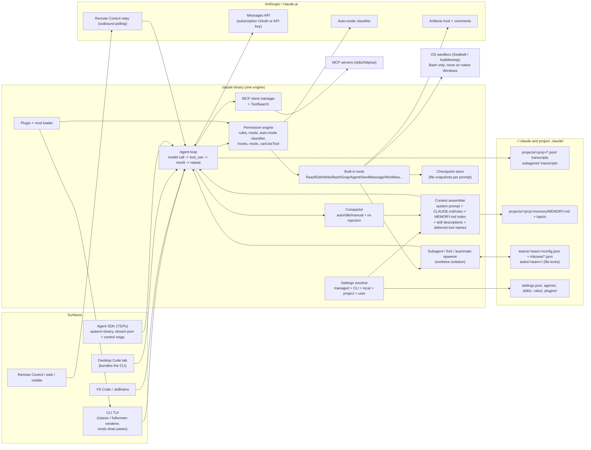

# Teardown: Claude Code (Anthropic)

**Date:** 2026-10-22. **Subject version:** Claude Code v2.1.308 (released 2026-10-22), Agent SDK TypeScript v0.3.308.
**Why:** Bench builds on Claude Code through the Agent SDK today, and v1 has to replace it for the founder's daily work: diff review, terminal and slash commands (BRD "Claude Code depth", interview B4-Q8b).
**Read first, not repeated here:** [anthropic-repos-and-auth.md](../anthropic-repos-and-auth.md) covers subscription auth rules, the SDK-to-Bench option map and which repos to use. [anthropic-repo-conventions.md](../anthropic-repo-conventions.md) covers how Anthropic structures its repos. This teardown only adds to them.

**Evidence rules.** Public sources only: code.claude.com docs, the public `anthropics/claude-code` and `anthropics/claude-agent-sdk-typescript` repos (CHANGELOG, `mods/`, issues, releases via the GitHub API), Anthropic blog posts and community write-ups. The Claude Code binary and its bundled JS were **not** opened, decompiled, deobfuscated or modified, and no traffic was intercepted. Anthropic's terms forbid it, and the founder's account depends on compliance ([ADR-0002](../../adr/0002-auth-subscription-vs-api-key.md)). Anything that only those methods could answer is marked **Unknown**.

**Notation.** `CC:` = `https://code.claude.com/docs/en/`. `GH:` = `https://github.com/anthropics/`. Unless a row gives another date, docs were read on 2026-10-22. Types: **Obs** = stated in a primary source; **Inf** = our inference from observations; **Unk** = unknown. Confidence: H / M / L.

---

## 0. Summary

1. Claude Code is no longer just a terminal tool. It is one engine (the `claude` binary) behind six surfaces: CLI, VS Code, JetBrains, Desktop, web/cloud and mobile via Remote Control. The SDK drives the same binary.
2. Its power comes from a layered configuration stack: CLAUDE.md, rules, auto memory, skills, subagents, hooks, mods, plugins and MCP, each with user, project, local and managed scopes.
3. Context management is progressive disclosure: MCP tools are deferred behind ToolSearch, only skill descriptions load up front, and only the 200-line `MEMORY.md` index loads. Auto-compaction re-injects a documented set of things. The system prompt was cut by more than 80% for Claude 5 models.
4. Agent teams are experimental and file-based (one JSON mailbox per agent, a file-locked task list). They are bounded: one team per session, a fixed lead, no resume, and split panes need tmux or iTerm2. **They do not run in `-p` or Agent SDK sessions.**
5. Checkpoints snapshot only edits made by Claude's file tools, once per user prompt, for the last 100 prompts. Bash changes and most subagent edits are not tracked. The SDK exposes the same mechanism (`enableFileCheckpointing` plus `rewindFiles`).
6. Review UX is now strong. The CLI `/diff` panel (a built-in mod with public source) shows per-turn diffs. The Desktop Changes pane takes inline line comments and submits them as one batch. `/code-review` produces cards.
7. Usage visibility is good for one session: `/usage` shows attribution and "f to fix" recommendations, and the statusline JSON includes `rate_limits`. It is weak across many agents.
8. The Bash sandbox runs on macOS, Linux and WSL2 only. **On native Windows, commands run unsandboxed.** That matters for a Windows-first Bench.
9. Release velocity is extreme: about 6 releases a week (100 releases between 2026-06-25 and 2026-10-22) and many version-gated behaviour changes, so Bench must pin versions and contract-test the stream.
10. The opening for Bench: a persistent, per-agent-scoped team (model, connectors, skills, cwd, memory) with a native Windows multi-pane view and cross-agent cost and approvals. Claude Code's own team feature is structurally single-session.

---

## 1. Question checklist

Status: **A** = answered, **P** = partially answered, **U** = unresolved.

| # | Question | Evidence needed | Status | Ledger |
|---|---|---|---|---|
| Q1 | What is the interaction model: surfaces, plan mode, permission modes? | Overview, permission-modes, desktop docs | A | F1–F5 |
| Q2 | What does the agent loop look like, and which tools exist? | Tools reference, agent-loop docs, blog | P (exact prompt assembly unknown) | F6–F10 |
| Q3 | How is context managed: auto-compact, context editing, what survives? | context-window, costs, model-config docs | P (clearing policy and thresholds per model not read in full) | F11–F13 |
| Q4 | What memory files exist, and how are they ordered and loaded? CLAUDE.md, rules, auto memory | memory docs | A | F14–F16 |
| Q5 | Subagents: definition, scoping, nesting, background running | sub-agents docs | A | F17 |
| Q6 | How do agent-team teammates communicate (task list, mailbox), and what are the limits? | agent-teams docs, issues, community | A | F18–F24 |
| Q7 | Hooks, skills, mods, plugins, marketplaces, MCP scoping | hooks, skills, mods, plugins, mcp docs | A | F25–F30 |
| Q8 | Checkpoints and rewind: what is tracked, and what can be restored? | checkpointing docs, SDK file-checkpointing | A (storage format unknown) | F31–F33 |
| Q9 | What is the diff and file review UX? | interactive-mode `/diff`, desktop docs, `mods/diff` source, issues | A | F34–F36 |
| Q10 | What is the terminal UX, and which slash commands exist? | commands, interactive-mode docs, issues | A | F37–F39 |
| Q11 | Headless mode, the SDK and stream-json | headless, SDK overview, TS reference | A | F40–F44 |
| Q12 | Desktop app panes: browser, terminal, PR, artifacts, sessions, side sessions | desktop, artifacts, remote-control, agent-view docs | P (internal Desktop-to-CLI wiring unknown) | F45–F50 |
| Q13 | Cost and usage visibility: `/usage`, `/cost`, statusline | costs, statusline docs | A | F51–F55 |
| Q14 | Security: sandboxing, permissions, trust | sandboxing, permissions, headless docs | A | F56–F59 |
| Q15 | Release cadence | CHANGELOG.md, GitHub releases API | A | F60–F62 |
| Q16 | What do users love and hate? | Issue search by reactions, reviews, HN | P (sentiment sources are thin and SEO-heavy) | F63–F67 |

---

## 2. Finding ledger

### 2.1 Interaction model

| # | Finding | Type | Evidence | Conf. | Search boundary |
|---|---|---|---|---|---|
| F1 | Six surfaces share one engine: Terminal CLI, VS Code, JetBrains, Desktop (Code tab), web (claude.ai/code) and mobile (via Remote Control and Dispatch). Settings, CLAUDE.md and MCP config work across all of them. | Obs | CC:overview (2026-10-22) | H | Docs only; surfaces not each tested |
| F2 | There are six permission modes: `default` (Manual), `acceptEdits`, `plan`, `auto`, `dontAsk` and `bypassPermissions`. `Shift+Tab` cycles through them. `dontAsk` is never in the cycle. Deny rules block in every mode. | Obs | CC:permission-modes | H | Docs; first 100k chars of page read |
| F3 | Auto mode uses a separate classifier model that reviews shell and network actions. It drops broad allow rules such as `Bash(*)`, treats stated boundaries ("don't push") as block signals, and pauses after 3 consecutive or 20 total blocks. Since v2.1.283 it is the built-in starting mode for interactive terminal and VS Code sessions. | Obs | CC:permission-modes; CC:best-practices | H | Classifier prompt and model not public |
| F4 | Plan mode allows reads plus classifier-approved commands. The approval offers "Yes + auto", "Yes, manual edits" or "keep planning". `Ctrl+G` edits the plan in an external editor. The plan is re-injected after compaction. | Obs | CC:permission-modes; CC:context-window | H | Docs |
| F5 | The Desktop app has the same modes in a selector under the prompt box. Auto needs specific models. Bypass is not available in cloud sessions. | Obs | CC:desktop | H | Docs |

### 2.2 Agent loop and tools

| # | Finding | Type | Evidence | Conf. | Search boundary |
|---|---|---|---|---|---|
| F6 | About 45 built-in tools: Agent, Bash, PowerShell, Read, Edit, Write, NotebookEdit, Glob, Grep, LSP, WebFetch, WebSearch, Skill, ToolSearch, SendMessage, Task\*, TodoWrite, Monitor, Cron\*, ScheduleWakeup, Enter/ExitPlanMode, Enter/ExitWorktree, Workflow, Artifact, AskUserQuestion, MCP resource tools, PushNotification and others. | Obs | CC:tools-reference (table) | H | Tool names as documented; internal behaviour not inspected |
| F7 | The Task tools (TaskCreate/Get/List/Update) are on by default only on older models (Opus 4.7, Sonnet 4.6, Haiku 4.5 and earlier). Newer models leave them out unless you opt in. On current models, team coordination therefore falls back to messages. | Obs | CC:tools-reference#task-tool-availability; CC:agent-teams | H | Docs |
| F8 | For Claude 5-generation models, Anthropic cut more than 80% of Claude Code's system prompt "with no measurable loss" on coding evals. Code review and verification moved into skills, and tools are deferred behind ToolSearch. | Obs | claude.dev/blog/the-new-rules-of-context-engineering-for-claude-5-generation-models (2026-07-24) | H | Blog claims; evals not public |
| F9 | Dynamic workflows let Claude write a JS harness with `agent()`, `parallel()` and `pipeline()`, choosing model and isolation (worktree or remote) per agent. Interrupted runs resume, and completed `pipeline()`/`parallel()` agents are served from a run journal. | Obs | claude.dev/blog/a-harness-for-every-task-dynamic-workflows-in-claude-code (2026-06-02); GH:claude-code CHANGELOG 2.1.305 | H | Blog plus changelog |
| F10 | Exact system-prompt text, when system reminders are injected, and tool-result truncation heuristics. | Unk | Only answerable by inspecting the binary or its traffic (prohibited) | n/a | Not attempted, by design |

### 2.3 Context management

| # | Finding | Type | Evidence | Conf. | Search boundary |
|---|---|---|---|---|---|
| F11 | Auto-compact runs as the context window nears its limit. `/autocompact <tokens>` sets the threshold; subagents can set their own `autoCompactWindow`. Idle compaction also exists. `/rewind` can "Summarize from here" or "Summarize up to here". | Obs | CC:context-window; CC:checkpointing | H | Per-model default thresholds (CC:model-config) not read |
| F12 | After compaction, these come back: the system prompt and output style, the root CLAUDE.md and unscoped rules, auto memory, skill descriptions, a fresh git status, the plan file, and up to 5 recently modified files (a file over 5k tokens comes back as a path reference only). Invoked skill bodies return capped at 5k tokens each and 25k in total. Path-scoped rules and nested CLAUDE.md files are summarized away and reload on demand. `SessionStart` hooks with source `compact` run again. | Obs | CC:context-window "What survives compaction" | H | Docs |
| F13 | The context-editing policy for clearing old tool results. Its existence is confirmed (`/usage` counts it as an "expected rebuild"), but its rules are not documented. | Unk (exists: Obs) | CC:costs#prompt-cache-statistics | M | The rules would need binary inspection |

### 2.4 Memory

| # | Finding | Type | Evidence | Conf. | Search boundary |
|---|---|---|---|---|---|
| F14 | CLAUDE.md hierarchy: **managed policy** (Windows: `C:\Program Files\ClaudeCode\CLAUDE.md`), then **user** (`~/.claude/CLAUDE.md`), then **project** (`./CLAUDE.md` or `./.claude/CLAUDE.md`), then **local** (`CLAUDE.local.md`). Files in ancestor directories load at launch; files in subdirectories load the first time Claude touches a file there. `@path` imports go up to 4 hops deep. External imports need a one-time approval. Files up to 4 MiB load in full; the docs recommend under 200 lines. | Obs | CC:memory | H | Docs |
| F15 | `.claude/rules/*.md` files can carry `paths:` frontmatter so they load only for matching files. `~/.claude/rules/` holds user-level rules. `AGENTS.md` is read when no CLAUDE.md exists (v2.1.277+, through a built-in mod). | Obs | CC:memory; CC:plugins/mods/overview | H | Docs |
| F16 | Auto memory lives in `~/.claude/projects/<project>/memory/`: a `MEMORY.md` index (first 200 lines or 25KB loaded each session) plus topic files read on demand. Each note has a type: `user`, `feedback`, `project` or `reference`. It is shared across the worktrees of one repo, stays on the machine, and is exempt from transcript cleanup. Disable it with `autoMemoryEnabled` or `CLAUDE_CODE_DISABLE_AUTO_MEMORY=1`; relocate it with `autoMemoryDirectory`. Subagents get their own store with `memory: user\|project\|local`. | Obs | CC:memory#auto-memory; CC:sub-agents | H | Docs. Bench's own design is in [memory-vault.md](../memory-vault.md) |

### 2.5 Subagents and agent teams

| # | Finding | Type | Evidence | Conf. | Search boundary |
|---|---|---|---|---|---|
| F17 | Subagents: built-in Explore, Plan and general-purpose. Definitions resolve in this order: managed, `--agents`, project, user, plugin. Frontmatter fields include `tools`, `disallowedTools`, `model`, `permissionMode`, `maxTurns`, `skills`, `mcpServers`, `hooks`, `memory`, `isolation: worktree`, `effort` and `background`. Spawned subagents run in the background by default. `/subtask` forks the conversation. Nesting goes 3 levels deep by default, with at most 20 running at once. Named subagents can be messaged and resumed with `SendMessage`. | Obs | CC:sub-agents | H | First 100k chars |
| F18 | Agent teams are **experimental** and switched on with `CLAUDE_CODE_EXPERIMENTAL_AGENT_TEAMS=1`. A team has a lead (the main session), teammates (separate Claude Code instances), a shared task list and mailboxes. | Obs | CC:agent-teams | H | Docs |
| F19 | **How teammates communicate.** Each agent has a mailbox file at `~/.claude/teams/{team}/inboxes/{agent}.json`, and every entry is validated when read. A send counts as done only once the write succeeds. The task list lives in `~/.claude/tasks/{team}/`, with three states and dependencies; claiming uses file locks. The team config (`members[]`, runtime state) is deleted when the session ends. Messages are delivered automatically. An idle teammate notifies the lead and includes its final answer. There is no broadcast; you send one message per recipient. | Obs | CC:agent-teams#architecture, #context-and-communication | H | Docs; files not inspected on disk |
| F20 | **Teams do not run in `-p` or Agent SDK sessions.** There, a named subagent runs as an ordinary subagent. | Obs | CC:agent-teams#enable-agent-teams | H | Docs. Decisive for Bench (see §6) |
| F21 | Team limits: one team per session; no nested teams; the lead is fixed; `/resume` and `/rewind` don't restore in-process teammates; task status can lag; shutdown is slow; teammate permission modes can't be set at spawn; split panes need tmux or iTerm2 and are **not supported in Windows Terminal**, VS Code's terminal or Ghostty. | Obs | CC:agent-teams#limitations | H | Docs |
| F22 | Safety: an inter-agent message is labelled as coming from another Claude session, so a teammate cannot approve or consent on the user's behalf. In auto mode the classifier reviews every inter-agent message before delivery. Teammate permission prompts surface in the lead. | Obs | CC:agent-teams#permissions | H | Docs |
| F23 | Scoping gaps: in-process teammates ignore a definition's `mcpServers` and `skills` and load the project's. A feature request for per-teammate cwd, CLAUDE.md and MCP config is open. Enabling teams can turn ordinary named subagents into teammates without asking. | Obs | CC:agent-teams#use-subagent-definitions-for-teammates; GH:claude-code/issues/23669 (open, 2026-02-06) | H | Issue search, title "teammate" |
| F24 | Cost: teams use "approximately 7x more tokens than standard sessions when teammates run in plan mode", and cost scales linearly with team size. The docs recommend 3–5 teammates. Community reports that idle agents add cost. | Obs (docs), S (community) | CC:costs#manage-agent-team-costs; hn.svelte.dev/item/47828968 | M | One HN thread |

### 2.6 Hooks, skills, mods, plugins, MCP

| # | Finding | Type | Evidence | Conf. | Search boundary |
|---|---|---|---|---|---|
| F25 | About 30 hook events, including SessionStart/End, UserPromptSubmit, Pre/PostToolUse, PostToolBatch, PermissionRequest/Denied, Subagent/Task/Teammate events, Pre/PostCompact, InstructionsLoaded, FileChanged, Worktree\*, PreModelSwitch and Elicitation. Five hook types: `command`, `http`, `mcp_tool`, `prompt` and `agent`. Exit code 2 blocks. `onFailure: "block"` exists since v2.1.295. | Obs | CC:hooks | H | First 100k of a 273k-char page |
| F26 | **Mods** are JS/TS hook modules that run in-process. They can draw panes, restyle the UI, add commands that run with no model turn, and rewrite tool calls. They were generally available from v2.1.287 (Desktop v2.1.286). They are not sandboxed. In `-p` and SDK sessions they **draw nothing**. Several built-in features are mods (`/diff`, AGENTS.md loading, telemetry), and their source is public in `GH:claude-code/tree/main/mods`. | Obs | CC:plugins/mods/overview | H | Docs; mod source not reviewed line by line |
| F27 | Skills are `SKILL.md` files; only their descriptions sit in context until invoked. Slash commands and skills are one surface. The SDK `skills` option is an allowlist, but dispatching `/<name>` bypasses it. | Obs | CC:agent-sdk/slash-commands (skills page) | H | Docs |
| F28 | A plugin is `.claude-plugin/plugin.json` plus skills, agents, hooks, a mod, MCP servers and output styles. Marketplaces are catalogs (`marketplace.json`); the official marketplace is added automatically. Install scope is user, project or local. Trust tiers are official, community and third-party, by name. An enabled plugin's descriptions cost tokens on every turn, and `/plugin` shows a "Context cost" estimate. | Obs | CC:plugins | H | Docs |
| F29 | MCP scopes: local (`~/.claude.json`), project (`.mcp.json`), user, plugin and claude.ai connectors, in precedence local > project > user > plugin > connectors. Managed config sits above all of them. Definitions are not merged across scopes. Tool search (deferred loading) is on by default. Output warns at 10k tokens and is capped at 25k by default. | Obs | CC:mcp | H | First 100k of page |
| F30 | `-p` and SDK sessions load a project's `.mcp.json` servers and settings hooks **without a trust prompt** unless you use `--bare`, `--strict-mcp-config` or `disabledMcpjsonServers`. | Obs | CC:headless#start-faster-with-bare-mode; CC:mcp | H | Docs. A Bench security requirement |

### 2.7 Checkpoints and rewind

| # | Finding | Type | Evidence | Conf. | Search boundary |
|---|---|---|---|---|---|
| F31 | A checkpoint is taken for every prompt that starts a turn. Snapshots are kept for the 100 most recent checkpoints and deleted by the retention sweep (default about 30 days, `cleanupPeriodDays`). `Esc Esc` or `/rewind` opens the menu: restore code and conversation, conversation only, code only, summarize from here, summarize up to here. `/clear` can be rewound within the same process. | Obs | CC:checkpointing | H | Docs |
| F32 | Not tracked: Bash file changes, edits from most subagents (except a foreground forked skill), external or concurrent-session edits, symlinked and hard-linked files, and messages queued mid-turn. "Not a replacement for version control." | Obs | CC:checkpointing#limitations | H | Docs |
| F33 | SDK: set `enableFileCheckpointing` and `extraArgs: {'replay-user-messages': null}` to get user-message UUIDs, then call `rewindFiles(uuid)`. This rewinds **files only**, not the conversation; the conversation is handled separately with `resumeSessionAt` or `forkSession`. The snapshot storage format and location are **Unk** (not documented). | Obs / Unk | CC:agent-sdk/file-checkpointing; TS reference options | H / n/a | Storage would need disk or binary inspection; not attempted |

### 2.8 Diff and file review UX

| # | Finding | Type | Evidence | Conf. | Search boundary |
|---|---|---|---|---|---|
| F34 | CLI `/diff` is the built-in mod `cc-plugin-diff`. In the fullscreen renderer it is a persistent side panel (needs 110 columns or more; opens by itself from 144 columns once Claude edits). It lists changed files with +/- counts and has a **per-turn view** built from Claude's file edits, plus `Current` (the git working tree). Shell-made changes appear only under `Current`. Requires v2.1.287+. | Obs | CC:interactive-mode#review-changes-with-diff | H | Docs; mod source available, not reviewed |
| F35 | Desktop Changes pane: review file by file, **click any line to comment, `Ctrl+Enter` sends all comments at once**, then Claude applies them and shows a new diff. A `/code-review` card is grouped by file, with "Walk through in diff", "Fix this one" and "Apply fixes". | Obs | CC:desktop | H | Docs; app not run |
| F36 | Demand signal: "VS Code Extension: Diff review UI similar to GitHub Copilot Edits Review" has 296 reactions and is open. Per-hunk accept or reject is not documented on any surface. | Obs / Inf | GH:claude-code/issues/33932 (2026-03-13) | M | Reaction-sorted issue search |

### 2.9 Terminal UX and slash commands

| # | Finding | Type | Evidence | Conf. | Search boundary |
|---|---|---|---|---|---|
| F37 | About 119 commands and bundled skills are documented, including `/diff`, `/rewind` (aliases `/checkpoint`, `/undo`), `/branch`, `/fork`, `/subtask`, `/btw`, `/tasks`, `/workflows`, `/goal`, `/code-review` (effort levels, `--fix`, `--comment`), `/usage` (aliases `/cost`, `/stats`), `/context`, `/compact`, `/autocompact`, `/memory`, `/hooks`, `/permissions`, `/sandbox`, `/plugin`, `/mcp`, `/agents`, `/background`, `/remote-control`, `/desktop`, `/teleport` and `/tui`. Up to 6 skills can be chained in one message. | Obs | CC:commands | H | Count from the command tables; may include hidden or bundled entries |
| F38 | Terminal UX: a flicker-free fullscreen alt-screen renderer (`/tui fullscreen`), an agent panel below the prompt (arrows, Enter, `x` to stop), `Ctrl+T` task list, `Ctrl+B` to background, `Esc` to interrupt, `Esc Esc` to rewind, queued messages, side questions that never enter history, voice dictation, and a spinner token counter. | Obs | CC:interactive-mode; CC:agent-teams | H | Docs |
| F39 | The most-reacted terminal complaints are about scrolling and flicker: #826 (822 reactions), #3648 (836, closed), #769 (336), #1913 (321). Copy/paste indentation is #18170 (300). The fullscreen renderer is Anthropic's answer. | Obs | GH:claude-code/issues (reactions sort, 2026-10-22) | H | Top 25 open issues plus topic searches |

### 2.10 Headless mode, SDK, stream-json

| # | Finding | Type | Evidence | Conf. | Search boundary |
|---|---|---|---|---|---|
| F40 | `claude -p` supports `--output-format text\|json\|stream-json`, `--include-partial-messages`, `--json-schema` (to `structured_output`) and `--permission-prompts none`. The stream opens with `system/init` (model, tools, `mcp_servers`, `mcp_server_errors`, `plugins`, `plugin_errors`, `slash_commands`, `skills`, `capabilities[]`) and contains `system/api_retry` events, `parent_tool_use_id` for subagent messages, and a final `result` with `total_cost_usd`, the per-model breakdown and `permission_denials`. | Obs | CC:headless | H | Docs |
| F41 | `--bare` skips auto-discovery of hooks, skills, plugins, MCP, CLAUDE.md and auto memory, **never reads OAuth or the keychain** (it needs an API key), and "will become the default for `-p` in a future release". | Obs | CC:headless#start-faster-with-bare-mode | H | Docs. Risk for subscription-based Bench (§4, U6) |
| F42 | The SDK runs the Claude Code binary. Query methods: `interrupt`, `setPermissionMode`, `setModel`, `rewindFiles`, `supportedCommands/Models/Agents`, `getContextUsage`, `mcpServerStatus`, `toggleMcpServer`, `setMcpServers`, `reconnectMcpServer`, `reloadSkills/Plugins/OutputStyles`, `stopTask`, `streamInput`, `accountInfo`. Session functions: `listSessions`, `getSessionMessages`, `getSessionInfo`, `renameSession`, `tagSession`, `forkSession`. Options include `sessionStore`, `maxBudgetUsd`, `taskBudget`, `enableFileCheckpointing`, `sandbox`, `outputStyle` and `forwardSubagentText`. | Obs | CC:agent-sdk/typescript (296k chars, method tables scanned) | H | Names only; behaviour not tested |
| F43 | Third parties may not offer claude.ai login or rate limits without approval. Product branding may not say "Claude Code". | Obs | CC:agent-sdk/overview | H | Already in [anthropic-repos-and-auth.md](../anthropic-repos-and-auth.md) |
| F44 | Artifacts are off by default in the SDK and in `-p`, and mods draw nothing there. The SDK gives you the engine, not the UI. | Obs | CC:artifacts#availability; CC:plugins/mods/overview | H | Docs |

### 2.11 Desktop app

| # | Finding | Type | Evidence | Conf. | Search boundary |
|---|---|---|---|---|---|
| F45 | Desktop panes (draggable; `Ctrl+\` closes one): Chat (view modes Normal, Thinking, Verbose), **Changes/diff**, Code review, **Terminal** (`` Ctrl+` ``, shares Claude's env), **Browser** (`Ctrl+Shift+B`; previews the dev server so Claude can screenshot and click; external sites need per-site approval), File editor (autosave), Plan, Tasks, Subagent, iOS Simulator (macOS). Requires Desktop v1.2581.0+. | Obs | CC:desktop | H | Docs; app not run |
| F46 | Sessions: a sidebar; parallel sessions side by side (Alt-click) or in separate windows; per-session **worktree** under `.claude/worktrees/`; **side chats** (`Ctrl+;` or `/btw`, not saved); **suggested tasks** that you start in a new session; Claude can list, read, message and archive other Desktop sessions (not CLI or cloud ones). | Obs | CC:desktop | H | Docs |
| F47 | PR monitoring shows CI status, **Auto-fix** for failing checks and review comments, and **Merge when ready** (squash). It needs an authenticated `gh`. Also: cloud sessions, Dispatch from phone, desktop scheduled tasks, connectors GUI, computer-use preview. | Obs | CC:desktop | H | Docs |
| F48 | Artifacts: single self-contained HTML or Markdown pages hosted on claude.ai under a strict CSP. Private by default, versioned, shareable, with comment threads Claude can answer. Connector calls run with the viewer's account. They need a claude.ai login (not an API key). | Obs | CC:artifacts | H | Docs |
| F49 | Remote Control: the local process makes outbound HTTPS calls only and polls the Anthropic API, opening no inbound ports. One remote session per interactive process unless server mode is used. Agent view (`claude agents`) runs detached sessions under a supervisor process; `claude agents --json` exposes their state. | Obs | CC:remote-control; CC:agent-view | H | Docs |
| F50 | Desktop internals: the app "includes Claude Code", and `/status` reports a bundled CLI version. We infer that Desktop runs a bundled CLI process per session and drives it through a structured protocol. Whether that protocol is the SDK's stream-json is **Unk**. | Inf / Unk | CC:overview; CC:plugins/mods/overview | L | Answering it would need traffic interception (prohibited) |

### 2.12 Cost and usage visibility

| # | Finding | Type | Evidence | Conf. | Search boundary |
|---|---|---|---|---|---|
| F51 | `/usage` (aliases `/cost`, `/stats`). The Session block shows a list-price **estimate**, per-model tokens and a prompt-cache line (hit %, misses with a likely cause, warm/cold). On subscription plans it adds plan bars, **attribution** by skill, subagent, plugin and MCP server, **recommendations** with an `f` key to apply them (v2.1.305), loop rows, and 24h/7d toggles. Data comes from local history on this machine only. | Obs | CC:costs | H | Docs |
| F52 | The statusline script receives JSON on stdin: `cost.total_cost_usd`, `context_window.used_percentage`, `current_usage`, `prompt_cache`, and **`rate_limits.five_hour` / `seven_day` with `used_percentage` and `resets_at`**. Updates are debounced at 300 ms, with an optional `refreshInterval`. There is a separate subagent-rows statusline. | Obs | CC:statusline | H | Docs |
| F53 | OpenTelemetry export works on every setup. A `claude_code.safety_event` exists for each blocked or prompted call (v2.1.307). `/insights` writes an HTML report on how you work. | Obs | CC:costs; CHANGELOG 2.1.307 | H | Docs and changelog |
| F54 | Benchmark: enterprise average of about $13 per developer per active day and $150–250 per month; 90% of users stay under $30 per active day. | Obs | CC:costs | H | Anthropic's own figures |
| F55 | Gap: the prompt-cache line covers "the main conversation only, not subagents". Nothing shows per-teammate or per-agent spend side by side live. | Obs / Inf | CC:costs#prompt-cache-statistics | M | Docs; absence inferred |

### 2.13 Security

| # | Finding | Type | Evidence | Conf. | Search boundary |
|---|---|---|---|---|---|
| F56 | The Bash sandbox covers Bash, PowerShell and Monitor commands and their children. It uses Seatbelt on macOS and bubblewrap plus socat on Linux/WSL2, and network traffic goes through a local proxy with a domain allowlist that **starts empty**. In auto-allow mode, sandboxed commands run without prompts. The `dangerouslyDisableSandbox` retry is the escape hatch; disable it with `allowUnsandboxedCommands: false`. Credential masking substitutes sentinels. Built on the open-source `@anthropic-ai/sandbox-runtime`. | Obs | CC:sandboxing | H | Docs |
| F57 | **On native Windows, Claude Code runs commands unsandboxed**; the sandbox needs WSL2. File tools, MCP servers, hooks and mods run outside the sandbox. | Obs | CC:sandboxing; CC:plugins/mods/overview | H | Docs. Material for Windows-first Bench |
| F58 | Repo-supplied settings, hooks, external imports, `autoMemoryDirectory` and agent definitions need workspace trust in interactive mode. `-p` and SDK sessions skip the trust dialog (see F30). | Obs | CC:memory; CC:agent-teams; CC:headless | H | Docs |
| F59 | Permission precedence: deny > ask > allow, across modes. Hooks and mods can approve; with managed settings or a Team/Enterprise login, a mod cannot get past `ask` rules. | Obs | CC:plugins/mods/overview; CC:permission-modes | M | permissions page not read in full |

### 2.14 Release cadence

| # | Finding | Type | Evidence | Conf. | Search boundary |
|---|---|---|---|---|---|
| F60 | CHANGELOG.md has 428 version sections (0.2.21 to 2.1.308). The GitHub releases API shows **100 releases from 2026-06-25 (v2.1.193) to 2026-10-22 (v2.1.308)**: about 0.84 per day, or 6 per week. 27 releases in the last 30 days, 8 in the last 7. | Obs (computed) | GH:claude-code CHANGELOG.md and releases API (2026-10-22) | H | Last 100 releases only |
| F61 | The Agent SDK TS version tracks the CLI (0.3.308 on the same day) and also shipped 27 releases in 30 days. | Obs (computed) | GH:claude-agent-sdk-typescript releases API | H | Last 100 releases |
| F62 | The docs carry many "Before v2.1.x…" behaviour notes and version minimums on almost every page. Single releases change defaults: `-p` starts in Manual mode from v2.1.302, auto mode became the default in v2.1.283, and `--bare` will become the `-p` default. Integration churn is a first-order risk for Bench. | Inf | Docs passim; CHANGELOG | H | Reading across about 20 pages |

### 2.15 What users love and hate

| # | Finding | Type | Evidence | Conf. | Search boundary |
|---|---|---|---|---|---|
| F63 | Loved: depth on large codebases, multi-file refactors, terminal-native composability, and a good fit for experienced developers. | S | aitoolreviewer.it.com/?p=114; morphllm.com/claude-coding-agent | L–M | SEO-heavy reviews; no survey found |
| F64 | Hated, part 1: **usage limits**. #16157 "Instantly hitting usage limits with Max" (726 reactions); #38335 "session limits exhausted abnormally fast" (544); #46917 "inflates cache_creation by ~20K tokens" (219). | Obs | GH:claude-code issues (reactions sort) | H | Top 25 open issues |
| F65 | Hated, part 2: terminal flicker and scrolling (F39); no multi-account support (#18435, 1161; #36151, 1060); a Windows Desktop window that stays always on top (#85891, 291); Cowork's 10GB VM (#22543); model verbosity that ignores instructions (#65961, 252); a 2026-04 quality regression thread (#42796, 3286, closed). | Obs | GH:claude-code issues | H | Same |
| F66 | Extensibility demand: "Mods – make Claude 10x more extensible" (#91870, 224); AGENTS.md support (#6235, 6687, now shipped); multi-window Desktop (#30154, 264). | Obs | GH:claude-code issues | H | Same |
| F67 | Agent-team friction: requests for zellij and Ghostty split panes (#24122, 96; #24189, 74); Windows users run teams through WSL2 plus tmux. | Obs / S | GH:claude-code issues; ardalis.com/setting-up-claude-code-agent-teams-with-wsl2-and-tmux-on-windows | M | Title search "agent team" |

---

## 3. Probable architecture (INFERENCE)

> **This diagram is an inference** from public docs, the public `mods/` source tree, the SDK reference and issue titles. It is not derived from the binary or its traffic. Names in quotes are documented features; the boxes and arrows between them are our reconstruction.

**How to read it (inference):** every surface is a client of the same loop. The SDK and Desktop sit at the same level as the TUI. Collaboration state (teams, tasks, mailboxes, memory, transcripts) is **plain files** under `~/.claude`, which is why teams are tied to one machine and one session. Approval decisions go through a single permission engine that hooks, mods, the classifier and the SDK's `canUseTool` all feed into.

---

## 4. Open unknowns

| # | Unknown | Why it matters to Bench | Legitimate path to resolve |
|---|---|---|---|
| U1 | Exact system prompt, system-reminder injection and tool-result truncation (F10) | Prompt-cost modelling per agent | Measure from outside: `getContextUsage()` and `/context` on our own sessions. Never read the binary |
| U2 | Rules for context editing (clearing old tool results) and default auto-compact thresholds per model (F13) | Bench's own 80% checkpoint rule (BRD S5) must fire before Claude Code's compaction | Read CC:model-config; measure the `compact_boundary.pre_tokens` distribution in spike S0 |
| U3 | Checkpoint snapshot format and location (F33) | We only need the API, so this is low priority | Not needed; use `rewindFiles` |
| U4 | How auto-mode classifier calls count against plan usage | Auto mode is now the default; Bench may run many agents in auto | Ask Anthropic or watch `/usage` attribution |
| U5 | The Desktop-to-CLI protocol (F50) | Whether Desktop exposes features the SDK doesn't | Ignore; build on the SDK only |
| U6 | When `--bare` becomes the `-p` default, and whether the SDK follows (F41). `--bare` doesn't read OAuth | It could break subscription auth for SDK sessions ([ADR-0002](../../adr/0002-auth-subscription-vs-api-key.md)) | Watch the CHANGELOG each release; pin the SDK; contract test "subscription login works" |
| U7 | How tokens map to the 5h and 7d `rate_limits` percentages | Budgeting across agents | Empirical: log `used_percentage` deltas against `modelUsage` |
| U8 | Whether agent teams will graduate, and whether they will ever run in the SDK | If they do, Bench could reuse the mailbox and task primitives | Track docs and CHANGELOG |
| U9 | A native Windows sandbox roadmap (F57) | Windows-first Bench has no OS sandbox for agent shell commands | Track `sandbox-runtime` issues; offer WSL2 mode |
| U10 | Real user sentiment beyond issue reactions | Prioritising v1 polish | Founder dogfooding plus a targeted HN/Reddit read later |

---

## 5. What Bench gets for free via the Agent SDK

Reuse these. Do not rebuild them. Option names are in F42 and in the map in [anthropic-repos-and-auth.md §2](../anthropic-repos-and-auth.md).

| # | Capability | SDK surface | Note for Bench |
|---|---|---|---|
| G1 | **The whole agent loop and ~45 tools**, including Bash/PowerShell, Edit/Write, Grep, WebFetch/Search and LSP | `query()`, `tools`, `disallowedTools` | Only the UI is ours |
| G2 | **File checkpoints and rewind** | `enableFileCheckpointing`, `replay-user-messages`, `rewindFiles()`; conversation side via `resumeSessionAt` / `forkSession` | Bench adds a git safety net for Bash edits (B4) |
| G3 | **Command surface** (built-ins that work headless, bundled skills, user skills, `.claude/commands`) | `supportedCommands()`, `init.slash_commands`, dispatch by sending `/<name>` | Palette lists them; Bench adds its own commands |
| G4 | **Permissions and approvals** | `canUseTool`, `permissionMode`, `setPermissionMode()`, `PermissionRequest` hook, `--permission-prompts none` for unattended agents | Per-agent policy lives in Bench |
| G5 | **Sessions**: resume, fork, list, read, rename, tag, external store | `resume`, `forkSession()`, `listSessions()`, `getSessionMessages()`, `renameSession()`, `tagSession()`, `sessionStore` | Session browser is just UI |
| G6 | **Context management**: auto-compact, `/compact`, usage breakdown | `compact_boundary`, `PreCompact`/`PostCompact` hooks, `getContextUsage()` | Drives Bench's context gauge and checkpoint rule |
| G7 | **Cost and limits** | result `total_cost_usd` and `modelUsage`, `maxBudgetUsd`, `taskBudget`, rate-limit fields | Cost is an estimate; label it so |
| G8 | **Subagents, skills, plugins, MCP (incl. in-process MCP)** with per-agent allowlists | `agents`, `skills`, `plugins`, `mcpServers` + `strictMcpConfig`, `createSdkMcpServer()`, `toggleMcpServer()`, `mcpServerStatus()` | Per-agent scoping is Bench's differentiator, and the SDK supports it |
| G9 | **Hooks for observability and quality gates** | `hooks` option incl. `PreToolUse`, `PostToolUse`, `SubagentStop`, `Stop`, `TaskCompleted` | Feeds the trace view and the verifier |
| G10 | **Streaming and control** | `includePartialMessages`, `forwardSubagentText`, `parent_tool_use_id`, `interrupt()`, `setModel()`, `api_retry` events, `init.capabilities` | Feature-detect with `capabilities`, not version strings |
| G11 | **Sandbox for macOS, Linux and WSL2** | `sandbox` options (`allowWrite`, `allowedDomains`, `failIfUnavailable`…) | Not on native Windows (B10) |
| G12 | **Output styles and system-prompt append** | `outputStyle`, `systemPrompt` / append | Agent persona lives here, not in a forked prompt |

**Not free (verified):** agent teams (F20), anything a mod draws (F26), artifacts (F44), `/diff` and Desktop panes, `/usage` UI, the statusline, the TUI-only commands (`/theme`, `/terminal-setup`…), and Remote Control.

---

## 6. What Bench must build to replace Claude Code in v1

Sizes: **S** = under 3 dev-days, **M** = 1–2 weeks, **L** = more than 2 weeks, for one developer agent plus review. Ordered by the founder's stated v1 scope (diff review, terminal, commands) and then by what that scope depends on.

| # | Build | What "replace Claude Code" means here | Size | Depends on |
|---|---|---|---|---|
| B1 | **Diff review pane** | Per agent: a working-tree view, a **per-turn view** (from checkpoint UUIDs and tool events), file list with +/- counts, inline line comments **sent back as one batched prompt** (Desktop pattern), accept or revert per file, and per hunk via git apply. Multi-agent: filter by agent and by task. | **L** | G2, G9 (edit events); git CLI wrapper in `core`; Monaco or CodeMirror diff in the renderer; per-agent worktree (B8) |
| B2 | **Integrated terminal** | xterm.js plus node-pty (ConPTY on Windows), opened in the agent's cwd/worktree with the same env as the agent (minus `ANTHROPIC_API_KEY`, per ADR-0002), several tabs, and "send selection to agent". | **M** | Electron main-process PTY host; IPC allowlist (security-baseline); B8 |
| B3 | **Slash-command palette** | `/` menu built from `supportedCommands()` plus Bench-native commands (`/agent`, `/group`, `/handoff`, `/usage`, `/rewind`, `/diff`, `/memory`); arg hints; fuzzy match; native replacements for TUI-only commands (theme, keybindings). | **M** | G3; command registry in `core`; B1, B4, B6 for the Bench-native ones |
| B4 | **Checkpoints and rewind UI** | Timeline per agent: restore code, restore conversation, restore both, summarize from here or up to here. **Plus a git snapshot per turn** (a stash-like ref in the worktree) so Bash and subagent edits can also be restored, closing the gap in F32. | **M** (SDK part S, git safety net M) | G2, G5; B8; git CLI wrapper |
| B5 | **Approvals inbox and permission modes** | One inbox across all agents (Claude Code makes teammate prompts bubble up to the lead); per-agent mode with Shift+Tab equivalent; allow once, always or deny; "recently denied" list. | **M** (part may exist from MVP) | G4; per-agent policy store |
| B6 | **Usage and context meter (statusline equivalent)** | Per agent and total: context %, estimated cost, cache hit %, plan `five_hour`/`seven_day` % with reset time, and attribution by agent, connector and skill (what `/usage` does for one session). | **M** | G6, G7; rate-limit fields; U7 |
| B7 | **Plan review** | Render the `ExitPlanMode` plan, edit it, approve into a mode, reject with a comment. | **S** | G4 (intercept in `canUseTool`) |
| B8 | **Worktree per agent** | Create, list and clean worktrees; show the branch; merge back. This is a prerequisite for safe parallel edits, given the agent-teams docs' warning that two teammates editing the same file leads to overwrites. | **M** | git CLI; `isolation`, or our own `git worktree` calls |
| B9 | **Session browser** | Resume, fork, rename, tag and search past sessions per agent. | **S–M** | G5 |
| B10 | **Windows command safety** | No OS sandbox on native Windows (F57). Bench enforces folder grants and a deny-list in `canUseTool`/`PreToolUse`, offers an optional WSL2 runtime per agent with the SDK sandbox, and states the gap honestly in Settings. | **M** (WSL2 option L) | G4, G9, G11; security-baseline |
| B11 | **Connector, skill and plugin manager** | Inventory from the user's Claude Code config, per-agent ticks, live status and reconnect. | **M** (overlaps S6) | G8 |
| B12 | **Version pinning and stream contract tests** | Pin `@anthropic-ai/claude-agent-sdk` and the CLI; a CI fixture suite over `init`, `result`, `compact_boundary`, `api_retry` and the checkpoint UUID flow; a weekly upgrade job. Needed because of about 6 releases a week (F60–F62). | **S** | CI (anthropic-repo-conventions) |
| B13 | **Browser preview pane** *(v1.x, optional)* | An Electron webview on the dev server, with screenshot and click via an MCP tool Bench provides. | **L** | In-process MCP server (G8) |
| B14 | **PR and CI monitor** *(v1.x)* | CI status, auto-fix loop and merge-when-ready through `gh`. | **M** | `gh` CLI installed and authenticated by the user |

**Critical path for v1:** B12, then B8, B2, B4, B1, B3, B5 and B6. B1 is the largest and depends on B4's turn snapshots to show per-turn diffs that include Bash changes.

---

## 7. Steal / Avoid / Beat

### Steal

| # | What | From | Bench use |
|---|---|---|---|
| S1 | **Inline line comments that batch into one prompt**, followed by a fresh diff | Desktop Changes pane (F35) | The core interaction of B1 |
| S2 | **The rewind menu's five verbs**: restore code, conversation or both; summarize from or up to here | `/rewind` (F31) | B4, word for word; users already know these verbs |
| S3 | **Per-turn diff views next to a working-tree view** | `/diff` mod (F34), public source in `mods/diff` | B1. Read the source for UX ideas only (Commercial Terms; do not copy code) |
| S4 | **Usage attribution plus a one-key "fix" recommendation** | `/usage` (F51) | B6: "Agent X's MCP server costs 30% of usage, untick it?" |
| S5 | **Progressive disclosure everywhere**: `MEMORY.md` index under 200 lines, skill descriptions only, deferred MCP tools | F8, F12, F16 | Already Bench's memory-vault direction; apply to agent cards too |
| S6 | **Inter-agent messages are never user consent**, and the classifier reviews them | Agent teams (F22) | Bench's security baseline for handoffs |
| S7 | **Exit-code-2 quality gates** on task completion and on going idle | `TaskCompleted` / `TeammateIdle` hooks (F25) | The Bench verifier refuses "done" without evidence |
| S8 | **Statusline-style JSON contract** for a pluggable status bar | F52 | A Bench plugin surface later |

### Avoid

| # | What | Why | Bench instead |
|---|---|---|---|
| A1 | **A terminal multiplexer as the multi-agent UI** (tmux or iTerm2; Windows Terminal not supported) | Unusable for Windows-first users (F21, F67) | Native panes in Electron |
| A2 | **Ephemeral team state**: config deleted at session end, no teammate resume, fixed lead, one team per session | Work and relationships vanish (F19, F21) | Teams, agents and boards are durable files plus a DB (PRODUCT-MODEL) |
| A3 | **Teammates loading every project MCP server and skill** | Token waste and less accurate tool choice (F23) | Per-agent `mcpServers` + `strictMcpConfig`, `skills` allowlist |
| A4 | **Checkpoints that silently skip Bash and subagent edits** | Users believe they can undo something that can't be undone (F32) | Git snapshot per turn (B4), with the limits shown in the UI |
| A5 | **Teams that form without asking** (a named subagent becomes a teammate) | Surprise token spend of roughly 7x (F23, F24) | Spawning an agent is always explicit and shows its cost |
| A6 | **Loading repo hooks and `.mcp.json` in headless runs without trust** | Supply-chain risk (F30, F58) | `settingSources` set explicitly, `strictMcpConfig`, and a Bench trust prompt per folder |
| A7 | **Command sprawl** (about 119 entries) and behaviour gated by version | Hard to learn, and it churns (F37, F62) | A small Bench-native set plus pass-through of the user's skills |

### Beat (where Bench's team model wins over single-session Claude Code)

| # | Claude Code today | Bench's edge |
|---|---|---|
| X1 | A team lives and dies with one session; teammates can't be resumed (F21) | **Persistent agents** with their own sessions, memory and checkpoints that survive restarts and weeks of work |
| X2 | In-process teammates ignore per-definition MCP and skills; per-teammate cwd and CLAUDE.md is an open request (F23, #23669) | **Each agent has its own model, connectors, skills, cwd/worktree and private memory**, which is Bench's core claim (competitive brief §3) |
| X3 | Teams are unavailable in the SDK, and split panes need tmux or iTerm2 (F20, F21) | **A native multi-pane team view on Windows**: every agent's transcript, diff and terminal side by side |
| X4 | Cost visibility is per session; the cache line covers only the main conversation (F51, F55) | **Live cost, context and plan-% per agent and per group**, with budgets and a router that keeps group chats from scaling linearly |
| X5 | Teammate approvals bubble into the lead; modes can't be set per teammate at spawn (F21, F22) | **One approvals inbox with per-agent, per-tool policy** set when the agent is created |
| X6 | Task status "can lag" and depends on file locks and model-optional Task tools (F7, F21) | **A durable task board owned by Bench** (not by the model), with structured handoffs and a verifier |
| X7 | One lead coordinates by spawn prompts; teammates lack the lead's history (F19) | **A main agent that routes by agent cards**, plus group context summaries, so delegation is cheap and continuous |

---

## Sources (primary, read 2026-10-22 unless dated)

- Docs at code.claude.com/docs/en/: overview, best-practices, memory, permission-modes, hooks, sub-agents, agent-teams, plugins, plugins/mods/overview, mcp, checkpointing, context-window, costs, statusline, headless, tools-reference, commands, interactive-mode, desktop, artifacts, remote-control, agent-view, sandboxing, output-styles, github-actions, agent-sdk/overview, agent-sdk/file-checkpointing, agent-sdk/slash-commands (skills page), agent-sdk/typescript.
- GitHub: anthropics/claude-code CHANGELOG.md and releases API; anthropics/claude-code issues (reaction-sorted search); anthropics/claude-agent-sdk-typescript releases API; anthropics/claude-code `mods/` (listing only).
- Blog: "A harness for every task: dynamic workflows in Claude Code" (claude.dev, 2026-06-02); "The new rules of context engineering for Claude 5 generation models" (claude.dev, 2026-07-24).
- Community (secondary, low weight): hn.svelte.dev/item/47828968; ardalis.com WSL2 + tmux agent-teams guide; aitoolreviewer.it.com; morphllm.com; medium.com Claude Code 2026 guide.
