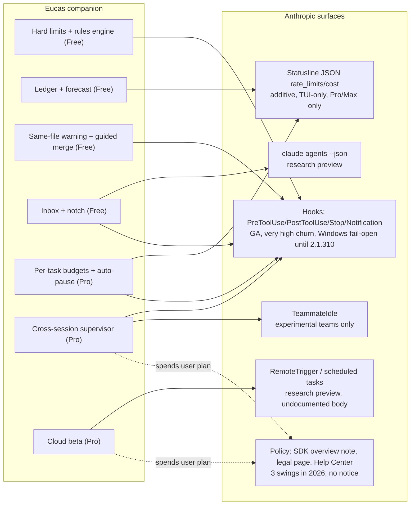

# Pre-mortem teardown: the Eucas companion, lens "platform dependency on Anthropic"

**Date:** 2026-10-26. **Subject:** our own planned product, the Eucas companion (Windows-first desktop companion around the user's own Claude Code sessions; Free + Pro $10/mo; FSL licence).
**Premise:** it is April 2027, six months after launch, and the companion has failed **because of Anthropic**. This file works backwards from that premise to the failure modes, what we would see first, and what would stop them.
**Decision this informs:** whether the companion (and especially its **Pro** tier) should go ahead as specified, and which BRD items to propose before the next baseline.

**Read first, not repeated here:** [anthropic-repos-and-auth.md](../anthropic-repos-and-auth.md), [risk-facts-2026-10-23.md](../risk-facts-2026-10-23.md) (the 2026 enforcement timeline), [claude-code.md](claude-code.md) (Claude Code teardown, 2026-10-22), [competitive-brief-companion-2026-10-25.md](../competitive-brief-companion-2026-10-25.md), [ADR-0002](../../adr/0002-auth-subscription-vs-api-key.md) and spike **SP-CR1** (`docs/spikes/SP-CR1.md` on `spike/cloud-routines`; read from the checked-out copy in the sibling worktree `trusting-raman-eb7ee6`, since this session had no shell for `git fetch`).

**Evidence rules.** Public sources only: code.claude.com docs, the Help Center, platform.claude.com docs, the public `anthropics/claude-code` CHANGELOG and issues, Anthropic legal pages, press. Nothing was decompiled, intercepted or bypassed. **Notation:** `CC:` = `https://code.claude.com/docs/en/`. Types: **Obs** (stated in a source), **Inf** (our inference), **Unk** (unknown). Confidence H/M/L. Unless a row says otherwise, sources were read on **2026-10-26**.

---

## 0. Summary (blunt)

1. **The mechanism is safe; the business model is the exposure.** A companion that only adds hooks, reads the statusline and runs the **unmodified** binary under the user's own login is the case Anthropic's legal page explicitly allows today. Every 2026 enforcement hit tools that **took the OAuth token out of the binary** (OpenCode spoofed Claude Code's client identity; OpenClaw-style harnesses called the API with subscription tokens). We do neither.
2. **But the SDK overview still says "Unless previously approved, Anthropic does not allow third party developers to offer claude.ai login or rate limits for their products."** Our free hooks spend no model tokens. Our **Pro** features (supervisor nudges, cloud hand-off, "keep going") exist to spend the user's plan on our product's behalf. A paid product whose paid features consume subscription limits is the reading of that sentence most likely to bite. **Paid is more exposed than free.**
3. **Policy text has swung three times this year** (Feb: "OAuth tokens … in any other product, tool, or service, including the Agent SDK … not permitted"; Apr: harnesses moved to extra usage; May–Jun: credits, then paused; Oct: today's wording that permits the unmodified binary). Enforcement is "without prior notice". Assume at least one more swing in our first six months.
4. **Absorption is the likelier killer, and it hits Pro first.** Notifications, needs-input state, usage warnings, auto-resume, worktree isolation, single-session keep-going (`/goal`), a cloud coordinator with per-thread usage (Projects) and per-developer **spend caps with 75%/95% warnings** (Claude apps gateway, Enterprise) are already shipped. Interactive per-person budgets are one product decision away. What stays ours: **deterministic, user-owned, cross-session policy enforced outside the model, tested fail-closed on Windows, and (if we choose) vendor-neutral**.
5. **Interface churn is real and constant:** about 6 releases a week; roughly 50 hook-related changelog entries across 2.1.287–2.1.295 alone; behaviour changes to hook output validation, permission-rule matching, `-p` default mode and hook concurrency in the last two weeks. Hooks **failed open on Windows** until 2.1.309/2.1.310 (a week ago). For a solo developer, tracking this is a standing tax, not a one-off.
6. **Cloud routines are the weakest leg of Pro:** research preview, renamed once (routines → scheduled tasks), undocumented create body (SP-CR1), a beta-header API, launch caps (5 Pro / 15 Max / 25 Team per day, press report) that no longer appear in the docs. Treat them as a free, switchable beta, never a reason to pay.
7. **Verdict for this lens: serious but fixable for the product; near-fatal for the Pro tier as currently specified.** Fixes: get written approval before charging; make Pro features token-neutral or run them inside the user's own session; drop cloud from the paid promise; ship a contract-test harness against every CLI release; keep a free, open core that survives absorption.

---

## 1. Question checklist

| # | Question | Evidence | Status | Ledger |
|---|---|---|---|---|
| Q1 | Terms: could Anthropic block or throttle a hooks-only companion? What triggers enforcement? Is paid more exposed? | Legal page, SDK overview, Help Center, Consumer Terms, press on OpenCode/OpenClaw | **A** (trigger list is inferred from what was enforced; no written criteria exist) | T1–T14 |
| Q2 | Absorption: what will Anthropic ship natively within 6 months; what stays ours? | CHANGELOG, docs (agent view, /goal, Projects, gateway spend limits, statusline), issue #66048 | **P** (roadmap is not public) | A1–A12 |
| Q3 | Interface stability and solo maintenance cost | CHANGELOG (2.1.287–2.1.310), issue mirrors, docs version notes | **P** (only ~200k of a 1.08M-char changelog read) | S1–S12 |
| Q4 | Cloud routines: status, caps, odds of change/removal, effect on Pro | Routines docs, SP-CR1, 9to5Mac 2026-04-14 | **A** | C1–C8 |
| Q5 | Branding and marketing limits | Legal page, SDK overview, Trademark Guidelines | **A** | B1–B6 |
| Q6 | Official paths that reduce risk | Legal page, SDK overview, Claude Marketplace press, plugin docs | **P** (no small-vendor programme found) | P1–P7 |

---

## 2. Finding ledger

### 2.1 Terms and enforcement (Q1)

| # | Finding | Type | Evidence | Conf. | Search boundary |
|---|---|---|---|---|---|
| T1 | "Unless previously approved, Anthropic does not allow third party developers to offer claude.ai login or rate limits for their products, including agents built on the Claude Agent SDK. Use the API key authentication methods … instead." | Obs | CC:agent-sdk/overview (2026-10-26) | H | Verbatim note on the page |
| T2 | OAuth is "designed to support ordinary use of Claude Code and other native Anthropic applications". Third parties may not "offer Claude.ai login", "route requests through Free, Pro, or Max plan credentials on behalf of their users", or "collect, store, or intermediate Claude.ai credentials or session tokens". This does not "prevent an end user from signing in to the unmodified Claude Code binary with their own Claude subscription". Enforcement "without prior notice". | Obs | CC:legal-and-compliance (2026-10-26) | H | Verbatim |
| T3 | The same page lets products "preinstall or run" Claude Code if the binary is unmodified, no auth method is removed, and each end user authenticates with their own subscription or key; the vendor may not "pay for, resell, or intermediate Claude usage". | Obs | CC:legal-and-compliance | H | Verbatim |
| T4 | "Advertised usage limits for Pro and Max plans assume ordinary, individual usage of Claude Code and the Agent SDK." | Obs | CC:legal-and-compliance | H | Verbatim |
| T5 | Help Center (update 2026-10-07): Max and Team plans now include monthly API credits; "You can still use the Claude Agent SDK, `claude -p`, and third-party apps with your subscription limits." The 15 June metering change stays paused; **no notice period** is promised. | Obs | support.claude.com/en/articles/15036540 (2026-10-26) | H | Article summary via fetch tool |
| T6 | The Oct monthly API credits ($100 Max 5x, $200 Max 20x, up to $500 Team; **Pro not eligible**) cover the API, Managed Agents and the Agent SDK **with an API key**, and explicitly **not Claude Code**. They do not change plan limits. | Obs | platform.claude.com/docs/en/about-claude/api-credits-for-subscribers | H | Full page |
| T7 | Jan 2026 (dated 9 Jan by blogs): Anthropic "tightened our safeguards against spoofing the Claude Code harness". OpenCode sent headers impersonating the CLI; users saw "This credential is only authorized for use with Claude Code". Some accounts were auto-banned by abuse filters, then restored. | Obs (S) | venturebeat.com/technology/anthropic-cracks-down-on-unauthorized-claude-usage-by-third-party-harnesses | M | Secondary; Anthropic quote via press |
| T8 | 20 Feb 2026: the compliance page was changed to say using subscription OAuth tokens "in any other product, tool, or service", explicitly including the Agent SDK, "is not permitted". Thariq Shihipar: harnesses "generate unusual traffic patterns without any of the usual telemetry". OpenCode removed Claude OAuth citing "anthropic legal requests". | Obs (S) | theregister.com/software/2026/02/20/anthropic-clarifies-ban-on-third-party-tool-access-to-claude/5014546 | M | Secondary; the Feb wording is no longer on the live page (T2) |
| T9 | 4 Apr 2026: harnesses like OpenClaw moved to extra usage; 13 May: partial reversal via a metered Agent SDK credit; 15 Jun: paused. | Obs (S) | infoworld, venturebeat (cited in risk-facts-2026-10-23 §1c); aitoolsreview.co.uk | M | Secondary, consistent across 3+ outlets |
| T10 | **No enforcement found against a tool that wraps the unmodified binary with hooks** (Conductor, episko, ccusage, Claude-Code-Usage-Monitor all still advertise subscription use). Conductor's docs say it ships Claude Code preinstalled and accepts "an existing subscription". | Obs (negative, bounded) | conductor.build/docs/reference/harnesses/claude-code; searches 2026-10-26 | M | Web search of press + HN; absence ≠ non-existence |
| T11 | **What has triggered enforcement so far:** (a) client spoofing / tokens used outside the binary; (b) cost arbitrage (c't: $109.55/day OpenClaw vs ~$6/day average developer); (c) traffic "without the usual telemetry"; (d) volume patterns (2025 weekly limits after "24/7" background use and account sharing). | Inf | T7–T9; TechCrunch 2025-07-28 | M | Inferred from what was acted on; no published criteria |
| T12 | A hooks-only companion adds **no network traffic** of its own: command hooks and the statusline run locally; model calls (if any) go through the official binary with normal telemetry. On mechanism alone, the enforcement surface is near zero. | Inf | T2, T11; CC:hooks; CC:statusline | M | |
| T13 | **Paid is more exposed than free.** T1 forbids "offer[ing] … rate limits for their products" without approval. A free tool whose hooks spend no tokens is plausibly "the user's own tooling". A paid Pro tier whose sold features (cross-session supervisor nudges, cloud hand-off, auto-continue) **spend the user's plan** reads as offering subscription rate limits for our product. The SDK is also under the Commercial Terms once used to power a product for customers. | Inf | T1, T3; CC:agent-sdk/overview "License and terms" | M | Anthropic has not ruled on this case publicly |
| T14 | Consumer Terms §3: no automated access "Except when … via an Anthropic API Key or where we otherwise explicitly permit it." The Help Center sentence (T5) is the explicit permission; it is a support article, revocable, with no notice period. | Obs + Inf | anthropic.com/legal/consumer-terms (read 2026-10-23, risk-facts §1a) | M | |

### 2.2 Absorption (Q2)

| # | Our feature | Native today | Likelihood native within 6 months | Type | Evidence | Conf. |
|---|---|---|---|---|---|---|
| A1 | Notifications / needs-you inbox | **Shipped:** agent view notifies on needs-input, finished, failed (`agent_needs_input`, `agent_completed`); Projects desktop notifications; Remote Control push; `waitingFor` states in `claude agents --json` | Already absorbed | Obs | CC:agent-view; CC:claude-projects | H |
| A2 | Usage ledger + 5h/7d forecast | **Mostly shipped:** `/usage` with attribution and one-key fixes (2.1.305), warning when resuming would use a noticeable share of the 5h limit (2.1.304), auto-wait for limit reset, statusline `rate_limits`; episko forecasts free | Very high (a forecast line in `/usage` is a small step) | Obs + Inf | CHANGELOG 2.1.304–2.1.305; CC:statusline | H |
| A3 | Budgets with auto-pause, interactive | **Exists for others:** per-developer daily/weekly/monthly **spend caps with 75%/95% warnings and hard 429 stop** (Claude apps gateway, Enterprise); Managed Agents session budgets; SDK `maxBudgetUsd`/`taskBudget`; `--max-budget-usd` print-only. Consumer interactive cap: request #66048 closed by bot as **"not planned"** (stale), no staff reply | Medium (infra exists; consumer incentive is to sell extra usage, not cap it) | Obs + Inf | CC:claude-apps-gateway-spend-limits; github.com/anthropics/claude-code/issues/66048 | M |
| A4 | Same-file conflict warning | **Partial:** background sessions auto-isolate in worktrees; docs tell users to "avoid dispatching parallel sessions that edit the same files" outside git; Projects has "Resolve conflicts" buttons | Medium-low for a pre-collision warning | Obs + Inf | CC:agent-view; CC:claude-projects | M |
| A5 | Rules editor compiled to hooks | **Partial:** `/permissions`, `/hooks` UIs; auto mode treats stated boundaries ("don't push") as block signals; 2.1.305 flags "permission rules that restrict nothing"; mods (GA 2.1.287) let any plugin draw panes in the TUI | Medium (a plain-language rules UI is a natural next step for `/permissions`) | Obs + Inf | CC:permission-modes; CHANGELOG 2.1.305; CC:plugins/mods/overview | M |
| A6 | Hard safety limits, fail-closed on Windows | **Catching up:** `onFailure: "block"` (2.1.295); Windows fail-open fixes (2.1.309, 2.1.310); `rm`/`rmdir` denied outright in bypass mode (2.1.309); auto mode blocks force-push, `reset --hard`. Still allows push to default branch (brief §3) | Medium-high that "push to default branch" joins auto mode's block list; our "fail closed" edge is shrinking every release | Obs + Inf | CHANGELOG; competitive brief §3 | M |
| A7 | Supervisor / keep-going | **Shipped single-session:** `/goal` (evaluator per turn, token spend shown, no hard cap; turn limits only as prose in the condition); cross-thread **Projects coordinator** in the cloud (limits "a preference rather than a cap"; 200 new threads/day) | High that Projects or agent view gains a cross-session coordinator with caps | Obs + Inf | CC:goal; CC:claude-projects | M |
| A8 | Session state view | **Shipped:** agent view, `claude agents --json` (research preview) | Already absorbed; we only read it | Obs | CC:agent-view | H |
| A9 | Laptop-closed work | **Shipped and owned by Anthropic:** cloud sessions, scheduled tasks, Projects | Already absorbed; Eucas only wraps it | Obs | CC:routines; SP-CR1 | H |
| A10 | Guided merge | Desktop PR monitor with auto-fix and merge-when-ready; Projects "Merge it" | Medium | Obs | claude-code.md F47; CC:claude-projects | M |
| A11 | **What stays ours (if built well):** deterministic policy enforced outside the model, owned by the user, applied across every session and surface; budgets measured in **% of plan** and per task, across sessions, that actually pause; plain-language explanations of collisions; a neutral auditor that is not "Anthropic grading its own homework"; and, if we choose, **vendor neutrality** (one rulebook across Claude Code, Codex, Gemini CLI). Anthropic will never ship the last one. | Inf | A1–A10 | M |
| A12 | Anthropic's cadence makes "6 months" long: about 6 CLI releases a week; Projects, routines, agent view, `/goal`, mods and the gateway all shipped inside 2026. | Obs + Inf | claude-code.md F60; CHANGELOG | H |

### 2.3 Interface stability (Q3)

| # | Finding | Type | Evidence | Conf. | Search boundary |
|---|---|---|---|---|---|
| S1 | Cadence: 100 releases from 2026-06-25 to 2026-10-22 (about 6 a week); latest 2.1.310 on 2026-10-26. The Agent SDK tracks the CLI. | Obs | claude-code.md F60–F61; CHANGELOG head | H | GitHub releases API (last 100) |
| S2 | **Hooks fail-open on Windows, recent:** 2.1.309 "`PreToolUse` and `PermissionRequest` hooks with `"shell": "powershell"` failing open when Git for Windows isn't installed"; 2.1.310 same for missing Git Bash; 2.1.309 PowerShell exit code 2 not blocking. Earlier reports: exit 2 ignored on Windows (#80039, 2.1.217, Jul 2026), hooks never firing on Windows (#88896, 2.1.240), block JSON ignored on Windows (#22009, Jan 2026). | Obs | CHANGELOG 2.1.309–2.1.310; claudeissues.com mirrors of anthropics/claude-code issues | H (changelog) / M (mirrors) | Mirrors, not github.com; status of #80039/#88896 not re-checked |
| S3 | **Semantic changes to hooks and permissions in the last ~2 weeks:** `updatedInput` from PreToolUse/PermissionRequest now validated, unknown keys dropped (2.1.300); `UserPromptSubmit` runs before skill expansion (2.1.300); MCP allow rule `mcp__a` no longer matches `a__b` (2.1.300); `-p` and SDK sessions start in `default` mode (2.1.302); prompt/agent hooks capped at 12 concurrent per event (2.1.302); skills limited to 1,024 hooks per source (2.1.304); managed PreToolUse deny with `continue:false` no longer ends the turn (2.1.296); a deny reason replaced by a timeout error (fixed 2.1.304). | Obs | CHANGELOG 2.1.296–2.1.304 | H | First 100k chars of changelog |
| S4 | Roughly **50 hook-related entries across 2.1.287–2.1.295** (about one week). Almost none are labelled "breaking"; behaviour changes appear as "Changed"/"Fixed". | Obs (approx. count) | CHANGELOG chars 100k–200k | M | Skim count by fetch tool |
| S5 | Statusline schema is **additive and version-gated** (`prompt_cache` 2.1.251, `spend_limit` 2.1.251/2.1.284, `last_miss_cause` 2.1.260, `pr.kind` 2.1.234); a `/usage` and statusline ">100%" bug fixed in 2.1.299. `rate_limits` "appears only for claude.ai Pro and Max subscribers … and only after the first API response"; each window "may be independently absent". | Obs | CC:statusline; CHANGELOG 2.1.299 | H | Full page |
| S6 | The statusline is **one command per settings scope**: the companion must own `statusLine` and chain the user's existing script (ccusage etc.), or lose its data. It is a TUI feature; whether the Desktop Code tab and IDE extensions run it is **not documented** (see U3). | Obs + Inf | CC:statusline; claude-code.md §5 "Not free" | M | |
| S7 | Agent view is "in research preview. The interface and keyboard shortcuts may change"; `claude agents --json` is the supported read path, but "files under `~/.claude/jobs/<id>/` are not a stable interface". `claude agents` behaviour fixed/changed in 2.1.290s and 2.1.300. | Obs | CC:agent-view; CHANGELOG | H | |
| S8 | `--bare` "will become the default for `-p` in a future release" and doesn't read OAuth. If the SDK follows, every `claude -p`/SDK call we make (supervisor, RemoteTrigger) loses subscription auth unless we pass flags. | Obs + Inf | CC:headless; claude-code.md U6 | M | |
| S9 | Team/Enterprise admins can set `allowManagedHooksOnly` or `disableAllHooks`; `/goal` and user hooks then stop. A company laptop can switch the whole companion off centrally. | Obs | CC:goal "Requirements"; CC:settings-reference | H | |
| S10 | `TeammateIdle` exists only with experimental agent teams (`CLAUDE_CODE_EXPERIMENTAL_AGENT_TEAMS=1`), which don't run in `-p` or the SDK. | Obs | claude-code.md F18, F20 | H | |
| S11 | **Solo maintenance estimate:** at ~6 releases/week with ~25–50 hook/permission entries a week, keeping a fail-closed safety layer honest needs (a) a pinned, tested CLI version per Eucas release, (b) a contract suite (hook exit codes on PowerShell and Git Bash, statusline fixture, `agents --json` fixture, RemoteTrigger body), (c) a weekly upgrade job. Expect **2–4 hours a week** of triage plus a **1–3 day** fix about once a month when a behaviour change lands. Without (a)–(c), the safety promise is unfalsifiable. | Inf | S1–S5 | M | No measured data; estimate |
| S12 | Pinning conflicts with the user's own install: the companion hooks into **the user's** `claude`, which auto-updates. We cannot pin the user's binary; we can only detect the version (`SessionStart` / statusline `version`) and degrade. | Inf | CC:setup (auto-update, not re-read); ADR-0002 rule "don't modify the binary" | M | |

### 2.4 Cloud routines (Q4)

| # | Finding | Type | Evidence | Conf. | Search boundary |
|---|---|---|---|---|---|
| C1 | "Scheduled tasks are in research preview. Behavior, limits, and the API surface may change." Renamed from "routines" (the name still appears in URLs, API, CLI alias). | Obs | CC:routines (2026-10-26) | H | |
| C2 | Current documented limits are **hourly only**: 100 scheduled runs/hour/account; 30 Run-now/API fires per task/hour; 100 Run-now and 100 API fires per account/hour; no overage. Runs "draw down subscription usage the same way interactive sessions do". | Obs | CC:routines "Usage and limits" | H | |
| C3 | At launch (2026-04-14) the press reported **daily** caps: "Pro supports running 5 routines per day", Max 15, Team/Enterprise 25. These numbers **do not appear** in today's docs. | Obs (S) + Inf | 9to5mac.com/2026/04/14 | M | Either the caps changed or the docs omit them; can't tell which without an account test |
| C4 | The `/fire` endpoint is under `experimental-cc-routine-2026-04-01`; "Breaking changes ship behind new dated beta header versions, and the two most recent previous header versions continue to work". We don't use `/fire` (token storage forbidden, SP-CR1 finding 3). | Obs | CC:routines | H | |
| C5 | `RemoteTrigger`'s create/update body is **undocumented** (`{[k: string]: unknown}`); our working shape came from the `/schedule` skill after four failed guesses. `mcp_connections: []` attached all 8 connectors anyway; the cloud adds its own tools (PushNotification sent a push unasked). | Obs | SP-CR1 findings 2, 4 | H | Our own spike on the founder's account |
| C6 | Team/Enterprise owners can turn scheduled tasks off org-wide; existing tasks stop. | Obs | CC:routines | H | |
| C7 | Odds within 6 months: **high** that shape or limits change (renamed once already; caps moved); **medium** that the scriptable path (`RemoteTrigger` from `-p`) is narrowed in favour of Projects; **low** that routines are removed outright (they underpin Projects' scheduled tasks). | Inf | C1–C6; CC:claude-projects | M | |
| C8 | If cloud goes, Pro loses its only "laptop-closed" claim. Anthropic's own Projects already offers laptop-closed parallel threads with a coordinator and usage by thread, free with the plan. Cloud as a **paid** Eucas feature is weak even if routines stay. | Inf | C1–C7; competitive brief §2 | M | |

### 2.5 Branding and marketing (Q5)

| # | Finding | Type | Evidence | Conf. |
|---|---|---|---|---|
| B1 | Not permitted: "Claude Code" or "Claude Code Agent" as a name; "Claude Code-branded ASCII art or visual elements that mimic Claude Code"; the product "should … not appear to be Claude Code or any Anthropic product". Allowed: "{YourAgentName} Powered by Claude". | Obs | CC:agent-sdk/overview "Branding guidelines" | H |
| B2 | "You can accurately say, in plain text, that your product has Claude Code preinstalled or that it runs Claude Code." Not in a product, feature or company name, logo, or "in a way that suggests Anthropic built, endorses, or is partnered with your product". Other use needs written permission. | Obs | CC:legal-and-compliance | H |
| B3 | Trademark Guidelines (2024-08-01): marks only "as specifically permitted … in materials we approve beforehand"; no implied endorsement; no altered logos. | Obs | anthropic.com/legal/trademark-guidelines | H |
| B4 | **What we may say (Inf):** "Eucas works with your Claude Code sessions", "uses the official Claude Code CLI with your own login", "Powered by Claude", plus "Not affiliated with or endorsed by Anthropic." Not: "Claude Code companion" as a product name or subtitle, "for Claude Code" in the app name or store title, Claude's sunburst/orange or a terminal look that mimics Claude Code, Anthropic logos on the site, screenshots framed as an Anthropic UI, "official", "approved", "partner". | Inf | B1–B3 | M |
| B5 | Feature names must avoid Anthropic product names ("Routines", "Projects", "Agent view", "Auto mode") as our own labels. Saying "hand off to your Claude cloud scheduled tasks" in plain text is accurate; a button called "Claude Routines" is not ours to name. | Inf | B2 | M |
| B6 | The product name Eucas, the Quartet logo and the Atlas notch are ours; the risk is visual mimicry in screenshots and the marketing video (terminal frames with Claude Code's banner). | Inf | CLAUDE.md naming notes; B1 | M |

### 2.6 Official paths (Q6)

| # | Finding | Type | Evidence | Conf. |
|---|---|---|---|---|
| P1 | The only written door is **prior approval**: T1 "Unless previously approved"; the legal page: "For questions about permitted authentication methods for your use case, please contact sales"; branding questions also go to sales. No public form, SLA or criteria. | Obs | CC:agent-sdk/overview; CC:legal-and-compliance | H |
| P2 | **Claude Marketplace** (limited preview, ~6 Mar 2026): an enterprise procurement store; launch partners Snowflake, GitLab, Harvey, Rogo, Replit, Lovable; waitlist; no commission reported. Not a realistic channel for a solo $10/mo desktop tool. | Obs (S) | siliconangle.com/2026/03/06/anthropic-launches-claude-marketplace-third-party-cloud-services; venturebeat | M |
| P3 | **Claude Code plugins** are the sanctioned extension point: a plugin bundles hooks, skills, agents, MCP servers and a mod; community marketplaces are supported; the official marketplace is added automatically. Shipping the rules engine as a plugin uses Anthropic's own mechanism instead of editing `~/.claude/settings.json` from outside. | Obs + Inf | CC:plugins; claude-code.md F28 | M |
| P4 | Mods (GA 2.1.287) can draw panes inside the TUI; a mod is a native surface for warnings and budgets, but it draws nothing in `-p`/SDK and is not sandboxed. | Obs | CC:plugins/mods/overview | H |
| P5 | The API-key path is always permitted: T1 tells third parties to "Use the API key authentication". Max/Team monthly credits now fund SDK runs with a key (T6). Pro supervisor/cloud features could run on **the user's API key/credits** instead of the subscription. | Obs + Inf | T1, T6 | M |
| P6 | No startup, partner or "verified tool" programme for small Claude Code tool vendors was found. | Obs (negative) | Searches 2026-10-26 | L |
| P7 | Precedent: Conductor (funded, closed source, paid cloud) advertises subscription use and has not been publicly enforced against; whether it holds written approval is unknown. | Obs + Unk | conductor.build docs; T10 | L |

---

## 3. Probable dependency map (INFERENCE)

> **Inference** from the docs above. It shows which Eucas features stand on which Anthropic surface, and how stable each surface is.

**Reading:** the Free tier rests on hooks and the statusline (churny but GA). Every Pro feature rests either on a preview surface or on spending the user's plan for our product, which is exactly what T1 reserves for approved vendors.

---

## 4. Failure modes

| # | Failure | How it happens | Likelihood (6 mo) | Kills users? | Kills buyers? | Early warning signal | Prevention or fix | Fixable? |
|---|---|---|---|---|---|---|---|---|
| F1 | **Pro is "offering rate limits" without approval** | We charge $10 for features that drive the user's subscription (supervisor turns, auto-continue, cloud runs). Anthropic reads T1 against us: a takedown letter, a docs line naming "companions", or the CLI refusing `-p` for non-native callers. | Medium | No (Free still works) | **Yes** | Legal/docs edits mentioning "third-party apps", an email from Anthropic, a sales reply that says no, other paid wrappers (Conductor, VibeHandler) getting letters | Ask for **written approval before charging**; make Pro features token-neutral (deterministic hooks) or run them **inside the user's own interactive session**; offer API-key mode for anything that spends tokens | Partly |
| F2 | **Policy swing #4** | Help Center permission (T5) is withdrawn or metered again (as in Apr–Jun), or the Feb wording returns. SDK/`claude -p` on subscription becomes extra usage. | Medium | Partly (supervisor and cloud costs jump) | Yes (Pro value drops) | Help Center article updated; Zed/Conductor blog posts; HN "Tell HN" threads; credit programmes reshaped | Keep the Free tier free of model calls; Pro features degrade to "suggest, don't run"; API-key fallback with clear cost display | Partly |
| F3 | **Users' accounts flagged for non-ordinary usage** | The supervisor keeps sessions going overnight, many sessions in parallel; a user's account trips abuse filters (as happened in Jan) or weekly limits drain. Users blame Eucas. | Low-medium | **Yes** (trust is gone after one ban story) | Yes | Reddit/GitHub reports of bans mentioning Eucas; sudden 429s; Anthropic statements about "24/7" use | Hard defaults: low concurrency, no unattended loops on subscription without a cap, ≥1 h schedule floor, visible "this uses your plan" | Yes |
| F4 | **Absorption of Pro** | Anthropic ships an interactive spend/usage cap (the gateway already has one), a cross-session coordinator with caps (Projects), forecast in `/usage`. Pro's three headline features become free. | **High** | No | **Yes** | CHANGELOG entries for "budget", "cap", "spend limit" outside the gateway; Projects GA on Windows Desktop; `/goal` gaining turn/token limits | Price Pro on what Anthropic won't build: deterministic policy, cross-vendor rules, audit export, team policy packs. Or keep Eucas free and monetise elsewhere | Partly |
| F5 | **Absorption of the Free hero** | Auto mode adds "push to default branch" to its block list; `/permissions` gains a plain-language rule editor; hooks `onFailure: block` becomes default. Our "nobody has it" claims expire. | Medium-high | Partly (fewer reasons to install) | Yes (no funnel) | Auto mode release notes; `/permissions` UI changes; a mod-based rules plugin in the official marketplace | Lead with things a vendor can't credibly do: neutral, deterministic, user-owned, cross-vendor, tested on Windows. Ship as a plugin to sit where users already are | Partly |
| F6 | **A release breaks enforcement silently** | A hook semantics change (S3) or Windows shell change makes a rule fail open; an agent pushes to main or deletes files while Eucas says "protected". | **High** (at least once) | **Yes** (a safety product that fails once loses trust) | Yes | Contract test red on a new CLI version; user reports; changelog lines with "hooks", "PreToolUse", "Windows" | Version gate: on an untested CLI version, show "protection unverified" and switch to fail-closed defaults (deny on hook error); nightly CI against latest `claude`; never claim "guaranteed" | Yes |
| F7 | **Statusline route closes or goes blind** | `rate_limits` renamed/moved, gated to Desktop, or users run sessions in Desktop/IDE where no statusline runs; or the user's own statusline is overwritten and they uninstall. | Medium | Partly (ledger empty) | Partly (budgets depend on it) | Schema diff in fixture test; "no data" rate in telemetry-free local counters; Desktop share of sessions | Chain the user's statusline; read only documented fields; fall back to `/usage`-style "unknown" state; never fall back to `.credentials.json` or OAuth endpoints (ADR-0002) | Yes |
| F8 | **Agent view / `--json` changes or is folded into Projects** | Preview interface changes; fields renamed; supervisor behaviour changes (sessions stop after ~1 h). | Medium-high | Partly (inbox stale) | No | `claude agents --json` fixture fails; docs "may change" notes | Treat as optional input; derive state from our own hooks (Notification, Stop) first | Yes |
| F9 | **Cloud routines change or vanish** | Preview shape changes (C5), caps tighten (C3), scriptable path narrowed in favour of Projects, or org admins disable it (C6). | **High** (some change) / Low (removal) | No | Partly (one Pro bullet) | Docs edits on the routines page; `RemoteTrigger` errors; beta header bumps | Ship cloud as a **free, switchable beta**, never in the paid promise; zod-validate the response and degrade to "cloud unavailable" (SP-CR1 finding 2) | Yes |
| F10 | **Enterprise lock-out** | Company laptops use managed settings with `allowManagedHooksOnly` / `disableAllHooks`; the companion simply doesn't run for the users most likely to pay. | Medium (for business buyers) | No (personal users fine) | **Yes** (business segment) | Support tickets "hooks don't fire"; managed-settings docs changes | Ship the rules as a managed-settings bundle an admin can install; or accept that the buyer is the individual | Partly |
| F11 | **Branding complaint** | Store listing, site or video uses "Claude Code" in a title, its look, or screenshots that imply partnership. Anthropic asks for removal, or a store rejects the listing. | Low (if careful) | No | Partly (launch delayed) | Anthropic marketing/legal email; store review notes | Copy rules in BRD (B4); legal review of site, video and store text before launch | Yes |
| F12 | **Solo maintenance collapse** | 6 releases a week plus Windows shell quirks consume the founder's time; contract tests lag; trust erodes; the project goes quiet like Crystal and Claude Squad. | Medium-high | Yes (slowly) | Yes | Weeks with red contract tests; open "doesn't work on 2.1.3xx" issues older than 7 days | Narrow the surface (fewer hook events, no `TeammateIdle`, no preview APIs in core); automate the upgrade job; open contributions under the licence | Partly |
| F13 | **`--bare` default flips for `-p`/SDK** | `-p` stops reading OAuth by default; the supervisor and RemoteTrigger calls fail auth. | Low-medium | No | Yes (Pro breaks) | CHANGELOG line about `--bare` default | Pass explicit flags; contract test "subscription login works in `-p`"; API-key fallback | Yes |

---

## 5. Kill criteria (end or pivot the idea if any of these happen)

**End the paid tier (keep a free, open companion) if:**
1. Anthropic **declines** written approval for a paid product that uses users' subscriptions, or doesn't answer within 30 days of a clear request **and** Pro features can't be made token-neutral.
2. Anthropic ships an **interactive budget or spend cap for Pro/Max** (any surface: CLI, Desktop or Projects) that pauses work at a user-set limit. Pro's lead feature is then free.
3. A **cross-session coordinator with caps** reaches Pro/Max on Windows (Projects with hard limits, or agent view gaining a supervisor with budgets).

**Pivot the whole companion if:**
4. The Help Center permission (T5) is withdrawn and subscription use by **any** third-party process (including hooks calling `claude -p`) is metered or banned. Then go API-key-only, or make the product a pure Claude Code **plugin** with no external process.
5. Hooks become **managed-only by default** or require Anthropic signing for third-party plugins.
6. Auto mode or `/permissions` ships **deterministic, user-written hard rules** (not classifier judgement) across sessions. The Free hero is then parity, and the only remaining wedge is vendor neutrality: pivot to "one rulebook for every coding agent" or stop.

**Stop immediately if:**
7. **Any** user account is suspended where Anthropic cites Eucas-driven traffic, or we can't rule it out within 48 hours.
8. A **silent fail-open** in our own enforcement reaches a user (a protected action happened while Eucas showed "protected") and the root cause is an Anthropic change we can't detect ahead of time. A safety product can't survive that twice.

**Watch triggers (re-run this pre-mortem when seen):** a new "Using Claude Code with third-party tools" Help Center article; any change to the SDK overview note; a "budget" or "cap" line in the CHANGELOG outside the gateway; Projects reaching Team/Enterprise or Windows-local threads; `claude agents` leaving research preview; routines leaving research preview (or their docs disappearing).

---

## 6. Lens verdict

**Serious but fixable for the product. Near-fatal for the Pro tier as currently specified.**

- **Not fatal**, because the mechanism (hooks + statusline + unmodified binary + the user's own `claude login`) is the one pattern Anthropic's legal page explicitly allows, and every enforcement in 2026 targeted something we don't do.
- **Serious**, because (1) Pro sells features that spend the user's plan, which the SDK overview reserves for approved vendors; (2) Anthropic is shipping our Pro feature list as free platform features, with budgets/caps already built for Enterprise; (3) the safety promise depends on hook semantics that change weekly and failed open on Windows until last week; (4) cloud is a preview we don't control.
- **Fixable**, if: we get written approval before charging; Pro is rebuilt on deterministic, token-neutral value (policy, audit, cross-session and cross-vendor rules) instead of model-driven loops; cloud leaves the paid promise; and a version-gated contract suite turns "protection unverified" on whenever the user's CLI is ahead of our tests.

---

## 7. Steal / Avoid / Beat (for this lens)

- **Steal:** Anthropic's own fail-closed switch (`onFailure: "block"`) as our default for every safety hook; the gateway's **75% / 95% warning thresholds** and `retry-after` style "resets at" messages for our budgets; the plugin format as our distribution unit (hooks + mod + skills in one package); `claude agents --json` as an *optional* input, never a dependency.
- **Avoid:** anything that touches tokens or impersonates the CLI (OpenCode); cost arbitrage patterns (OpenClaw: always-on loops on a subscription); a paid feature that only wraps an Anthropic preview (cloud); marketing copy that says "Claude Code" in a name or looks like Claude Code; claiming "guaranteed" protection on an unpinned CLI.
- **Beat:** deterministic rules Anthropic's classifier can't promise; per-task budgets in **% of plan** that really pause, across sessions; a "protection verified for this CLI version" badge nobody else shows; Windows fail-closed tests published in the repo; vendor neutrality (one rulebook across coding agents), which Anthropic will never build.
- **Parity (minimum):** read-only reuse of native notifications/needs-input state; never worse than auto mode's own blocks.

---

## 8. Proposed BRD items (from teardown, needs client approval)

| ID | Proposed item | Rationale | Evidence |
|---|---|---|---|
| PM-P1 | **No paid tier until Anthropic's written OK.** Before Pro takes money, send a written request (contact sales) describing the companion; record the answer in ADR-0002. Until then, ship Free only. | T1 reserves "offer … rate limits for their products" for approved vendors; paid is more exposed (T13). | CC:agent-sdk/overview; CC:legal-and-compliance |
| PM-P2 | **Pro features must be token-neutral or user-initiated.** The supervisor nudges through hooks inside the user's own interactive sessions (e.g. Stop-hook continue within a budget) and never starts its own subscription-funded `claude -p` loops; any feature that does spend tokens offers API-key mode with a cost estimate. | Keeps Pro out of T1's reach and away from "non-ordinary" volume (T4, T11). | T1, T4, T11; CC:goal (Stop-hook mechanism) |
| PM-P3 | **Cloud hand-off is a free, switchable beta, not a Pro feature.** Zod-validate RemoteTrigger responses and show "cloud unavailable" on any shape change. | Research preview, undocumented body, caps changed since launch, Projects already does it free. | C1–C8; SP-CR1 |
| PM-P4 | **Version-gated protection.** Eucas reads the user's CLI version each session; on a version our contract suite hasn't passed, it shows "protection unverified for 2.1.x" and uses fail-closed defaults (`onFailure: "block"`, deny on hook error). A nightly CI job runs the suite against the latest `claude` on Windows (PowerShell and Git Bash) and Ubuntu. | Hooks failed open on Windows until 2.1.310; weekly semantic changes. | S2–S4, S11–S12 |
| PM-P5 | **Distribute the rules engine as a Claude Code plugin** (hooks + optional mod), installed through a marketplace, instead of editing `~/.claude/settings.json` from outside. The desktop app stays the editor and ledger. | Uses Anthropic's sanctioned extension point; easier to audit; survives UI absorption. | P3, P4 |
| PM-P6 | **Statusline chaining and honest blindness.** Eucas wraps (never replaces) the user's existing statusline; when `rate_limits` is absent (API key, Desktop/IDE sessions, before the first response) the ledger says "unknown", never guesses. | One `statusLine` per scope; `rate_limits` Pro/Max-only and may be absent. | S5, S6 |
| PM-P7 | **Brand and copy rules:** product, feature and store names never contain "Claude Code"; no Claude-like visuals or terminal mimicry in screenshots or video; allowed lines are "works with your Claude Code sessions", "uses the official Claude Code CLI with your own login", "Powered by Claude", plus "Not affiliated with or endorsed by Anthropic". | Branding rules and trademark guidelines. | B1–B6 |
| PM-P8 | **Usage guardrails as defaults:** max concurrent supervised sessions 3; no unattended keep-going on subscription without a budget; schedules ≥1 h; a visible "uses your plan" label on every token-spending action. | Prevents account flags and "non-ordinary usage" (F3). | T4, T11; risk-facts §1 |
| PM-P9 | **Kill criteria in the PRD.** Add §5's kill and watch triggers to the PRD, with a monthly re-check of the SDK overview, legal page, Help Center article 15036540 and the CHANGELOG. | Policy has swung three times in 2026 with no notice. | T5, T7–T9 |
| PM-P10 | **Decide the moat explicitly:** either (a) vendor-neutral rules (Claude Code first, Codex/Gemini CLI later) or (b) stay Claude-only and accept Pro may be absorbed. Record the choice. | A11: the one thing Anthropic won't build. | A1–A11 |

## 9. Strategy delta (proposed)

- The companion's **risk from Anthropic is commercial, not technical**. Ship the Free companion; hold Pro until PM-P1 is answered.
- Re-cut Pro around **deterministic, token-neutral value** (policy packs, audit history and export, cross-session per-task budgets in % of plan, Windows-verified enforcement) and away from model-driven loops and cloud.
- Treat every Anthropic preview (agent view, routines, teams) as an optional input with a graceful "unavailable" state.
- Decide on vendor neutrality now; it is the only feature line with no absorption risk.
- Note outside this lens: an FSL licence is not OSI open source, while the founder's stated plan is "open-source at v0.1". Worth reconciling before launch copy is written.

## 10. Open unknowns

| # | Unknown | Why it matters | How to resolve (legitimately) |
|---|---|---|---|
| U1 | Would Anthropic approve a **paid** companion that drives users' subscriptions? | Decides whether Pro can exist | Written request to sales (PM-P1) |
| U2 | Are the 5/15/25 **daily** routine caps still enforced? | Cloud feature sizing | Founder-account test (create runs until refused), or a docs/support answer |
| U3 | Does the statusline run in the **Desktop Code tab** and IDE extensions? | Ledger coverage on Windows, where Desktop is common | Founder observation on his own machine; docs |
| U4 | Do **command hooks** count as "usage" in any policy sense? (They spend no tokens.) | Whether Free carries any T1 risk | Ask in the same written request |
| U5 | Does Conductor (or any paid wrapper) hold written approval? | Precedent for PM-P1 | Public statements only; don't ask their staff to disclose contracts |
| U6 | When `--bare` becomes the `-p` default, and whether the SDK follows | Breaks Pro's `-p` calls | CHANGELOG watch; contract test |
| U7 | Anthropic's roadmap for interactive budgets and cross-session coordination | Timing of F4 | Not knowable; watch CHANGELOG, Projects docs, issue responses |
| U8 | Current status of Windows hook issues #80039 and #88896 | Size of the Windows fail-open tail | Read the issues on github.com (mirrors only seen here) |
| U9 | Rest of the CHANGELOG (only the newest ~200k of 1.08M chars read) | Better churn statistics for S11 | Read the rest; count hook/statusline entries per month |

## Sources (read 2026-10-26 unless stated)

- Anthropic docs: [Agent SDK overview](https://code.claude.com/docs/en/agent-sdk/overview) · [Legal and compliance](https://code.claude.com/docs/en/legal-and-compliance) · [Scheduled tasks (routines)](https://code.claude.com/docs/en/routines) · [Agent view](https://code.claude.com/docs/en/agent-view) · [Statusline](https://code.claude.com/docs/en/statusline) · [/goal](https://code.claude.com/docs/en/goal) · [Projects](https://code.claude.com/docs/en/claude-projects) · [Claude apps gateway spend limits](https://code.claude.com/docs/en/claude-apps-gateway-spend-limits) · [API credits for Max and Team](https://platform.claude.com/docs/en/about-claude/api-credits-for-subscribers) · [Help Center 15036540](https://support.claude.com/en/articles/15036540-use-the-claude-agent-sdk-with-your-claude-plan) · [Trademark Guidelines](https://www.anthropic.com/legal/trademark-guidelines)
- GitHub: [claude-code CHANGELOG](https://github.com/anthropics/claude-code/blob/main/CHANGELOG.md) (2.1.287–2.1.310) · [issue #66048](https://github.com/anthropics/claude-code/issues/66048) · issue mirrors: [#80039](https://claudeissues.com/issue/80039-windows-pretooluse-hook-exit-2-doesnt-block-the-tool-call-posttooluse-exit-2-std), [#88896](https://claudeissues.com/issue/88896-pretooluse-hooks-never-fire-on-windows-v2-1-240), [#22009](https://claudeissues.com/issue/22009-bug-pretooluse-hook-block-response-ignored-on-windows)
- Press (secondary): [VentureBeat, harness crackdown](https://venturebeat.com/technology/anthropic-cracks-down-on-unauthorized-claude-usage-by-third-party-harnesses) · [The Register, 2026-02-20](https://www.theregister.com/software/2026/02/20/anthropic-clarifies-ban-on-third-party-tool-access-to-claude/5014546) · [AIToolsReview, OpenClaw timeline](https://aitoolsreview.co.uk/insights/anthropic-blocks-openclaw-policy-shift) · [9to5Mac, routines launch 2026-04-14](https://9to5mac.com/2026/04/14/anthropic-adds-repeat=) · [SiliconANGLE, Claude Marketplace](https://siliconangle.com/2026/03/06/anthropic-launches-claude-marketplace-third-party-cloud-services/) · [Conductor docs](https://www.conductor.build/docs/reference/harnesses/claude-code)
- Internal: SP-CR1 (2026-10-25), risk-facts-2026-10-23, claude-code teardown (2026-10-22), companion brief (2026-10-25), ADR-0002.
