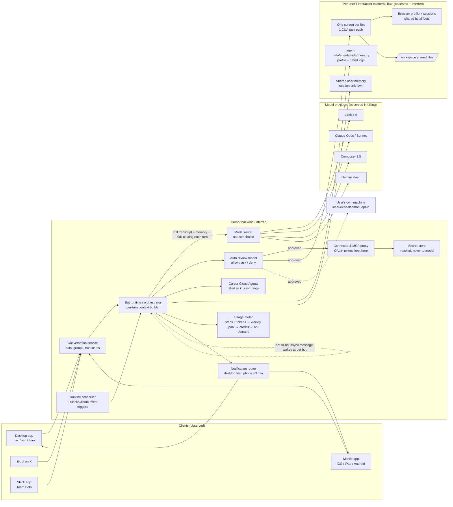

# Teardown: Grok Bot (xAI, built and billed via Cursor)

**Date:** 2026-10-22 · **Method:** black-box product teardown (REA "reverse-engineer-anything" method, adapted) · **Builds on:** [../competitive-brief.md](../competitive-brief.md)
**Evidence rule:** public sources only: official docs, announcements, changelogs and release trackers, help and pricing pages, forum threads, reviews, App Store listing. No binaries were downloaded, decompiled or inspected, no traffic was intercepted, and no login was used. A public "reconstructed Grok Bot 0.18" source repo turned up in search (gitee). **It was deliberately not opened**, because it is decompiled code and outside the evidence rule.

**Labels used throughout:** **[O]** Observation: stated by a primary source or directly reported by users. **[I]** Inference: our reasoning from observations. **[U]** Unknown: not answerable from public evidence. Docs pages were all read on 2026-10-22, and docs are living pages, so a statement may be newer than launch.

---

## 0. What changed versus the competitive brief

The brief (2026-10-21) needs these corrections. Each one is backed by the ledger in §3.

| Brief said | Evidence now says | Ledger |
|---|---|---|
| Platforms: Desktop + iOS | macOS, **Windows, Linux** desktop; iPhone, **iPad, Android** (Android shipped ~Sep 2) | F-60, F-61 |
| Global/shared memory: **Absent** | A **"shared user memory" that every bot reads and writes** exists (user-observed). Team Bots have explicit **team memory + private per-person notes**. Still no UI to view or edit it | F-21, F-22, F-24 |
| Underlying model: Weak–Adequate (Grok) | **Mixed routing** that users observed includes Claude Opus 5 and Sonnet, Grok 4.6, Cursor Composer 2.5, Gemini 2.5 Flash. The complaint is **no choice and opaque cost**, not a weak model | F-11, F-12 |
| Files only on their cloud | Opt-in **"Execution on Local Computer"** exists (local daemon, per-command approval by default). Users describe it as flaky | F-08, F-09 |
| No spend cap | An account-level **on-demand monthly limit** exists, but it isn't Grok Bot-specific, it doesn't stop a run mid-way, and it doesn't stop credits draining. "A separate Grok Bot spend cap is not available today" | F-52, F-53 |
| (no main agent) | A **Main Bot role** shipped ~0.62–0.66 (Sep–Oct). @bot on X routes to it | F-04 |
| Approvals: strong | Approvals are strong in DMs, but they **do not appear in group chats at all**, and routine or bot-originated approvals **expire after ~10 min** | F-33, F-41 |

---

## 1. Question checklist (the job, turned into questions)

| # | Question | Evidence it needs | Status |
|---|---|---|---|
| Q1 | What are the objects (bot, profile, main bot, group, DM, team bot) and their fields? | Docs: bots, team-bots, tag-on-x; changelog | **Answered** |
| Q2 | What runs where: one computer per bot or per user? What is the VM? | Docs: overview, computer-and-apps, teams; forum | **Answered** (specs partial) |
| Q3 | Which models, and how is routing decided? | Docs: security; forum billing rows | **Partially answered** (models seen, routing logic unknown) |
| Q4 | Memory: per-bot scope, persistence, storage, view and edit, compaction | Docs: bots, FAQ, team-bots; forum feature requests | **Answered** (shared-memory storage location partial) |
| Q5 | Connectors and skills: scope, MCP, permissions, credentials | Docs: computer-and-apps, security, teams, skills page | **Answered** |
| Q6 | Group chat: who replies, turn-taking, loop prevention, handoffs | Docs: chat-and-collaboration; guides | **Partially answered** (the mechanism is not documented) |
| Q7 | Routines, triggers, "teach a task" | Docs: skills-routines-and-automations | **Answered** |
| Q8 | Approvals, auto-review, isolation and security boundaries | Docs: security, approvals page | **Answered** |
| Q9 | Visibility: transcript, computer view, trace | Docs: chat, computer-and-apps, mobile | **Answered** |
| Q10 | Pricing, metering, cost complaints | Cursor plans page; forum threads; App Store | **Answered** (unit prices unknown, and not published) |
| Q11 | Onboarding and first-run friction | Docs: get-started; reviews | **Answered** |
| Q12 | Templates and marketplace | Docs: bots; x.ai guide; trackers | **Partially answered** (marketplace curation and selling unknown) |
| Q13 | Platforms | Docs: overview, FAQ, mobile; App Store | **Answered** |
| Q14 | UX patterns behind the "group chat effect" | Docs: settings-and-notifications, mobile; guides | **Partially answered** (no hands-on screenshots) |
| Q15 | Release cadence and roadmap signals | App Store history; changelog trackers; forum staff replies | **Answered** (official changelog page blocked to our fetcher) |

---

## 2. Evidence walk, question by question

### Q1. Product model
- **Bot** = name, label, description, avatar, notifications toggle [O]. **There is no separate instructions field.** Durable rules go into the description ("Update the description when you discover a durable preference, boundary, or responsibility") [O]. Team Bot descriptions are capped at **140 chars** [O]. *So the description has to do double duty, as a routing card and as the system prompt.* [I]
- Create: **New → Create new Bot** (Cmd/Ctrl+N), or let an existing bot suggest or create a focused bot ("Ask before creating several Bots if you want to keep the roster small") [O].
- **Duplicate** copies the profile, settings, enabled skills, routines and avatar, but **not** history, learned memory or attachments [O]. **Delete** removes the profile, conversation and routines, but files and sign-ins on the shared computer remain [O]. **Hide** keeps a bot's routines running [O].
- **Main Bot** role added ~v0.62–0.66 (podcast summary of release notes, ~Oct 5) [O, secondary]. The docs say @bot on X routes to "your main Bot" [O]. Before that shipped, users hand-built a "Chief of Staff" coordinator that delegates to specialists [O, guides].
- **Team Bot** = one bot a whole team talks to, in the app and **in Slack as its own Slack app** [O]. The owner publishes it and appoints managers. Each teammate's chat is private, and the owner can't read it [O].
- **Bot email addresses** with draft approvals (~v0.70.2) [O, secondary]. Team admins can turn **Agent Email** off (it's off by default for teams) [O].

### Q2. Agent architecture visible from outside
- **One persistent cloud computer per user account**, shared by all of that user's bots: "The computer is assigned to your user account, not an individual Bot" [O]. Each bot gets **its own screen**, and only **one computer-use task per bot at a time**. "The screens are separate work surfaces, not separate security boundaries" [O].
- The computer is a **Firecracker microVM** [O, teams doc], with **sudo on by default** (admin toggle) [O], a shared `/workspace` [O], browser, terminal, and files. It hibernates when idle and is terminated after 30 days asleep (admin setting) [O]. Reset restores the "last saved snapshot" [O]. A user reports a **16 GB VM** [O, single forum report]. A user observed per-bot memory snapshots at `/home/box/agent-data/agents/<bot id>/memory/` while browsing the bot computer's own filesystem [O, user report]. *So it runs Linux, the internal name for the VM is "box", and agent state sits on the VM disk.* [I]
- **Delegation:** bots can delegate to **Cursor Cloud Agents** and subagents (an admin toggle, on by default). That delegated work bills as *Cursor* usage, not Grok Bot usage [O].
- **Local execution:** an opt-in "Execution on Local Computer" setting with Always allow / Ask every time / Never allow. A member's default is to ask per task [O]. Users see a `local-exec-daemon`, plus tools named `Shell`, `CopyFromBox` and `ListMachines` in error messages and logs, and they report frequent disconnects [O, forum]. **Local egress routing** (route the bot's web traffic through your own machine) is on by default for Enterprise [O].
- **Connectors live on Cursor's backend.** "Connector tokens stay on Cursor's backend." Bots call tools without ever receiving the OAuth tokens [O]. Browser sessions, by contrast, live on the VM and are shared across bots [O].

### Q3. Models and routing
- "Model selection is managed by Cursor, with no customer-facing picker." A model allowlist is Enterprise-only [O].
- Models users have seen in billing and usage rows: `claude-opus-5-thinking-low`, Sonnet (4.5 named once), `cursor-grok-4.6-high-fast`, Composer 2.5 / 2.5 Fast, `gemini-2.5-flash` [O, forum]. Billing row names: `grok-bot-default` (chat), `grok-bot-cua` (computer use), `sand-default` / `sand-automation` (chat and routines) [O, forum].
- Voice mode runs on **Grok Voice 3.0** (Oct 14) [O, secondary].
- *Routing appears to be per role: a default chat or coordinator model, a separate computer-use model, cheaper models for automations, and Cursor models for delegated coding. "sand" is likely an internal codename.* [I] Users report "heavy model for simple work" and then a cheaper tier that made bots "quite stupid at times" [O, Reddit via cellcog]. *That suggests the routing policy was retuned in late August to cut burn.* [I]
- **[U]** The actual routing rules, how much of each model is used, and whether routing adapts to the task. Only internal telemetry or an official statement would resolve this.

### Q4. Memory
- A bot keeps "stable working preferences, important facts, and summaries from its work" [O]. Memory is **automatic**. The docs give no UI to view, edit or delete it, and tell you to "correct stale assumptions directly" in chat [O].
- Users describe a per-bot "profile" plus **dated logs** in Markdown on the VM, **plus a "shared user memory" that every bot reads and writes**, with no place in the app to view or export it [O, forum feature requests Aug 11 and Oct 9; no staff reply].
- Team Bots: **team memory** that every teammate's conversation reads, which the bot writes "only when told the whole team should know". Each person also has **private notes**. You can ask the bot what it saved and tell it to correct or remove items [O].
- **Context:** "Each Bot is one unbounded thread" (user). Staff confirmed auto-summarization near the context limit, and **no same-bot new session, no manual compaction, no context meter** (Aug 20; still "not shipped" Sep 23) [O]. Users report **200–250k input tokens per reply** on a long-lived coordinator [O]. The workarounds are Duplicate + Hide, or a fresh single-bot group chat ("daft") [O].
- *Memory isn't the cost driver. The transcript is. Every turn reloads history, tool output, screenshots and agent-to-agent messages.* [I, strongly supported by staff "isn't intended behavior" plus user token counts]

### Q5. Connectors, skills, MCP, permissions
- Connectors are installed as **plugins** from **Connect apps**. You attach one per message with `@` in the composer. Skills are invoked with `/` [O]. "Installed connectors are account-wide," and "any permitted connector is available to every Bot a member runs" [O]. There's no per-bot connector selection [O].
- **MCP:** admins manage "Plugins & MCPs" in the Cursor dashboard, and there's an **MCP allowlist** (Enterprise) [O]. Templates note that "non-standard plugins, such as MCP servers, must be reconnected" [O]. Team Bots warn that command-based MCP servers should never hold credentials [O].
- **Private skills are shared across all your bots** [O]. A skill = "steps, decision rules, expected output, and safety boundaries" [O].
- One connector can link several accounts (for example several Gmail accounts) [O]. There's a 1Password integration where every fill needs its own approval (Sep 16) [O, secondary].
- Secrets: a **secure secret request** masks the value and keeps it out of the transcript **and out of the model** [O]. Team Bots hold up to **25 secrets**, referenced by name and redacted in output [O].
- *Skills load as a full catalog on every turn* (users ask for "skills loaded on demand", and staff took that as "a useful signal") [I, from O].

### Q6. Group chats and handoff
- A group has **2–6 bots** at creation, and members can be edited later [O]. You direct a message by writing normally (the "bots decide"), using `@bot`, replying to a bot's message, or `@everyone` ("sparingly") [O].
- **Approvals, secret and login requests, and email or Slack drafts never appear in groups** [O]. A practitioner puts it this way: "In a group, bots can't ask for permission," so actions belong in 1:1 chats [O, Oct 12 guide].
- Handoffs are **asynchronous**: the receiving bot wakes up, handles the message and can reply later, and the handoff is visible in the conversation [O]. Group handoffs are **text-only**, so images go by DM [O]. "Too many parallel handoffs can create duplicate work and noisy updates" and "Ask for a single owner at each stage" [O].
- Practitioners report that letting bots find each other "by name or relying on memory didn't work reliably". They fix it with a **shared routing skill** (who owns what, who reviews whom) plus a shared `decision-log.md` [O, Oct 12 guide]. Bots "pick up topics and either comment or stay quiet" [O].
- Humans can't be invited into a group: it's "just a personal agent swarm" (HN) [O]. Team Bots in Slack channels answer @mentions and then follow that thread [O].
- **[U]** The turn-taking mechanism (every bot sees every message and decides vs a router), loop prevention, and cost per group message. *Most likely each member bot gets each group message and self-selects. That makes group chat cost scale with group size.* [I, weak]

### Q7. Routines, triggers, teach a task
- A routine = one owning bot + a schedule or event + instructions. **Max 50 per bot**, schedules **≥5 minutes apart**, last **20 run records** kept. Deleting a routine can't be undone, and deleting a bot deletes its routines [O].
- Triggers: a **schedule** (explicit time zone), or an **event** through *Cursor account integrations* (a Slack message, a GitHub notification), which are separate from the Slack and GitHub plugins [O]. "Avoid broad listeners such as 'every new message'" [O].
- **Test run** does real work [O]. After a long absence the bot may ask whether to keep routines running, and **pauses them if you don't answer** [O]. On mobile you can view and pause routines but not edit them [O].
- **Teach a task:** records **visible computer interaction for up to 10 minutes**, with no mic. It produces a **draft skill** that you must add decision rules and failure handling to. It is rolling out gradually and isn't on mobile [O]. The fallback is "build a skill from written instructions and a completed task" [O].
- Cost: a routine re-sends the whole conversation, and "every few minutes ≈ 100 runs/day" [O, forum].

### Q8. Approvals, auto-review, security
- Approval card: the proposed operation + inputs, then **Allow once / Always allow (saves a rule) / Deny** [O]. Approvals from routines, triggers or other bots **expire after ~10 min**. An expired card can still add an "always allow" rule without running the action [O]. Slack approval cards (~0.62–0.66) [O, secondary].
- **Auto-review** = "an independent review model that evaluates risky Bot actions before they run" (shell, plugin calls, computer use, automation writes, delegation). It can allow, ask or deny. Rules come in two kinds, **Ask first** and **Allow automatically**, and Ask first wins a conflict. Enterprise admins can enforce it and lock team rules. It "does not review every side effect" (memory writes and settings) [O]. Personal rules are stored per desktop install and synced to the VM [O].
- **Bots are not a security boundary:** shared files, browser sessions and CLI credentials, and deleting a bot doesn't remove them [O]. "A Bot can never hold more access than the person it belongs to." Actions are attributed to the member [O].
- Prompt injection: outside content "is marked as untrusted data when presented to the model". The layers are auto-review, network policy, per-action approvals and per-user isolation. "These controls reduce, but do not eliminate, risk" [O].
- Logins, 2FA, CAPTCHAs and payments: the bot **hands over the computer** (Take over → I'm done) instead of typing credentials [O].
- Enterprise: network allowlists (allow-all by default), action recording (90 days, off by default), audit logs, OTel export, SCIM, Admin API [O].

### Q9. Visibility
- The transcript shows tool activity, computer use, files created, questions, approvals and voice memos [O]. You can thread replies to one result. "A reaction alone should not carry a safety-critical decision" [O].
- Computer view: you can open the shared desktop from a conversation and see clicks, typing, navigation and status. You can leave and come back, and take over [O]. The same on mobile [O].
- **No** per-message cost, no context meter, no visible prompt, and no per-bot cost breakdown. The dashboard didn't even attribute spend to Grok Bot until a fix around Sep 27 [O, forum].
- Team admins get "Conversation Insights" analytics [O, link only; contents **[U]**].

### Q10. Pricing and metering
- Access paths: The X Subscription (Premium/Super/Ultra, launched ~Oct 12, **one weekly pool shared with Cursor and the Grok apps**), legacy Cursor Pro/Pro+/Ultra/Teams, and linked SuperGrok / Plus / Heavy / X Premium+ [O]. iOS in-app purchases: Pro $25.99, Pro+ $77.99, Ultra $259.99 [O].
- Metered by "**agent steps and tokens** rather than the number of messages" [O]. **No dollar size for the pool is published**: "We don't publish a dollar figure for the weekly included allowance" (staff) [O]. On-demand bills at "model and token cost", with no per-unit rate on the pricing page [O].
- The limit is "not a hard stop in the middle of a run" [O]. Billing order: weekly pool → referral or usage credits → paid on-demand. The $0 on-demand limit does **not** stop credit drain. Staff say the only reliable workaround is to "watch the meter and pause near 100%" [O, Sep 1].
- The cost complaints run from Aug to Oct and keep coming back: Ultra at 65% on day 1 and 99% on day 3; ~284M tokens in 2 days with 84% cache reads; Ultra pool ≈ "8 hours of use"; $27 gone in 10 minutes; a $20 top-up lasting ~3 hours; Heavy at 70% of the Grok Bot quota but 6% of the SuperGrok quota; and spill into paid usage with no warning [O, forum]. A global usage reset happened twice (Aug 26 and Sep 5) [O]. "We're aware that in some cases, limits are depleting quickly" (official account) [O].
- *The burn comes from the architecture (unbounded transcripts + full skill catalog + screenshots + agent-to-agent traffic reloaded every turn), not from pricing alone. A price change won't fix it, and context management will.* [I]

### Q11. Onboarding
- Needs an eligible paid plan. **Legacy Privacy Mode isn't supported** ("requires cloud data storage") [O]. Steps: download → browser sign-in (→ link SuperGrok) → an intro to bots, the shared computer and routines → "which tools do you use?" (it **only shapes suggestions and connects nothing**) → the VM is provisioned **in the background** → **"Meet a future teammate"**: pick a suggested bot or "Create your own" (name, one job, how it should work) → the first task is a document summary that **needs no connector**, sold as "a five-minute first result" [O].
- Logins happen just in time: the bot hits a login wall, and you Take over → I'm done [O].
- Friction reported: paywall with no free tier at launch (later a limited trial credit), plan confusion and a stale help page, a broken iOS GitHub login in launch week, a dashboard that disagreed with the app, account-linking confusion [O]. *The flow itself is well designed. The friction is commercial (plans, billing), not UX.* [I]

### Q12. Templates and marketplace
- **Share as Template** packages instructions, relevant memories, skills, routines (triggers) and first-party plugins. It **excludes** personal memories, custom code and scripts, private skills, secrets, and non-standard (MCP) plugins [O, x.ai guide Sep 8]. Links are **Public** or **Team-only**, and Enterprise defaults to Team-only. Cursor enforces the policy server-side [O]. The recipient gets a **copy**, never your computer, logins or history [O].
- Marketplace launched ~**Sep 4**, starting with **Haggle Bot** (procurement, a self-reported "$100K+ saved") [O, secondary]. The docs say "Marketplace lists Bots you can add as your own copy" [O]. "Soon you could sell them" [O, blog speculation only].
- **[U]** Curation, review process, ranking, revenue share.

### Q13. Platforms
macOS (Apple silicon and Intel), Windows (x64 and Arm64), Linux (x64 and Arm64; .deb, .rpm, AppImage); iPhone (iOS 18+), iPad, Android 9+ [O]. Linux was "not supported" at launch per an Aug 12 review, so it was added later [O]. Plus Slack (Team Bots) and **@bot on X** (not available in the UK, EU, Australia, Iceland, Liechtenstein or Norway) [O]. Bots and conversations sync across devices [O].

### Q14. UX patterns behind the "group chat effect"
- **Identity:** each bot has a name + a short **label** (role tag) + avatar. Avatars were refreshed in 0.68 (Oct 5) [O]. Users name bots as characters (a "Scooby-Doo" social team) [O]. *The label line is a strong pattern: the name carries personality and the label carries routing.* [I]
- **Messaging-app grammar:** reply-to-message threads, reactions, drafts kept per conversation, share-sheet to a chat, search across messages, bots, groups, files and routines, pin and hide [O]. Bots answer with **voice memos**, and you can start a live **voice chat** [O].
- **Presence and attention states:** "Needs attention", "Unread activity", "Working/typing", sidebar and dock badges, mark read/unread [O].
- **Notification routing:** desktop first when you're active (passes the active-use test: unlocked and used in the last 5 min). If a bot needs input, your **phone pings ~3 min later**. "Finished replies skip your phone." Per-bot notification toggle, none per group [O]. *That cuts noise while making sure blocking questions always reach you.* [I]
- **Async, wake-on-message colleagues:** bots finish while your laptop is closed and "only come back when something needs your approval" [O]. Bots run in parallel, with visible bot-to-bot messages, which HN users rated "pretty slick" [O].
- **Composer:** `@` for bots, groups, routines and connectors, and `/` for skills. Everything is addressable from one box [O].
- **[U]** Exact visual design (bubble layout, typing animation, avatar style). It would need screenshots or a hands-on walkthrough video.

### Q15. Cadence and roadmap signals
- **Cadence:** iOS shipped 18 versions in ~70 days (1.0 Aug 11 → 1.17.0 ~Oct 21), about **one release every 4 days** [O]. Desktop went from 0.18 to 0.71.2 in about 2 months [O]. Official changelog at x.ai/changelog/bot (it returned 403 to our fetcher; we used trackers) [O].
- **Shipped after launch:** plan expansion (Aug 21/26), template sharing (~Aug 28), Microsoft plugins (Aug 31), Android (Sep 2), Enterprise (Sep 3), marketplace (Sep 4), usage reset (Sep 5), 1Password (Sep 16), voice and voice notes (Sep 17–18), Main Bot + Slack approval cards + Team Bot managers (0.62–0.68, Oct), bot email (0.70.2), Secure Forms and reconnect cards (0.71.2, Oct 14), The X Subscription bundle (Oct 12), IncidentWatch/IncidentSweep examples (Oct 20) [O, mostly secondary].
- **Open requests with "no timeline" (staff):** a usage warning before paid spill, per-product spend attribution and caps, same-bot new session, compaction, a context meter, on-demand skills, a memory viewer [O]. *The roadmap is heading toward enterprise, distribution (X, Slack, email) and identity. Cost and memory hygiene are lagging.* [I]
- Still labelled "beta" [O].

---

## 3. Finding ledger

Confidence: H = primary docs or several independent reports; M = one credible report or a secondary summary of a primary; L = single anecdote or unverified secondary. Search boundary = where we stopped and why.

| ID | Finding | Type | Evidence (URL, date) | Conf. | Search boundary |
|---|---|---|---|---|---|
| F-01 | Bot fields: name, label, description, avatar, notifications. No instructions field | O | docs.x.ai/grok-bot/bots; /settings-and-notifications (read 2026-10-22) | H | Docs only; no in-app screenshot |
| F-02 | Duplicate drops history and memory; delete leaves files and logins on the VM | O | docs.x.ai/grok-bot/bots (2026-10-22) | H | — |
| F-03 | Bots can suggest or create other bots | O | docs.x.ai/grok-bot/bots | H | How it's prompted is not documented |
| F-04 | Main Bot role shipped ~0.62–0.66; @bot routes to the main bot | O | Grok Bot Release Notes podcast (~2026-10-05); docs.x.ai/grok-bot/tag-on-x | M | Official changelog 403 to fetcher |
| F-05 | Team Bots: owner, managers, private per-teammate chats, own Slack app | O | docs.x.ai/grok-bot/team-bots | H | — |
| F-06 | One persistent computer per user, shared by all bots; one screen per bot | O | docs.x.ai/grok-bot/computer-and-apps; /teams-and-enterprises | H | — |
| F-07 | VM is a Firecracker microVM, sudo on by default, hibernates, 30-day idle termination | O | docs.x.ai/grok-bot/teams-and-enterprises; /computers | H | CPU, disk, OS image not published |
| F-08 | Opt-in local execution via a local daemon; per-command approval by default | O | docs.x.ai/grok-bot/teams-and-enterprises; /approvals-security-and-privacy | H | — |
| F-09 | Local execution is unreliable (disconnects, CopyFromBox failures) | O | forum.cursor.com/t/…/169877 (Aug 29–Sep 17, 2026) | M | Later threads not read |
| F-10 | Bots can delegate to Cursor Cloud Agents; that bills as Cursor usage | O | docs teams page; forum …/169796 (staff, Sep 28–30) | H | — |
| F-11 | No model picker; Cursor routes models | O | docs.x.ai/grok-bot/security; forum staff Aug 28 | H | — |
| F-12 | Models users observed: Claude Opus 5 (thinking-low), Sonnet, Grok 4.6 high-fast, Composer 2.5, Gemini 2.5 Flash | O | forum.cursor.com/t/…/169796; …/169551 (Aug–Sep 2026) | M | Users' billing rows; no official list |
| F-13 | Separate billing rows for chat (`grok-bot-default`), computer use (`grok-bot-cua`), routines (`sand-automation`) | O | forum …/169796 | M | — |
| F-14 | Routing is per role (chat, CUA, automation, delegated coding) | I | from F-12, F-13 | M | Only official confirmation or telemetry would settle it |
| F-15 | Routing was retuned toward cheaper models in late Aug | I | cellcog.ai/blog/grok-bot-problems (r/grok, Aug 22) | L | Single report |
| F-16 | VM ~16 GB RAM | O | forum …/169551 (DannyB, Sep 3) | L | One user |
| F-17 | VM is Linux, internal name "box" | I | `/home/box/...` path, `CopyFromBox` tool name (forum) | M | We didn't inspect anything ourselves |
| F-18 | Connector tokens stay on Cursor's backend; bots never see OAuth tokens | O | docs.x.ai/grok-bot/security | H | — |
| F-19 | Connectors are account-wide; no per-bot selection; MCP admin-managed with an Enterprise allowlist | O | docs computer-and-apps; teams | H | — |
| F-20 | Private skills are shared by all bots | O | docs skills-routines-and-automations | H | — |
| F-21 | Memory is automatic; no UI to view, edit or delete; correct it via chat | O | docs bots; forum …/168066 (Aug 11, Oct 9) | H | — |
| F-22 | A "shared user memory" read and written by all bots exists | O | forum …/168066 (Oct 9 user report) | M | Storage location unknown; no staff reply |
| F-23 | Per-bot memory = profile + dated Markdown logs on the VM | O | forum …/168066 | M | User browsed the VM through the product |
| F-24 | Team Bot: team memory + per-person private notes; ask the bot to correct or remove | O | docs team-bots | H | — |
| F-25 | No new session, compaction or context meter; auto-summary near the limit only | O | forum …/168333 (staff Aug 20, Sep 23) | H | — |
| F-26 | 200–250k input tokens per reply on long-lived bots | O | forum …/168333 | M | User-reported |
| F-27 | The full transcript plus the full skill catalog reload every turn, and that drives cost | I | F-25, F-26, staff "isn't intended behavior" (Aug 26) | H | — |
| F-30 | Groups: 2–6 bots; @, reply-to, @everyone; bots self-select | O | docs chat-and-collaboration | H | Mechanism undocumented |
| F-31 | Group handoffs async and text-only; visible in transcript | O | docs chat-and-collaboration | H | — |
| F-32 | Bots can't find each other reliably by name; a shared routing skill fixes it | O | productcompass.pm (2026-10-12) | M | One practitioner |
| F-33 | Approvals, secrets and drafts never appear in groups | O | docs chat-and-collaboration; productcompass | H | — |
| F-34 | No humans in groups besides the owner | O | news.ycombinator.com/item?id=49261514 (~Aug 2026) | M | Team Bots in Slack are the exception |
| F-35 | Each group message goes to every member bot | I | "bots decide who responds" | L | Needs official statement or a cost experiment |
| F-40 | Routines: 50/bot, ≥5 min, 20 run records, schedule or event (Slack, GitHub) | O | docs skills-routines-and-automations | H | — |
| F-41 | Approvals from routines or other bots expire ~10 min | O | docs approvals-security-and-privacy | H | — |
| F-42 | Routines auto-pause after a long user absence with no answer | O | docs skills-routines-and-automations | H | Absence threshold unknown |
| F-43 | Teach a task: ≤10 min screen recording → draft skill; gradual rollout; desktop only | O | docs skills-routines…; mobile | H | — |
| F-44 | Auto-review = separate model; Ask-first beats Allow-auto; Enterprise can lock it | O | docs security; approvals | H | Which model is not stated |
| F-45 | Bots are not a security boundary | O | docs computer-and-apps, FAQ, teams | H | — |
| F-46 | Credentials and 2FA through computer takeover; secure secret request hides the value from the model | O | docs security; approvals | H | — |
| F-50 | Metered by agent steps + tokens; no published pool size or unit rate | O | cursor.com/help/grok-bot/plans; forum staff | H | — |
| F-51 | Pool burns in hours to days on top plans | O | forum …/171221, …/169551; HN | H | Many independent reports |
| F-52 | No Grok Bot-specific spend cap; limit isn't a mid-run hard stop | O | docs teams; plans page | H | — |
| F-53 | No warning before paid spill; $0 limit doesn't stop credit drain | O | forum …/169679 (staff Sep 1) | H | — |
| F-54 | The X Subscription: one weekly pool across Grok Bot, Cursor and Grok apps | O | plans page; releasebot (Oct 12) | M | — |
| F-55 | Billing and refund pain (stale help page, app-store charges) | O | cellcog; App Store reviews (Oct 1) | M | — |
| F-56 | Onboarding: tools question that connects nothing, background VM, "Meet a future teammate", connector-free 5-min first task | O | docs get-started | H | No hands-on video watched |
| F-57 | Just-in-time login takeover instead of an upfront connector wizard | O | docs get-started | H | — |
| F-58 | Templates include instructions, memories, skills, routines, first-party plugins; exclude secrets, scripts, MCP | O | x.ai/bot/guides/templates-for-grok-bot (2026-09-08) | H | — |
| F-59 | Marketplace launched ~Sep 4 with Haggle Bot | O | 4geeks tracker; digg | M | Curation and revenue share unknown |
| F-60 | Desktop on macOS, Windows, Linux | O | docs overview, FAQ | H | — |
| F-61 | Mobile on iPhone, iPad, Android (Android ~Sep 2) | O | docs mobile; 4geeks | H | — |
| F-62 | @bot on X; geo-limited | O | docs tag-on-x | H | — |
| F-70 | Desktop notifications first; phone pinged ~3 min later only if input is needed | O | docs settings-and-notifications | H | — |
| F-71 | Attention states: Needs attention, Unread, Working/typing | O | docs settings-and-notifications | H | No visual reference |
| F-72 | Voice memos from bots + live voice chat (Grok Voice 3.0) | O | docs chat; releasebot (Oct 14) | H | — |
| F-73 | Name + label + avatar identity; avatars refreshed 0.68 | O | docs; changelog via search (Oct 5) | M | — |
| F-80 | iOS release roughly every 4 days | O | apps.apple.com/us/app/grok-bot/id6794501026 (2026-10-22) | H | — |
| F-81 | Cost and context controls requested since Aug; "no timeline" | O | forum …/168333, …/169679 | H | — |
| F-82 | Strategy prioritizes distribution (X, Slack, email) and enterprise over cost hygiene | I | F-80, F-81, changelog themes | M | — |
| F-90 | Decompiled "grok-bot-0.18-reconstructed" repo exists | O | search result (gitee) | — | **Not opened**: outside the evidence rule |

---

## 4. Probable architecture (INFERENCE, not confirmed)

> Everything below is reconstructed from the observations in §3. The boxes and arrows are our best reading of the evidence. Nothing here was inspected directly. Dashed edges are the weakest inferences.

**Key inferred properties:** (1) The unit of isolation is the **user**, never the bot. (2) The bot is a **persona + transcript + memory folder** running on a shared runtime and a shared VM. (3) Cost is driven by **context assembly**, not by the computer. (4) Approvals are a **per-action gate on the orchestrator** with a model-based pre-filter, and they're only rendered in 1:1 chats.

---

## 5. Steal / Avoid / Beat (for Bench)

### Steal (copy, with a design note)

| # | Pattern | Why it works | Bench design note |
|---|---|---|---|
| S1 | **Name + short label + avatar** per bot | The name carries personality and the label carries routing, which is what creates the "colleague" feeling | Bench `agent.md`: `name`, `label` (≤24 chars, shown under the name in chat), `avatar`. The label is what the router reads first |
| S2 | **Desktop-first notifications, phone after ~3 min only for "needs input"**; finished work never pings the phone | Avoids notification spam from an agent swarm while still making sure blockers reach you | Bench is desktop-only, so do the same with OS toasts: "needs input" → toast + tray badge, and repeat once after N min if unseen. "Finished" → badge only |
| S3 | **Approvals never posted into group chats.** They go to a 1:1 card with once / always / deny, and the group gets "waiting on you" | Keeps groups readable and keeps safety decisions out of the noise | Bench approval inbox (one place) + an inline "⏸ waiting for approval" chip in the group. Grok Bot's rule that "a reaction can't approve" is worth copying |
| S4 | **Ask-first beats allow-auto** rule precedence; narrow rules; an independent reviewer before risky actions | Deterministic conflict rule, so users can reason about it | Bench permissions: per-agent rule list with `ask` > `allow`. Optional Haiku pre-review of shell/connector writes, shown in the trace |
| S5 | **Onboarding that connects nothing upfront**: a "which tools do you use?" question that only shapes suggestions, plus a first task that needs no connector, and logins just in time | Fastest time to a first result; no OAuth wall | Bench first run: main agent says hi → "what do you work on?" → suggests 2 agents (drafted, not saved) → first task on a local file. Connectors are requested only when a task needs one |
| S6 | **Duplicate without memory; templates exclude secrets, scripts and personal memory** | Safe sharing by construction | Bench export = `agent.md` + skills + routines; `memory/` and secrets are excluded by default, with a diff preview before export |
| S7 | **Routine guardrails**: ≥5 min spacing, Test run, auto-pause after long absence, "no-data/stale-data" policy in the routine spec | Stops runaway cost and stale automation | Bench scheduler (S6): same limits + a cost estimate per run shown before enabling |
| S8 | **Secure secret request** (masked, kept out of the transcript and away from the model) + **take over the screen for 2FA** | Credentials never enter context | Bench: secrets referenced by name from the OS keychain; never put a value into a prompt |

### Avoid

| # | Pitfall | Evidence | Bench rule |
|---|---|---|---|
| A1 | **One unbounded thread per bot**; the only fix is "make a new bot" | F-25, F-26, "daft" workaround | Every agent has sessions: **New session**, **Compact now**, and a visible context meter |
| A2 | **Full skill catalog + all connectors in every turn** | F-19, F-27 | Per-agent connector and skill selection (already in PRODUCT-MODEL §3); skills loaded on demand |
| A3 | **Opaque pool with no published size**, spill into paid usage with no warning, and caps that don't stop mid-run | F-50–F-53 | Never auto-spend. Show the plan meter and per-message cost, and hard-stop at the budget (between steps) |
| A4 | **Shared credentials and browser across all bots** ("not a security boundary") | F-45 | Separate working folder and connector set per agent; say clearly where isolation stops (same OS user) |
| A5 | **Memory you can't see** | F-21, F-22 | Already planned: Markdown memory, editable. Also show **which memory entries were loaded** in each turn's trace |
| A6 | **Routing that users can't see or override** (heavy model for trivial work, then "stupid" cheap model) | F-12, F-15 | Model per agent, shown on the agent card and on each message |
| A7 | **Bot-to-bot discovery by name/memory** (unreliable) | F-32 | The main agent routes from structured agent cards, not free-text memory |

### Beat (outdo)

| # | Where Grok Bot is weak | How Bench wins visibly |
|---|---|---|
| B1 | Cost is the #1 complaint, with no per-product attribution | **Cost before, during and after**: an estimate before a routine or long task, a live per-message cost, a per-agent weekly total, and a hard budget stop. Put it on the main screen, not in settings |
| B2 | Context bloat (200k+ tokens/reply) | **Context meter + one-click compact + new session per agent**, plus "this turn loaded: 3 memory files, 2 connectors, 1 skill" in the trace |
| B3 | Group chats are a bot swarm with unclear turn-taking and no approvals | **A deterministic router** (Haiku picks one responder by default, and others join only when @mentioned or invited by the responder), plus a group "decision log" file, plus approvals that surface as a chip linking to the inbox. Show *why* an agent answered ("routed: matches label 'Designer'") |
| B4 | No model choice | Model per agent, and cheap models for routines. Grok Bot users ask for exactly this ("cheaper model options") |
| B5 | Memory hidden; shared memory is invisible | **Global memory with a "promote to global" flow** and a log of who wrote what (Grok Bot users asked for exactly that: date + recording bot) |

---

## 6. Open unknowns (and what would resolve them)

| Unknown | Why it matters to Bench | Evidence that would resolve it (legitimate) |
|---|---|---|
| Group chat turn-taking: does every bot get every message, or is there a router? | Decides whether our router is a real differentiator on cost | An official doc or talk; a user cost experiment (same prompt in a 2-bot vs 6-bot group, compare meter deltas) published in the forum |
| The model routing policy (which model for which step) | Benchmarks our "model per agent" claim | Official statement; Enterprise model-allowlist docs; consistent billing-row reports |
| Weekly pool size in dollars or tokens | Lets us quote "X tasks on Bench vs Y on Grok Bot" | Cursor publishing it (staff have said they don't); aggregated user reports (one user estimated ~16.4M tokens for Heavy, low confidence) |
| Where shared user memory lives and how it's chosen per turn | Memory design comparison | A docs update; staff reply on forum thread 168066 |
| Marketplace curation, ranking, revenue share | Whether a template marketplace is a moat | An official marketplace page or creator terms (x.ai/legal/bot-sharing-terms, not yet read) |
| Exact visual UI (typing indicators, avatar style, group layout) | UX parity for the "group chat effect" | Official demo video; YouTube walkthroughs (not watched in this pass); App Store screenshots |
| Conversation Insights (admin analytics) contents | Team-level visibility benchmark | cursor.com/docs/account/teams/analytics#grok-bot-conversation-insights (not read) |
| VM CPU/disk, OS image, snapshot cadence | Only matters if we ever add a cloud mode | Docs computer-recovery page; staff statements. **Do not** answer by inspecting the VM image or the client binary |
| Loop prevention between bots | Safety for our own agent-to-agent handoffs | Official doc or staff reply; user reports of loops (none found) |
| Official changelog contents for 0.62–0.71 | Exact dating of Main Bot, email, Slack approvals | x.ai/changelog/bot in a normal browser (our fetcher got 403) |

---

## 7. Checklist status (final)

| # | Question | Status | Remaining gap |
|---|---|---|---|
| Q1 | Product model | **Answered** | Exact Main Bot release date (secondary only) |
| Q2 | Architecture / shared computer | **Answered** | CPU/disk specs |
| Q3 | Models and routing | **Partially answered** | Routing policy |
| Q4 | Memory | **Answered** | Shared-memory storage location |
| Q5 | Connectors, skills, MCP, permissions | **Answered** | — |
| Q6 | Group turn-taking and handoff | **Partially answered** | Mechanism, loop prevention |
| Q7 | Routines, triggers, teach a task | **Answered** | Auto-pause absence threshold |
| Q8 | Approvals, auto-review, security | **Answered** | Auto-review model identity |
| Q9 | Visibility | **Answered** | Conversation Insights contents |
| Q10 | Pricing and metering | **Answered** | Pool size (vendor doesn't publish it) |
| Q11 | Onboarding | **Answered** | Hands-on timing |
| Q12 | Templates and marketplace | **Partially answered** | Curation, monetization |
| Q13 | Platforms | **Answered** | — |
| Q14 | Group-chat-effect UX | **Partially answered** | Visual details |
| Q15 | Cadence and roadmap | **Answered** | Official changelog text for 0.62–0.71 |

## Sources (all read 2026-10-22)

Official: docs.x.ai/grok-bot (overview), /get-started, /bots, /team-bots, /chat-and-collaboration, /computer-and-apps, /computers, /skills-routines-and-automations, /security, /approvals-security-and-privacy, /settings-and-notifications, /teams-and-enterprises, /mobile, /tag-on-x, /use-cases, /faq; cursor.com/help/grok-bot/plans; x.ai/news/introducing-grok-bot (2026-08-11); x.ai/bot/guides/templates-for-grok-bot (2026-09-08); apps.apple.com/us/app/grok-bot/id6794501026.
Forum: forum.cursor.com/t/…/169551, …/169679, …/169796, …/171221, …/168066, …/168333, …/169877.
Community and reviews: news.ycombinator.com/item?id=49261514; eesel.ai/blog/grok-bot-review (2026-08-12); cellcog.ai/blog/grok-bot-problems; mindstudio.ai/blog/grok-bot-tips-and-hacks (2026-08-19); patrickschaber.substack.com (2026-10-04); productcompass.pm/p/grok-bot-product-swarm (2026-10-12); 4geeks.com Grok Bot news tracker; releasebot.io/updates/xai; gradually.ai changelog tracker; Grok Bot Release Notes podcast (Apple Podcasts).
Not accessible: x.ai/changelog/bot and x.ai/bot (HTTP 403 to fetcher).
