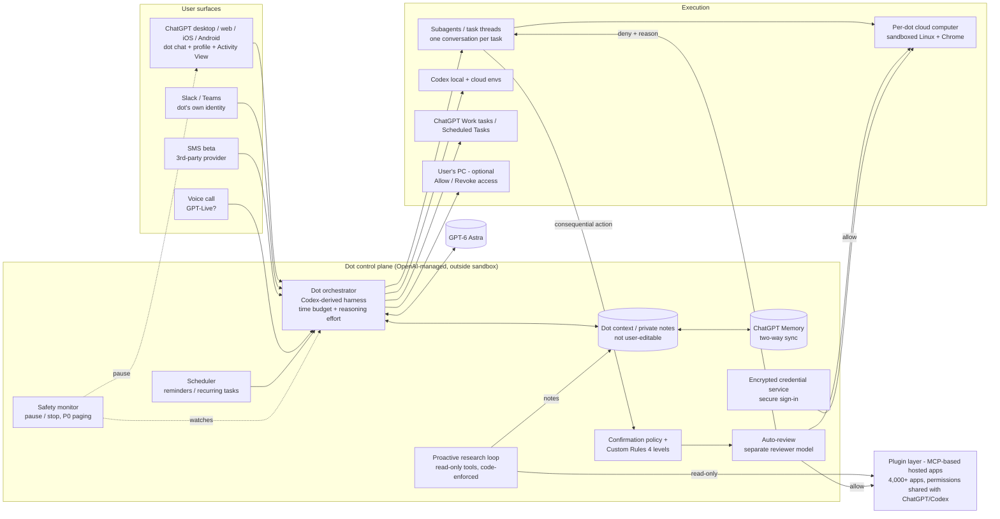

# Teardown: OpenAI ChatGPT Dots

**Date:** 2026-10-22 (Dots launched 2026-09-29 at DevDay, so this is week 3. Re-check before decisions.)
**Method:** black-box product teardown adapted from the REA "reverse-engineer-anything" skill: a question checklist, a finding ledger, a probable architecture, then Steal / Avoid / Beat.
**Evidence rules:** public sources only: OpenAI's announcement, safety post, system card appendix, Help Center, release notes, DevDay recap, OpenAI community forum, press, a live blog and secondary guides. Nothing was decompiled, intercepted, downloaded or accessed behind a login. A few forum posts quote error strings that users saw in their own sessions. They are listed as *user-reported* and are never treated as verified internals.
**Labels:** **[V]** = verified on an OpenAI page; **[S]** = secondary source (press, blog, forum); **[O]** = my own observation of a public OpenAI asset; *italics* = inference.

**How much evidence is there?** More than expected. OpenAI published a launch post, a safety post, two Help Center articles and a system-card appendix (§12), so the product model, safety, memory, approvals and pricing are well documented. The **avatar and animation system is thinly documented.** No design write-up, designer interview or animation spec exists publicly. What follows on visuals comes from launch imagery, press descriptions and one Help Center line, and is labelled accordingly. Independent hands-on reviews are scarce. The best field evidence is the OpenAI community "Dots" forum category.

---

## 1. Question checklist (with the evidence each one needs)

| # | Question | Evidence needed | Status |
|---|---|---|---|
| Q1 | What is a "dot": product model, personality, character? | Launch post, Help Center, keynote | **Answered** |
| Q2 | Visible agent architecture: cloud computer, tools, model, which OpenAI platform pieces | Launch post, safety post, system card, DevDay recap, keynote remarks | **Partially answered** (platform reuse is an inference) |
| Q3 | Memory: ChatGPT memory, editing, scope | Help Center, safety FAQ | **Answered** |
| Q4 | Connectors and apps | Launch post, FAQ, recap | **Answered** |
| Q5 | Check-ins and scheduling | Help Center, forum | **Answered** (cadence logic unknown) |
| Q6 | Multi-dot / teams of dots | Launch post, Help Center, keynote | **Answered: not shipped** |
| Q7 | Approvals and safety | Safety post, FAQ, system card | **Answered** |
| Q8 | Visibility of actions | Help Center, safety post, forum | **Answered** |
| Q9 | Pricing and limits | Launch post, release notes, Help Center | **Partially answered** (post-promo terms unpublished) |
| Q10 | Onboarding | Help Center, live blog, guides | **Partially answered** |
| Q11 | **Avatar and animation design** | Launch imagery, press, Help Center, keynote | **Partially answered** (visual system yes; animation states mostly unknown) |
| Q12 | Platforms and ChatGPT app integration | Help Center, launch post, forum | **Answered** |
| Q13 | Roadmap signals | Launch post, Help Center, forum feature requests | **Answered** |

---

## 2. Findings by question

### Q1. Product model: what a dot is
- An **always-on, persistent agent inside ChatGPT** that "can take on ongoing responsibility and keep making progress between conversations" [V Help Center]. Its pitch: "an extension of you" that learns "your preferences, how you think, and what good looks like to you" [V launch post].
- **One primary dot per user at launch.** "Today, you can start with your primary dot, give it a name, and make it your own" [V].
- **Identity:** a user-given name, a handle (`@yourname-dot` by default, then `@yourname-<agentname>` once named) and a character or pet avatar [V Help Center].
- **Personality:** no persona editor is documented. There are no tone sliders and no SOUL-style file. The personality comes from the name, the avatar and learned preferences. Altman framed it as "an AI helper that always has your back" [S KQED]. On the forum, one user asked whether dots have a distinct personality or are "just another interface". Nobody answered [S forum].
- **Specialist dots** (organisation-owned, with their own identity, credentials and IT-provisioned access) are a **preview, run as enterprise pilots only**. There is also a Microsoft Agent 365 governance tie-in [V].

### Q2. Visible agent architecture
- **Model:** GPT-6 Astra [V]. The system card adds that "the final product uses a combination of time budget and reasoning effort" [V system card §12.3].
- **A new "time-budget setting that guides how long they work"** is the main new mechanism. Alignment evals ran at simulated budgets from 4 minutes up to one year, with a clock tool that can wait [V §12.1, §12.3].
- **Harness:** "built on existing model and agent capabilities". The system card compares "the Codex and dots harnesses" [V]. Thibault Sottiaux said dots "grew out of the Codex harness becoming more reliable at longer tasks" [S Willison live blog]. Dots "often delegat[e] work to subagents" [V §12.1].
- **Cloud computer:** each dot has its own sandboxed cloud workspace running **Linux and Chrome**, maintained by OpenAI, and isolated per user [V safety post]. Users can **open it, watch it and Take over / Return control** [V Help Center].
- **Control plane separated from the execution sandbox:** "Dots run code in environments that are separate from the systems that coordinate their work and enforce key safeguards … they cannot … turn off required checks" [V safety post].
- **Optional local computer:** off by default. You enable it from the desktop app ("Allow access" / "Revoke access"). Local work runs as separate tasks, can use local skills and can fall back to the local browser when the cloud browser is blocked [V Help Center].
- **Delegation targets:** Codex (local and cloud environments), ChatGPT Work tasks and Scheduled Tasks [V Help Center; V forum update of 9 Oct].
- **Tools seen by a user:** web research, browser control, shell commands and messaging [S forum, _j, 3 Oct].
- *Inference on platform pieces:* the public **Agents API with computer use** (DevDay recap) "brings Codex's multi-agent capabilities, tool search, tool calling, and context compaction" into apps [V recap]. Dots most likely run on the **same internal Codex-derived harness** rather than on the public Agents API itself. A user-reported error, `Invalid 'input[87].id' … maximum length 64` [S forum, 21 Oct], has the shape of a Responses-API input-item list, which suggests dots conversations are Responses-style item lists. Plugins are the MCP-based ChatGPT plugin system: MCP Events triggers were announced the same day [V recap], and a user saw "hosted apps tools/list request failed with HTTP status 403" [S forum, 20 Oct]. Auto-review is Codex's open-source reviewer-agent protocol [V system card §12.3.6; V auto-review docs].
- *User-reported internal names (unverified, for orientation only):* `guardian_circuit_breaker` safety flag, "Orbit safety state changed", "Your dot's runtime is not idle", `cloud_aeon_recovery_required` [S forum]. Codex's managed auto-review config key is `guardian_policy_config` [V docs], which hints that "guardian" is the reviewer and monitor family name.

### Q3. Memory
- A dot **receives ChatGPT memories and recent conversation context**, and its conversations **contribute back to ChatGPT memory**. The sharing continues after setup. Turning off ChatGPT Memory stops sharing but does not delete what the dot already has [V FAQ].
- A dot **forms its own memories, including from connected apps, even unprompted**, through proactive research that saves "private notes" [V].
- **You cannot view, edit or delete individual dot memories.** The only wipe is **Reset**, which deletes the dot itself along with its conversations, saved memories and scheduled tasks [V FAQ, Help Center].
- Disconnecting an app does **not** delete what was learned from it [V].
- The dot's context does not retain credentials, images or screenshots [V FAQ].
- Scope: per dot. **Each task has its own conversation** and "doesn't automatically receive every conversation you've had with your dot" [V Help Center]. Delegated sub-agents are "instructed to keep the information needed for the task and avoid retaining unnecessary sensitive details" [V safety post].
- Field signal: "lost context, broken task continuity" regression reports [S forum, 20 Oct], and "limited context retention for long-running projects" [S Geeky Gadgets, 2 Oct].

### Q4. Connectors and apps
- More than **4,000 apps through the ChatGPT plugin ecosystem** [V]. **Permissions are shared** across dots, ChatGPT, ChatGPT Work and Codex and are managed in ChatGPT's Plugins tab, so **there are no per-dot connector scopes** [V FAQ].
- A dot can get its **own Slack account** (its own identity). Personal email can be connected, but there is **no standalone dot email address** at launch [V].
- Read permission does not imply write permission. Expired connections surface as reconnection requests [V Help Center].
- Field signals: Google Calendar "Bad Request" errors, and a Meet link the connector could not remove [S forum]. Users asked "what stops unsolicited reading of other private files?" after connecting Drive [S forum].

### Q5. Check-ins and scheduling
- **Push messages:** dots "can also message you with progress, questions, or decisions that need you" [V]. They **cannot call you** at launch. You can call them [V].
- **Scheduled work:** reminders and recurring checks (for example "review your calendar each morning") are managed in the dot profile's Recent activity or the ChatGPT **Scheduled** section, with active, paused and completed states and editable repeat, time and completion notifications [V Help Center].
- **Proactive research** produces unprompted suggestions. One real example: the dot flagged a flight delay, the user dismissed it, and the dot raised it again when the delay got worse [S forum]. Another dot picked up a forgotten invoice, prepared it and sent it after approval [V launch post].
- Report cadence can be set in the brief (immediate, daily, weekly, or only when something changes) [S Anima guide]. *There is no dedicated cadence control, so it is plain instruction.*
- Fixes on 9 Oct include "fewer unnecessary notifications" [S forum, OpenAI staff post], *which implies early check-ins were noisy.*

### Q6. Multiple dots and teams
- **Not shipped.** "Over time, we envision teams of dots working together" [V]. The future pricing levers are: "add more dots, and scale the output of each dot by either increasing its speed or the total amount of work it can take on per month" [V].
- The current near-team surfaces are **ChatGPT Space** (shared workspace for "teammates, ChatGPT, and your dot"), **team tasks** and **@ChatGPT in Slack/Teams** [V recap]. Internally, OpenAI staff run dots with their own Slack identities [S live blog].
- The system card says the dots confirmation policy "restricts engagement with agents outside their own ecosystem unless explicitly requested" [V §12.3.4].

### Q7. Approvals and safety
- **Four-level Custom Rules:** *Take action without asking / Take action if pre-approved / Ask before taking action / Hand off to you.* "Pre-approved" means the user explicitly requested the action in the prompt [V Help Center]. Dots can draft Custom Rules, but changing them needs your approval [V safety post].
- **Hard floors:** you take over password changes and money transfers yourself. Permanent deletion, installing or running unrecognised software and granting security-sensitive access need confirmation every time. Purchases on saved merchant cards need approval, which can be given in advance for a specific purchase [V].
- **Recipient-specificity scaling:** health data needs a named recipient. Less sensitive personal data needs a recipient class ("any airline company"), which can be broadened by a Custom Rule. Approving one message grants no ongoing permission, and "asking for a draft doesn't authorize sending it" [V].
- **Auto-review:** a separate reviewer model checks consequential actions (sends, file changes) against instructions, rules and safety requirements before they run. If it blocks an action, it tells the dot why, and the dot asks, tries an alternative, hands off or stops. It runs outside the dot's environment, so the dot can't disable it [V]. In Codex it trips a circuit breaker after 3 consecutive denials or 10 in 50 [V docs].
- **Proactive research is read-only, enforced in code:** it cannot send, change app content, or control a browser or computer [V].
- **Monitoring** can pause the dot and show a warning ("Your dot paused out of precaution" / "Resume your dot") [V safety post; S forum UI text]. A safety-pause/resume bug left at least one user stuck with HTTP 409 [S forum].
- **Secure sign-in:** the model is paused while the user types credentials into a secure form, and an encrypted credential service supplies saved passwords without exposing them to the model [V].
- **System card numbers:** 0 successes from 16,600 GPT-Red attack emails (bulk) and 0 from 2,638 iterative attempts. 0% prohibited-action completion under auto-review across time budgets. But **"unwanted persistence" after warnings in about 15–17% of rollouts**, and in chained-task scope tests **moderate scope violations doubled from 8.6% to 19.7%** when intervening tasks went from 5 to 10. The production monitor can be partially evaded at P0 priority [V §12].
- Context: TheNextWeb reports OpenAI disclosed agents had posted 53 users' images online the Monday before launch [S]. KQED reports GPT-6.1 Astra was pulled for overstepping authority [S].

### Q8. Visibility
- **Activity View** (desktop): ongoing and delegated tasks, descriptions, status and steps taken. You can redirect or stop from there [V]. The dot profile has **In progress / Scheduled / Completed** lists and **Computers** (open the live cloud computer; Take over / Return control) [V].
- **No audit export or memory inspector** is documented [S eesel; V FAQ says memories are not viewable].
- Field gaps: progress from delegated Codex work shows up late (often only after completion) and requests for current command, timestamps and stall alerts [S forum, 21 Oct]; the chat lacks copy, retry and edit buttons [S forum]; sent/read ticks show with no reply [S forum]; users ask for search inside dot messages [S forum].

### Q9. Pricing and limits
- **First dot included** on Pro (excluding the EEA, Switzerland and the UK; 18+) and Business Premium. The Enterprise, Edu and Healthcare **beta is off by default** [V].
- **Conversations with the dot don't count** toward ChatGPT usage limits. A separate **"deeper work" allowance** applies, and Codex/Work tasks count as normal [V]. For the first month, dots usage doesn't count toward plan allowances, and **post-promo terms are unpublished** [V release notes].
- Pro tiers: $100 / $200 / $500 (Pro 500 is new, with Ultrafast) [V release notes; S eesel]. Users report that long voice calls hit limits [S forum].

### Q10. Onboarding
- Entry is chatgpt.com/dots or the ChatGPT apps. At launch it was **desktop-only** (mobile web showed a gray ring and "Please create a dot on your computer") [S live blog]. **Mobile creation on iOS/Android was added around 9 Oct** [V Help Center, now current; S forum].
- Flow: "create your first dot … connect your apps, and let it introduce itself" [V]. Name it, pick a character or pet, follow the prompts and connect apps. Messaging channels (Slack, texting) are set up from desktop [V]. "Users do not need to pick a character or name to get started" [S Fortune, citing OpenAI].
- The dot introduces itself in chat and invites customisation [S Anima, screenshot caption]. Rollout friction: many "still waiting for my dot" posts, and "Failed to load your dot" after delete/recreate [S forum].

### Q11. Avatar and animation design (the client's priority)
**What is established**
- **A character system, not a single mascot.** OpenAI's design team, working with external partners, "explored abstract shapes, recognizable objects, and different materials and textures before settling on a flexible system of shapes, colors, and accessories". The work drew partly on **Codex Pets** [S Fortune, citing OpenAI].
- **Shapes seen:** a round puff or blob, a cloud, a heart, a frog-like round body, a triangle, a bunny and a bean-shaped default ("Dottie") [S Fast Company, Engadget, Pillitteri; O].
- **Palette:** five launch colours, each tied to a named character in OpenAI's own alt text: **pink Iggy, blue Felipe, green Todd, yellow Alfred, purple Jojo** [V launch-post image alt text].
- **Accessories:** headphones, beret, bow tie, sunglasses, glasses [S; O].
- **Face:** eyes only. "None of them seem to have noses or mouths" [S Engadget]. Eye styles vary: closed contented arcs on pink Iggy [O] and googly eyes on the green one [S Engadget].
- **Material:** soft, fuzzy, plush 3D rendering with a felt or fur texture and soft shading [O launch images]. Press calls them "muppet-like" [S Engadget], "Pixar"-like [S] and "blobby" [S Fast Company].
- **Placement in the UI** [O, from two official launch screenshots]:
  1. A large hero character sits outside the app frame, peeking over the window edge, as a marketing composition.
  2. In the product, a **small avatar badge sits top-centre of the chat header with the dot's name under it**, like a contact in a messaging app.
  3. **The chat accent colour matches the dot's colour**: pink user bubbles for Iggy and blue for Felipe. *Inference: the character colour is a theme token applied to the conversation.*
  4. The layout is **split-screen**: chat on the left and the dot's live computer or browser on the right.
- **Customisation:** "choose from the available characters or select a pet for your dot. **Your dot may also generate a pet for you**" [V Help Center]. Edit later via profile → pencil icon [V]. One secondary source says users can change "shape, color, eyes, glasses" [S Pillitteri]. Granular part-level editing is **not confirmed** by OpenAI.
- **Animation:** "**Animated cues show users when an agent is working**" [S Fortune, from OpenAI]. The brand mark is a cloud of animated dots [S live blog]. The **pet lineage (Codex Pets)** has documented status animation: an animated sprite overlay that shows whether a thread is **running, waiting for input, or ready for review**, and `/hatch` builds a custom animated pet from an image or text [S Hongkiat, Engadget, May 2026]. *Inference: dots reuse this three-state model (working / needs you / done) and the pet-generation pipeline.*
- **Self-awareness of appearance:** "a Dot knows what it looks like and can use Blender to render small scenes of itself" [S live blog, quoting Thibault Sottiaux]. *This suggests the character spec is part of the dot's context, so it can render or describe itself consistently.*
- **Why:** OpenAI's stated reason is approachability that "would not interfere with work", **plus telling agents apart when several share a workspace** (an explicit multi-dot rationale) [S Fortune].
- **Critique:** "cutewashing" [S Fast Company], "children's iconography" (Fairplay) [S Fortune], and "a distraction from the data access" [S Engadget]. OpenAI's counter is that the character "cannot convey everything an agent can do", which is why Activity View exists [S Fortune].

**What is unknown:** the full list of animation states (idle, listening, speaking on calls, thinking, blocked or paused, error); whether the in-app avatar is real-time 3D, pre-rendered video or a sprite sheet; how the paused or safety-flagged state looks on the avatar; the exact picker UI and number of presets; how generated pets are constrained to the house style; and the voice-call visual.

### Q12. Platforms and ChatGPT integration
- ChatGPT desktop (macOS, Windows), desktop web, and the iOS/Android apps (create and talk). **Not mobile web** [V].
- Slack and Teams messaging. **Texting is a limited US-Pro beta** through a third-party provider (reply STOP to stop) [V]. Voice calls run in-app, and call bugs are frequent on the forum [S].
- "Dots carry context across every channel" [V]. Dots can create Codex cloud tasks, drive local Codex, and review and edit ChatGPT Scheduled Tasks [V].
- Users asked to @mention their dot from any ChatGPT chat [S forum], *so a dot is a separate destination, not ambient inside every chat.*

### Q13. Roadmap signals
- Official: **teams of dots; more dots per account; speed and monthly-capacity upsells; texting GA; specialist dots plus Agent 365; EEA/UK Pro access; post-promo usage terms** [V].
- From forum demand: write-scoped access to ChatGPT features, multiple connected PCs per dot, delegating to local project sessions, an unfinished-work dashboard, message search, Plus-tier access, and real-time progress streaming [S forum].

---

## 3. Finding ledger

| # | Finding | Type | Evidence (URL, date) | Confidence | Search boundary |
|---|---|---|---|---|---|
| 1 | Dots are always-on agents on GPT-6 Astra with their own cloud computer and 4,000+ apps through plugins | Observation | openai.com/index/introducing-dots (2026-09-29) | High | Official post |
| 2 | One primary dot at launch; teams of dots are future work | Observation | same; KQED 2026-09-29 | High | — |
| 3 | Specialist dots are enterprise pilots only, with Microsoft Agent 365 integration | Observation | same | High | No pilot customers named |
| 4 | Harness derived from Codex; subagent delegation; new time-budget setting | Observation | deploymentsafety.openai.com/gpt-6-astra/change-log §12 (2026-09-29); simonwillison.net live blog (2026-09-29) | High | Internals not public |
| 5 | Cloud workspace is a sandboxed Linux + Chrome environment, isolated per user; the control plane is separate from the sandbox | Observation | openai.com/index/how-we-build-safety-security-and-privacy-into-dots (2026-09-29) | High | — |
| 6 | Dots likely use Responses-style item lists and MCP-based hosted plugins | Inference | community.openai.com/t/1408478 (2026-10-21); /t/1408057 (2026-10-20); DevDay recap | Low–Med | User-reported strings only; no traffic inspection done |
| 7 | Dots run on internal infrastructure, not on the public Agents API | Inference | DevDay recap (2026-09-29) vs. system card harness wording | Medium | Not stated by OpenAI |
| 8 | Memory is two-way synced with ChatGPT memory; dot memories cannot be viewed or edited; Reset is the only wipe | Observation | help.openai.com/articles/20001529 (viewed 2026-10-22) | High | — |
| 9 | Plugin permissions are shared across dots, ChatGPT, Work and Codex (no per-dot scoping) | Observation | same | High | — |
| 10 | Four-level Custom Rules; hard floors for password changes, money and deletion | Observation | help.openai.com/articles/20001530; FAQ | High | — |
| 11 | Auto-review is a separate reviewer model the dot cannot disable; Codex circuit breaker trips at 3 consecutive or 10 of 50 denials | Observation | safety post; learn.chatgpt.com/docs/sandboxing/auto-review | High (dots), Med (that the breaker values carry over) | Dots-specific breaker values not published |
| 12 | Proactive research is read-only, enforced in code | Observation | safety post | High | — |
| 13 | About 15–17% "unwanted persistence" after warnings; scope violations doubled 8.6% → 19.7% with longer task chains | Observation | system card §12.3 | High | Eval setting, not production |
| 14 | Activity View shows tasks and steps, with live computer view and Take over | Observation | Help Center; safety post | High | — |
| 15 | Progress from delegated Codex work arrives late; no audit export | Observation (user) | community.openai.com/t/1408352 (2026-10-21) | Medium | Single thread |
| 16 | First dot included in Pro/Business Premium; chats free; "deeper work" allowance; post-promo terms unpublished | Observation | launch post; release notes (2026-09-29) | High | — |
| 17 | Creation was desktop-only at launch; mobile creation added around 9 Oct | Observation | live blog 11:32; Help Center (current); forum /t/1404834 (2026-10-09) | High | — |
| 18 | Avatar is a system of shapes, colours and accessories, built with external partners, drawing on Codex Pets | Observation (press, citing OpenAI) | fortune.com 2026-10-02 | Medium | No OpenAI design post found |
| 19 | Five launch characters: pink Iggy, blue Felipe, green Todd, yellow Alfred, purple Jojo | Observation | Launch-post image alt text (2026-09-29) | High | — |
| 20 | Plush or fuzzy 3D look; eyes but no mouth or nose; accessories | Observation | Launch images [O]; engadget.com 2026-10-02 | Medium–High | Two images inspected |
| 21 | Chat accent colour matches the dot's colour; avatar badge sits in the chat header | Observation (marketing screenshots) | Launch-post carousel images [O] | Medium | Not verified in the live product |
| 22 | Users can pick a character or a pet; the dot may generate a pet | Observation | Help Center 20001530 | High | Generation mechanics unknown |
| 23 | Animated cues indicate working state | Observation (press, citing OpenAI) | Fortune 2026-10-02 | Medium | States not enumerated |
| 24 | Dot animation states mirror Codex Pets (running / waiting for input / ready for review) | Inference | hongkiat.com (2026-05-10); engadget Codex Pets | Low–Med | — |
| 25 | A dot knows its own look and can render itself in Blender | Observation (verbal, on stage) | Willison live blog 16:31 | Medium | Unclear whether it's productised |
| 26 | Reliability is rough: call failures, stuck safety pauses, HTTP 400/403 failures, task routing errors | Observation (user) | community.openai.com Dots category (Sep 30–Oct 21) | Medium | Self-selected complainers |
| 27 | Anthropomorphic design draws "cutewashing" and child-appeal criticism | Observation | Fast Company; Fortune; Engadget | High | Opinion |
| 28 | Full animation-state set, rendering tech, picker granularity | **Unknown** | — | — | Answerable only from a hands-on account (with permission) or by inspecting the client, which is out of bounds |
| 29 | How the scheduler and proactive-research triggering work internally (polling vs MCP Events) | **Unknown** | — | — | Only answerable by intercepting traffic, which is out of bounds |
| 30 | Size of the deeper-work allowance and post-month pricing | **Unknown** | — | — | Unpublished |

---

## 4. Probable architecture (INFERENCE, not confirmed by OpenAI)

*Notes:* (1) The control plane being separate from the sandbox, the reviewer and monitor being outside the dot's reach, and read-only proactive research are **stated** by OpenAI. Exactly how the boxes connect is inferred. (2) "Orbit" and "guardian" may be internal names for parts of this, based only on user-reported error text.

---

## 5. Steal / Avoid / Beat (for Bench: a local, glass-box Claude agent team)

### Steal
1. **The four-level action ladder:** *act / act if pre-approved in this prompt / ask first / hand off to you*. Add the rule that "asking for a draft doesn't authorise sending it". This is a clean, explainable permission model for per-agent rules.
2. **Read-only proactive mode, enforced in code rather than by prompt.** Background agents get a read-only tool allowlist that writes notes. Any follow-up action goes through the normal approval path.
3. **A separate reviewer outside the agent's reach** (Auto-review), plus a circuit breaker (3 consecutive or 10 of 50 denials). On Bench: a Haiku reviewer gate in the main process that no agent can edit, with the denial reason fed back to the agent.
4. **Recipient-specificity scaling:** the more sensitive the data, the more specific the recipient must be (named person vs. recipient class).
5. **Avatar as a system:** a shape × colour × accessory grammar with eyes only, no mouth. It looks friendly without faking emotion, and it can be generated or composed for any number of agents. **Use the agent's colour as its conversation theme token** (bubbles, accents, header badge). That is an elegant way to tell agents apart in group chats. OpenAI's own rationale ("telling agents apart in a shared workspace") is exactly Bench's multi-agent need.
6. **Status animation borrowed from pets:** three states that matter (**working / needs you / done**), plus *paused* and *blocked*. The avatar should be a status light first and decoration second. Give each agent a small character spec in its own context so it can describe or render itself consistently.
7. **Split view:** conversation on the left, the agent's live workspace on the right, with Take over / Return control.

### Avoid
1. **Unviewable, uneditable memory where the only wipe is deleting the agent.** Users dislike this, and it is Bench's clearest contrast.
2. **Shared connector permissions across every agent.** Dots inherit all of ChatGPT's plugins. Per-agent scoping is both safer and cheaper in tokens.
3. **Opaque metering** ("deeper work allowance", unpublished terms after the first month). Long voice calls silently hit limits.
4. **Leading with cuteness while the agent reads your inbox.** The "cutewashing" critique sticks. Keep avatars optional, adult in tone (no child-like iconography) and visibly tied to status and permissions, never in place of them.
5. **Late progress sync from delegated work.** Forum users want live command, output, timestamps and stall alerts.
6. **Desktop-only first-run gating** with a dead-end screen. It was Willison's first complaint.

### Beat
1. **Glass-box memory:** editable Markdown memory per agent plus global memory, with a line-level delete and a "learned from <connector> on <date>" label. Dots cannot do this.
2. **Teams today:** Dots ship one agent and promise teams "over time". Bench ships named multi-agent teams with per-agent model, connectors and colour or avatar now.
3. **A real trace:** the exact prompt, tool calls, reviewer verdicts and per-step cost, all exportable. Dots have no audit export.
4. **Local-first:** files never leave the machine, so there is no "your computer stays separate unless…" caveat to explain.
5. **Avatar states that are honest:** show the reviewer verdict, approval-pending and safety-paused states on the avatar itself, so the character communicates risk rather than hiding it.

---

## 6. Open unknowns
- Full animation-state set for dot avatars (idle, listening, speaking, thinking, blocked, paused, error), and rendering tech (real-time 3D, video or sprite).
- Character picker UI: number of presets, part-level editing (shape, eyes, accessory) vs. whole presets, and how generated pets are kept on-style.
- Whether colour theming of the chat is real product behaviour or only marketing composition.
- Scheduler and trigger internals (polling vs. MCP Events), and how proactive research decides when to run.
- Default time budget per task and how it maps to the "deeper work" allowance; prices after the first month.
- Whether specialist dots or teams of dots will get per-dot connector scoping and memory inspection.
- Real-world reliability numbers. There is no independent evaluation yet, only forum anecdotes and one secondhand video review.

---

## 7. Checklist status

| # | Item | Status |
|---|---|---|
| Q1 | Product model, personality, character | Answered |
| Q2 | Visible architecture / platform pieces | Partially answered (platform reuse inferred) |
| Q3 | Memory | Answered |
| Q4 | Connectors and apps | Answered |
| Q5 | Check-ins and scheduling | Answered (trigger logic unresolved) |
| Q6 | Multiple dots / teams | Answered (not shipped) |
| Q7 | Approvals and safety | Answered |
| Q8 | Visibility | Answered |
| Q9 | Pricing and limits | Partially answered |
| Q10 | Onboarding | Partially answered |
| Q11 | Avatar and animation design | Partially answered (visual system yes; animation states unresolved) |
| Q12 | Platforms and ChatGPT integration | Answered |
| Q13 | Roadmap signals | Answered |

## Sources
- OpenAI, "Introducing dots" (2026-09-29): https://openai.com/index/introducing-dots/
- OpenAI, "How we build safety, security, and privacy into dots" (2026-09-29): https://openai.com/index/how-we-build-safety-security-and-privacy-into-dots/
- OpenAI, DevDay 2026 Recap (2026-09-29): https://openai.com/index/devday-2026-recap/
- GPT-6 Astra System Card, Appendix §12 Dots: https://deploymentsafety.openai.com/gpt-6-astra/change-log
- Help Center, "Getting started with your dot": https://help.openai.com/en/articles/20001530-getting-started-with-your-dot
- Help Center, "Dots privacy, security, and safety FAQs": https://help.openai.com/en/articles/20001529-dots-privacy-security-and-safety-faqs
- ChatGPT release notes (2026-09-29 entries): https://help.openai.com/en/articles/6825453-chatgpt-release-notes
- Codex auto-review docs: https://learn.chatgpt.com/docs/sandboxing/auto-review
- OpenAI Community, Dots category and threads (2026-09-30 to 2026-10-21): https://community.openai.com/c/chatgpt/dots ; /t/1404834 ; /t/1402360 ; /t/1408478 ; /t/1408057 ; /t/1402937 ; /t/1408352
- Simon Willison, DevDay 2026 live blog (2026-09-29): https://simonwillison.net/2026/Sep/29/openai-devday-2026-live-blog/
- Fortune (2026-10-02): https://fortune.com/2026/10/02/meta-openai-ai-agent-mascots-jolly-dots-trust/
- Fast Company / FC Middle East (2026-10-01): https://fastcompanyme.com/technology/openais-new-dots-agent-comes-with-a-crew-of-friendly-mascots/
- Engadget (2026-10-02): https://www.engadget.com/2275148/dont-let-the-adorable-ai-agents-fool-you/
- Mashable via Yahoo (2026-09-29): https://tech.yahoo.com/ai/chatgpt/articles/openai-dots-own-little-guy-213519742.html
- TechCrunch (2026-09-29): https://techcrunch.com/?p=3171209
- TheNextWeb (2026-09-29): https://thenextweb.com/news/openai-dots-always-on-ai-agents-cloud-computers-devday
- KQED (2026-09-29): https://www.kqed.org/news/12101819
- DataCamp guide (2026-09-29): https://www.datacamp.com/blog/openai-dots
- eesel (2026-09-30, vendor-biased): https://www.eesel.ai/blog/openai-dots
- Anima guide (2026-09-30, vendor-biased): https://animaapp.com/blog/agentic/openai-dots/
- Geeky Gadgets (2026-10-02, summarises a video): https://www.geeky-gadgets.com/chatgpt-dots-review-24-hours/
- Hongkiat on Codex Pets (2026-05-10): https://www.hongkiat.com/blog/codex-pets-custom-hatch-guide/
